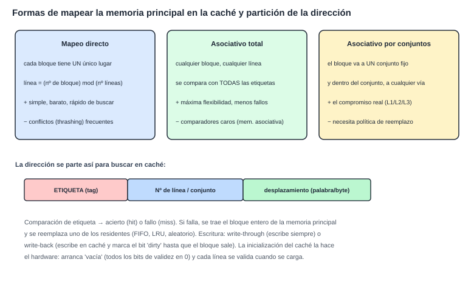
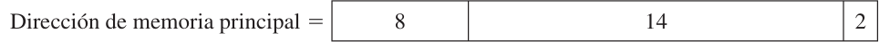
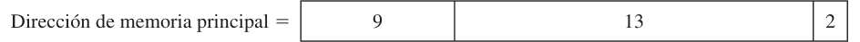

# 2.5.2 Caché, mapeos y políticas

> [!abstract] En una frase
> La caché es una memoria rápida y chica que guarda **copias de bloques** de la RAM. Para saber si un dato está (y dónde), la dirección se parte en **etiqueta / índice / desplazamiento**; el **mapeo** decide en qué línea puede ir cada bloque, y las **políticas** deciden qué escribir y qué expulsar.

> [!note] Si la primera vez que ves esto
> Es una **biblioteca con estantes fijos y un catálogo**: los libros (bloques) no pueden ir a cualquier estante. En el **mapeo directo** cada libro tiene **un solo** estante posible (rápido de buscar, pero dos libros que caen en el mismo estante se pelean). En el **totalmente asociativo** cualquier libro puede ir a cualquier estante (no hay peleas, pero hay que **revisar todos**). El **asociativo por conjuntos** es el compromiso: cada libro puede ir a un grupo chico de estantes.

## La dirección, vista por la caché

```
┌───────────────┬──────────────┬────────────────────┐
│   ETIQUETA    │   ÍNDICE     │  DESPLAZAMIENTO    │
│  ¿es mi bloque?│ ¿qué línea? │ ¿qué byte del bloque?│
└───────────────┴──────────────┴────────────────────┘
```

| Campo | Para qué sirve | Se calcula |
|---|---|---|
| **Desplazamiento** | elegir el byte dentro de la línea | `log₂(tamaño de línea)` |
| **Índice** | elegir la línea (o conjunto) | `log₂(cantidad de líneas / vías)` |
| **Etiqueta** | comparar y confirmar el acierto | los bits que sobran |

## Los tres mapeos



| Mapeo | Cada bloque puede ir a… | Ventaja | Desventaja |
|---|---|---|---|
| **Directo** | **una** línea (índice) | simple, barato, rápido | conflictos: dos bloques con el mismo índice se expulsan |
| **Totalmente asociativo** | **cualquier** línea | sin conflictos | comparar **todas** las etiquetas a la vez (caro) |
| **Asociativo por conjuntos** (n vías) | una de las `n` líneas de su conjunto | buen equilibrio | más lógica que el directo |

**Cálculo típico:** caché de 32 KB, líneas de 32 B ⇒ 1024 líneas.

- Directo: índice = 10 bits, desplazamiento = 5 bits.

- 4 vías: 256 conjuntos ⇒ índice = 8 bits; se comparan **4** etiquetas en paralelo.

## Políticas de escritura

| Política | Qué hace | Consecuencia |
|---|---|---|
| **write-through** | escribe en caché **y** en RAM a la vez | siempre coherente, más tráfico |
| **write-back** | escribe sólo en caché y marca **dirty**; baja a RAM cuando se expulsa | menos tráfico, necesita bit *dirty* |
| **write-allocate** | al fallar una escritura, trae el bloque a caché | bien con write-back |
| **no-write-allocate** | escribe directo en RAM sin traerlo | típico con write-through |

## Políticas de reemplazo (cuando hay que sacar uno)

- **LRU** (*Least Recently Used*): el que hace más tiempo no se usa. La mejor, pero cara de implementar.

- **FIFO**: el más viejo. Simple.

- **Aleatorio**: sorprendentemente competitivo.

- **LFU**: el menos usado.

## Aciertos y fallos

| Tipo de fallo | Qué lo causa | Cómo se combate |
|---|---|---|
| **Frío (compulsorio)** | primera referencia al bloque | no se evita (sólo se amortigua con prefetch) |
| **De conflicto** | dos bloques compiten por la misma línea/conjunto | más vías |
| **De capacidad** | la caché es chica para el conjunto de trabajo | caché más grande |

> [!warning] Errores típicos
> - Sumar mal los bits: la suma **etiqueta + índice + desplazamiento = bits de la dirección**.
> - Confundir *write-back* con *write-allocate* (una es dónde se escribe, la otra si se trae el bloque).
> - Decir que el índice "identifica el bloque": identifica la **línea**; quien identifica el bloque es la etiqueta.

## Figura del libro



*Fig. 4.8 — Ejemplo de correspondencia directa.* · Stallings, *Organización y arquitectura de computadores*, 7ª ed., p. 141.



*Fig. 4.12 — Ejemplo de correspondencia asociativa por conjuntos de dos vías.* · Stallings, *Organización y arquitectura de computadores*, 7ª ed., p. 147.

> [!example] Los tres mapeos con la misma dirección
> Caché de 64 líneas de 4 palabras ⇒ desplazamiento = 2 bits. **Directa**: 6 bits de línea, se usa un pedazo de la dirección tal cual ⇒ 1 comparación, pero un bloque conflictivo desaloja siempre. **Asociativa total**: no hay campo de línea, se compara contra **todas** las etiquetas a la vez. **Por conjuntos de 2 vías**: 5 bits de conjunto + 1 de vía ⇒ el compromiso que usan todas las PC.

## Relacionado
[[2.5.1 Jerarquía y localidad]] · [[2.5.3 AMAT y cálculo de mejora]] · [[2.3.2 SRAM y DRAM]] · [[Memoria caché]] · [[TP12 Memoria principal]] · [[Glosario — Unidad 2]]
