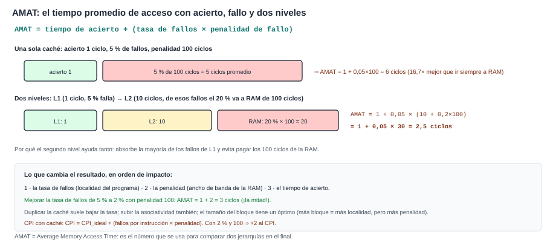
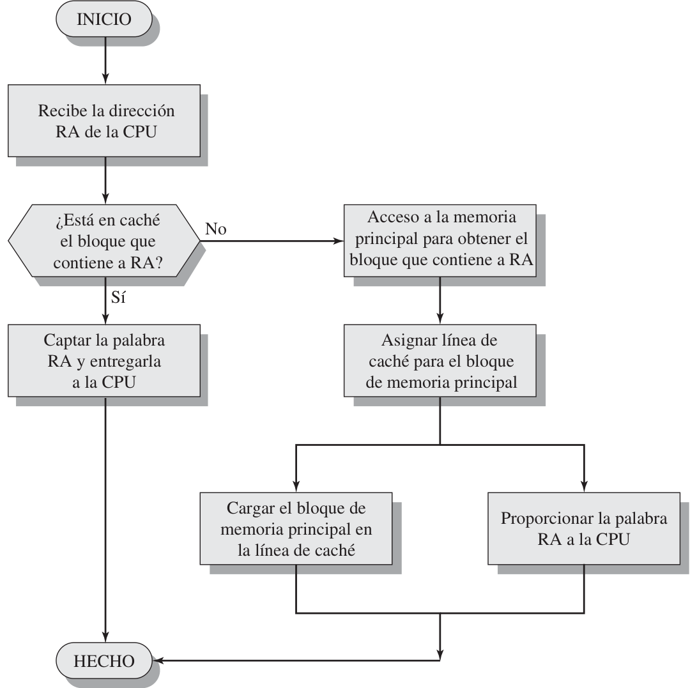

# 2.5.3 AMAT y cálculo de mejora

> [!abstract] En una frase
> `AMAT = tiempo de acierto + tasa de fallos × penalidad de fallo`. Es el tiempo **promedio** por acceso teniendo en cuenta la caché, y es la forma de cuantificar si la jerarquía mejora de verdad.

> [!note] Si la primera vez que ves esto
> Si el 95 % de las veces encontrás lo que buscás en la heladera (1 segundo) y el 5 % restante tenés que ir al supermercado (100 segundos), tu tiempo promedio por búsqueda es `1 + 0,05 × 100 = 6 segundos`, no 100. Eso es el AMAT: **el promedio**, ponderado por la probabilidad de fallar.

## AMAT con uno y con dos niveles



## La fórmula

```
AMAT = h + m × P
```

| Símbolo | Significado |
|---|---|
| `h` | tiempo de **acierto** (hit time): lo que tarda la caché |
| `m` | **tasa de fallos** (miss rate) = `1 − tasa de aciertos` |
| `P` | **penalidad** del fallo: lo que tarda traer el bloque de RAM |

## Ejemplo 1 (el clásico)
Caché de 1 ns, tasa de aciertos 95 %, penalidad 100 ns: `AMAT = 1 + 0,05 × 100 = 1 + 5 = ` **6 ns** por acceso. Sin caché, todos los accesos tardarían **100 ns** ⇒ se acelera ~**16,7 veces**.

## Ejemplo 2 (comparar dos cachés)

| Caché | `h` | Aciertos | `P` | AMAT |
|---|---|---|---|---|
| A | 1 ns | 90 % | 100 ns | `1 + 0,1·100 = ` **11 ns** |
| B | 2 ns | 97 % | 100 ns | `2 + 0,03·100 = ` **5 ns** |

**Conclusión:** B es mejor **aunque sea más lenta en el acierto**: lo que manda es `m × P`. Bajar la tasa de fallos vale mucho más que bajar 1 ns de acierto.

## Ejemplo 3 (con L1 y L2)
`L1: 1 ns, 90 %` · `L2: 5 ns, 95 % de los fallos de L1 resueltos` · `RAM: 100 ns`.

- Fallo de L1 (10 %) → se consulta L2: 95 % acierta en 5 ns; 5 % de esos (0,5 % del total) va a RAM en 100 ns.

- `AMAT = 1 + 0,10 × [5 + 0,05 × 100] = 1 + 0,10 × 10 = ` **2 ns**.

## Qué se puede concluir (lo que se pide argumentar)

1. La mejora viene de la **tasa de aciertos**, no del tamaño bruto.

2. Un fallo muy caro (RAM lenta) hace que convenga **cualquier** mejora en la tasa de fallos.

3. Por eso existen **L1 chica y rápida** + **L2/L3 más grandes**: cada nivel filtra los fallos del anterior.

4. La fórmula **no** dice nada de un acceso aislado: es un **promedio** estadístico.

> [!warning] Errores típicos
> - Usar la tasa de **aciertos** en lugar de la de **fallos**: `m = 1 − aciertos`.
> - Mezclar unidades (ns con µs) sin convertir.
> - Comparar cachés mirando sólo el tiempo de acierto.
> - Olvidar que en un sistema con L2 hay que **anidar** los cálculos.

## Figura del libro



*Fig. 4.5 — Operación de lectura de caché.* · Stallings, *Organización y arquitectura de computadores*, 7ª ed., p. 135.

## Relacionado
[[2.5.1 Jerarquía y localidad]] · [[2.5.2 Caché, mapeos y políticas]] · [[Memoria caché]] · [[Jerarquía de memorias]] · [[TP12 Memoria principal]] · [[Glosario — Unidad 2]]
