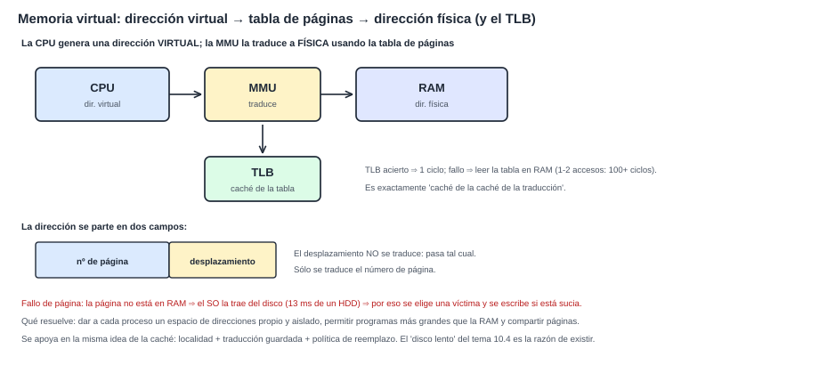
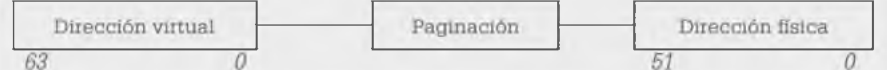
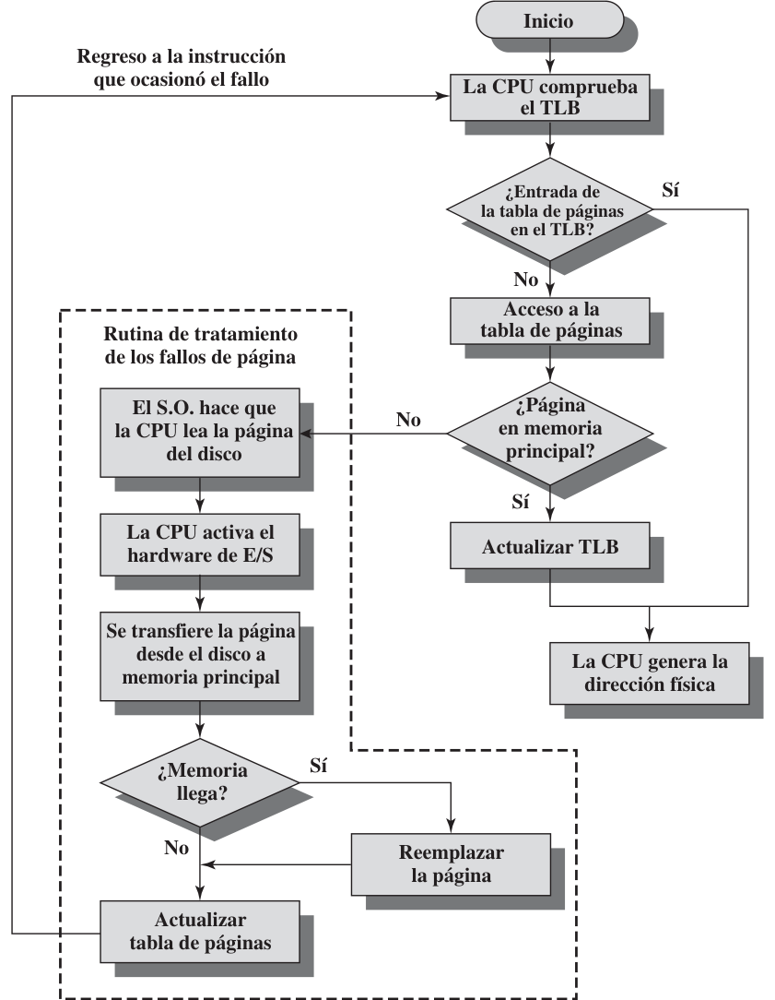

# 2.6.1 Memoria virtual y paginación

> [!abstract] En una frase
> La memoria virtual es una **ilusión** que da el sistema operativo: cada programa cree tener un espacio de direcciones propio y continuo (memoria **virtual**), que el hardware traduce a direcciones **físicas** por **páginas** de tamaño fijo, usando la **tabla de páginas** y la **TLB**.

> [!note] Si la primera vez que ves esto
> Imaginá que en la facultad te dan un **número de legajo** (dirección virtual) y no un aula. El legajo es tuyo y fijo, pero la facultad puede cambiarte de aula (marco físico) cuando quiere, sin avisarte. La "tabla de páginas" es la cartelera que traduce legajo → aula.

## Virtual a física



## De la dirección virtual a la física

```
  dirección virtual (VA)
  ┌─────────────┬──────────────┐
  │  PÁGINA (p) │ DESPLAZ. (d) │
  └──────┬──────┴──────┬───────┘
         │             │
   [tabla de páginas]  │
         │             │
  ┌──────▼─────┬───────▼──────┐
  │ MARCO (f)  │  DESPLAZ. (d)│  = dirección física
  └────────────┴──────────────┘
```

| Concepto | Qué es |
|---|---|
| **Página** | bloque de tamaño fijo del espacio **virtual** (típico 4 KB) |
| **Marco** (frame) | bloque del mismo tamaño en la **RAM física** |
| **Tabla de páginas** | dice en qué marco está cada página (y sus permisos) |
| **TLB** | caché de esa tabla (para no consultarla en cada acceso) |
| **Fallo de página** | la página no está en RAM: hay que traerla del disco (muy caro) |

**El desplazamiento no se traduce:** es el mismo dentro de la página y del marco (eso permite que las páginas sean de tamaño fijo).

## Qué resuelve (las cuatro razones)

1. **Aislamiento:** un proceso no puede leer la memoria de otro (cada uno tiene su tabla).

2. **Más memoria que la física:** las páginas que no se usan se dejan en el disco (swap).

3. **Reubicación:** el programa no necesita saber en qué dirección física quedó.

4. **Protección:** la tabla indica lectura/escritura/ejecución por página.

## La TLB (lo que lo hace rápido)
La tabla de páginas está en memoria: consultarla en **cada** acceso duplicaría el tiempo. La **TLB** es una memoria **asociativa** chica (32-512 entradas) que guarda las traducciones recientes: `acierto en TLB ⇒ 1 ciclo` · `fallo ⇒ consultar la tabla (y quizá el disco)`.

## Comparación con la caché (para no mezclar)

| | Caché | Memoria virtual |
|---|---|---|
| Qué guarda | **copias** de bloques de RAM | **traducciones** y páginas |
| Si falla | se trae el bloque de RAM | se trae la página del **disco** |
| Quién la maneja | el hardware | el **SO** (+ hardware de traducción) |
| Tamaño del bloque | 32-128 B | 4 KB |

> [!warning] Errores típicos
> - Decir que la memoria virtual "es la RAM del disco": es una **dirección**, no un lugar.
> - Traducir también el desplazamiento (no se toca).
> - Confundir fallo de página (disco) con fallo de caché (RAM).

## Figura del libro



*Fig. 14.1 — Traducción de la dirección virtual.* · Quiroga, *Arquitectura de computadoras*, p. 362.



*Fig. 8.18 — Funcionamiento de la paginación y del buffer de traducción* · Stallings, *Organización y arquitectura de computadores*, 7ª ed., p. 303.

## Ejemplo resuelto (con números)
Dirección **virtual de 32 bits** y páginas de **4 KB**:

- `4 KB = 2¹²` ⇒ los **12 bits bajos** son el **desplazamiento** dentro de la página.

- Los **20 bits altos** son el **número de página virtual (VPN)** ⇒ `2²⁰ = 1 048 576` páginas posibles.

- La **MMU** traduce el VPN al número de marco físico con la tabla de páginas; el desplazamiento **no se toca**.

- Costo: si el marco no está en el `TLB`, la traducción cuesta **1 acceso extra a memoria** por cada acceso.

## Relacionado
[[2.6.2 Memoria auxiliar y memoria asociativa]] · [[2.5.2 Caché: mapeos y políticas]] · [[2.5.1 Jerarquía y localidad]] · [[Memoria virtual y administración de memoria]] · [[Glosario — Unidad 2]]
