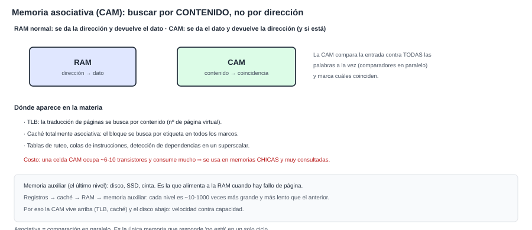
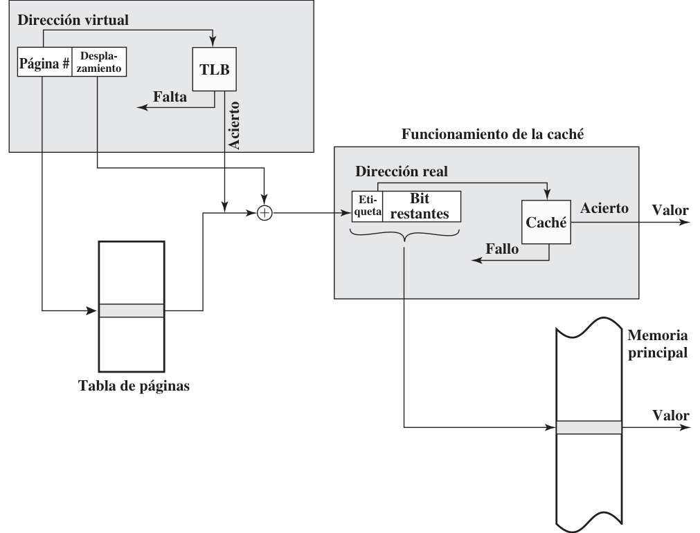

# 2.6.2 Memoria auxiliar y memoria asociativa

> [!abstract] En una frase
> La **memoria auxiliar** es el último nivel de la jerarquía (disco rígido, SSD, cinta): enorme, barata y **no
> volátil**, pero miles de veces más lenta. La **memoria asociativa** (CAM) no se direcciona por posición sino que
> se **consulta por contenido**: se le pregunta "¿tenés este dato?" y **todas** las posiciones comparan a la vez.

> [!note] Si la primera vez que ves esto
> La auxiliar es el **placard**: guardás todo, pero tardás en encontrar algo. La asociativa es un **buscador**: no
> abrís cajón por cajón, gritás un nombre y todos contestan al mismo tiempo si lo tienen.

## Buscar por contenido



## Memoria auxiliar

| Tecnología | Cómo guarda | Latencia | Ventaja | Desventaja |
|---|---|---|---|---|
| **Disco rígido (HDD)** | magnetismo en platos giratorios | 5-10 ms | barato por TB | partes móviles, lento |
| **SSD (Flash)** | celda flotante | 0,1-0,2 ms | rápido, sin partes móviles | desgaste, más caro |
| **Cinta** | magnetismo secuencial | segundos | archivo masivo | acceso secuencial |
| **Óptico (CD/DVD)** | surcos y reflejo | ~100 ms | distribución | baja capacidad |

**Por qué existe:** la RAM es volátil y cara. Todo lo que tiene que sobrevivir al apagado vive acá, y el SO lo
sube a RAM cuando hace falta (paginación, *swap*, archivos mapeados en memoria).

**Diferencia clave con la RAM:** acá se accede **por bloques/sectores** (512 B – 4 KB), no por byte; y el tiempo se
mide en **ms**, no en ns.

## Memoria asociativa (CAM)

```
   dato buscado ──►┌────┬────┬────┬────┐
                   │ C0 │ C1 │ C2 │ C3 │   todas comparan en paralelo
                   └─┬──┴─┬──┴─┬──┴─┬──┘
                     └────┴────┴────┘
                            │
                    ¿alguna coincide?  ──► acierto + índice
```

| | Memoria **RAM** normal | Memoria **asociativa (CAM)** |
|---|---|---|
| Se accede por | **dirección** (posición) | **contenido** (etiqueta) |
| Comparaciones por acceso | 1 | **todas en paralelo** |
| Costo | bajo | **muy alto** (una comparación por celda) |
| Tamaño | grande | chica |
| Se usa en | memoria principal | **TLB**, caché asociativa, tablas de ruteo |

**Por qué es cara y chica:** cada celda necesita su **comparador** y la lógica de prioridad para devolver el
primer acierto. Se reserva para donde la velocidad de búsqueda es crítica (TLB, routers).

## Cómo se conectan los dos conceptos
La **TLB** del tema anterior **es** una memoria asociativa: guarda pares `página → marco` y los busca por contenido.
Y la caché totalmente asociativa también necesita comparar etiquetas en paralelo: es el mismo principio.

> [!warning] Errores típicos
> - Decir que la memoria auxiliar "es la virtual" (una es el **nivel físico**, la otra la **ilusión de
>   direcciones**).
> - Confundir acceso por bloque con acceso por byte.
> - Decir que la CAM es grande: es **chica y carísima**.

## Figura del libro



*Fig. 8.19 — Buffer de traducción anticipada y funcionamiento de la caché.* · Stallings, *Organización y arquitectura de computadores*, 7ª ed., p. 304.

## Ejemplo resuelto
Un `TLB` de **64 entradas** asociativas:
- Busca el VPN en **las 64 entradas a la vez** (memoria asociativa): 1 ciclo.
- Si **acierta** (caso normal, > 90 %): la traducción no cuesta nada extra.
- Si **falla**: hay que ir a la tabla de páginas en memoria (**1 acceso más**, y si está en disco, muchísimo más).
- AMAT con `h = 0,95`, acierto 1 ciclo y fallo 20 ciclos: `1 + 0,05 × 20 = 2` ciclos.

## Relacionado
[[2.6.1 Memoria virtual y paginación]] · [[2.5.1 Jerarquía y localidad]] · [[2.4.2 PROM, EPROM, EEPROM y Flash]] ·
[[Memoria auxiliar y memoria asociativa]] · [[Jerarquía de memorias]] · [[Glosario — Unidad 2]]
