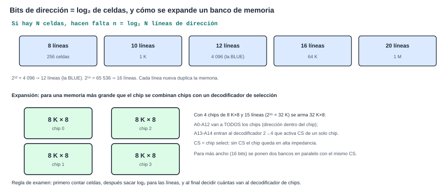
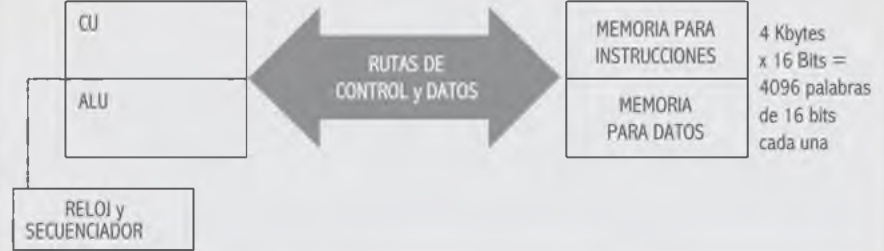

# 2.7.1 Bits de dirección = log₂ de celdas

> [!abstract] En una frase
> Si una memoria tiene `N` celdas direccionables, necesita **`log₂(N)` bits de dirección**. Lo que importa es la **cantidad de celdas**, no los bytes totales: primero se divide el tamaño por el tamaño de celda.

> [!note] Si la primera vez que ves esto
> Es como numerar los asientos de un estadio: si hay 4096 asientos, necesitás 12 bits para numerarlos (`2¹² = 4096`). Si en cambio hay 1 GB de bytes y cada celda guarda 4 bytes, no hay 1 GB de asientos: hay **250 millones** (un cuarto), porque cada asiento es más grande.

## Cuántas líneas hacen falta

## La receta de 4 pasos

1. **Convertir el tamaño a bytes** (potencias de 2).

2. **Dividir por el tamaño de celda** ⇒ cantidad de celdas `N`.

3. Calcular `log₂(N)` ⇒ bits de dirección.

4. Verificar: `2^(bits)` tiene que dar `N`.

## Las potencias de 2 que hay que tener a mano

| | Bytes | Potencia |
|---|---|---|
| 1 KB | 1 024 | 2¹⁰ |
| 1 MB | 1 048 576 | 2²⁰ |
| 1 GB | — | 2³⁰ |
| 1 TB | — | 2⁴⁰ |

## Ejemplos resueltos
**a) 4 KB con celdas de 1 byte:** `4096 = 2¹²` ⇒ **12 bits**.

**b) 512 MB con celdas de 4 bytes:** `512 MB = 2²⁹` bytes; `2²⁹ / 2² = 2²⁷` celdas ⇒ **27 bits**.

**c) 1 GB con celdas de 4 bytes:** `2³⁰ / 2² = 2²⁸` celdas ⇒ **28 bits**.

**d) 256 KB con celdas de 8 bytes:** `2¹⁸ / 2³ = 2¹⁵` ⇒ **15 bits**.

**e) RAM de 8 palabras:** `log₂ 8 = ` **3 bits** (el caso de la RAM 8×3).

## Cómo se relaciona con el chip físico
Si la memoria total se arma con **4 chips**, los **2 bits más altos** de la dirección se usan para elegir el chip (van a un decodificador que maneja los `CS`), y los restantes entran al chip. Por eso: `bits de dirección = bits de selección de chip + bits internos del chip`.

## Errores que se pagan caro

- **Dividir mal:** usar MB como 1 000 000 en vez de 2²⁰ (en la materia, **siempre** potencias de 2).

- **Olvidar el tamaño de celda:** decir "1 GB ⇒ 30 bits" cuando la celda es de 4 B (son 28).

- **Sumar en vez de restar** al repartir palabra de instrucción (eso es el tema 2.7.2).

- Confundir **bits de dirección** con **bits de dato**: la dirección dice *cuál*; el dato dice *qué*.

> [!tip] Verificación en 5 segundos
> `2^bits de dirección × tamaño de celda` tiene que dar **exactamente** el tamaño total de la memoria. Si no da, el error está en el exponente o en la división.

## Figura del libro

*Fig. 7.7 — Memoria para instrucciones y para datos: 4 Kbytes = 4096 palabras de 16 bits ⇒ 2¹² ⇒ 12 bits de dirección.* · Quiroga, *Arquitectura de computadoras*, p. 175.

> [!warning] El error que más se repite
> Confundir **bits de dirección** con **bits de dato**: una memoria de 4096 × 16 necesita **12** bits de dirección (por las 4096 palabras) y tiene **16** bits de dato (por el ancho de la palabra). Si el examen pide "cuántas líneas de dirección", la respuesta es `log₂(cantidad de palabras)`, **no** el ancho de la palabra.

## Relacionado
[[2.7.2 CodOp vs campo de dirección]] · [[2.3.3 Matriz, expansión y RAM 8x3]] · [[Espacio de direccionamiento y cálculo de CodOp-Dirección]] · [[TP18 Direccionamiento de memoria]] · [[Glosario — Unidad 2]]

## Ejemplo de video
Memoria de 512 MB con celdas de 4 bytes: 2²⁹ ÷ 2² = 2²⁷ celdas, así que hacen falta **27 bits de dirección**. Si la instrucción tiene 32 bits, quedan 5 bits para el código de operación. Ver [[00 Videos de apoyo (análisis)]].
