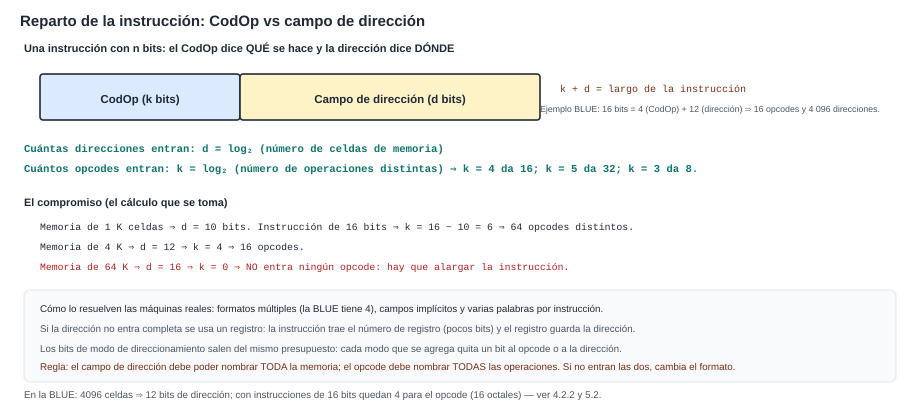
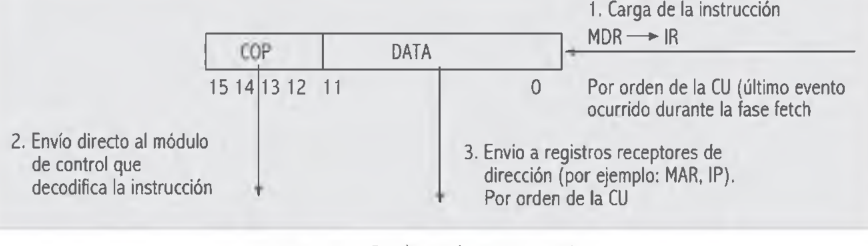

# 2.7.2 CodOp vs campo de dirección

> [!abstract] En una frase
> En una instrucción, la palabra se reparte entre **código de operación** (qué hacer) y **campo de dirección** (dónde): `bits de CodOp = bits de la palabra − bits de dirección`. Cuanta más memoria hay que direccionar, **menos instrucciones distintas** entran.

> [!note] Si la primera vez que ves esto
> Tenés una palabra de 16 bits y tenés que repartirla como una **pieza de 16 casillas** entre dos usos que compiten: "qué hacer" y "dónde". Si la memoria es chica y necesita 12 casillas para la dirección, te quedan **4** para el opcode (16 instrucciones). Si la memoria crece y necesita 13, te quedan **3** (8 instrucciones). **Es un presupuesto, no un regalo.**

## El reparto de los bits



## La fórmula y el reparto

```
┌───────────────┬────────────────────────────┐
│    CodOp      │   campo de dirección        │
│  (p − d) bits │        d bits               │
└───────────────┴────────────────────────────┘
        palabra de p bits, memoria de 2^d celdas
```

`d = log₂(celdas)` (tema 2.7.1) ⇒ `CodOp = p − d` ⇒ **cantidad de instrucciones = 2^CodOp**.

## Ejemplos

| Memoria | Celda | `d` | Palabra | `CodOp` | Instrucciones posibles |
|---|---|---|---|---|---|
| 4 K celdas | 1 B | 12 | 16 bits | **4** | 16 |
| 512 MB | 4 B | 27 | 32 bits | **5** | 32 |
| 1 GB | 4 B | 28 | 32 bits | **4** | 16 |
| 64 K celdas | 1 B | 16 | 16 bits | **0** | ✗ (no entra ninguna) |

> [!important] El caso de la BLUE
> La BLUE tiene 4096 celdas de 16 bits ⇒ `d = 12` bits de dirección y la palabra es de 16 ⇒ **`CodOp = 4` bits**, es decir **16 opcodes**: exactamente los `00` a `17` en octal (HLT, ADD, XOR, AND, IOR, NOT, LDA, STA, SRJ, JMA, JMP, INP, OUT, RAL, CSA, NOP).

## Qué pasa cuando la memoria crece (el trade-off)

1. **Menos opcodes** (se achica el CodOp) ⇒ menos instrucciones distintas.

2. Para evitarlo se inventan **formatos**: instrucciones de 2 palabras (la segunda aporta más dirección) o registros índice que suman a un campo corto. Eso es exactamente lo que hacen la BLUE indexada y el 8086.

3. Otra salida: **palabras más largas** (32 o 64 bits), a costa de más memoria por instrucción.

## Errores típicos

- Restar mal: `CodOp = 16 − 12 = 4` (no 12).

- Confundir "bits de dirección **por palabra**" con "bits de la palabra".

- Olvidar que `2^CodOp` es la cantidad de **instrucciones distintas**, no de operandos.

- Decir que un campo de 12 bits direcciona 12 celdas: direcciona **4096**.

> [!tip] Cómo se pregunta en el final
> "Si la memoria tiene 512 MB y celdas de 4 bytes, y la palabra es de 32 bits, ¿cuántas instrucciones distintas puede tener la máquina?" → `2²⁹/2² = 2²⁷` ⇒ 27 bits de dirección ⇒ `32 − 27 = 5` ⇒ **2⁵ = 32 instrucciones**.

> [!warning] El error que más se repite
> Sumar mal: `opcode + dirección` tiene que dar **exactamente** el ancho de la instrucción (12 bits en la BLUE, 12 + 4 = 16). Si la memoria crece, crece el campo de dirección y **se achica** el opcode (o la instrucción se alarga): no se pueden los dos a la vez. Y con `2ᵏ` opcodes no "sobran" códigos: cada uno es una instrucción.

## Figura del libro



*Fig. 7.9 — Código de instrucción: los 16 bits repartidos en OP y DATA.* · Quiroga, *Arquitectura de computadoras*, p. 177.

> [!tip] Qué mirar
> De los 16 bits, 4 son código de operación y 12 de dirección (o dato). La instrucción entra al IR, se separan los campos y el decodificador de OP decide qué hacer: **más opcodes = menos direcciones**.

## Relacionado
[[2.7.1 Bits de dirección igual a log2 de celdas]] · [[Formato de la instrucción (4 formatos)]] · [[Espacio de direccionamiento y cálculo de CodOp-Dirección]] · [[TP17 Formato básico de instrucciones]] · [[Glosario — Unidad 2]]
