# Unidad 3 — Transferencia de registros y microoperaciones

> [!abstract] Qué es este archivo
> **La Unidad 3 completa en un solo archivo**: los **7 subtemas** pegados uno detrás de otro, con todo su contenido: definiciones, tablas, diagramas, ejemplos resueltos, figuras del libro y errores típicos. Son **5.019 palabras** y **3 temas**. Está pensado para **leer de corrido** y para **imprimir**: no hace falta abrir ninguna otra nota.
>
> - **Repaso rápido** (una página): [[00 Síntesis — Unidad 3]].
> - **Buscar un punto**: el índice de abajo o el de la unidad, [[00 Unidad 3 — temas y subtemas]].
> - Cada subtema conserva su número (`1.4.1`), así coincide con el índice y con las preguntas del final.
> - **Todo junto, las 10 unidades**: [[00 Materia completa (las 10 unidades en un archivo)]].
>
> *Archivo generado con `tools/unir_unidades.py`: no editarlo a mano, editar el subtema y regenerar.*

## Contenido

**3.1 Microoperaciones y bus**

- [[#3.1.1 Notación de transferencia entre registros]]

- [[#3.1.2 Bus único y buffers de 3 estados]]

- [[#3.1.3 Buses de datos, de direcciones y de control]]

**3.2 La ALU**

- [[#3.2.1 Estructura, G-P y señales de selección]]

- [[#3.2.2 Operaciones aritméticas, lógicas y flags]]

**3.3 Registros de la CPU**

- [[#3.3.1 AC, PC, IR, MAR y MBR]]

- [[#3.3.2 Base, índice, puntero de pila y estado]]

---

## 3.1 Microoperaciones y bus

### 3.1.1 Notación de transferencia entre registros

> [!abstract] En una frase
> La notación de transferencia (RTL) describe el funcionamiento de la máquina con **microoperaciones**: cada línea dice **qué registro recibe** (`←`) qué valor, y todas se ejecutan en **un pulso de reloj**.

> [!note] Si es la primera vez que ves esto
> Es el **guion de una receta**: "poné la harina en el bol" sería `BOL ← HARINA`. La flecha `←` no es igualdad matemática: es **"se copia en"** (el registro de la izquierda toma el valor de la derecha, y el de la derecha **no cambia**).

#### Una transferencia por pulso

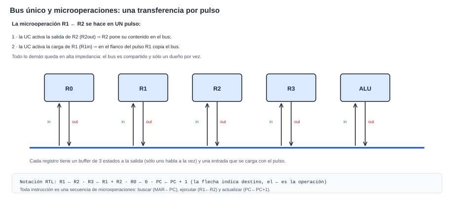

#### Los símbolos

| Símbolo | Significado | Ejemplo |
|---|---|---|
| `←` | transferencia (copia) | `MAR ← PC` |
| `,` | varias microoperaciones **en el mismo pulso** | `MAR ← PC, PC ← PC + 1` (¡sólo si hay dos caminos!) |
| `:` | condición (transferencia condicional) | `RUN: IR ← MBR` |
| `X'` o `X̄` | complemento lógico | `AC ← AC'` |
| subíndice | bit | `PC(0)` es el bit menos significativo |
| `M[dir]` | contenido de memoria en esa dirección | `AC ← M[1000]` |
| `+`, `−`, `⊕`, `·`, `+` | aritmética, XOR, AND, OR | `AC ← AC + MBR` |

#### Ejemplos que hay que saber leer y escribir

| Microoperación | Qué hace |
|---|---|
| `MAR ← PC` | el PC pone la dirección en el registro de dirección (para ir a buscar la instrucción) |
| `MBR ← M[MAR]` | **lectura**: la memoria entrega la palabra direccionada |
| `PC ← PC + 1` | incrementa el contador de programa |
| `IR ← MBR` | la instrucción llega al registro de instrucción |
| `M[MAR] ← MBR` | **escritura**: el dato del MBR va a memoria |
| `AC ← AC + MBR` | suma el dato al acumulador |
| `A ← AC, Z ← 0` | dos destinos en el mismo pulso (el bus lo permite a la vez) |

> [!important] `←` vs `=`
> `X ← Y` **no** dice que X valga siempre Y: dice que **en este pulso** se copia. Por eso después puede haber `X ← X + 1` sin contradicción.

#### El registro de estado y las condiciones
Las transferencias condicionales se escriben con la condición delante:
```
SI'·CP8 : PC ← 0        (si no hay interrupción, no pasa nada)
RUN·CP1 : MAR ← PC
```
El bit `RUN` y los bits de estado (`SI` = hay interrupción pendiente) son los que habilitan cada línea.

#### Ejemplo completo (sumar dos números de memoria)
```
CP1: MAR ← PC,            (dirección de la instrucción)
CP2: MBR ← M[MAR], PC ← PC + 1
CP3: IR ← MBR
...
CP9: MAR ← IR(dir),       (dirección del primer operando)
CP10: MBR ← M[MAR]
CP11: AC ← AC + MBR
```
Cada línea es **un pulso**; juntas son el **ciclo de instrucción** de esa instrucción (Unidad 4).

> [!warning] Errores típicos
> - Leer `←` como igualdad y "despejar".
> - Poner dos transferencias por pulso cuando hay **un solo bus** (ver [[3.1.2 Bus único y buffers de 3 estados]]).
> - Olvidar que `M[MAR]` en el lado derecho es **lectura** y en el izquierdo **escritura**.

#### Figura del libro

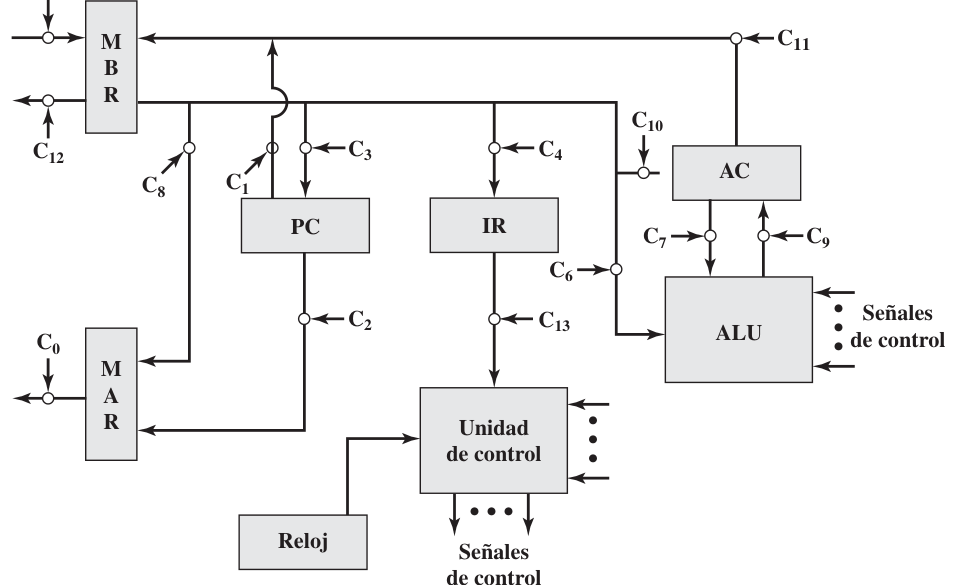

*Fig. 16.5 — Caminos de datos y señales de control.* · Stallings, *Organización y arquitectura de computadores*, 7ª ed., p. 633.

#### Relacionado
[[3.1.2 Bus único y buffers de 3 estados]] · [[3.2.2 Operaciones aritméticas, lógicas y flags]] · [[Proceso de manejo de una instrucción]] · [[TP14 Buses]] · [[Glosario — Unidad 3]]

### 3.1.2 Bus único y buffers de 3 estados

> [!abstract] En una frase
> El **bus único** es un conjunto de cables compartido por todos los registros; como es **uno solo**, en cada pulso **una** fuente puede manejarlo y uno o varios registros pueden leerlo. Los **buffers de 3 estados** son los que desconectan a los registros que no están hablando.

> [!note] Si es la primera vez que ves esto
> Es una **calle de un solo carril** con muchos garajes: en cada momento **un** auto puede estar en la calle (los demás esperan en su garaje con la puerta cerrada). El buffer de 3 estados es esa **puerta del garaje**: cerrada cuando el registro no transmite. Si dos autos salieran a la vez, chocarían — en electrónica eso es un **cortocircuito lógico** en el bus.

#### El tercer estado

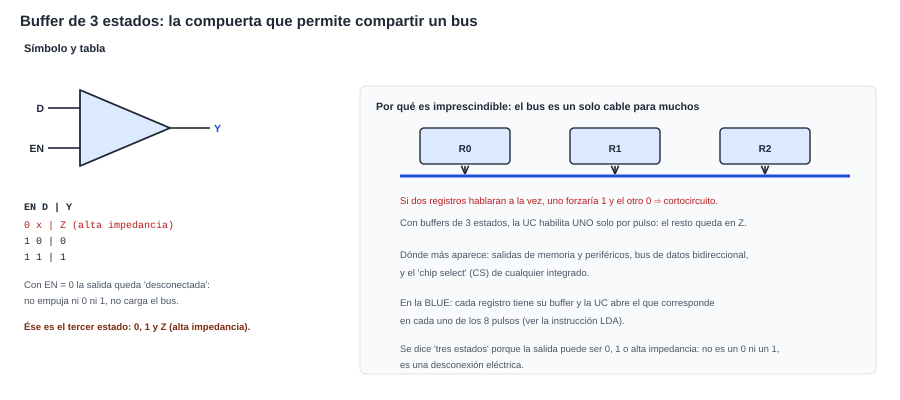

#### Por qué "una transferencia por pulso"
Con un bus de 16 bits compartido, la transferencia `MAR ← PC, PC ← PC + 1` es **imposible en un pulso**: para sumar hay que llevar el valor del PC a la ALU, sumarle 1, y traerlo de vuelta. Eso son **tres** pasos:

```
CP2: PC → Y        (el PC sale al bus y entra al registro Y de la ALU)
CP3: Y + 1 → Z     (la ALU suma; el resultado queda en Z)
CP4: Z → PC        (vuelve al PC)
```

> [!important] La consecuencia que hay que saber explicar
> **La simplicidad del hardware cuesta pulsos.** Un bus único es barato de construir y fácil de controlar, pero necesita más pulsos por instrucción (la BLUE tarda 8 pulsos en el ciclo de búsqueda). Con **dos o tres buses** (uno para cada operando) se haría en menos, a costa de más cables y más pines.

#### El buffer de 3 estados

| `EN` (habilitación) | Salida |
|---|---|
| 1 | copia el valor del registro (0 o 1) |
| 0 | **alta impedancia (Z)**: desconectado |

**Funciones:** selector de fuente del bus (`PC`, `MBR`, `AC`… uno habilitado por vez) y salida de memoria (la celda sólo pone el dato cuando se la lee).

#### Cómo queda el dibujo de la máquina

```
      ┌──────┐   ┌──────┐   ┌──────┐   ┌──────┐
      │  PC  │   │  AC  │   │  IR  │   │ MBR  │      registros
      └──┬───┘   └──┬───┘   └──┬───┘   └──┬───┘
         │[3e]      │[3e]      │[3e]      │[3e]        ← buffers de 3 estados
   ══════╧══════════╧══════════╧══════════╧═══════     BUS ÚNICO (16 bits)
         │                     ▲
      ┌──▼───┐             ┌───┴───┐
      │ MAR  │             │  UC   │  ← la UC habilita un buffer por pulso
      └──────┘             └───────┘
```

**Cada señal de habilitación** es una compuerta AND entre el pulso y el estado: `PC_out = CP1` significa "en el pulso 1, el PC pone su contenido en el bus".

#### Bus único vs varios buses

| | Bus único | 2-3 buses |
|---|---|---|
| Cables / pines | pocos | muchos |
| Pulsos por instrucción | más (8, 16…) | menos |
| Control | simple | complejo |
| Se usa en | BLUE (didáctica), microcontroladores chicos | CPUs modernas |

> [!warning] Errores típicos
> - Habilitar dos fuentes en el mismo pulso (dos valores peleando el bus).
> - Creer que `←` mueve datos "por dentro" de la máquina mágicamente: siempre pasa por el bus.
> - Olvidar que el registro **fuente no se borra** al transferir (copiar, no mover).

#### Figura del libro

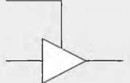

*Fig. 5.15 — Buffer triestado.* · Quiroga, *Arquitectura de computadoras*, p. 126.

#### Ejemplo resuelto
Transferir `R1 ← R2` en una máquina de **bus único**:

1. En un pulso se activa **`R2out = 1`**: el buffer de 3 estados de `R2` pone sus bits en el bus.

2. En **ese mismo pulso** se activa **`R1in = 1`**: `R1` copia el bus en el flanco.

- Son **2 señales de control simultáneas**; si se activan dos `out` a la vez, **dos** registros manejan el bus ⇒ **cortocircuito**. Por eso el 3.er estado es obligatorio.

- Ésa es la respuesta a "¿cuántas señales hacen falta para mover un dato?": **dos** (origen y destino).

#### Relacionado
[[3.1.1 Notación de transferencia entre registros]] · [[3.1.3 Buses de datos, de direcciones y de control]] · [[Flujo de información en BLUE (datos y direcciones)]] · [[Ciclo de máquina]] · [[TP14 Buses]] · [[Glosario — Unidad 3]]

### 3.1.3 Buses de datos, de direcciones y de control

> [!abstract] En una frase
> Un bus es un **conjunto de líneas compartidas**. El de **datos** lleva la información (bidireccional), el de **direcciones** indica a quién se habla (unidireccional, desde la CPU) y el de **control** lleva las órdenes (leer, escribir, interrumpir).

> [!note] Si la primera vez que ves esto
> Pensá en una **oficina de correos**: el bus de direcciones es el **domicilio** (¿a dónde va?), el de datos es el **sobre con la carta** (qué se manda) y el de control son las **instrucciones** ("entregar" o "retirar"). Sin dirección, el cartero no sabe dónde ir; sin control, no sabe si dejar o llevarse algo.

#### Los tres grupos de líneas


#### Los tres buses

| Bus | Dirección | ¿De qué depende su tamaño? | Ejemplo (BLUE) |
|---|---|---|---|
| **Datos** | bidireccional | tamaño de la palabra | **16 bits** |
| **Direcciones** | unidireccional (CPU → memoria) | `log₂(celdas)` | **12 bits** (4096 celdas) |
| **Control** | según línea | — | `Read`, `Write`, `Clock`, `IRQ`, `Reset` |

**Regla que se pregunta siempre:** la cantidad de **bits de dirección** fija el **espacio de direccionamiento**: `2^bits` celdas. Con 12 bits se direccionan 4096; con 32 bits, `2³²` = 4 G celdas.

#### Buses interno y externo

| | Bus interno | Bus externo |
|---|---|---|
| Qué conecta | los registros y la ALU **dentro** del chip | la CPU con la memoria y los periféricos |
| Velocidad | muy alta | menor (sale del chip) |
| Ancho | el de la palabra interna | puede ser menor (se hace en varios ciclos) |

Ejemplo histórico: el **8088** tiene bus interno de 16 bits y **externo de 8**: cada acceso de 16 bits ocupa dos ciclos de bus. Eso muestra que interno ≠ externo.

#### El ciclo de bus (cómo se usa)

1. La CPU pone la **dirección** en el bus de direcciones.

2. Pone la orden en el de **control** (`Read` o `Write`).

3. Los **datos** viajan por el bus de datos (memoria → CPU en lectura; CPU → memoria en escritura).

4. La memoria confirma (`ACK`/`READY`) y el ciclo termina.

#### Bus único vs buses separados: el costo

| Esquema | Ventaja | Desventaja |
|---|---|---|
| **Bus único compartido** (datos y direcciones multiplexados) | menos pines, más barato | menos pulsos útiles: primero la dirección, después el dato → 2 ciclos por acceso |
| **Buses separados** | un acceso por ciclo | más pines y más pista en la placa |

Por eso las memorias modernas **multiplexan** parte de la dirección (RAS/CAS en la DRAM) para no duplicar pines.

#### Cómo se lee esto en la materia

- En la **BLUE**, el bus único interno obliga a que cada microoperación use un pulso ([[3.1.2 Bus único y buffers de 3 estados]]).

- El **MAR** alimenta el bus de direcciones; el **MBR** se conecta al de datos: por eso son registros separados ([[3.3.1 AC, PC, IR, MAR y MBR]]).

- La **señal `Read`/`Write`** de la memoria es la que distingue lectura de escritura en la celda ([[2.3.1 Celda elemental de memoria]]).

> [!warning] Errores típicos
> - Decir que el bus de direcciones es bidireccional (es **unidireccional**: la CPU manda).
> - Confundir ancho del bus de datos con tamaño de la memoria (el tamaño lo fija el de **direcciones**).
> - Olvidar las líneas de control: sin `Read`/`Write` el dato no se sabe si entra o sale.

#### Figura del libro

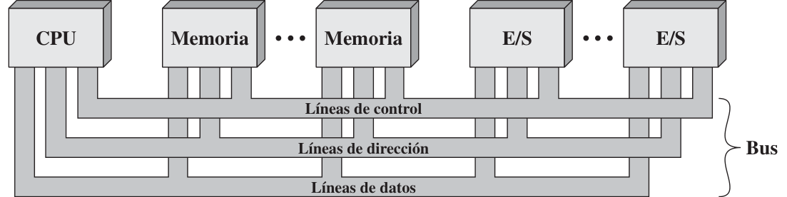

*Fig. 3.16 — Esquema de interconexión mediante un bus.* · Stallings, *Organización y arquitectura de computadores*, 7ª ed., p. 99.

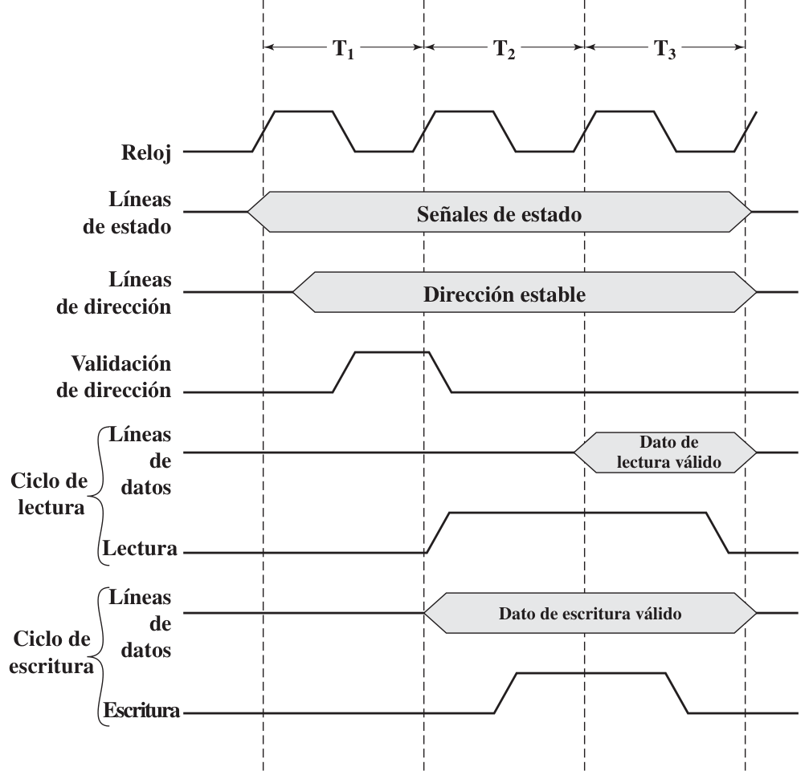

*Fig. 3.19 — Temporización síncrona de las operaciones de bus.* · Stallings, *Organización y arquitectura de computadores*, 7ª ed., p. 106.

> [!example] Las tres líneas en una lectura
> `LDA 500`: el **bus de direcciones** lleva `500` (12 bits en la BLUE), el **bus de datos** trae `M[500]` y el **bus de control** activa `MEMout`/`MBRin` y `Read`. Tres grupos de líneas, **una** operación: si falta la señal de control, el dato sale pero nadie lo guarda.

#### Relacionado
[[3.1.2 Bus único y buffers de 3 estados]] · [[3.3.1 AC, PC, IR, MAR y MBR]] · [[Estructura básica de un computador]] · [[TP14 Buses]] · [[2.7.1 Bits de dirección igual a log2 de celdas]] · [[Glosario — Unidad 3]]

## 3.2 La ALU

### 3.2.1 Estructura, G-P y señales de selección

> [!abstract] En una frase
> La ALU tiene **dos entradas de datos** (A y B), **un paquete de líneas de selección** `S` que dice qué operación hacer, y **una salida** `F`. En las etapas encadenadas, cada bit informa a la siguiente con **`G` (genera acarreo)** y **`P` (propaga acarreo)**.

> [!note] Si la primera vez que ves esto
> Es una **calculadora con un solo botón giratorio**: según en qué posición esté la perilla (`S`), suma, resta, hace AND o pasa el dato. Las entradas siempre son las mismas dos; lo que cambia es la operación. `G` y `P` son los "mensajeros" que le avisan al bit de al lado si hay que llevarse uno.

#### La ALU como bloque

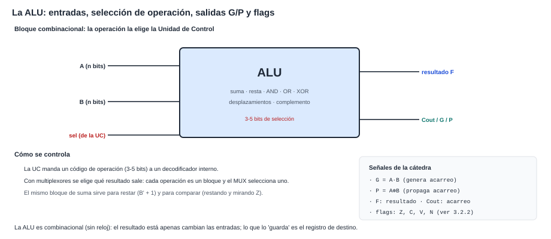

#### Diagrama de bloques

```
        A (n bits)   B (n bits)
            │            │
            └────►[ ALU ]◄────┘
                    │  ▲
                    │  └── S (selección)   Cin (acarreo de entrada)
                    │
                 F (resultado) + flags (Z, C, N, V)
```

| Señal | Función |
|---|---|
| `A`, `B` | operandos (vienen de registros, del bus o del MBR) |
| `S` (`S3..S0`) | código de operación: suma, resta, AND, OR, XOR, NOT, incremento, passthrough |
| `Cin` | acarreo de entrada (con `Cin = 1` y `B` negado, resta) |
| `F` | resultado |
| **flags** | `Z` cero, `C` acarreo, `N` negativo, `V` desbordamiento |

#### G y P: cómo se comunican las etapas
Para sumar dos números de `n` bits se encadenan `n` sumadores completos. El acarreo puede **propagarse** por cadena (lento) o **calcularse por anticipado** con dos señales por bit:

```
G  = A · B        "este bit genera acarreo"        (los dos son 1)
P  = A ⊕ B        "este bit propaga el acarreo"    (si le entra, lo pasa)
Cout = G + P · Cin
```

Con eso, el acarreo del bit `i` se calcula **en paralelo**:
```
C1 = G0 + P0·C0
C2 = G1 + P1·G0 + P1·P0·C0
C3 = G2 + P2·G1 + P2·P1·G0 + P2·P1·P0·C0
```
La suma de cada bit, en cambio, es simplemente `F = P ⊕ Cin` (con `P = A⊕B`).

> [!important] Por qué importa
> Con acarreo en cascada, sumar 32 bits tarda `32 × retardo`. Con **acarreo anticipado** (`G`/`P`) tarda unas pocas compuertas por más bits que haya. Es una de las mejoras de la Unidad 9 y la razón de que existan `G` y `P`.

#### El selector: qué código hace qué

| `S` (ejemplo) | Operación | Cómo se logra |
|---|---|---|
| `000` | `F = A + B` | suma con `Cin = 0` |
| `001` | `F = A − B` | `A + B' + 1` → negar B y `Cin = 1` |
| `010` | `F = A · B` | compuertas AND |
| `011` | `F = A + B` (OR lógica) | compuertas OR |
| `100` | `F = A ⊕ B` | XOR |
| `101` | `F = A'` | NOT |
| `110` | `F = A + 1` | incremento (`B = 0`, `Cin = 1`) |
| `111` | `F = A` | passthrough (para circular un dato) |

> [!warning] Errores típicos
> - Confundir `P = A⊕B` con `P = A+B`: las dos variantes existen en los libros, pero **hay que decir cuál se usa**
>   (con `A⊕B` el cálculo del acarreo es el de arriba).
> - Decir que la ALU tiene memoria: **no la tiene**, sólo combina.
> - Olvidar `Cin`: sin él no hay resta ni incremento.

#### Figura del libro

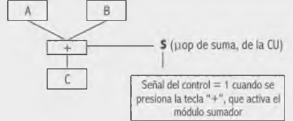

*Fig. 7.1 — Diagrama de bloque de un dispositivo que suma los bits de los registro A y B.* · Quiroga, *Arquitectura de computadoras*, p. 170.

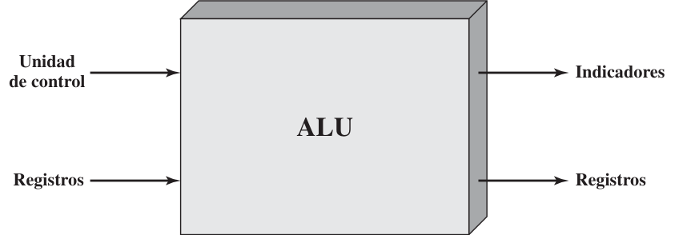

*Fig. 9.1 — Entradas y salidas de la ALU.* · Stallings, *Organización y arquitectura de computadores*, 7ª ed., p. 325.

> [!example] La ALU en una suma
> `AC = 0000 1010` y `MBR = 0000 0011`, selección `ADD` ⇒ `G = 0000 1101` (13). El acarreo de salida `Cout = 0`, y como los dos operandos son positivos y el resultado también, `V = Cin ⊕ Cout = 0`. Si la operación fuera `AND`, `G = 0000 0010` y las banderas se recalculan igual.

#### Relacionado
[[3.2.2 Operaciones aritméticas, lógicas y flags]] · [[1.5.2 Sumador de n bits y resta en complemento a 2]] · [[ALU]] · [[Hardware aritmético (resumen)]] · [[Glosario — Unidad 3]]

### 3.2.2 Operaciones aritméticas, lógicas y flags

> [!abstract] En una frase
> La ALU agrupa tres familias de operaciones —**aritméticas** (suma, resta, incremento, decremento), **lógicas** (AND, OR, XOR, NOT) y de **desplazamiento/rotación**— y después de cada una actualiza los **flags** (`Z`, `C`, `N`, `V`), que son los que permiten tomar decisiones (saltos condicionales).

> [!note] Si la primera vez que ves esto
> Los **flags** son las "luces del tablero" del resultado: si dio **cero** (Z), si se **llevó** uno (C), si el bit de signo quedó en 1 (N) y si el resultado **no entra** en el tamaño (V). El programa después pregunta por esas luces: "si dio cero, salta" es `JZ` en un 8086 o `SRJ` condicionado en la BLUE.

#### Cómo se arma cada bandera

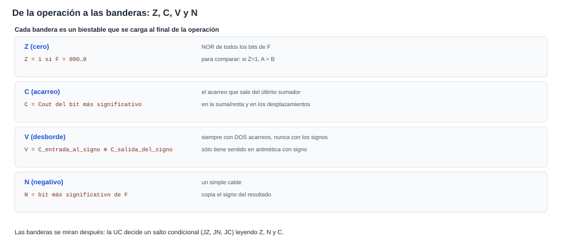

#### Las operaciones

| Familia | Operación | Expresión | Se usa para |
|---|---|---|---|
| Aritmética | suma | `F = A + B` | todo |
| Aritmética | **resta** | `F = A + B' + 1` | restar, comparar (`A − B`) |
| Aritmética | incremento / decremento | `F = A ± 1` | PC+1, contadores |
| Lógica | AND | `F = A·B` | enmascarar bits (quedarse con algunos) |
| Lógica | OR | `F = A+B` | encender bits (poner una bandera) |
| Lógica | XOR | `F = A⊕B` | invertir bits selectivamente, comparar |
| Lógica | NOT | `F = A'` | complemento a 1 (paso previo al A2) |
| Desplazamiento | `SHL` / `SHR` | `F = A << 1` / `A >> 1` | multiplicar / dividir por 2 |
| Rotación | `ROL` / `ROR` | el bit que sale entra | rotar sin perder bits |

**Comparar sin restar:** `A = B` ⇔ `A ⊕ B = 0`. Es lo que hace la ALU con la salida `Z` del XOR.

#### Los flags (registro de estado)

| Flag | Vale 1 si… | Cómo se calcula |
|---|---|---|
| **Z** (cero) | el resultado es 0 | `NOR` de todos los bits de `F` |
| **C** (acarreo) | se llevó/pidió uno | `Cout` del bit más significativo |
| **N** (negativo) | el bit de signo es 1 | `F(n−1)` |
| **V** (desbordamiento) | el resultado no entra en A2 | `Cin_último ⊕ Cout_último` |

> [!important] `C` no es `V`
> `C` mira el acarreo **sin signo** (¿pasó de `2ⁿ−1`?); `V` mira el **signo** (¿dos positivos dieron negativo?). En una resta `6 − 3 = 3` puede haber `C = 1` **sin** error. La distinción es una pregunta clásica.

#### Ejemplo completo
`A = 0110` (6), `B = 0011` (3), `S = resta`:

1. Se niega `B` → `1100`, y `Cin = 1`.

2. `0110 + 1100 + 1 = 1 0011`.

3. `F = 0011` ⇒ `Z = 0` (no es cero), `N = 0` (positivo), `C = 1` (hubo acarreo de salida, se descarta), `V = Cin_últ ⊕ Cout_últ = 1 ⊕ 1 = 0` (no hubo error). Resultado **3**, correcto.

#### Cómo lo controla la máquina
La UC pone el código en `S` y habilita la escritura del flag en el registro de estado, **en el mismo pulso** en que el resultado se guarda en el acumulador. En la BLUE, la señal de una suma es `E·CP8·(ADD + …)` (ver [[Cómo se implementa la Unidad de Control]]).

> [!warning] Errores típicos
> - Decir que la ALU "guarda" el resultado: lo deja en `F`; el que lo guarda es el registro (AC).
> - Confundir `F = A + B'` (complemento a 1) con la resta completa (`+1`).
> - Olvidar que las operaciones lógicas **no** producen acarreo (C no cambia o se pone en 0 según la máquina).

#### Figura del libro

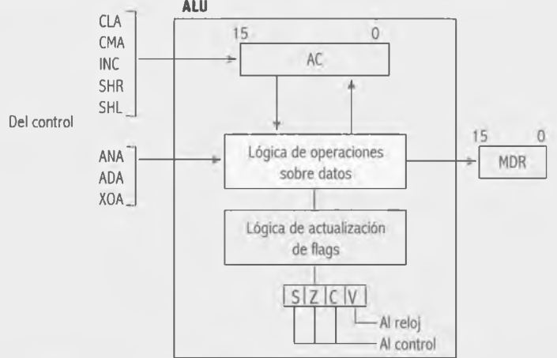

*Fig. 7.25 — Instrucciones aritméticas y lógicas en la ALU.* · Quiroga, *Arquitectura de computadoras*, p. 196.

#### Relacionado
[[3.2.1 Estructura, G-P y señales de selección]] · [[3.3.2 Base, índice, puntero de pila y estado]] · [[ALU]] · [[Hardware aritmético (resumen)]] · [[1.5.2 Sumador de n bits y resta en complemento a 2]] · [[Glosario — Unidad 3]]

## 3.3 Registros de la CPU

### 3.3.1 AC, PC, IR, MAR y MBR

> [!abstract] En una frase
> Los cinco registros básicos de una CPU con acumulador son: **PC** (dirección de la próxima instrucción), **MAR** (dirección que se está accediendo), **MBR** (dato que va o viene de memoria), **IR** (instrucción en curso) y **AC** (acumulador donde se opera).

> [!note] Si la primera vez que ves esto
> Imaginá que estás **copiando un texto a mano**: el **PC** es tu dedo que marca el renglón que sigue, el **IR** es el renglón que estás copiando ahora, el **AC** es el papel donde escribís el resultado, y **MAR/MBR** son el "número de página" y el "renglón que trajiste" del libro que tenés al lado.

#### Los registros y su cableado


#### La tabla de los cinco

| Registro | Nombre | Qué guarda | Ancho típico (BLUE) |
|---|---|---|---|
| **PC** | Program Counter | dirección de la **próxima** instrucción | 12 bits |
| **MAR** | Memory Address Register | dirección que va al **bus de direcciones** | 12 bits |
| **MBR** | Memory Buffer Register | dato que entra o sale de memoria | 16 bits |
| **IR** | Instruction Register | la instrucción que se está ejecutando | 16 bits |
| **AC** | ACcumulator | operando y resultado de la ALU | 16 bits |

> [!important] Por qué MAR y MBR son dos registros distintos
> El **ancho de la dirección** (12) no coincide con el **ancho del dato** (16). Son dos buses distintos, con dos funciones distintas: uno dice **a quién** se accede, el otro lleva **qué**. Y el MBR permite además **sostener** el dato en el bus mientras la CPU hace otras cosas (por ejemplo, decodificar en el IR).

#### Cómo se usan en el ciclo (las 6 primeras microoperaciones)
```
CP1: MAR ← PC          (digo a qué dirección voy)
CP2: PC ← PC + 1       (dejo listo el siguiente renglón)
      Read             (orden de lectura)
CP5: MBR ← M[MAR]      (llega la palabra)
CP6: IR ← MBR          (la instrucción va al IR)
      [decodificación] (la UC mira el opcode del IR)
```
Después, en la ejecución, el `IR` **sigue teniendo la instrucción**: de su campo de dirección salen los accesos a los operandos. El `AC` es el que cambia con el resultado.

#### Quién es visible para el programador

| Registro | ¿El programa lo usa? |
|---|---|
| **PC** | indirectamente: los saltos lo modifican |
| **AC** | **sí**, es el operando implícito de `ADD`, `LDA`, etc. |
| **IR** | **no**: es interno del hardware |
| **MAR / MBR** | **no**: son transparentes (sólo los ve la UC) |

Por eso los dos últimos **no aparecen** en un lenguaje ensamblador pero **sí** en el diagrama de bloques.

> [!warning] Errores típicos
> - Decir que el PC apunta a la instrucción **que se está ejecutando**: apunta a la **próxima** (ya se incrementó).
> - Confundir MAR con MBR (dirección vs dato).
> - Poner el resultado de la ALU en el IR: va al **AC** (o al registro que diga la instrucción).

#### Figura del libro

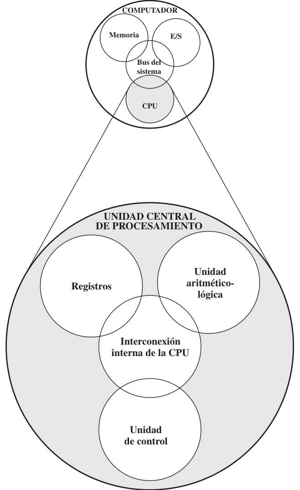

*Fig. 1.5 — La unidad central de procesamiento (CPU).* · Stallings, *Organización y arquitectura de computadores*, 7ª ed., p. 36.

> [!example] Después de `LDA 500`
> `PC = 201` (ya apunta a la próxima), `MAR = 500`, `MBR = M[500]`, `IR = LDA 500`, `AC = M[500]`. Si el examen pregunta "¿qué vale el MAR al final?", la respuesta es **500**: el último acceso fue al operando.

#### Relacionado
[[3.3.2 Base, índice, puntero de pila y estado]] · [[3.1.1 Notación de transferencia entre registros]] · [[Flujo de información en BLUE (datos y direcciones)]] · [[Registros de la CPU]] · [[Ciclo de búsqueda (7 y 8 pulsos)]] · [[Glosario — Unidad 3]]

### 3.3.2 Base, índice, puntero de pila y estado

> [!abstract] En una frase
> Además de los cinco básicos, la CPU necesita **registros que ayuden a calcular direcciones** —**base** (`RB`), **índice** (`RIF`, `RID`)—, uno que administre la **pila** (**SP**) y uno que guarde las **banderas** del resultado (**registro de estado**).

> [!note] Si la primera vez que ves esto
> Son las "herramientas de dirección" del cartero: el **base** es el **edificio** (se suma siempre), el **índice** es el **departamento** que va cambiando mientras recorrés el pasillo, y el **puntero de pila** es el **montón de papeles** donde dejás lo que después vas a necesitar de vuelta (por ejemplo, al atender una interrupción).

#### Dónde viven base, índice y pila


#### Los registros auxiliares

| Registro | Para qué sirve | Efecto en la dirección |
|---|---|---|
| **RB** (registro base) | **reubicar** todo el programa (lo maneja el sistema, no el programador) | `EA = RB + campo` (siempre) |
| **RIF** (registro índice de **fuente**) | apuntar al **origen** de una copia o de una operación | `EA = campo + RIF` cuando la instrucción lo indica |
| **RID** (registro índice de **destino**) | apuntar al **destino** (copia vector-vector) | `EA = campo + RID` |
| **SP** (puntero de pila) | guardar/recuperar contexto (interrupciones, llamadas) | apila en `M[SP]`, `SP ← SP − 1` (o +1) |
| **Estado** (flags / EMR) | `Z, C, N, V` y bits de control como la **máscara de interrupciones** | no direcciona: decide saltos |

#### Cómo se combinan (la fórmula de la BLUE indexada)
```
EA = RB + campo de dirección [+ RIF o RID]
```

- **Base siempre**: si el programa se mueve de lugar, se cambia **solo** `RB` y ninguna instrucción se toca.

- **Índice sólo cuando la instrucción lo pide**: un modo de direccionamiento de 2 bits dice si se suma `RIF`, `RID` o nada.

**Ejemplo (recorrer un arreglo de 100 números):**
```
      RB = 1000            (base del arreglo)
      RIF = 0
lazo: LDA 0, RIF          (EA = RB + 0 + RIF)
      ADD acumulador
      RIF = RIF + 1       (incremento del índice)
      comparar con 100
      SRJ lazo
```
Cambiar `RIF` recorre el arreglo **sin reescribir** la instrucción: eso es el ahorro que justifica el registro índice (y por eso existe la BLUE indexada, que cuesta 24 pulsos).

#### El registro de estado y la máscara

| Bit | Qué controla |
|---|---|
| `Z, C, N, V` | resultado de la última operación (para saltos condicionales) |
| **`SI`** | hay una interrupción pendiente |
| **`EMR`** (máscara) | si está en 1, **se ignoran** las interrupciones (sección crítica) |
| `RUN` | la CPU está en marcha (halt vs run) |

> [!important] `SI` y `EMR` se confunden siempre
> `SI` = "**hay** un pedido" (lo levanta el periférico) · `EMR` = "**quiero** atenderlo" (lo decide el programa). La interrupción se atiende sólo si los dos están en 1: `IRQ · SI · EMR · CP8`.

#### Quién los ve

- **RB**: sólo el sistema operativo (reubicación).

- **RIF / RID**: el programador, en los modos indexados.

- **SP**: el programador indirectamente (`PUSH`/`POP`, llamadas a subrutina, interrupciones).

- **Estado**: el programador lo lee (saltos) y lo escribe (máscara).

> [!warning] Errores típicos
> - Decir que el base cambia con cada instrucción: el base es **fijo** para todo el programa.
> - Confundir índice de **fuente** con índice de **destino** (RIF = origen, RID = destino).
> - Olvidar que el `SP` **se mueve** al apilar (no es una dirección fija).

#### Figura del libro

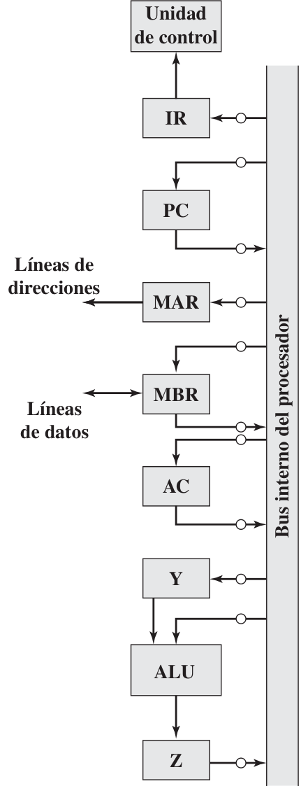

*Fig. 16.6 — Procesador con bus interno.* · Stallings, *Organización y arquitectura de computadores*, 7ª ed., p. 635.

> [!example] Para qué está cada uno
> `LDA (RIF+4)` con `RIF = 100` ⇒ la dirección efectiva es `104`: el **índice** evita recalcular la dirección en cada vuelta del bucle. El **puntero de pila** (`SP`) dice dónde está el tope de la pila, y el **registro de estado** guarda las banderas `Z, C, V, N` de la última operación.

#### Relacionado
[[3.3.1 AC, PC, IR, MAR y MBR]] · [[Registros base e índice]] · [[Interrupciones y entrada-salida]] · [[BLUE indexada (RIF, RID, nuevo formato)]] · [[Registros de la CPU]] · [[Glosario — Unidad 3]]

---

## Al terminar la unidad

- Una pasada rápida: [[00 Síntesis — Unidad 3]].

- Los subtemas por separado: [[00 Unidad 3 — temas y subtemas]].

- Seguir de corrido: [[00 Materia completa (las 10 unidades en un archivo)]].

- Practicar: [[Banco de preguntas del final]] · [[Autoevaluación]] · [[Prácticas resueltas]].
