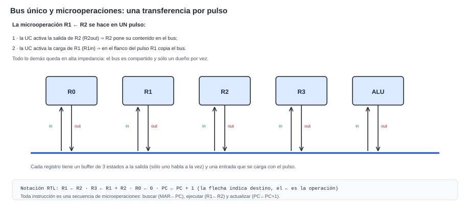
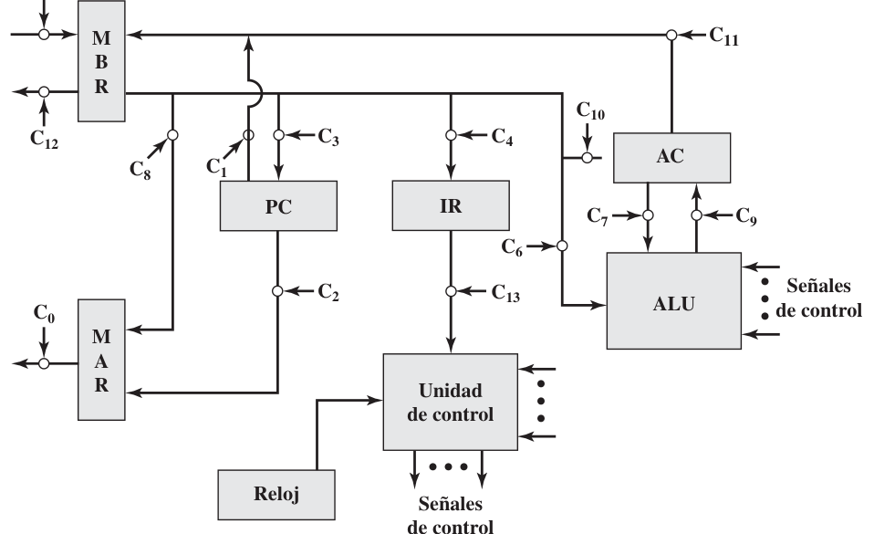

# 3.1.1 Notación de transferencia entre registros

> [!abstract] En una frase
> La notación de transferencia (RTL) describe el funcionamiento de la máquina con **microoperaciones**: cada línea
> dice **qué registro recibe** (`←`) qué valor, y todas se ejecutan en **un pulso de reloj**.

> [!note] Si es la primera vez que ves esto
> Es el **guion de una receta**: "poné la harina en el bol" sería `BOL ← HARINA`. La flecha `←` no es igualdad
> matemática: es **"se copia en"** (el registro de la izquierda toma el valor de la derecha, y el de la derecha
> **no cambia**).

## Una transferencia por pulso



## Los símbolos

| Símbolo | Significado | Ejemplo |
|---|---|---|
| `←` | transferencia (copia) | `MAR ← PC` |
| `,` | varias microoperaciones **en el mismo pulso** | `MAR ← PC, PC ← PC + 1` (¡sólo si hay dos caminos!) |
| `:` | condición (transferencia condicional) | `RUN: IR ← MBR` |
| `X'` o `X̄` | complemento lógico | `AC ← AC'` |
| subíndice | bit | `PC(0)` es el bit menos significativo |
| `M[dir]` | contenido de memoria en esa dirección | `AC ← M[1000]` |
| `+`, `−`, `⊕`, `·`, `+` | aritmética, XOR, AND, OR | `AC ← AC + MBR` |

## Ejemplos que hay que saber leer y escribir

| Microoperación | Qué hace |
|---|---|
| `MAR ← PC` | el PC pone la dirección en el registro de dirección (para ir a buscar la instrucción) |
| `MBR ← M[MAR]` | **lectura**: la memoria entrega la palabra direccionada |
| `PC ← PC + 1` | incrementa el contador de programa |
| `IR ← MBR` | la instrucción llega al registro de instrucción |
| `M[MAR] ← MBR` | **escritura**: el dato del MBR va a memoria |
| `AC ← AC + MBR` | suma el dato al acumulador |
| `A ← AC, Z ← 0` | dos destinos en el mismo pulso (el bus lo permite a la vez) |

> [!important] `←` vs `=`
> `X ← Y` **no** dice que X valga siempre Y: dice que **en este pulso** se copia. Por eso después puede haber
> `X ← X + 1` sin contradicción.

## El registro de estado y las condiciones
Las transferencias condicionales se escriben con la condición delante:
```
SI'·CP8 : PC ← 0        (si no hay interrupción, no pasa nada)
RUN·CP1 : MAR ← PC
```
El bit `RUN` y los bits de estado (`SI` = hay interrupción pendiente) son los que habilitan cada línea.

## Ejemplo completo (sumar dos números de memoria)
```
CP1: MAR ← PC,            (dirección de la instrucción)
CP2: MBR ← M[MAR], PC ← PC + 1
CP3: IR ← MBR
...
CP9: MAR ← IR(dir),       (dirección del primer operando)
CP10: MBR ← M[MAR]
CP11: AC ← AC + MBR
```
Cada línea es **un pulso**; juntas son el **ciclo de instrucción** de esa instrucción (Unidad 4).

> [!warning] Errores típicos
> - Leer `←` como igualdad y "despejar".
> - Poner dos transferencias por pulso cuando hay **un solo bus** (ver [[3.1.2 Bus único y buffers de 3 estados]]).
> - Olvidar que `M[MAR]` en el lado derecho es **lectura** y en el izquierdo **escritura**.

## Figura del libro



*Fig. 16.5 — Caminos de datos y señales de control.* · Stallings, *Organización y arquitectura de computadores*, 7ª ed., p. 633.

## Relacionado
[[3.1.2 Bus único y buffers de 3 estados]] · [[3.2.2 Operaciones aritméticas, lógicas y flags]] ·
[[Proceso de manejo de una instrucción]] · [[TP14 Buses]] · [[Glosario — Unidad 3]]
