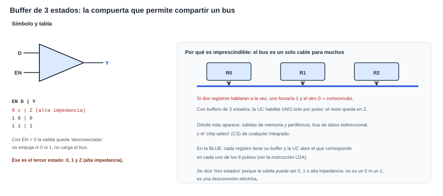

# 3.1.2 Bus único y buffers de 3 estados

> [!abstract] En una frase
> El **bus único** es un conjunto de cables compartido por todos los registros; como es **uno solo**, en cada pulso
> **una** fuente puede manejarlo y uno o varios registros pueden leerlo. Los **buffers de 3 estados** son los que
> desconectan a los registros que no están hablando.

> [!note] Si es la primera vez que ves esto
> Es una **calle de un solo carril** con muchos garajes: en cada momento **un** auto puede estar en la calle (los
> demás esperan en su garaje con la puerta cerrada). El buffer de 3 estados es esa **puerta del garaje**: cerrada
> cuando el registro no transmite. Si dos autos salieran a la vez, chocarían — en electrónica eso es un
> **cortocircuito lógico** en el bus.

## El tercer estado



## Por qué "una transferencia por pulso"
Con un bus de 16 bits compartido, la transferencia `MAR ← PC, PC ← PC + 1` es **imposible en un pulso**: para sumar
hay que llevar el valor del PC a la ALU, sumarle 1, y traerlo de vuelta. Eso son **tres** pasos:

```
CP2: PC → Y        (el PC sale al bus y entra al registro Y de la ALU)
CP3: Y + 1 → Z     (la ALU suma; el resultado queda en Z)
CP4: Z → PC        (vuelve al PC)
```

> [!important] La consecuencia que hay que saber explicar
> **La simplicidad del hardware cuesta pulsos.** Un bus único es barato de construir y fácil de controlar, pero
> necesita más pulsos por instrucción (la BLUE tarda 8 pulsos en el ciclo de búsqueda). Con **dos o tres buses**
> (uno para cada operando) se haría en menos, a costa de más cables y más pines.

## El buffer de 3 estados

| `EN` (habilitación) | Salida |
|---|---|
| 1 | copia el valor del registro (0 o 1) |
| 0 | **alta impedancia (Z)**: desconectado |

**Funciones:** selector de fuente del bus (`PC`, `MBR`, `AC`… uno habilitado por vez) y salida de memoria
(la celda sólo pone el dato cuando se la lee).

## Cómo queda el dibujo de la máquina

```
      ┌──────┐   ┌──────┐   ┌──────┐   ┌──────┐
      │  PC  │   │  AC  │   │  IR  │   │ MBR  │      registros
      └──┬───┘   └──┬───┘   └──┬───┘   └──┬───┘
         │[3e]      │[3e]      │[3e]      │[3e]        ← buffers de 3 estados
   ══════╧══════════╧══════════╧══════════╧═══════     BUS ÚNICO (16 bits)
         │                     ▲
      ┌──▼───┐             ┌───┴───┐
      │ MAR  │             │  UC   │  ← la UC habilita un buffer por pulso
      └──────┘             └───────┘
```

**Cada señal de habilitación** es una compuerta AND entre el pulso y el estado: `PC_out = CP1` significa "en el
pulso 1, el PC pone su contenido en el bus".

## Bus único vs varios buses

| | Bus único | 2-3 buses |
|---|---|---|
| Cables / pines | pocos | muchos |
| Pulsos por instrucción | más (8, 16…) | menos |
| Control | simple | complejo |
| Se usa en | BLUE (didáctica), microcontroladores chicos | CPUs modernas |

> [!warning] Errores típicos
> - Habilitar dos fuentes en el mismo pulso (dos valores peleando el bus).
> - Creer que `←` mueve datos "por dentro" de la máquina mágicamente: siempre pasa por el bus.
> - Olvidar que el registro **fuente no se borra** al transferir (copiar, no mover).

## Relacionado
[[3.1.1 Notación de transferencia entre registros]] · [[3.1.3 Buses de datos, de direcciones y de control]] ·
[[Flujo de información en BLUE (datos y direcciones)]] · [[Ciclo de máquina]] · [[TP14 Buses]]
