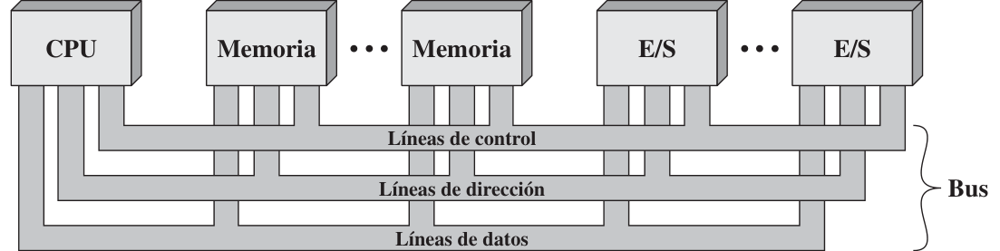
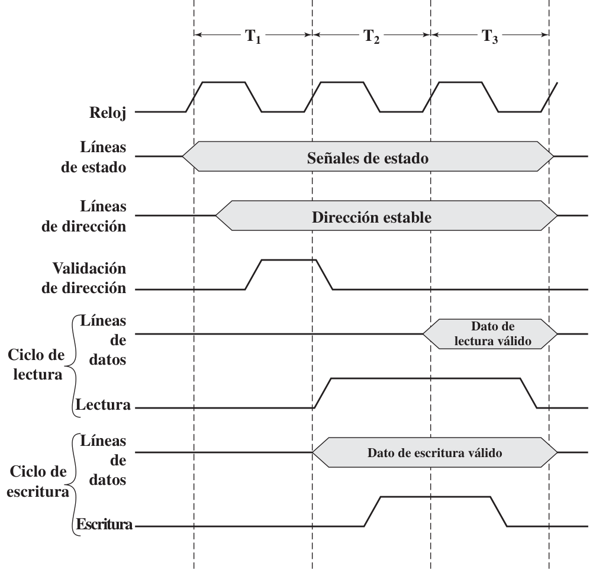

# 3.1.3 Buses de datos, de direcciones y de control

> [!abstract] En una frase
> Un bus es un **conjunto de líneas compartidas**. El de **datos** lleva la información (bidireccional), el de
> **direcciones** indica a quién se habla (unidireccional, desde la CPU) y el de **control** lleva las órdenes
> (leer, escribir, interrumpir).

> [!note] Si la primera vez que ves esto
> Pensá en una **oficina de correos**: el bus de direcciones es el **domicilio** (¿a dónde va?), el de datos es el
> **sobre con la carta** (qué se manda) y el de control son las **instrucciones** ("entregar" o "retirar"). Sin
> dirección, el cartero no sabe dónde ir; sin control, no sabe si dejar o llevarse algo.

## Los tres grupos de líneas

## Los tres buses

| Bus | Dirección | ¿De qué depende su tamaño? | Ejemplo (BLUE) |
|---|---|---|---|
| **Datos** | bidireccional | tamaño de la palabra | **16 bits** |
| **Direcciones** | unidireccional (CPU → memoria) | `log₂(celdas)` | **12 bits** (4096 celdas) |
| **Control** | según línea | — | `Read`, `Write`, `Clock`, `IRQ`, `Reset` |

**Regla que se pregunta siempre:** la cantidad de **bits de dirección** fija el **espacio de direccionamiento**:
`2^bits` celdas. Con 12 bits se direccionan 4096; con 32 bits, `2³²` = 4 G celdas.

## Buses interno y externo

| | Bus interno | Bus externo |
|---|---|---|
| Qué conecta | los registros y la ALU **dentro** del chip | la CPU con la memoria y los periféricos |
| Velocidad | muy alta | menor (sale del chip) |
| Ancho | el de la palabra interna | puede ser menor (se hace en varios ciclos) |

Ejemplo histórico: el **8088** tiene bus interno de 16 bits y **externo de 8**: cada acceso de 16 bits ocupa dos
ciclos de bus. Eso muestra que interno ≠ externo.

## El ciclo de bus (cómo se usa)
1. La CPU pone la **dirección** en el bus de direcciones.
2. Pone la orden en el de **control** (`Read` o `Write`).
3. Los **datos** viajan por el bus de datos (memoria → CPU en lectura; CPU → memoria en escritura).
4. La memoria confirma (`ACK`/`READY`) y el ciclo termina.

## Bus único vs buses separados: el costo
| Esquema | Ventaja | Desventaja |
|---|---|---|
| **Bus único compartido** (datos y direcciones multiplexados) | menos pines, más barato | menos pulsos útiles: primero la dirección, después el dato → 2 ciclos por acceso |
| **Buses separados** | un acceso por ciclo | más pines y más pista en la placa |

Por eso las memorias modernas **multiplexan** parte de la dirección (RAS/CAS en la DRAM) para no duplicar pines.

## Cómo se lee esto en la materia
- En la **BLUE**, el bus único interno obliga a que cada microoperación use un pulso
  ([[3.1.2 Bus único y buffers de 3 estados]]).
- El **MAR** alimenta el bus de direcciones; el **MBR** se conecta al de datos: por eso son registros separados
  ([[3.3.1 AC, PC, IR, MAR y MBR]]).
- La **señal `Read`/`Write`** de la memoria es la que distingue lectura de escritura en la celda
  ([[2.3.1 Celda elemental de memoria]]).

> [!warning] Errores típicos
> - Decir que el bus de direcciones es bidireccional (es **unidireccional**: la CPU manda).
> - Confundir ancho del bus de datos con tamaño de la memoria (el tamaño lo fija el de **direcciones**).
> - Olvidar las líneas de control: sin `Read`/`Write` el dato no se sabe si entra o sale.

## Figura del libro

*Fig. 3.16 — Esquema de interconexión mediante un bus.* · Stallings, *Organización y arquitectura de computadores*, 7ª ed., p. 99.

*Fig. 3.19 — Temporización síncrona de las operaciones de bus.* · Stallings, *Organización y arquitectura de computadores*, 7ª ed., p. 106.

## Relacionado
[[3.1.2 Bus único y buffers de 3 estados]] · [[3.3.1 AC, PC, IR, MAR y MBR]] · [[Estructura básica de un computador]] ·
[[TP14 Buses]] · [[2.7.1 Bits de dirección igual a log2 de celdas]]
