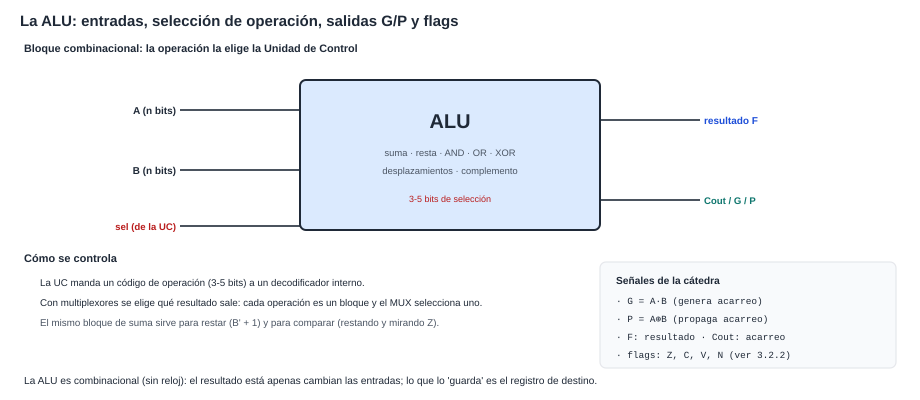
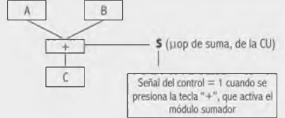
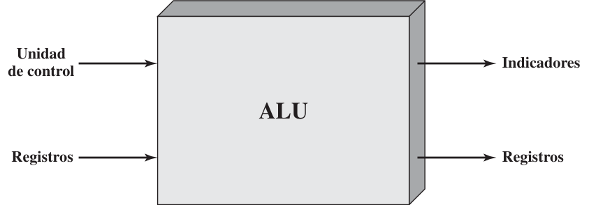

# 3.2.1 Estructura, G/P y señales de selección

> [!abstract] En una frase
> La ALU tiene **dos entradas de datos** (A y B), **un paquete de líneas de selección** `S` que dice qué operación
> hacer, y **una salida** `F`. En las etapas encadenadas, cada bit informa a la siguiente con **`G` (genera
> acarreo)** y **`P` (propaga acarreo)**.

> [!note] Si la primera vez que ves esto
> Es una **calculadora con un solo botón giratorio**: según en qué posición esté la perilla (`S`), suma, resta,
> hace AND o pasa el dato. Las entradas siempre son las mismas dos; lo que cambia es la operación. `G` y `P` son
> los "mensajeros" que le avisan al bit de al lado si hay que llevarse uno.

## La ALU como bloque



## Diagrama de bloques

```
        A (n bits)   B (n bits)
            │            │
            └────►[ ALU ]◄────┘
                    │  ▲
                    │  └── S (selección)   Cin (acarreo de entrada)
                    │
                 F (resultado) + flags (Z, C, N, V)
```

| Señal | Función |
|---|---|
| `A`, `B` | operandos (vienen de registros, del bus o del MBR) |
| `S` (`S3..S0`) | código de operación: suma, resta, AND, OR, XOR, NOT, incremento, passthrough |
| `Cin` | acarreo de entrada (con `Cin = 1` y `B` negado, resta) |
| `F` | resultado |
| **flags** | `Z` cero, `C` acarreo, `N` negativo, `V` desbordamiento |

## G y P: cómo se comunican las etapas
Para sumar dos números de `n` bits se encadenan `n` sumadores completos. El acarreo puede **propagarse** por
cadena (lento) o **calcularse por anticipado** con dos señales por bit:

```
G  = A · B        "este bit genera acarreo"        (los dos son 1)
P  = A ⊕ B        "este bit propaga el acarreo"    (si le entra, lo pasa)
Cout = G + P · Cin
```

Con eso, el acarreo del bit `i` se calcula **en paralelo**:
```
C1 = G0 + P0·C0
C2 = G1 + P1·G0 + P1·P0·C0
C3 = G2 + P2·G1 + P2·P1·G0 + P2·P1·P0·C0
```
La suma de cada bit, en cambio, es simplemente `F = P ⊕ Cin` (con `P = A⊕B`).

> [!important] Por qué importa
> Con acarreo en cascada, sumar 32 bits tarda `32 × retardo`. Con **acarreo anticipado** (`G`/`P`) tarda unas
> pocas compuertas por más bits que haya. Es una de las mejoras de la Unidad 9 y la razón de que existan `G` y `P`.

## El selector: qué código hace qué
| `S` (ejemplo) | Operación | Cómo se logra |
|---|---|---|
| `000` | `F = A + B` | suma con `Cin = 0` |
| `001` | `F = A − B` | `A + B' + 1` → negar B y `Cin = 1` |
| `010` | `F = A · B` | compuertas AND |
| `011` | `F = A + B` (OR lógica) | compuertas OR |
| `100` | `F = A ⊕ B` | XOR |
| `101` | `F = A'` | NOT |
| `110` | `F = A + 1` | incremento (`B = 0`, `Cin = 1`) |
| `111` | `F = A` | passthrough (para circular un dato) |

> [!warning] Errores típicos
> - Confundir `P = A⊕B` con `P = A+B`: las dos variantes existen en los libros, pero **hay que decir cuál se usa**
>   (con `A⊕B` el cálculo del acarreo es el de arriba).
> - Decir que la ALU tiene memoria: **no la tiene**, sólo combina.
> - Olvidar `Cin`: sin él no hay resta ni incremento.

## Figura del libro



*Fig. 7.1 — Diagrama de bloque de un dispositivo que suma los bits de los registro A y B.* · Quiroga, *Arquitectura de computadoras*, p. 170.



*Fig. 9.1 — Entradas y salidas de la ALU.* · Stallings, *Organización y arquitectura de computadores*, 7ª ed., p. 325.

> [!example] La ALU en una suma
> `AC = 0000 1010` y `MBR = 0000 0011`, selección `ADD` ⇒ `G = 0000 1101` (13). El acarreo de salida `Cout = 0`, y
> como los dos operandos son positivos y el resultado también, `V = Cin ⊕ Cout = 0`. Si la operación fuera `AND`,
> `G = 0000 0010` y las banderas se recalculan igual.

## Relacionado
[[3.2.2 Operaciones aritméticas, lógicas y flags]] · [[1.5.2 Sumador de n bits y resta en complemento a 2]] ·
[[ALU]] · [[Hardware aritmético (resumen)]]
