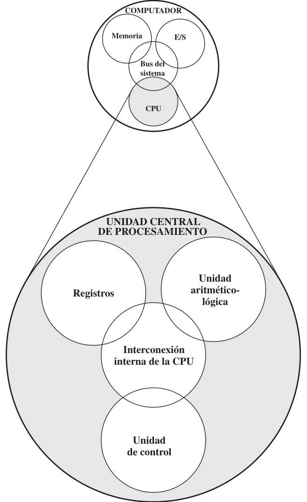

# 3.3.1 AC, PC, IR, MAR y MBR

> [!abstract] En una frase
> Los cinco registros básicos de una CPU con acumulador son: **PC** (dirección de la próxima instrucción), **MAR**
> (dirección que se está accediendo), **MBR** (dato que va o viene de memoria), **IR** (instrucción en curso) y
> **AC** (acumulador donde se opera).

> [!note] Si la primera vez que ves esto
> Imaginá que estás **copiando un texto a mano**: el **PC** es tu dedo que marca el renglón que sigue, el **IR** es
> el renglón que estás copiando ahora, el **AC** es el papel donde escribís el resultado, y **MAR/MBR** son el
> "número de página" y el "renglón que trajiste" del libro que tenés al lado.

## Los registros y su cableado


## La tabla de los cinco

| Registro | Nombre | Qué guarda | Ancho típico (BLUE) |
|---|---|---|---|
| **PC** | Program Counter | dirección de la **próxima** instrucción | 12 bits |
| **MAR** | Memory Address Register | dirección que va al **bus de direcciones** | 12 bits |
| **MBR** | Memory Buffer Register | dato que entra o sale de memoria | 16 bits |
| **IR** | Instruction Register | la instrucción que se está ejecutando | 16 bits |
| **AC** | ACcumulator | operando y resultado de la ALU | 16 bits |

> [!important] Por qué MAR y MBR son dos registros distintos
> El **ancho de la dirección** (12) no coincide con el **ancho del dato** (16). Son dos buses distintos, con dos
> funciones distintas: uno dice **a quién** se accede, el otro lleva **qué**. Y el MBR permite además **sostener** el
> dato en el bus mientras la CPU hace otras cosas (por ejemplo, decodificar en el IR).

## Cómo se usan en el ciclo (las 6 primeras microoperaciones)
```
CP1: MAR ← PC          (digo a qué dirección voy)
CP2: PC ← PC + 1       (dejo listo el siguiente renglón)
      Read             (orden de lectura)
CP5: MBR ← M[MAR]      (llega la palabra)
CP6: IR ← MBR          (la instrucción va al IR)
      [decodificación] (la UC mira el opcode del IR)
```
Después, en la ejecución, el `IR` **sigue teniendo la instrucción**: de su campo de dirección salen los accesos a
los operandos. El `AC` es el que cambia con el resultado.

## Quién es visible para el programador
| Registro | ¿El programa lo usa? |
|---|---|
| **PC** | indirectamente: los saltos lo modifican |
| **AC** | **sí**, es el operando implícito de `ADD`, `LDA`, etc. |
| **IR** | **no**: es interno del hardware |
| **MAR / MBR** | **no**: son transparentes (sólo los ve la UC) |

Por eso los dos últimos **no aparecen** en un lenguaje ensamblador pero **sí** en el diagrama de bloques.

> [!warning] Errores típicos
> - Decir que el PC apunta a la instrucción **que se está ejecutando**: apunta a la **próxima** (ya se incrementó).
> - Confundir MAR con MBR (dirección vs dato).
> - Poner el resultado de la ALU en el IR: va al **AC** (o al registro que diga la instrucción).

## Figura del libro



*Fig. 1.5 — La unidad central de procesamiento (CPU).* · Stallings, *Organización y arquitectura de computadores*, 7ª ed., p. 36.

> [!example] Después de `LDA 500`
> `PC = 201` (ya apunta a la próxima), `MAR = 500`, `MBR = M[500]`, `IR = LDA 500`, `AC = M[500]`. Si el examen
> pregunta "¿qué vale el MAR al final?", la respuesta es **500**: el último acceso fue al operando.

## Relacionado
[[3.3.2 Base, índice, puntero de pila y estado]] · [[3.1.1 Notación de transferencia entre registros]] ·
[[Flujo de información en BLUE (datos y direcciones)]] · [[Registros de la CPU]] · [[Ciclo de búsqueda (7 y 8 pulsos)]]
