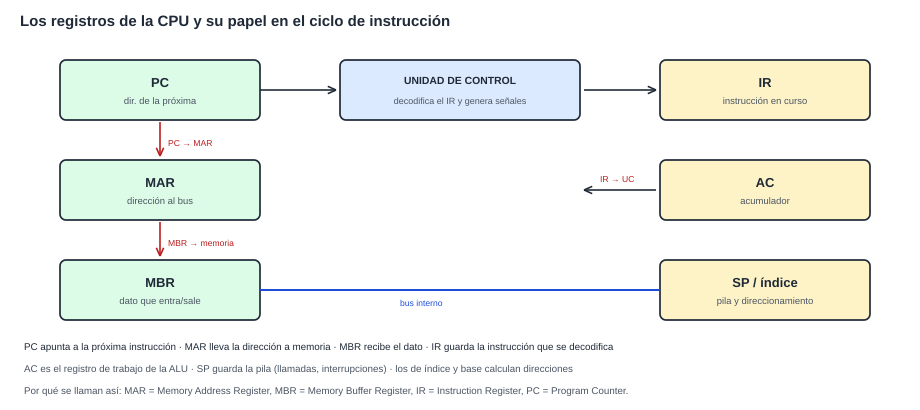

# 3.3.2 Base, índice, puntero de pila y estado

> [!abstract] En una frase
> Además de los cinco básicos, la CPU necesita **registros que ayuden a calcular direcciones** —**base** (`RB`),
> **índice** (`RIF`, `RID`)—, uno que administre la **pila** (**SP**) y uno que guarde las **banderas** del
> resultado (**registro de estado**).

> [!note] Si la primera vez que ves esto
> Son las "herramientas de dirección" del cartero: el **base** es el **edificio** (se suma siempre), el **índice**
> es el **departamento** que va cambiando mientras recorrés el pasillo, y el **puntero de pila** es el **montón de
> papeles** donde dejás lo que después vas a necesitar de vuelta (por ejemplo, al atender una interrupción).

## Dónde viven base, índice y pila



## Los registros auxiliares

| Registro | Para qué sirve | Efecto en la dirección |
|---|---|---|
| **RB** (registro base) | **reubicar** todo el programa (lo maneja el sistema, no el programador) | `EA = RB + campo` (siempre) |
| **RIF** (registro índice de **fuente**) | apuntar al **origen** de una copia o de una operación | `EA = campo + RIF` cuando la instrucción lo indica |
| **RID** (registro índice de **destino**) | apuntar al **destino** (copia vector-vector) | `EA = campo + RID` |
| **SP** (puntero de pila) | guardar/recuperar contexto (interrupciones, llamadas) | apila en `M[SP]`, `SP ← SP − 1` (o +1) |
| **Estado** (flags / EMR) | `Z, C, N, V` y bits de control como la **máscara de interrupciones** | no direcciona: decide saltos |

## Cómo se combinan (la fórmula de la BLUE indexada)
```
EA = RB + campo de dirección [+ RIF o RID]
```
- **Base siempre**: si el programa se mueve de lugar, se cambia **solo** `RB` y ninguna instrucción se toca.
- **Índice sólo cuando la instrucción lo pide**: un modo de direccionamiento de 2 bits dice si se suma `RIF`,
  `RID` o nada.

**Ejemplo (recorrer un arreglo de 100 números):**
```
      RB = 1000            (base del arreglo)
      RIF = 0
lazo: LDA 0, RIF          (EA = RB + 0 + RIF)
      ADD acumulador
      RIF = RIF + 1       (incremento del índice)
      comparar con 100
      SRJ lazo
```
Cambiar `RIF` recorre el arreglo **sin reescribir** la instrucción: eso es el ahorro que justifica el registro
índice (y por eso existe la BLUE indexada, que cuesta 24 pulsos).

## El registro de estado y la máscara
| Bit | Qué controla |
|---|---|
| `Z, C, N, V` | resultado de la última operación (para saltos condicionales) |
| **`SI`** | hay una interrupción pendiente |
| **`EMR`** (máscara) | si está en 1, **se ignoran** las interrupciones (sección crítica) |
| `RUN` | la CPU está en marcha (halt vs run) |

> [!important] `SI` y `EMR` se confunden siempre
> `SI` = "**hay** un pedido" (lo levanta el periférico) · `EMR` = "**quiero** atenderlo" (lo decide el programa).
> La interrupción se atiende sólo si los dos están en 1: `IRQ · SI · EMR · CP8`.

## Quién los ve
- **RB**: sólo el sistema operativo (reubicación).
- **RIF / RID**: el programador, en los modos indexados.
- **SP**: el programador indirectamente (`PUSH`/`POP`, llamadas a subrutina, interrupciones).
- **Estado**: el programador lo lee (saltos) y lo escribe (máscara).

> [!warning] Errores típicos
> - Decir que el base cambia con cada instrucción: el base es **fijo** para todo el programa.
> - Confundir índice de **fuente** con índice de **destino** (RIF = origen, RID = destino).
> - Olvidar que el `SP` **se mueve** al apilar (no es una dirección fija).

## Relacionado
[[3.3.1 AC, PC, IR, MAR y MBR]] · [[Registros base e índice]] · [[Interrupciones y entrada-salida]] ·
[[BLUE indexada (RIF, RID, nuevo formato)]] · [[Registros de la CPU]]
