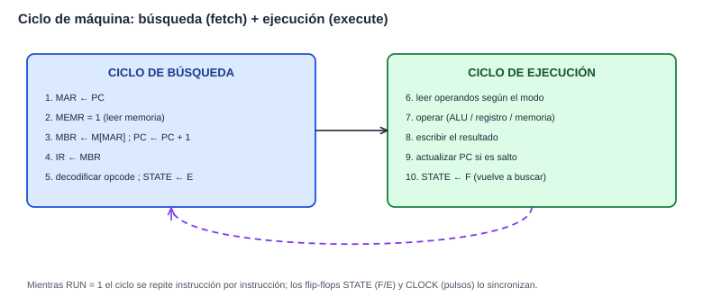

# 00 Síntesis — Unidad 4 (todo en un solo lugar)

> [!abstract] Qué es este archivo
> **Toda la Unidad 4 en una sola nota**: las cinco unidades funcionales y el modelo von Neumann, la especificación completa de la **máquina BLUE** con sus **16 opcodes**, el **ciclo de instrucción** (8 pulsos de búsqueda + ejecución) y la **Unidad de Control** con su fórmula. Sirve para **repasar antes del final** y para **imprimir**. Detalle completo: [[00 Unidad 4 — temas y subtemas]].

## Contenido

1. [[#1. Estructura y von Neumann]] · 2. [[#2. La máquina BLUE]] · 3. [[#3. Los 16 opcodes]] ·

4. [[#4. Búsqueda, los 8 pulsos]] · 5. [[#5. Ejecución]] · 6. [[#6. Unidad de Control]] ·

7. [[#7. Recetas de examen]] · 8. [[#8. Errores que cuestan puntos]] · 9. [[#9. Autoevaluación]]

---

## 1. Estructura y von Neumann

**Cinco unidades:** entrada · salida · **memoria** (guarda) · **ALU** (calcula) · **UC** (ordena). **CPU = UC + ALU + registros.** Buses: datos (bidireccional), direcciones (unidireccional, `log₂ celdas`), control.

**Modelo von Neumann:** instrucciones y datos en **la misma memoria** ⇒ programa almacenado. Ventajas: flexibilidad y autosimilitud. Costo: **cuello de botella** (un solo camino) ⇒ cachés I/D separadas y pipeline.

**IAS (1945):** palabra de **40 bits**, **2 instrucciones de 20 bits** por palabra, **1000 palabras**, registros `MBR, MAR, IR, IBR, PC, AC, MQ`. Instrucción: **8 bits opcode + 12 de dirección**. **Harvard:** dos memorias y dos buses separados (microcontroladores, DSP, L1 I/D).

---

## 2. La máquina BLUE


| Parámetro | Valor |
|---|---|
| Memoria | **4096 palabras × 16 bits** (dirección de **12 bits**) |
| Instrucción | 1 palabra: **4 bits opcode + 12 de dirección** |
| Bus | **único** de 16 bits ⇒ **una transferencia por pulso** |
| Arquitectura | de **acumulador** (`AC`) |
| Reloj | pulso de **125 ns**; ciclo de máquina = **8 pulsos = 1 µs** |

**Registros:** `PC` (12), `MAR` (12), `MBR` (16), `IR` (16), `AC` (16) y **estado**: `RUN` (marcha), `STATE` (0 búsqueda / 1 ejecución), `TRA` (E/S en curso).

**Por qué 8 pulsos y no 7:** el 8.º es la **reescritura** de la memoria de ferrita (leer destruía el dato).

---

## 3. Los 16 opcodes

| Octal | Mnem. | Qué hace | Ciclos | Pulsos |
|---|---|---|---|---|
| `00` | HLT | detiene (`RUN = 0`) | 1 | 8 |
| `01` | ADD | `AC ← AC + M[dir]` | 2 | 16 |
| `02` | XOR | `AC ← AC ⊕ M[dir]` | 2 | 16 |
| `03` | AND | `AC ← AC · M[dir]` | 2 | 16 |
| `04` | IOR | `AC ← AC + M[dir]` (OR) | 2 | 16 |
| `05` | NOT | `AC ← AC'` | 1 | 8 |
| `06` | LDA | `AC ← M[dir]` | 2 | 16 |
| `07` | STA | `M[dir] ← AC` | 2 | 16 |
| `10` | SRJ | salto relativo (retorno en `AC`) | 1 | 8 |
| `11` | JMA | salto absoluto | 1 | 8 |
| `12` | JMP | salto indirecto | 1 | 8 |
| `13` | INP | entra 8 bits del dispositivo `YY` | 2+n | 16+ |
| `14` | OUT | sale el byte alto al dispositivo | 2+n | 16+ |
| `15` | RAL | rota el `AC` a la izquierda | 1 | 8 |
| `16` | CSA | llaves al `AC` | 1 | 8 |
| `17` | NOP | nada | 1 | 8 |

> **Ojo:** es **octal** (después de `07` viene `10`).

**Codificación:** `LDA 2048` ⇒ `0110 1000 0000 0000` ⇒ `06 4000`. `INP 5` ⇒ `1101 0000 0000 0101`.

---

## 4. Búsqueda, los 8 pulsos

| CP | Microoperación | Señal |
|---|---|---|
| **1** | `MAR ← PC` + Read | `PC_out`, `MAR_in`, `Read` |
| **2** | `PC + 1 → Y` | `PC_out`, `Y_in` |
| **3** | `Y + 1 → Z` | `ALU: suma`, `Z_in` |
| **4** | `Z → PC` | `Z_out`, `PC_in` |
| **5** | `MBR ← M[MAR]` (strobe) | `MBR_in`, `strobe` |
| **6** | `MBR → IR` | `MBR_out`, `IR_in` |
| **7** | `TRA ← 1` (sólo INP/OUT) | `TRA_in` |
| **8** | `STA/ejecución` o `F → STATE` | `STATE_in` |



**Es igual para todas las instrucciones.** El `PC + 1` ocupa **3 pulsos** porque hay **un solo bus** (no puede salir a `MAR` y entrar a la ALU en el mismo pulso).

---

## 5. Ejecución

| Grupo | Instrucciones | Ciclos | Qué pasa |
|---|---|---|---|
| **A** | HLT, NOP, JMA, JMP, SRJ, CSA, NOT, RAL | **1** | resuelven en CP7-CP8 y **no cambian** `STATE` |
| **B** | ADD, XOR, AND, IOR, LDA, STA | **2** | `E→STATE` en CP8 y un ciclo de ejecución completo |
| **C** | INP, OUT | 2+n | esperan `R` (listo); el ciclo se **repite** |

**Búsqueda común:** `CP1 PC→MAR, Read` · `CP2 +1→Y` · `CP4 SUMA→PC` · `CP5 strobe MBR` · `CP6 MBR→IR` · `CP8 E→STATE`.

| Instrucción | CP1 | CP2 | CP4 | CP5 | CP6 | CP8 |
|---|---|---|---|---|---|---|
| **LDA** | `IR→MAR`, Read | — | — | strobe MBR | `MBR→A` | `F→STATE` |
| **STA** | `IR→MAR` | — | `A→MBR`, **Write** | — | — | `F→STATE` |
| **ADD/XOR/AND/IOR** | `IR→MAR`, Read | **`A→Z`** | — | strobe MBR | **`MBR→Y`** | **operación → A**, `F→STATE` |

**La lógica de las cuatro:** en CP2 el `AC` va a `Z`, en CP6 el dato va a `Y`; en CP8 la ALU opera y el resultado cae en el `AC`. Lo único que cambia entre ellas es **qué salida de la ALU se habilita**.

**INP/OUT:** `TRA ← 1` en CP7 de la búsqueda; en ejecución, si `R = 1` se copia el dato y `TRA ← 0`; si no, **se repite** el ciclo (16, 24, 32… pulsos). De ahí nacen las **interrupciones**.

---

## 6. Unidad de Control

**Cuatro funciones:** secuenciar · decodificar · generar señales · controlar excepciones (halt, reset, interrupción).

**El decodificador 1→16:** 4 inversores + **16 AND de 4 entradas** sobre el opcode del `IR` (una línea activa por instrucción).

**La fórmula:**
```
señal = estado · pulso · instrucción        y las señales iguales se juntan con OR
MBR_in = F·CP5 + E·CP5·(ADD + XOR + AND + IOR + LDA + STA)
```

| Señal | Expresión |
|---|---|
| `IR_in` | `F·CP6` |
| `A→Z` | `E·CP2·(ADD+XOR+AND+IOR)` |
| `MBR→Y` | `E·CP6·(ADD+XOR+AND+IOR)` |
| `ALU→A` (suma) | `E·CP8·ADD` |
| `MBR→A` (LDA) | `E·CP6·LDA` |
| `A→MBR` + Write (STA) | `E·CP4·STA` |

**Cableada vs microprogramada:** la BLUE es **cableada** (pocas instrucciones, rápida); el 8088 es **microprogramada** (ROM de control) — ver [[Unidad de control cableada y microprogramada]].

---

## 7. Recetas de examen

> [!important] Los cuatro movimientos
> 1. **Ubicar la fase**: ¿búsqueda o ejecución? (STATE).
> 2. **Numerar los pulsos** y decir qué hace cada uno.
> 3. **Nombrar la señal** que lo habilita (`F·CP5`, `E·CP8·ADD`).
> 4. **Contar**: ciclos de máquina × 1 µs.

| Si te piden… | Qué mostrar sí o sí |
|---|---|
| "ciclo de la instrucción X" | los 8 pulsos de búsqueda + los de ejecución |
| "¿por qué 8 pulsos?" | 7 de operación + 1 de reescritura de ferrita |
| "¿cuántos ciclos tiene ADD?" | **2** (necesita traer el operando) |
| "señal de control de …" | la expresión `estado·pulso·instrucción` |
| "diseñe la UC" | decodificador 1→16 + AND + OR |
| "tiempo de un programa" | `Σ (instrucciones × ciclos) × 1 µs` |

---

## 8. Errores que cuestan puntos

- Decir 4096 **bytes** (son palabras de 16 bits) o poner 8 bits de dirección (son **12**).

- Contar `08` como opcode (es **octal**).

- Decir que **ADD** es de un ciclo (es de **dos**).

- Poner el resultado de la ALU en el `MBR` (va al **`AC`**).

- En `STA`, olvidar que la **escritura** es en **CP4**.

- Dar vuelta la dirección de un salto (`JMA` absoluto, `JMP` indirecto, `SRJ` relativo).

- Decir que la **búsqueda** cambia según la instrucción (es siempre igual).

- Escribir `·` donde va `+` al combinar señales en la UC.

- Confundir el decodificador **1→16** (instrucciones) con el de **memoria** (3→8, etc.).

---

## 9. Autoevaluación (con respuesta)

1. Memoria de la BLUE → *4096 palabras × 16 bits*.

2. Bits de dirección → *12* (`2¹² = 4096`).

3. Duración de un ciclo de máquina → *8 × 125 ns = 1 µs*.

4. ¿Por qué el 8.º pulso? → *reescritura de la ferrita*.

5. ¿Cuántos opcodes? → *16* (4 bits).

6. `ADD` tarda → *16 pulsos (2 ciclos)*.

7. Instrucciones de 1 ciclo → *HLT, NOT, SRJ, JMA, JMP, RAL, CSA, NOP*.

8. En `LDA`, ¿en qué pulso llega el dato al AC? → *CP6 de la ejecución*.

9. En `STA`, ¿cuándo se escribe? → *CP4 de la ejecución*.

10. Señal que habilita `IR ← MBR` → *`F·CP6`*.

11. ¿Qué hace `INP` si el periférico no está listo? → *repite el ciclo de ejecución*.

12. Costo del decodificador 1→16 → *4 NOT + 16 AND de 4 entradas*.

---

## Relacionado
[[00 Unidad 4 completa (lectura de corrido)]] · [[00 Unidad 4 — temas y subtemas]] · [[00 Tema 4.2 — índice]] · [[00 Tema 4.3 — índice]] · [[00 Tema 4.4 — índice]] · [[00 Síntesis — Unidad 3]] · [[00 Unidad 5 — temas y subtemas]] · [[00 Tanda 1 — índice]]
