# Unidad 4 — Organización y diseño básico

> [!abstract] Qué es este archivo
> **La Unidad 4 completa en un solo archivo**: los **10 subtemas** pegados uno detrás de otro, con todo su contenido: definiciones, tablas, diagramas, ejemplos resueltos, figuras del libro y errores típicos. Son **8.916 palabras** y **4 temas**. Está pensado para **leer de corrido** y para **imprimir**: no hace falta abrir ninguna otra nota.
>
> - **Repaso rápido** (una página): [[00 Síntesis — Unidad 4]].
> - **Buscar un punto**: el índice de abajo o el de la unidad, [[00 Unidad 4 — temas y subtemas]].
> - Cada subtema conserva su número (`1.4.1`), así coincide con el índice y con las preguntas del final.
> - **Todo junto, las 10 unidades**: [[00 Materia completa (las 10 unidades en un archivo)]].
>
> *Archivo generado con `tools/unir_unidades.py`: no editarlo a mano, editar el subtema y regenerar.*

## Contenido

**4.1 Estructura y modelo von Neumann**

- [[#4.1.1 Unidades funcionales de una computadora]]

- [[#4.1.2 IAS y el programa almacenado]]

**4.2 La máquina BLUE**

- [[#4.2.1 Especificación, registros y 4096x16]]

- [[#4.2.2 Los 16 opcodes octales]]

- [[#4.2.3 Programar en BLUE]]

**4.3 El ciclo de instrucción**

- [[#4.3.1 Ciclo de reloj, de máquina y de instrucción]]

- [[#4.3.2 Búsqueda, los 8 pulsos]]

- [[#4.3.3 Ejecución instrucción por instrucción]]

**4.4 Unidad de Control**

- [[#4.4.1 Funciones y señales de control]]

- [[#4.4.2 estado·pulso·instrucción y el decodificador 1-16]]

---

## 4.1 Estructura y modelo von Neumann

### 4.1.1 Unidades funcionales de una computadora

> [!abstract] En una frase
> Una computadora tiene **cinco unidades funcionales**: **entrada**, **salida**, **memoria**, **ALU** y **unidad de control**. ALU + UC + registros forman la **CPU**; todas se comunican por los **buses** de datos, de direcciones y de control.

> [!note] Si la primera vez que ves esto
> Es una **cocina**: la **memoria** es la despensa (guarda ingredientes e instrucciones de la receta), la **ALU** es la mesada donde se mezcla, la **UC** es el cocinero que lee la receta y dice qué hacer en cada momento, la **entrada** es el delivery y la **salida** es el plato servido. Sin el cocinero (UC) todo está quieto; sin despensa, no hay nada que cocinar.

#### Las cinco unidades

| Unidad | Función | Ejemplos |
|---|---|---|
| **Entrada** | traer datos del exterior | teclado, mouse, sensor, lector |
| **Salida** | entregar resultados | monitor, impresora, LED |
| **Memoria** | guardar instrucciones y datos | RAM, ROM, caché |
| **ALU** | hacer las operaciones | sumador, compuertas lógicas |
| **Unidad de Control** | **decidir** y **ordenar** | decodificador + secuenciador |

**CPU = UC + ALU + registros.** Es la que *ejecuta*: la memoria sólo guarda y la E/S sólo transporta.

#### El diagrama de bloques

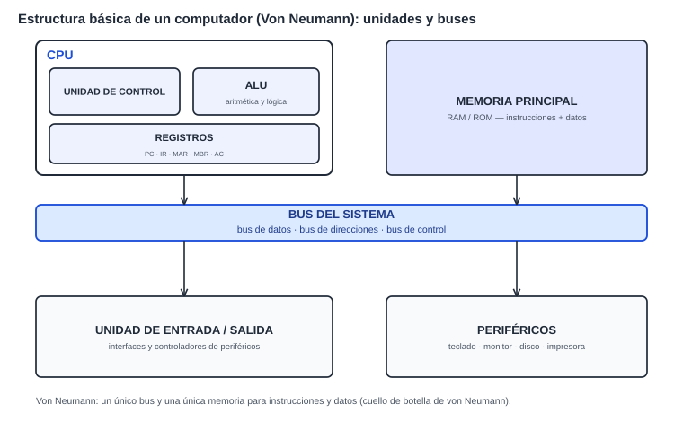

```
        ┌──────────────────── CPU ────────────────────┐
        │  ┌───────────────┐      ┌─────────────────┐  │
 datos  │  │ UNIDAD DE     │      │      ALU        │  │
◄──────►│  │ CONTROL       │─────►│  (operaciones)  │  │
        │  └───────┬───────┘      └────────┬────────┘  │
        │          │  señales              │           │
        │  ┌───────▼───────────────────────▼────────┐  │
        │  │           REGISTROS (PC, AC, IR…)      │  │
        │  └────────────────────┬───────────────────┘  │
        └───────────────────────┼──────────────────────┘
                                │
        ════════════════════════╪════════════════  buses (datos / direcciones / control)
                                │
        ┌───────────────────────┴──────────────────────┐
        │  MEMORIA            │        E/S              │
        └─────────────────────┴─────────────────────────┘
```

#### Qué hace la UC que no hace nadie más

- **Secuencia**: decide qué se hace en cada pulso (buscar, decodificar, ejecutar).

- **Decodifica**: mira el opcode del IR y activa la instrucción que corresponde.

- **Emite señales**: `PC_out`, `MAR_in`, `Read`, `ALU_op`, `AC_in`… Una por microoperación.

- **Atiende excepciones**: interrupciones, halt, reset.

> [!tip] La frase que ordena el oral
> "La memoria **guarda**, la ALU **calcula**, la E/S **transporta** y la UC **ordena**. El programa almacenado (tema 4.1.2) es lo que permite que la UC lea sus propias órdenes de la memoria."

#### Registros mínimos de la CPU
`PC`, `MAR`, `MBR`, `IR`, `AC` (ver [[3.3.1 AC, PC, IR, MAR y MBR]]). Sin ellos no hay forma de recordar dónde estoy, a quién le hablo y qué me pidieron.

> [!warning] Errores típicos
> - Poner la ALU fuera de la CPU.
> - Decir que la memoria "ejecuta" instrucciones: las ejecuta la CPU.
> - Olvidar los **buses de control**: sin ellos las unidades no se coordinan.

#### Figura del libro

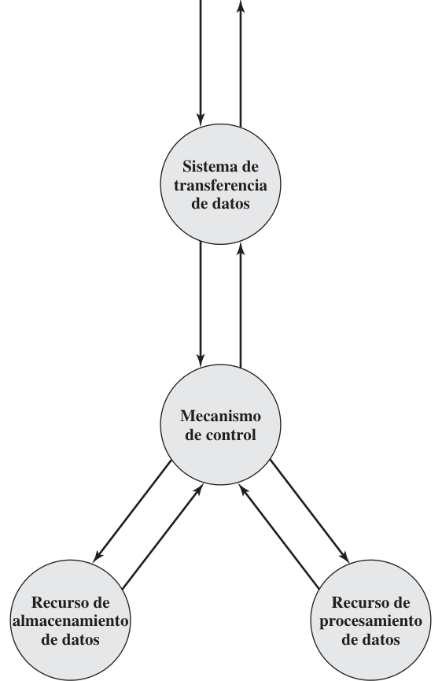

*Fig. 1.1 — Una visión funcional de un computador.* · Stallings, *Organización y arquitectura de computadores*, 7ª ed., p. 32.

> [!example] Recorrido de un dato
> Escribís `2 + 3` en el teclado: **entrada** (teclado → buffer) → **memoria** (guarda los dígitos) → **ALU** (suma) → **salida** (pantalla). Las cinco unidades clásicas —entrada, memoria, ALU, control y salida— unidas por buses: ésa es la unidad funcional de von Neumann.

#### Relacionado
[[4.1.2 IAS y el programa almacenado]] · [[4.2.1 Especificación, registros y 4096x16]] · [[3.1.3 Buses de datos, de direcciones y de control]] · [[Estructura básica de un computador]] · [[TP15 Arquitectura de Von Neumann (IAS)]] · [[Glosario — Unidad 4]]

### 4.1.2 IAS y el programa almacenado

> [!abstract] En una frase
> El modelo **von Neumann** (1945, máquina **IAS** de Princeton) guarda **instrucciones y datos en la misma memoria**: la UC lee sus propias órdenes de ahí. Eso es el **programa almacenado**, y es lo que hace que una computadora pueda cambiar de tarea **cargando otro programa**.

> [!note] Si la primera vez que ves esto
> Antes había que **recablear** la máquina para cada cálculo (como cambiar todas las fichas de un teléfono). Von Neumann dijo: "guardemos también la **receta** en la misma memoria que los ingredientes y que la máquina la lea". Desde entonces, programar es **escribir en memoria**, no enchufar cables.

#### La máquina IAS

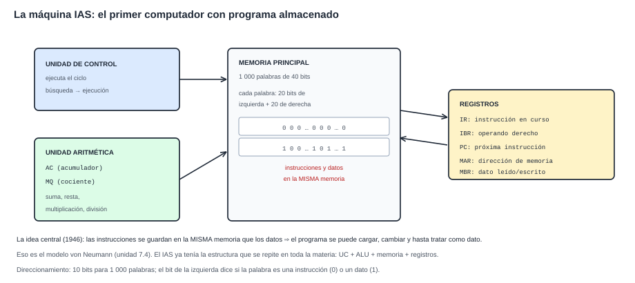

#### La máquina IAS (los números que suelen pedirse)

| Característica | Valor |
|---|---|
| Palabra | **40 bits** |
| Instrucción | **20 bits** (dos por palabra) |
| Memoria | **1000 palabras** (direccionables por palabra) |
| Números | 40 bits, signo + 39 de magnitud (o complemento a 2 en variantes) |
| Registros | `MBR`, `MAR`, `IR`, `IBR`, `PC`, `AC`, `MQ` |

**Los registros que agrega respecto de la BLUE:** `IBR` (buffer de instrucción: guarda la segunda instrucción de la palabra) y `MQ` (multiplicador-cociente, para multiplicar y dividir). El `PC` apunta a **palabra**, no a instrucción: por eso hace falta el `IBR`.

**Formato de instrucción IAS:** 8 bits de opcode + **12 bits de dirección** (2 instrucciones de 20 bits en 40). Es exactamente el mismo reparto que después usa la BLUE (4 + 12), con otro ancho de opcode.

#### El ciclo del programa almacenado

1. La UC **busca** la instrucción en la dirección del `PC`.

2. La **decodifica** (mira el opcode).

3. **Ejecuta**: accede a los operandos y opera.

4. Vuelve a 1 con el `PC` apuntando a la siguiente.

Ese lazo es igual en una IAS de 1945, en la BLUE didáctica y en un Ryzen. Cambian los anchos y las etapas, no la idea.

#### Las consecuencias (lo que se pregunta como "ventajas y desventajas")
**A favor:**

- **Flexibilidad total**: cambiar de programa = cargar otra memoria (no recablear).

- **Autosimilitud**: como una instrucción es un dato, un programa puede **tratar a otro programa como dato** (compiladores, cargadores, sistemas operativos, JIT).

- **Simplicidad de hardware**: una sola memoria y un solo camino.

**En contra:**

- **Cuello de botella von Neumann**: instrucciones y datos comparten el mismo bus ⇒ no se pueden traer a la vez. Es la razón de las cachés separadas (I-cache / D-cache) y del pipeline.

- **Vulnerabilidad**: si se puede escribir donde hay código, se puede inyectar código (de ahí el bit NX).

- **Un solo camino** ⇒ menos paralelismo que Harvard.

#### Harvard (el contraste que se pregunta)

| | **von Neumann** | **Harvard** |
|---|---|---|
| Memorias | una sola (datos + instrucciones) | **dos separadas** |
| Buses | uno | dos |
| Ventaja | flexibilidad, simple | más rápido (busca instrucción y dato a la vez) |
| Uso | computadoras de propósito general | microcontroladores, DSP, caché L1 (I/D separadas) |

> [!warning] Errores típicos
> - Decir que en von Neumann las instrucciones están en una memoria distinta de los datos (eso es **Harvard**).
> - Confundir el **modelo** con la **máquina IAS** (la IAS es una implementación concreta del modelo).
> - Olvidar el `IBR`: sin él no se explica cómo la IAS tiene 2 instrucciones por palabra y un `PC` por palabra.

#### Figura de clase

##### Los dos formatos de la palabra de 40 bits de la IAS.

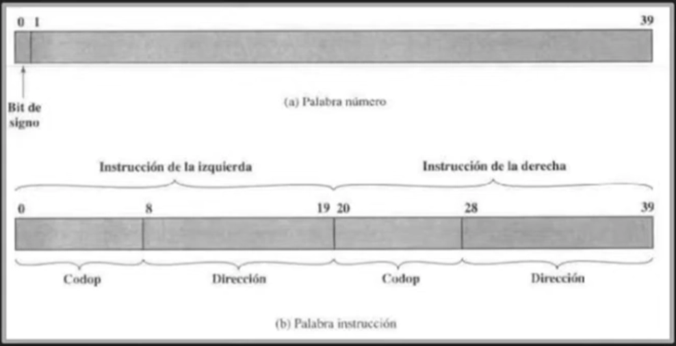

*Figura de clase — Resumen «Arquitectura final» (Said), p. 20.*

> [!tip] Qué mirar
> La IAS usa **una sola** palabra de **40 bits** para todo, y distingue qué es qué mirando el **bit de la izquierda**: si es `0` es un **dato** (`1` bit de signo + `39` de magnitud, punto fijo) y si es `1` es una **instrucción** (`8` de opcode + `12` + `12` de dirección = `20` bits usados, el resto sobra). Esa es la consecuencia más fuerte del programa almacenado: **el mismo formato de memoria guarda código y datos**, y el hardware no sabe cuál es hasta que lo decodifica.

#### Figura del libro

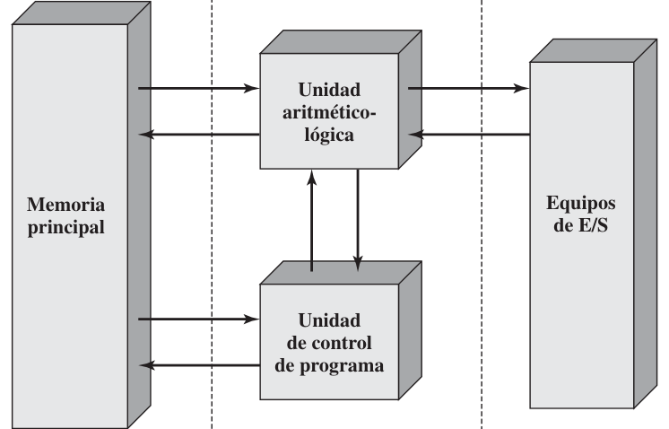

*Fig. 2.1 — Estructura del computador IAS.* · Stallings, *Organización y arquitectura de computadores*, 7ª ed., p. 42.

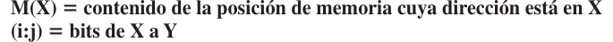

*Fig. 2.4 — Diagrama de flujo parcial de las operaciones del IAS.* · Stallings, *Organización y arquitectura de computadores*, 7ª ed., p. 46.

#### Ejemplo resuelto (una instrucción en la IAS)
`PC = 100`, y en `M[100]` está la instrucción "sumar `M[500]` al acumulador":

1. **Búsqueda**: `MAR ← PC (100)`, `MBR ← M[100]`, `IR ← MBR`, `PC ← 101`.

2. **Decodificación**: la UC ve que es un ADD y que el operando está en `500`.

3. **Ejecución**: `MAR ← 500`, `MBR ← M[500]`, `AC ← AC + MBR`.

- Termina con `PC = 101` **sin que la instrucción haya dicho nada del PC**: eso es el **programa almacenado** (la próxima instrucción es la siguiente dirección de memoria).

#### Relacionado
[[4.1.1 Unidades funcionales de una computadora]] · [[4.2.1 Especificación, registros y 4096x16]] · [[Estructura básica de un computador]] · [[TP15 Arquitectura de Von Neumann (IAS)]] · [[Pipeline]] · [[Glosario — Unidad 4]]

## 4.2 La máquina BLUE

### 4.2.1 Especificación, registros y 4096x16

> [!abstract] En una frase
> La BLUE es una máquina **didáctica**: memoria de **4096 palabras de 16 bits**, **bus único**, arquitectura de **acumulador**, con **8 pulsos de 125 ns** por ciclo de máquina (1 µs) y **16 instrucciones** de un solo operando de dirección.

> [!note] Si la primera vez que ves esto
> Es la computadora "de juguete" que tiene **lo justo** para mostrar cómo funciona una de verdad: un solo bus (para ver la regla de una transferencia por pulso), un solo acumulador (para no perderse entre registros) y un juego mínimo de instrucciones (para poder aprenderlas todas). Todo lo demás se entiende a partir de acá.

#### Especificación

| Parámetro | Valor | Consecuencia |
|---|---|---|
| Memoria | **4096 palabras × 16 bits** | dirección de **12 bits** (`2¹² = 4096`) |
| Palabra | 16 bits | datos y direcciones de 16 bits |
| Instrucción | 1 palabra: **4 bits opcode + 12 bits dirección** | 16 instrucciones |
| Bus | **único** de 16 bits | una transferencia por pulso |
| Arquitectura | de **acumulador** (`AC`) | un operando queda implícito |
| Reloj | pulso de **125 ns** | 8 MHz |
| Ciclo de máquina | **8 pulsos = 1 µs** | 1 000 000 de ciclos/s |
| Instrucciones | **16** | ver [[4.2.2 Los 16 opcodes octales]] |
| Números | **punto fijo**, complemento a dos | 16 bits = **15 de magnitud + 1 de signo** (rango −32 768 a +32 767) |
| E/S | **64 dispositivos** (6 bits) | dato de **8 bits** por transferencia |


#### La consola (lo que el operador manipula)

La BLUE se opera desde un panel: 16 llaves para escribir, 16 luces para ver y seis pulsadores. Esto **se pregunta** en el oral porque explica cómo se carga un programa sin sistema operativo.

| Elemento | Función |
|---|---|
| **Registro de llaves** (16 llaves de 3 posiciones) | escribe un valor: **arriba = 1**, **centro = sin efecto**, **abajo = 0** |
| **16 leds** | muestran el contenido de los registros (luces encendidas = 1) |
| **START** (arranque) | pone `RUN = 1`: la máquina empieza a buscar instrucciones desde el `PC` |
| **STOP** (parada) | detiene la ejecución al terminar el ciclo en curso |
| **LOAD PC** (cargar PC) | copia los 12 bits bajos del registro de llaves en el `PC` |
| **DEPOSIT** (depositar) | escribe en la celda apuntada por el `PC` el valor de las llaves, y **suma 1 al `PC`** |
| **EXAMINE** (examinar) | trae a la consola la celda apuntada por el `PC` (va al `IR`/luces) y **suma 1 al `PC`** |
| **MASTER CLEAR / RESET** | borrado total: deja la máquina en el estado inicial de alistamiento |

> [!tip] Cómo se carga un programa a mano
> 1. **LOAD PC** con la primera dirección del programa. 2. Escribir la instrucción con las llaves. 3. **DEPOSIT**
> (la guarda y avanza el `PC`). 4. Repetir 2 y 3 con cada palabra. 5. **LOAD PC** otra vez al inicio y **START**. Para verificar lo cargado: **LOAD PC** + **EXAMINE** repetidos.

#### Los registros

| Registro | Ancho | Función |
|---|---|---|
| **PC** | 12 | dirección de la próxima instrucción |
| **MAR** | 12 | dirección que va a memoria |
| **MBR** | 16 | dato que va/viene de memoria |
| **IR** | 16 | instrucción en curso (opcode + dirección) |
| **AC** | 16 | acumulador: operando y resultado |
| **Estado** | — | `RUN`, `STATE`, `TRA` (+ `SI`/`EMR` en la variante con interrupciones) |

**Los tres flip-flops de estado** son la clave del control:

| Flip-flop | Qué indica |
|---|---|
| **RUN** | la máquina está en marcha (si se apaga, `HLT`) |
| **STATE** | 0 = **búsqueda** (*fetch*), 1 = **ejecución** |
| **TRA** | transferencia: hay una operación de E/S esperando |

#### Direccionamiento
La instrucción trae **12 bits de dirección**, que se usan de dos formas:

- **Directa**: `EA = campo` (la dirección tal cual).

- **Para E/S**: los **6 bits bajos del IR** (`IR5–IR0`) se mandan por las líneas de selección de dispositivo ⇒ **64 dispositivos** (0 a 63). El campo de dirección de `INP`/`OUT` se escribe `XXYY`: la parte `XX` se ignora y `YY` es el número de dispositivo. El **dato** que se transfiere es de **8 bits** (los 8 bajos del `AC` al entrar, los 8 altos al salir).

La BLUE **básica no tiene indexación**: para recorrer un arreglo hay que **modificar la instrucción** (auto modificarse) o usar `JMA`. Eso es justamente lo que viene a resolver la **BLUE indexada** (24 pulsos).

#### Tiempos
```
1 pulso  = 125 ns
1 ciclo de máquina (búsqueda) = 8 pulsos = 1 µs
1 instrucción de 1 ciclo = 1 µs
1 instrucción de 2 ciclos (ADD, XOR, AND, IOR, LDA, STA) = 2 µs
```

> [!tip] La justificación del "8"
> La búsqueda usa **7 pulsos** de trabajo real; el 8.º es la **reescritura** de la memoria de ferrita (se leía destruyendo el dato). Por eso el ciclo quedó en **8**: siete de operación y uno de reescritura. Es la respuesta que se espera cuando preguntan "¿por qué 8 y no 7?".

> [!warning] Errores típicos
> - Decir 4096 **bytes**: son 4096 **palabras** de 16 bits (8 KB de 8 bits).
> - Poner 8 bits de dirección (son **12**).
> - Decir que el acumulador es opcional: en esta arquitectura **todo** pasa por el `AC`.

#### Ejemplo resuelto (dimensionar la BLUE)

- `4096 palabras × 16 bits`: `4096 = 2¹²` ⇒ **12 bits de dirección** y **16 bits de dato**.

- Capacidad total: `4096 × 16 = 65 536 bits = 8 KB`.

- Instrucción = **4 bits de opcode + 12 de dirección** = 16 bits ⇒ **16 instrucciones** distintas y direcciona **cualquier** palabra de la memoria.

- Tiempo: 8 pulsos de 125 ns = **1 µs** por ciclo de máquina ⇒ **1 000 000** de ciclos por segundo.

#### Figura de clase

##### La consola completa: seis pulsadores, 16 leds y 16 llaves binarias.

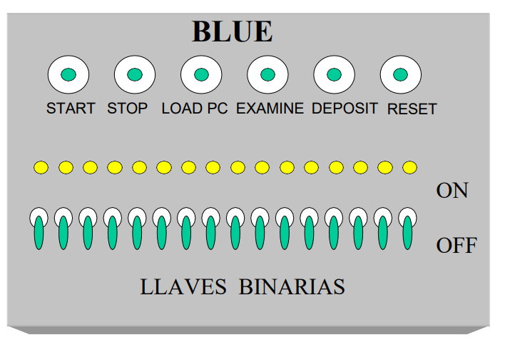

*Figura de clase — Resumen «Arquitectura final» (Said), p. 21.*

> [!tip] Qué mirar
> Los seis pulsadores con el nombre que se usa en el oral (**START, STOP, LOAD PC, EXAMINE, DEPOSIT, RESET**), la fila de **16 leds** de estado y las **16 llaves binarias** de tres posiciones (arriba `1`, centro sin efecto, abajo `0`). Con esto alcanza para explicar la **carga manual** de un programa sin sistema operativo: llaves → `DEPOSIT` → el `PC` avanza solo → `LOAD PC` al inicio → `START`.

#### Figura del libro

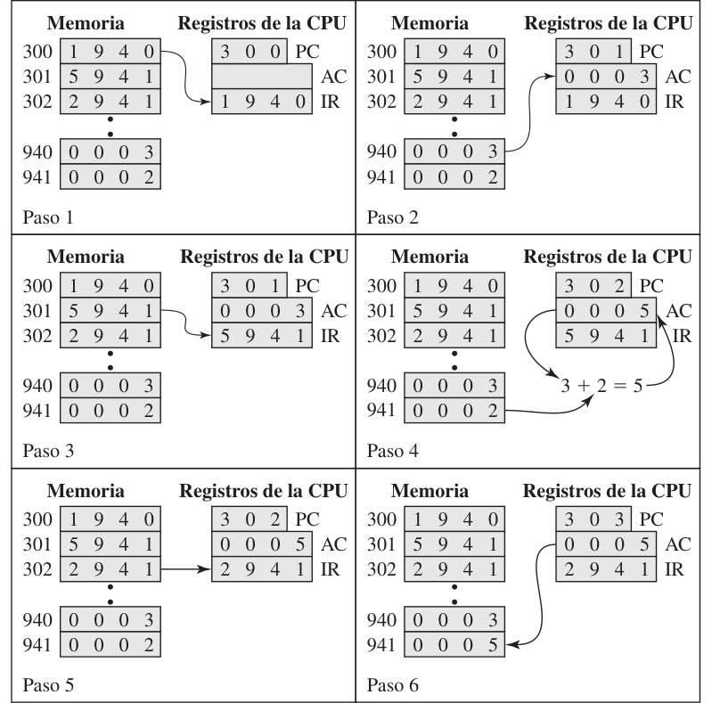

*Fig. 3.5 — Ejemplo de ejecución de un programa: contenidos de la memoria y registros de la CPU paso a paso.* · Stallings, *Organización y arquitectura de computadores*, 7ª ed., p. 86.

> [!tip] Qué mirar
> Los seis pasos muestran cómo cambian `PC`, `IR`, `MAR`, `MDR` y el acumulador en cada instrucción. Es la misma mecánica de la BLUE: la memoria siempre se toca a través de `MAR` y `MDR`.

#### Relacionado
[[4.2.2 Los 16 opcodes octales]] · [[4.2.3 Programar en BLUE]] · [[4.3.2 Búsqueda, los 8 pulsos]] · [[Máquina BLUE — arquitectura y conjunto de instrucciones]] · [[TP16 Ciclo de instrucción básico]] · [[Glosario — Unidad 4]]

### 4.2.2 Los 16 opcodes octales

> [!abstract] En una frase
> La BLUE tiene **16 instrucciones**, numeradas en **octal** del `00` al `17`: 4 bits de código de operación y 12 bits de dirección. Ocho se ejecutan en **un ciclo**, dos usan **dos ciclos** (LDA y STA) y dos hablan con periféricos (**INP**, **OUT**).

> [!note] Si la primera vez que ves esto
> El **opcode** es el número de la instrucción, como el código de un trámite: `06` siempre significa "traeme el dato que está en tal dirección" (`LDA`). No hay que confundirlo con los nemónicos del 8086: **éstos son los 16 de la BLUE** y son los que se usan en el pizarrón.

#### Los 16 opcodes, en octal

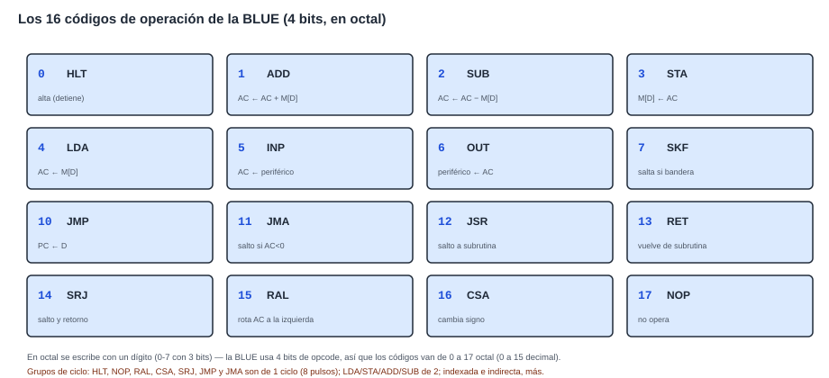

#### La tabla completa

| Octal | Mnemónico | Qué hace | Ciclos | Pulsos |
|---|---|---|---|---|
| `00` | **HLT** | detiene la máquina (`RUN = 0`) | 1 | 8 |
| `01` | **ADD** | `AC ← AC + M[dir]` | **2** | 16 |
| `02` | **XOR** | `AC ← AC ⊕ M[dir]` | **2** | 16 |
| `03` | **AND** | `AC ← AC · M[dir]` | **2** | 16 |
| `04` | **IOR** | `AC ← AC + M[dir]` (OR lógica) | **2** | 16 |
| `05` | **NOT** | `AC ← AC'` | 1 | 8 |
| `06` | **LDA** | `AC ← M[dir]` (cargar) | **2** | 16 |
| `07` | **STA** | `M[dir] ← AC` (guardar) | **2** | 16 |
| `10` | **SRJ** | salto relativo (vuelve por el `AC`) | 1 | 8 |
| `11` | **JMA** | salto **absoluto** incondicional | 1 | 8 |
| `12` | **JMP** | salto **indirecto** | 1 | 8 |
| `13` | **INP** | entra un dato de 8 bits del dispositivo `YY` | 2+n | 16+ |
| `14` | **OUT** | sale el byte alto del `AC` al dispositivo `YY` | 2+n | 16+ |
| `15` | **RAL** | rota el `AC` a la izquierda | 1 | 8 |
| `16` | **CSA** | copia las llaves al `AC` (y salta si es 0) | 1 | 8 |
| `17` | **NOP** | no operación | 1 | 8 |

**Las cuentas, agrupadas:**

| Grupo | Instrucciones | ¿Por qué? |
|---|---|---|
| **1 ciclo (8 pulsos)** | HLT, NOT, SRJ, JMA, JMP, RAL, CSA, NOP | no van a memoria a buscar operandos: terminan sin cambiar `STATE` |
| **2 ciclos (16 pulsos)** | **ADD, XOR, AND, IOR, LDA, STA** | necesitan **un acceso más a memoria** para traer el operando (o llevarlo) |
| **2+n pulsos** | INP, OUT | esperan al periférico (`TRA`/listo): el ciclo de ejecución se repite |

> [!important] Ojo con la numeración
> Después de `07` **no** sigue `08`: es **octal**, así que sigue `10`. Escribir `08`, `09` o `15` como decimal es el error más común de esta tabla.

#### El formato de la instrucción

```
  15        12 11                          0
 ┌────────────┬────────────────────────────┐
 │  OPCODE 4  │      DIRECCIÓN / YY (12)   │
 └────────────┴────────────────────────────┘
```

- **Aritméticas y lógicas** (`01`-`04`): la dirección apunta al **operando** en memoria (`NOT` y `RAL` trabajan sólo sobre el `AC`).

- **LDA / STA** (`06`, `07`): la dirección es el operando; el acceso usa el **2.º ciclo**.

- **Saltos** (`10`, `11`, `12`): la dirección es **a dónde saltar**.

- **E/S** (`13`, `14`): los **bits bajos** son el número de dispositivo; los altos, `00`.

- **Sin operando** (`00`, `15`, `16`, `17`): la dirección se ignora (`000`).

#### Ejemplos de codificación

| Instrucción | Binario (4 + 12) | Octal |
|---|---|---|
| `HLT` | `0000 000 000 000 000` | `00 0000` |
| `ADD 100` (decimal 100) | `0001 0000 0110 0100` | `01 0144` |
| `LDA 2048` | `0110 1000 0000 0000` | `06 4000` |
| `STA 4095` | `0111 1111 1111 1111` | `07 7777` |
| `INP 5` | `1101 0000 0000 0101` | `14 0005` (octal) |

#### Programa mínimo (sumar 5 + 3)
```
0000  06 0010      LDA 10       (AC ← M[10] = 5)
0001  01 0011      ADD 11       (AC ← AC + M[11] = 8)
0002  07 0012      STA 12       (M[12] ← AC)
0003  00 0000      HLT
...
0010  00 0005      5
0011  00 0003      3
0012  00 0000      resultado
```

> [!warning] Errores típicos
> - Usar nemónicos del 8086 (`SUB`, `JZ`, `MOV`, `IN`/`OUT` con otro formato) en la BLUE.
> - Confundir `JMA` (absoluto) con `JMP` (indirecto) y `SRJ` (relativo).
> - Contar `08` como opcode.
> - Decir que `LDA` es de un ciclo: **necesita dos** (buscar la instrucción y después el dato).

#### Figura de clase

##### El corte exacto de la instrucción: 15..12 opcode y 11..0 dirección.

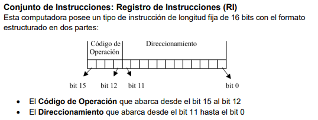

*Figura de clase — Resumen «Arquitectura final» (Said), p. 23.*

> [!tip] Qué mirar
> Los dos campos, con sus límites: **`15..12`** = código de operación (**4 bits ⇒ 16 instrucciones**) y **`11..0`** = direccionamiento (**12 bits ⇒ 4 096 posiciones**). Un opcode de 4 bits es exactamente un **dígito octal**, y por eso los nemónicos se escriben del `00` al `17`.

##### Los 16 nombres en castellano, con el nemónico de cada uno.

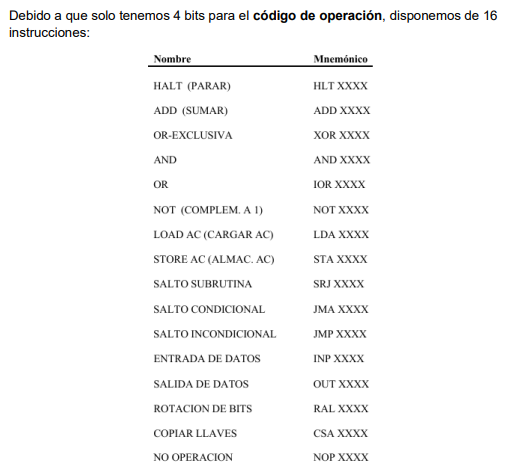

*Figura de clase — Resumen «Arquitectura final» (Said), p. 23.*

> [!tip] Qué mirar
> Es la tabla que conviene tener memorizada con **los dos** nombres, porque en el final se piden en castellano: **HALT** (parar), **ADD** (sumar), **SUB** (restar), **STA** (almacenar), **LDA** (cargar), **INP** (leer), **OUT** (escribir), **SKF** (saltar si bandera), **JMP** (salto incondicional), **JMA** (salto absoluto), **JSR** (salto a subrutina), **RET** (volver de subrutina), **SRJ** (saltar y retornar), **RAL** (rotar a la izquierda), **CSA** (cambio de signo) y **NOP** (no opera).

#### Figura del libro

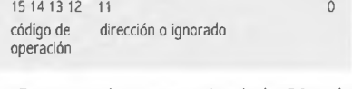

*Fig. 7.6 — Formato de instrucción de la CPU de «X»: 4 bits de código de operación y 12 de dirección o ignorado.* · Quiroga, *Arquitectura de computadoras*, p. 175.

> [!tip] Qué mirar
> Es exactamente el formato de la BLUE: `15..12` opcode y `11..0` dirección ⇒ 16 opcodes y 4096 posiciones. Los 4 bits son los que permiten escribir los opcodes en octal del `00` al `17`.

#### Relacionado
[[4.2.3 Programar en BLUE]] · [[4.2.1 Especificación, registros y 4096x16]] · [[Las 16 instrucciones de BLUE — ciclo completo pulso por pulso]] · [[Máquina BLUE — arquitectura y conjunto de instrucciones]] · [[Glosario — Unidad 4]]

### 4.2.3 Programar en BLUE

> [!abstract] En una frase
> Programar la BLUE es **escribir una lista de instrucciones y datos en memoria**: las instrucciones se ejecutan en orden desde la dirección 0 y el `PC` las recorre. No hay variables: hay **direcciones**.

> [!note] Si la primera vez que ves esto
> Es como escribir una **receta para alguien muy obediente y muy literal**: "buscá el número de la dirección 10, sumale el de la 11, guardá el resultado en la 12, terminá". Nada de `for` ni `if`: los lazos y las decisiones se hacen con **saltos** (`JMA`, `SRJ`) y comparaciones.

#### Un programa en memoria

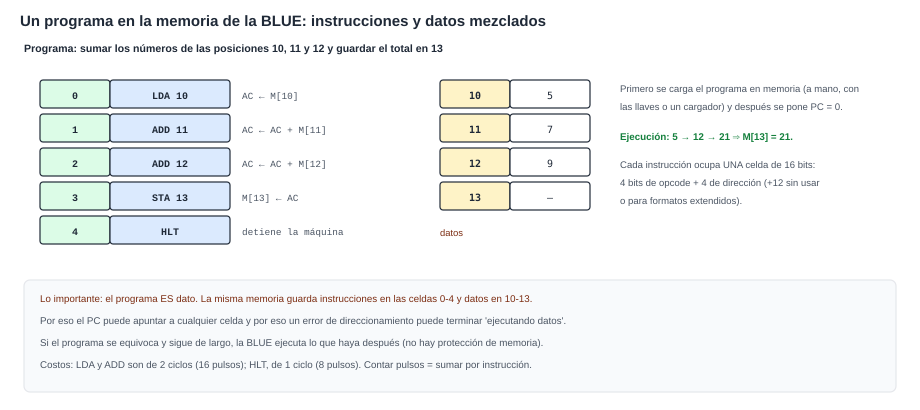

#### Los tres patrones que hay que saber

##### 1) Suma de dos números (secuencia directa)
```
0000  06 0010   LDA 10        AC ← 5
0001  01 0011   ADD 11        AC ← AC + 3
0002  07 0012   STA 12        M[12] ← AC
0003  00 0000   HLT
0010  00 0005   dato 5
0011  00 0003   dato 3
0012  00 0000   resultado
```

##### 2) Lazo sin índices (auto modificación)
La BLUE básica **no tiene registros índice**: para recorrer un arreglo hay que **cambiar la dirección de la instrucción**. El truco clásico es mantener en memoria una instrucción y modificarla:
```
lazo: LDA 0, dir_dato     (carga el dato apuntado)
      ADD acumulador
      STA acumulador
      ... incrementar la dirección guardada ...
      JMA lazo
```
En la práctica, en el TP se hace con un contador y una condición de corte: **es la limitación que motiva la BLUE indexada** (allí el lazo se escribe una vez y sólo se incrementa `RIF`).

##### 3) Decisión (si … entonces)
```
      LDA dato
      AND mascara         (¿tiene el bit?)
      CSA                 (si el resultado es 0, salta la próxima)
      JMA  caso_si
      JMA  caso_no
```

#### Las instrucciones que hacen "magia"

| Instrucción | Para qué se usa en un programa |
|---|---|
| **RAL** | rotar el `AC` a la izquierda: multiplicar por 2 y mover bits |
| **CSA** | limpiar el `AC` y saltar si quedó en 0 (comparación) |
| **SRJ** | llamar a una subrutina o saltar relativamente (corto) |
| **JMA / JMP** | ir a otra dirección de forma absoluta / indirecta (tablas de saltos) |
| **INP / OUT** | leer o escribir 8 bits de un dispositivo |

#### Cómo se cuenta lo que tarda un programa
```
tiempo = (instrucciones de 1 ciclo × 1 µs) + (instrucciones de 2 ciclos × 2 µs)
```
Ejemplo: en el programa de la suma, `LDA` son **2** ciclos, `ADD` **2**, `STA` **2** y `HLT` **1** ⇒ `2 + 2 + 2 + 1 = 7` ⇒ **7 µs**. En un lazo de 100 vueltas se multiplica por las vueltas.

#### Reglas de estilo del TP

1. **Reservar las direcciones de datos** después del código (por ejemplo desde 100).

2. Comentar **cada línea** con la microoperación (`AC ← AC + M[11]`).

3. Terminar siempre con `HLT` (si no, la máquina sigue leyendo memoria).

4. Verificar los valores finales a mano, instrucción por instrucción.

> [!tip] Lo que se evalúa
> No se evalúa la elegancia: se evalúa que el programa **termine**, que el resultado quede donde se pide y que se pueda **explicar qué hace cada instrucción**.

> [!warning] Errores típicos
> - Olvidar el `HLT` y "caer" en la zona de datos.
> - Confundir direcciones **decimales** con **octales** al codificar el campo.
> - Usar `STA` para leer o `LDA` para escribir.
> - Intentar indexar sin tocar la instrucción (la BLUE básica no lo permite).

> [!example] Un programa de 3 instrucciones
> Sumar `M[500] + M[501]` y guardar en `M[502]`: `LDA 500` (16 pulsos) · `ADD 501` (16 pulsos) · `STA 502` (16 pulsos) = **48 pulsos = 6 µs**. Un bucle de 10 repeticiones serían **60 µs**: por eso se cuenta en pulsos y no en "instrucciones".

#### Figura del libro

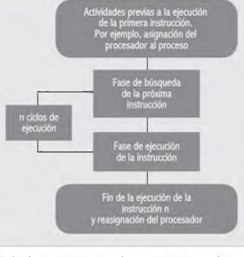

*Fig. 8.2 — Ciclo de instrucción para las n instrucciones de un programa.* · Quiroga, *Arquitectura de computadoras*, p. 213.

> [!tip] Qué mirar
> Un programa es una cadena de ciclos de instrucción: búsqueda, ejecución y paso a la siguiente. Programar en BLUE es ordenar esas instrucciones y tener en cuenta cuántos pulsos cuesta cada una.

#### Relacionado
[[4.2.2 Los 16 opcodes octales]] · [[4.2.1 Especificación, registros y 4096x16]] · [[Programar en BLUE — ejemplos]] · [[BLUE indexada (RIF, RID, nuevo formato)]] · [[TP16 Ciclo de instrucción básico]] · [[Glosario — Unidad 4]]

## 4.3 El ciclo de instrucción

### 4.3.1 Ciclo de reloj, de máquina y de instrucción

> [!abstract] En una frase
> Hay **tres ciclos anidados**: el **de reloj** (un pulso, 125 ns en la BLUE), el **de máquina** (8 pulsos, 1 µs: una búsqueda completa) y el **de instrucción** (uno o más ciclos de máquina, según la instrucción).

> [!note] Si la primera vez que ves esto
> Pensá en un **reloj de pared**: el **tic** es el ciclo de reloj; las **12 campanadas** que marcan una hora son el ciclo de máquina (varios tics juntos con un sentido); y "desde que te levantás hasta que terminás de desayunar" es el ciclo de instrucción (puede durar una o varias horas).

#### Los tres niveles

| Ciclo | Qué es | En la BLUE | Equivale a |
|---|---|---|---|
| **De reloj** | un pulso | **125 ns** | 1 microoperación |
| **De máquina** | 8 pulsos | **1 µs** | 1 búsqueda (+ ejecución de las de 1 ciclo) |
| **De instrucción** | 1, 2 o 2+n ciclos de máquina | 1-2 µs (o más con E/S) | ejecutar la instrucción completa |

```
                  ┌──────── ciclo de instrucción ────────┐
   ┌── ciclo de máquina (búsqueda) ──┐ ┌── ejecución ──┐
   │ CP1 CP2 CP3 CP4 CP5 CP6 CP7 CP8 │ │ CP1 … CP8     │
   └─────────────────────────────────┘ └───────────────┘
     ↑ un ciclo de reloj = un pulso
```


#### Cuántos ciclos tiene cada instrucción

| Tipo | Instrucciones | Ciclos de máquina | Pulsos |
|---|---|---|---|
| **1 ciclo** | HLT, NOT, SRJ, JMA, JMP, RAL, CSA, NOP | 1 | 8 |
| **2 ciclos** | **ADD, XOR, AND, IOR, LDA, STA** | 2 | 16 |
| **2+n** | **INP, OUT** | 2 + espera | 16 o más |

> [!important] Por qué las seis son de dos ciclos
> La **búsqueda** trae la **instrucción** (opcode + dirección) al `IR`, pero **no el operando**. Las seis que operan con un dato de memoria necesitan un ciclo extra para: poner la dirección del campo en el `MAR` (`IR → MAR`) y hacer la lectura. Las otras ocho (HLT, NOT, RAL, CSA y los saltos) **no van a memoria** por un operando: viven con lo que ya tienen (`AC`, `PC` o las llaves), así que ejecutan sus pocas microoperaciones dentro del mismo ciclo de búsqueda y **no cambian** el biestable `STATE`.

#### Los flip-flops de estado en el tiempo
```
        búsqueda            ejecución
STATE =    0        →          1        →   0 (vuelve a buscar)
```

- `STATE = 0` ⇒ la UC ejecuta la secuencia de **búsqueda**.

- `STATE = 1` ⇒ ejecuta la secuencia de **ejecución** de la instrucción decodificada.

- `TRA = 1` ⇒ hay una transferencia de E/S en curso: el ciclo de ejecución **se repite** hasta que el periférico responda.

#### Cálculo de tiempos (lo que se pregunta)
```
tiempo de una instrucción = ciclos de máquina × 1 µs
programa = Σ (instrucciones × sus ciclos) × 1 µs
```
Ejemplo: un programa con 100 `ADD` y 10 `LDA` tarda `(100 × 2 + 10 × 2) µs = 220 µs`.

> [!warning] Errores típicos
> - Confundir ciclo de **máquina** con ciclo de **instrucción**.
> - Decir que la BLUE tiene 8 pulsos por instrucción (tiene 8 por **ciclo de máquina**).
> - Multiplicar por 125 ns cuando piden el tiempo total de la instrucción (hay que usar 1 µs).

#### Figura del libro


*Fig. 3.3 — Ciclo de instrucción básico.* · Stallings, *Organización y arquitectura de computadores*, 7ª ed., p. 84.

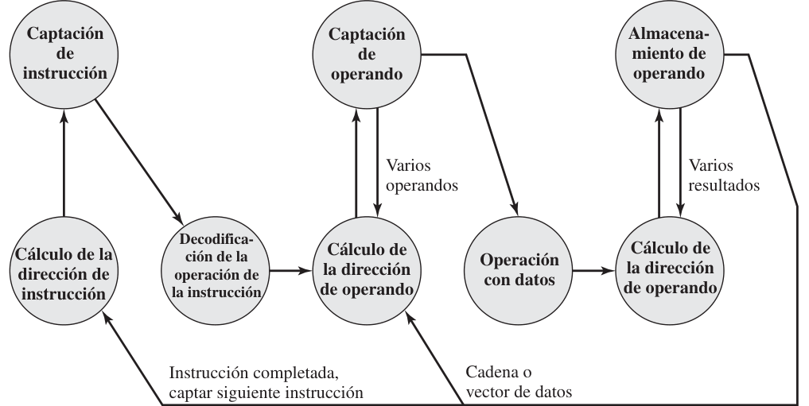

*Fig. 3.6 — Diagrama de estados del ciclo de intrucción.* · Stallings, *Organización y arquitectura de computadores*, 7ª ed., p. 87.

> [!example] Las tres escalas de tiempo
> Pulso: **125 ns**. Ciclo de máquina: **8 pulsos = 1 µs**. Instrucción: 1 ciclo (8 pulsos) o 2 ciclos (16 pulsos) ⇒ **1 o 2 µs**. Reloj de 8 MHz ⇒ 8 millones de pulsos por segundo. Si preguntan cuánto tardan 100 instrucciones de 2 ciclos: `100 × 2 µs = 200 µs`.

#### Relacionado
[[4.3.2 Búsqueda, los 8 pulsos]] · [[4.3.3 Ejecución instrucción por instrucción]] · [[Ciclo de máquina]] · [[Ciclo de búsqueda (7 y 8 pulsos)]] · [[Glosario — Unidad 4]]

### 4.3.2 Búsqueda, los 8 pulsos

> [!abstract] En una frase
> La **búsqueda** (*fetch*) es la secuencia de **8 pulsos** que trae la instrucción de la memoria al `IR` y deja el `PC` apuntando a la siguiente. Es **igual para todas las instrucciones** y se hace siempre.

> [!note] Si la primera vez que ves esto
> Es el momento en que la máquina "**va a leer el renglón siguiente**" de la receta. Como el bus es único, hay que hacerlo por partes: primero decir **a qué dirección** ir (CP1), después **actualizar el marcador** para la próxima (CP2-CP4), después **recibir** el dato (CP5), después **guardarlo** en el registro de instrucción (CP6), y al final **decidir** si se pasa a ejecutar (CP8).

#### Los 8 pulsos de la búsqueda

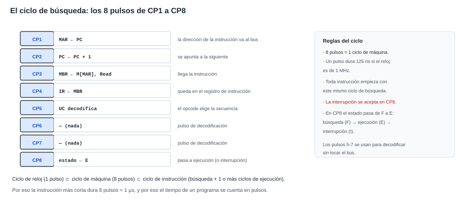

#### La tabla de la búsqueda (la que se dibuja en el pizarrón)

| Pulso | Microoperación | Nombre de la señal | Para qué |
|---|---|---|---|
| **CP1** | `MAR ← PC` + **Read** | `PC_out`, `MAR_in`, `Read` | decir a qué dirección se accede |
| **CP2** | `PC + 1 → Y` | `PC_out`, `Y_in` | el PC entra a la ALU por Y |
| **CP3** | `Y + 1 → Z` (ALU) | `ALU: suma`, `Z_in` | se calcula el incremento |
| **CP4** | `Z → PC` | `Z_out`, `PC_in` | el PC ya apunta a la siguiente |
| **CP5** | `MBR ← M[MAR]` (*strobe*) | `MBR_in`, `strobe` | llega la palabra de memoria |
| **CP6** | `MBR → IR` | `MBR_out`, `IR_in` | la instrucción va al registro |
| **CP7** | (E/S) `TRA ← 1` si es `INP`/`OUT` | `TRA_in` | prepara la transferencia |
| **CP8** | `STATE ← 1` si la instrucción lo pide · o `E → STATE` | `STATE_in` | pasa a ejecución (o queda en búsqueda) |

> [!important] Por qué son **dos** pulsos para el `PC + 1`
> Porque hay **un solo bus**: el PC no puede, en el mismo pulso, salir al bus (para ir a `MAR`) y a la vez entrar a la ALU. Por eso va **primero** a `MAR` (CP1) y **después** a `Y` (CP2). Es el ejemplo canónico de la regla "una transferencia por pulso".

#### Y el pulso 8, ¿para qué está?
En la memoria de **ferrita** original, **leer destruye el dato**: había que **reescribirlo**. El 8.º pulso es justamente esa **reescritura**. De ahí que la búsqueda "real" parezca de 7 pulsos y el ciclo sea de **8**:

```
7 pulsos de operación  +  1 pulso de reescritura  =  8 pulsos = 1 µs
```

#### Qué queda al terminar la búsqueda

| Registro | Contenido |
|---|---|
| `IR` | la instrucción (opcode de 4 bits + dirección de 12) |
| `PC` | la dirección de la **siguiente** instrucción |
| `MBR` | la palabra que se trajo (la instrucción) |
| `STATE` | 0 (sigue en búsqueda) o 1 (pasa a ejecutar) |

Con el `IR` cargado, la UC ya puede **decodificar**: el decodificador 1→16 activa la línea de la instrucción ([[4.4.2 estado·pulso·instrucción y el decodificador 1-16]]).

> [!warning] Errores típicos
> - Poner `PC ← PC + 1` en el mismo pulso que `MAR ← PC` (viola la regla del bus único).
> - Confundir `MBR ← M[MAR]` (lectura, CP5) con `M[MAR] ← MBR` (escritura, que es de `STA`).
> - Decir que la búsqueda cambia según la instrucción: **es siempre la misma**.

#### Figura del libro

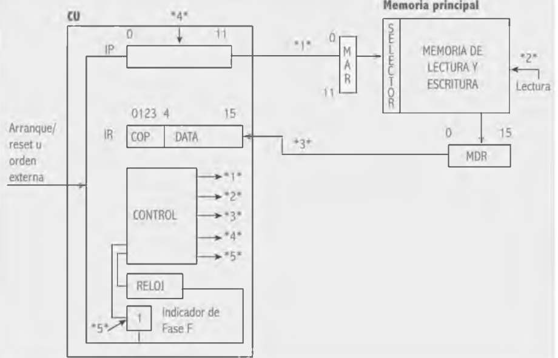

*Fig. 7.10 — Fase fetch.* · Quiroga, *Arquitectura de computadoras*, p. 178.

> [!example] Los 8 pulsos, en una línea
> `CP1: PC → MAR` · `CP2: PC + 1` · `CP3: MEMout, MBRin` (llega la instrucción) · `CP4: MBR → IR` · `CP5: decodifica el opcode` · `CP6: decodifica la dirección` · `CP7-CP8: decide el ciclo de ejecución`. Al terminar, el `IR` tiene la instrucción y el `PC` ya apunta a la siguiente.

#### Relacionado
[[4.3.3 Ejecución instrucción por instrucción]] · [[4.3.1 Ciclo de reloj, de máquina y de instrucción]] · [[Ciclo de búsqueda (7 y 8 pulsos)]] · [[Ciclo de ejecución — todas las operaciones]] · [[Ciclo de máquina]] · [[Glosario — Unidad 4]]

### 4.3.3 Ejecución instrucción por instrucción

> [!abstract] En una frase
> La **ejecución** es la parte que cambia: **8 instrucciones** la resuelven **dentro** del ciclo de búsqueda (no cambian `STATE`), **6** piden un **ciclo de ejecución completo** porque van a buscar un operando a memoria (ADD, XOR, AND, IOR, LDA, STA) y **2** (INP, OUT) esperan al periférico.

> [!note] Si la primera vez que ves esto
> Pensá en el **CP8 de la búsqueda como una bifurcación**: "¿esta instrucción necesita algo más de la memoria?" Si la respuesta es **no** (un salto, un `HLT`, un `NOT`), la máquina termina ahí y vuelve a buscar. Si es **sí**, pone `STATE = 1` y hace **otra vuelta de 8 pulsos** dedicada a traer ese dato.

#### La instrucción, pulso por pulso


#### Grupo A — las 8 que caben en el ciclo de búsqueda (1 ciclo)

| Instrucción | Qué hace al final | Dónde |
|---|---|---|
| **HLT** (00) | `RUN ← 0` | CP8 |
| **NOP** (17) | nada | — |
| **JMA** (11) | `PC ← IR(dir)` (salto absoluto) | CP8 |
| **JMP** (12) | salto indirecto (la dirección está en memoria) | CP8 |
| **SRJ** (10) | guarda el retorno en el `AC` y salta | CP7-CP8 |
| **CSA** (16) | copia las llaves al `AC` | CP8 |
| **NOT** (05) | `AC → Z` en CP7 y `Z' → AC` en CP8 | CP7-CP8 |
| **RAL** (15) | `AC → Z` y `2·Z → AC` (rotación) | CP7-CP8 |

> [!note] Por qué NOT y RAL usan el par Z → A
> La ALU **sólo** trabaja con las entradas `Y` y `Z`. Entonces el dato tiene que pasar del acumulador a `Z` (CP7), la ALU calcula (`Z'` o `2·Z`) y en CP8 el resultado vuelve al `AC`. Es el mismo truco del `PC + 1`.

#### Grupo B — las 6 que necesitan un ciclo de ejecución (2 ciclos, 16 pulsos)

Todas terminan la **búsqueda** con `CP8: E → STATE` y después ejecutan:

##### LDA — cargar el acumulador

| Fase | CP1 | CP2 | CP3 | CP4 | CP5 | CP6 | CP7 | CP8 |
|---|---|---|---|---|---|---|---|---|
| Búsqueda | PC→MAR, lectura | +1→Y | — | SUMA→PC | Strobe MBR | MBR→IR | — | **E→STATE** |
| Ejecución | **IR→MAR**, lectura | — | — | — | Strobe MBR | **MBR→A** | — | **F→STATE** |

##### STA — almacenar el acumulador

| Fase | CP1 | CP2 | CP3 | CP4 | CP5 | CP6 | CP7 | CP8 |
|---|---|---|---|---|---|---|---|---|
| Búsqueda | PC→MAR, lectura | +1→Y | — | SUMA→PC | Strobe MBR | MBR→IR | — | **E→STATE** |
| Ejecución | **IR→MAR** | — | — | **A→MBR**, **escritura** | — | — | — | **F→STATE** |

##### ADD / XOR / AND / IOR — las cuatro aritmético-lógicas

| Fase | CP1 | CP2 | CP3 | CP4 | CP5 | CP6 | CP7 | CP8 |
|---|---|---|---|---|---|---|---|---|
| Búsqueda | PC→MAR, lectura | +1→Y | — | SUMA→PC | Strobe MBR | MBR→IR | — | **E→STATE** |
| Ejecución | **IR→MAR**, lectura | **A→Z** | — | — | Strobe MBR | **MBR→Y** | — | **SUMA/XOR/AND/OR → A**, `F→STATE` |

> [!important] La lógica de las cuatro (la que se valora)
> En **CP2** el acumulador va a `Z`; en **CP6** el dato de memoria va a `Y`. La ALU queda con los **dos operandos** y en **CP8** hace la operación: el resultado cae en el `AC`. **La única diferencia entre ADD, XOR, AND e IOR es qué salida de la ALU se habilita en CP8.**

#### Grupo C — las 2 de entrada/salida (16 pulsos o más)
Usan **`TRA`** (transferencia en curso) y la señal **`R`** (periférico listo):

| Fase | CP7 | CP8 |
|---|---|---|
| Búsqueda | **TRA ← 1** (se manda el número de dispositivo por las líneas de selección) | **E → STATE** |
| Ejecución | si **R = 1** → copiar el dato (`INP`: líneas de entrada → `AC`) y **TRA ← 0** | si `TRA = 0` → **F → STATE**; si no, **se repite el ciclo** |

- `INP` (13): los **8 bits bajos** del `AC` ← dato del dispositivo; los altos, en 0.

- `OUT` (14): los **8 bits altos** del `AC` → dispositivo.

- Si el periférico no está listo, **se repite** el ciclo: 16, 24, 32… pulsos. Ése es el defecto de la E/S por consulta y la razón de ser de las **interrupciones**.

#### Resumen en una tabla

| Instrucción | Ciclos | Pulsos | ¿Cambia STATE? |
|---|---|---|---|
| HLT, NOP, JMA, JMP, SRJ, CSA, NOT, RAL | 1 | 8 | **no** |
| ADD, XOR, AND, IOR, LDA, STA | 2 | 16 | sí (`E→STATE` y después `F→STATE`) |
| INP, OUT | 2+n | 16+ | sí, y puede repetirse |

> [!warning] Errores típicos
> - Decir que `ADD` es de un ciclo (es de **dos**: necesita traer el operando).
> - Poner el resultado de la ALU en el `MBR` (va al `AC`).
> - Olvidar que en `STA` la **escritura** ocurre en el **CP4**, no en el CP5.
> - Contar 8 pulsos para `LDA` (son 16).

#### Figura de clase

##### La entrada/salida completa: 8 líneas de dato, 6 de selección y 64 dispositivos.

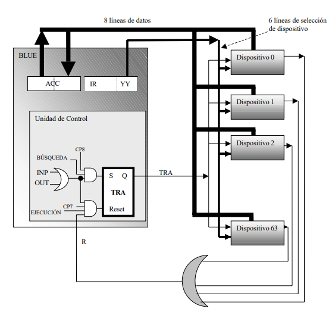

*Figura de clase — Resumen «Arquitectura final» (Said), p. 30.*

> [!tip] Qué mirar
> Lo que hay que poder dibujar de memoria: **8 líneas de datos** (un byte) y **6 líneas de selección** ⇒ `2⁶ =` **64 dispositivos**, numerados del `0` al **63**. La selección sale de `IR5..IR0` (por eso el dispositivo es un campo de la propia instrucción `INP`/`OUT`) y la unidad de control habilita la transferencia con **`TRA`**, un biestable que se pone al decodificar `INP`/`OUT` y se borra con `R` cuando el dispositivo terminó. Fijate que los periféricos se conectan al **bus de datos**, no a los registros internos: entre ellos están los buffers.

#### Figura del libro

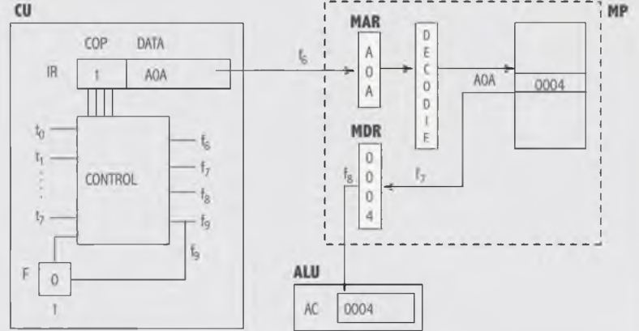

*Fig. 7.13 — Fase execute LDA.* · Quiroga, *Arquitectura de computadoras*, p. 182.

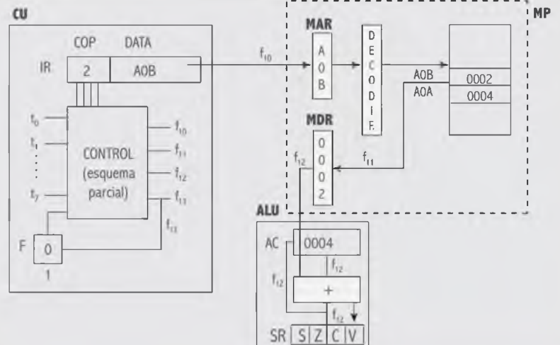

*Fig. 7.14 — Fase execute ADA.* · Quiroga, *Arquitectura de computadoras*, p. 183.

#### Ejemplo resuelto (contar los pulsos)
`ADD dir` en la BLUE, que necesita **2 ciclos** (búsqueda + ejecución):

| Pulsos | Qué hace |
|---|---|
| CP1-CP8 (búsqueda) | `PC → MAR`, `M[MAR] → MBR`, `MBR → IR`, `PC + 1`, decodifica |
| CP9-CP16 (ejecución) | `IR(dirección) → MAR`, `M[MAR] → MBR`, `AC ← AC + MBR` |

Total **16 pulsos = 2 µs**. Una instrucción de 1 ciclo (como `NOT`) son **8 pulsos = 1 µs**. La cuenta `pulsos × 125 ns` es lo primero que se pregunta.

#### Relacionado
[[4.3.2 Búsqueda, los 8 pulsos]] · [[4.4.1 Funciones y señales de control]] · [[Las 16 instrucciones de BLUE — ciclo completo pulso por pulso]] · [[Ciclo de ejecución — todas las operaciones]] · [[Interrupciones y entrada-salida]] · [[Glosario — Unidad 4]]

## 4.4 Unidad de Control

### 4.4.1 Funciones y señales de control

> [!abstract] En una frase
> La Unidad de Control **secuencia** (búsqueda/ejecución), **decodifica** la instrucción, **emite las señales** que abren y cierran las compuertas del bus, y **atiende** las excepciones (halt, reset, interrupciones).

> [!note] Si la primera vez que ves esto
> Es el **director de orquesta**: no toca ningún instrumento (no suma, no guarda), pero dice **quién entra y cuándo**. Cada músico es una compuerta del bus; la partitura son las señales; el compás es el pulso del reloj.

#### La UC y sus señales


#### Las cuatro funciones

| Función | Qué hace | Con qué |
|---|---|---|
| **1. Secuenciar** | decidir búsqueda o ejecución, y qué pulso toca | los FF `STATE`, `RUN`, `TRA` y el contador de pulsos |
| **2. Decodificar** | saber qué instrucción es | decodificador 1→16 sobre el opcode del `IR` |
| **3. Generar señales** | abrir/cerrar compuertas del bus y de la ALU | compuertas AND y OR |
| **4. Controlar excepciones** | halt, reset, interrupciones | `RUN`, `SI`, `EMR` |

#### Las señales (el vocabulario)

| Señal | Qué hace |
|---|---|
| `PC_out` / `PC_in` | habilita el PC a salir al bus / a cargarse |
| `MAR_in` | carga el MAR desde el bus |
| `Read` / `Write` | orden de lectura / escritura a memoria |
| `MBR_in` / `MBR_out` | carga el MBR / lo pone en el bus |
| `IR_in`, `AC_in`, `Z_in`, `Y_in` | cargan cada registro |
| `ALU_op` | qué operación hace la ALU (suma, XOR, AND, OR, NOT, 2·Z…) |
| `STATE_in`, `RUN_in`, `TRA_in` | cambian el estado de la máquina |

> [!important] Cada señal es un **AND** de tres cosas
> `PC_out` en el CP1 de la búsqueda no es una señal suelta: es `STATE' · CP1` (**estado** de búsqueda **y** pulso 1). Si además depende de la instrucción, se agrega el término del decodificador: `STATE · CP1 · LDA`.

#### Quién es síncrono y quién asíncrono

- **Señales sincrónicas**: todas las de los pulsos (ocurren con el reloj).

- **Señales asíncronas**: `Reset` (borra todo en cualquier momento) y, en algunas máquinas, la carga del `PC` por interrupción.

- **El reloj**: `RUN` habilita el reloj; con `RUN = 0` (después de `HLT`) la máquina **se detiene** porque no llegan pulsos.

#### Cómo se prueba que la UC está bien diseñada

1. **Para cada microoperación** de la tabla del ciclo, existe **una** señal que la habilita.

2. **Ningún pulso habilita dos fuentes** del mismo bus (no hay conflicto).

3. Toda instrucción **termina** en `F → STATE` o en `HLT` (no queda colgada).

> [!warning] Errores típicos
> - Decir que la UC **ejecuta** las operaciones: las ejecuta la ALU; la UC **ordena**.
> - Olvidar que la UC también decide **cuándo no hacer nada** (los CP sin microoperación).
> - Confundir el decodificador de instrucción (1→16) con el de memoria (n→2ⁿ).

#### Figura del libro

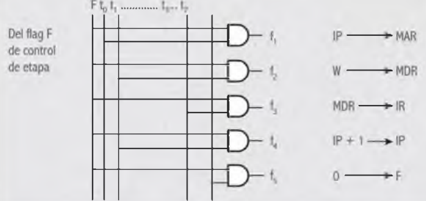

*Fig. 7.11 — Estructura de una parte del módulo de control para la fase fetch.* · Quiroga, *Arquitectura de computadoras*, p. 179.

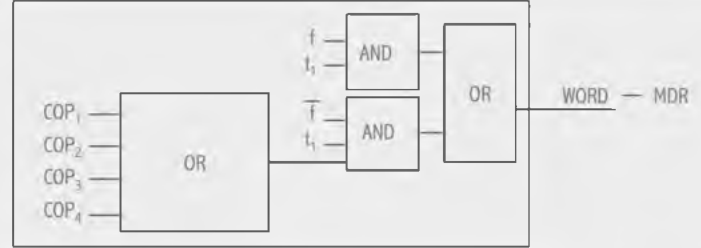

*Fig. 7.21 — Diseño parcial del control para la orden de lectura de la memoria.* · Quiroga, *Arquitectura de computadoras*, p. 193.

#### Ejemplo resuelto (señales de una instrucción)
Para `LDA dir` (cargar al acumulador), las señales de control por pulso son:

| Pulso | Señal | Efecto |
|---|---|---|
| CP2 | `PCout`, `MARin` | la dirección de la instrucción va al `MAR` |
| CP4 | `MEMout`, `MBRin` | se lee la palabra de memoria |
| CP6 | `MBRout`, `IRin` | la instrucción queda en el `IR` |
| CP10 | `IRout`, `MARin` | la dirección del operando va al `MAR` |
| CP12 | `MEMout`, `MBRin` | se lee el operando |
| CP14 | `MBRout`, `ACin` | el operando queda en el acumulador |

Cada fila son **dos** señales: nunca una sola, porque siempre hay **origen y destino**.

#### Relacionado
[[4.4.2 estado·pulso·instrucción y el decodificador 1-16]] · [[4.3.2 Búsqueda, los 8 pulsos]] · [[Cómo se implementa la Unidad de Control]] · [[Unidad de Control]] · [[Unidad de control cableada y microprogramada]] · [[Glosario — Unidad 4]]

### 4.4.2 estado·pulso·instrucción y el decodificador 1-16

> [!abstract] En una frase
> Toda señal de control de la BLUE se escribe como **`señal = estado · pulso · instrucción`**: el estado dice *en qué fase* estamos, el pulso dice *en qué instante*, la instrucción dice *para quién*. El **decodificador 1→16** convierte los 4 bits del opcode en **una línea activa** por instrucción.

> [!note] Si la primera vez que ves esto
> Es un **semáforo con tres condiciones**: la luz verde sólo se prende si es de día (estado), si toca el minuto 8 (pulso) y si el que espera es un auto (instrucción). Las tres cosas a la vez: eso es un **AND** de tres entradas.

#### estado · pulso · instrucción

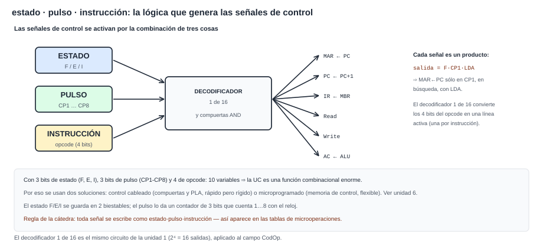

#### El decodificador de instrucción

```
        IR (bits 15..12) = opcode de 4 bits
                    │
              ┌─────▼─────┐
              │  1 → 16   │   (4 NOT + 16 AND de 4 entradas)
              └─────┬─────┘
     ┌───────┬──────┴──────┬────────┐
    L_HLT  L_ADD   …      L_IOR   L_NOP      ← una sola activa
```

| Salida | Se activa con | Ejemplo |
|---|---|---|
| `L_HLT` | `opcode = 0000` | `IR15..12 = 0000` |
| `L_ADD` | `opcode = 0001` | `IR15..12 = 0001` |
| … | … | … |
| `L_NOP` | `opcode = 1111` | `IR15..12 = 1111` |

**Costo:** 4 inversores y **16 compuertas AND de 4 entradas** (una por instrucción). Es el mismo circuito que un decodificador de memoria: `Yi = mi` ([[1.4.1 Decodificador]]).

#### La fórmula de la señal

```
señal = (estado) · (pulso) · (línea de instrucción)
```

Ejemplos reales de la BLUE:

| Señal | Expresión | Qué habilita |
|---|---|---|
| `MBR_in` (strobe) en búsqueda | `F · CP5` | cargar el MBR desde memoria |
| `IR_in` | `F · CP6` | pasar el MBR al IR |
| `E → STATE` (pasar a ejecutar) | `F · CP8 · (ADD + XOR + AND + IOR + LDA + STA + INP + OUT)` | ejecución de las de 2 ciclos |
| `A → Z` (aritméticas) | `E · CP2 · (ADD + XOR + AND + IOR)` | primer operando a la ALU |
| `MBR → Y` | `E · CP6 · (ADD + XOR + AND + IOR)` | segundo operando a la ALU |
| `ALU → A` (la suma) | `E · CP8 · ADD` | guardar el resultado |
| `MBR → A` (cargar) | `E · CP6 · LDA` | `LDA` |
| `A → MBR` + `Write` (guardar) | `E · CP4 · STA` | `STA` |
| `IR → MAR` | `E · CP1 · (ADD + XOR + AND + IOR + LDA + STA)` | dirección del operando al MAR |

> [!important] Y las OR
> Las señales que producen **el mismo efecto** se juntan: `MBR_in` puede ser `F·CP5` **o** `E·CP5·(las de 2 ciclos)`. Entonces:
> ```
> MBR_in = F·CP5 + E·CP5·(ADD + XOR + AND + IOR + LDA + STA)
> ```
> **Los AND «eligen», las OR «juntan».** Con esas dos reglas se dibuja cualquier UC cableada.

#### Cómo se implementa (los dos caminos)

| | **Cableada** | **Microprogramada** |
|---|---|---|
| Cómo | compuertas AND/OR + decodificador | una **ROM** con una palabra de control por pulso |
| Velocidad | más rápida | más lenta (leer la ROM) |
| Cambios | recablear | reprogramar la ROM |
| Se usa en | **BLUE**, RISC | CISC, 8088 |

La BLUE usa cableada: son pocas instrucciones y siempre las mismas.

> [!warning] Errores típicos
> - Poner `·` cuando corresponde `+` (o al revés) al juntar señales.
> - Olvidar el término de la instrucción y activar una señal en todas las instrucciones.
> - Usar el pulso **sin** el estado: `CP8` existe en búsqueda **y** en ejecución; hay que decir cuál.
> - Decir que el decodificador 1→16 simplifica: son 16 AND sin simplificar.

#### Figura del libro

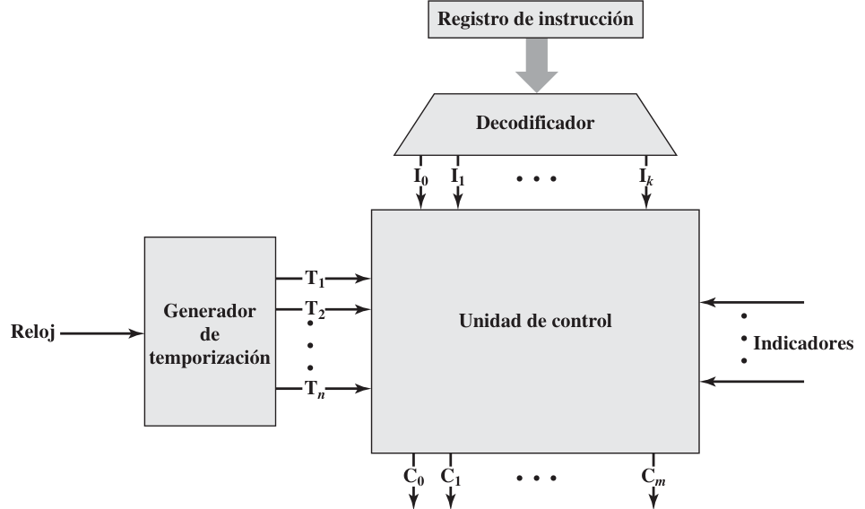

*Fig. 16.10 — Unidad de control con entradas decodificadas.* · Stallings, *Organización y arquitectura de computadores*, 7ª ed., p. 642.

> [!example] El AND de estado y pulso
> Si `PCout` debe activarse en `estado1, CP1`, entonces `PCout = E1 · CP1`: la señal se activa **sólo** si el estado es el correcto **y** el pulso es el correcto. Ése es todo el decodificador **1 de 16** (4 bits de estado → 16 líneas) más los generadores de pulso.

#### Relacionado
[[4.4.1 Funciones y señales de control]] · [[4.3.3 Ejecución instrucción por instrucción]] · [[Cómo se implementa la Unidad de Control]] · [[Unidad de control cableada y microprogramada]] · [[1.4.1 Decodificador]] · [[Glosario — Unidad 4]]

---

## Al terminar la unidad

- Una pasada rápida: [[00 Síntesis — Unidad 4]].

- Los subtemas por separado: [[00 Unidad 4 — temas y subtemas]].

- Seguir de corrido: [[00 Materia completa (las 10 unidades en un archivo)]].

- Practicar: [[Banco de preguntas del final]] · [[Autoevaluación]] · [[Prácticas resueltas]].
