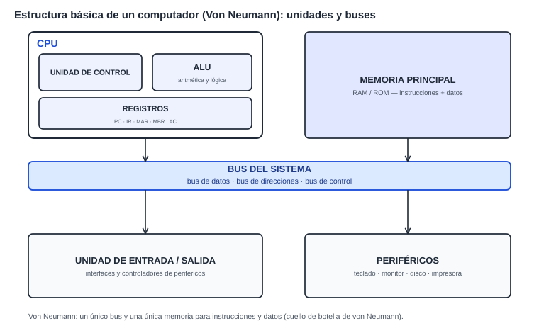
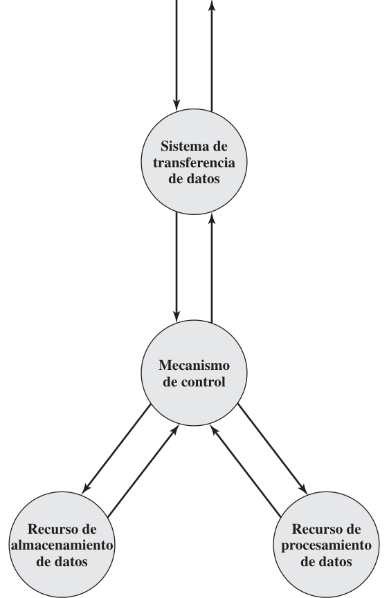

# 4.1.1 Unidades funcionales de una computadora

> [!abstract] En una frase
> Una computadora tiene **cinco unidades funcionales**: **entrada**, **salida**, **memoria**, **ALU** y **unidad de
> control**. ALU + UC + registros forman la **CPU**; todas se comunican por los **buses** de datos, de direcciones
> y de control.

> [!note] Si la primera vez que ves esto
> Es una **cocina**: la **memoria** es la despensa (guarda ingredientes e instrucciones de la receta), la **ALU** es
> la mesada donde se mezcla, la **UC** es el cocinero que lee la receta y dice qué hacer en cada momento, la
> **entrada** es el delivery y la **salida** es el plato servido. Sin el cocinero (UC) todo está quieto; sin
> despensa, no hay nada que cocinar.

## Las cinco unidades

| Unidad | Función | Ejemplos |
|---|---|---|
| **Entrada** | traer datos del exterior | teclado, mouse, sensor, lector |
| **Salida** | entregar resultados | monitor, impresora, LED |
| **Memoria** | guardar instrucciones y datos | RAM, ROM, caché |
| **ALU** | hacer las operaciones | sumador, compuertas lógicas |
| **Unidad de Control** | **decidir** y **ordenar** | decodificador + secuenciador |

**CPU = UC + ALU + registros.** Es la que *ejecuta*: la memoria sólo guarda y la E/S sólo transporta.

## El diagrama de bloques



```
        ┌──────────────────── CPU ────────────────────┐
        │  ┌───────────────┐      ┌─────────────────┐  │
 datos  │  │ UNIDAD DE     │      │      ALU        │  │
◄──────►│  │ CONTROL       │─────►│  (operaciones)  │  │
        │  └───────┬───────┘      └────────┬────────┘  │
        │          │  señales              │           │
        │  ┌───────▼───────────────────────▼────────┐  │
        │  │           REGISTROS (PC, AC, IR…)      │  │
        │  └────────────────────┬───────────────────┘  │
        └───────────────────────┼──────────────────────┘
                                │
        ════════════════════════╪════════════════  buses (datos / direcciones / control)
                                │
        ┌───────────────────────┴──────────────────────┐
        │  MEMORIA            │        E/S              │
        └─────────────────────┴─────────────────────────┘
```

## Qué hace la UC que no hace nadie más
- **Secuencia**: decide qué se hace en cada pulso (buscar, decodificar, ejecutar).
- **Decodifica**: mira el opcode del IR y activa la instrucción que corresponde.
- **Emite señales**: `PC_out`, `MAR_in`, `Read`, `ALU_op`, `AC_in`… Una por microoperación.
- **Atiende excepciones**: interrupciones, halt, reset.

> [!tip] La frase que ordena el oral
> "La memoria **guarda**, la ALU **calcula**, la E/S **transporta** y la UC **ordena**. El programa almacenado
> (tema 4.1.2) es lo que permite que la UC lea sus propias órdenes de la memoria."

## Registros mínimos de la CPU
`PC`, `MAR`, `MBR`, `IR`, `AC` (ver [[3.3.1 AC, PC, IR, MAR y MBR]]). Sin ellos no hay forma de recordar dónde
estoy, a quién le hablo y qué me pidieron.

> [!warning] Errores típicos
> - Poner la ALU fuera de la CPU.
> - Decir que la memoria "ejecuta" instrucciones: las ejecuta la CPU.
> - Olvidar los **buses de control**: sin ellos las unidades no se coordinan.

## Figura del libro



*Fig. 1.1 — Una visión funcional de un computador.* · Stallings, *Organización y arquitectura de computadores*, 7ª ed., p. 32.

## Relacionado
[[4.1.2 IAS y el programa almacenado]] · [[4.2.1 Especificación, registros y 4096x16]] ·
[[3.1.3 Buses de datos, de direcciones y de control]] · [[Estructura básica de un computador]] ·
[[TP15 Arquitectura de Von Neumann (IAS)]]
