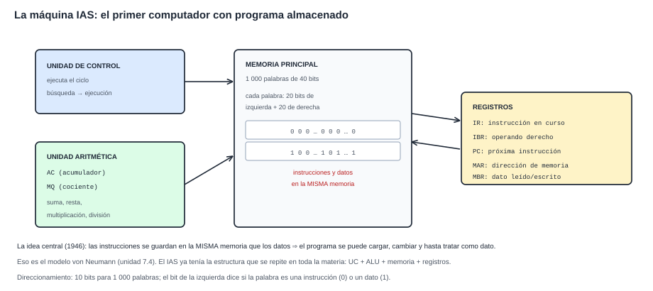
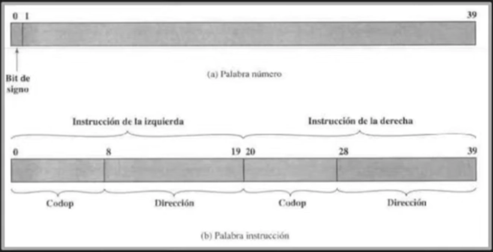
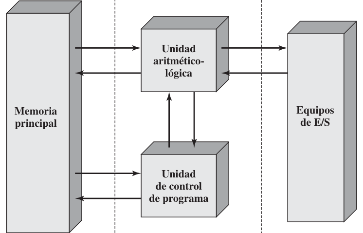
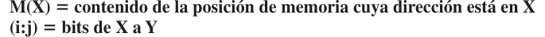

# 4.1.2 IAS y el programa almacenado

> [!abstract] En una frase
> El modelo **von Neumann** (1945, máquina **IAS** de Princeton) guarda **instrucciones y datos en la misma memoria**: la UC lee sus propias órdenes de ahí. Eso es el **programa almacenado**, y es lo que hace que una computadora pueda cambiar de tarea **cargando otro programa**.

> [!note] Si la primera vez que ves esto
> Antes había que **recablear** la máquina para cada cálculo (como cambiar todas las fichas de un teléfono). Von Neumann dijo: "guardemos también la **receta** en la misma memoria que los ingredientes y que la máquina la lea". Desde entonces, programar es **escribir en memoria**, no enchufar cables.

## La máquina IAS

## La máquina IAS (los números que suelen pedirse)

| Característica | Valor |
|---|---|
| Palabra | **40 bits** |
| Instrucción | **20 bits** (dos por palabra) |
| Memoria | **1000 palabras** (direccionables por palabra) |
| Números | 40 bits, signo + 39 de magnitud (o complemento a 2 en variantes) |
| Registros | `MBR`, `MAR`, `IR`, `IBR`, `PC`, `AC`, `MQ` |

**Los registros que agrega respecto de la BLUE:** `IBR` (buffer de instrucción: guarda la segunda instrucción de la palabra) y `MQ` (multiplicador-cociente, para multiplicar y dividir). El `PC` apunta a **palabra**, no a instrucción: por eso hace falta el `IBR`.

**Formato de instrucción IAS:** 8 bits de opcode + **12 bits de dirección** (2 instrucciones de 20 bits en 40). Es exactamente el mismo reparto que después usa la BLUE (4 + 12), con otro ancho de opcode.

## El ciclo del programa almacenado

1. La UC **busca** la instrucción en la dirección del `PC`.

2. La **decodifica** (mira el opcode).

3. **Ejecuta**: accede a los operandos y opera.

4. Vuelve a 1 con el `PC` apuntando a la siguiente.

Ese lazo es igual en una IAS de 1945, en la BLUE didáctica y en un Ryzen. Cambian los anchos y las etapas, no la idea.

## Las consecuencias (lo que se pregunta como "ventajas y desventajas")
**A favor:**

- **Flexibilidad total**: cambiar de programa = cargar otra memoria (no recablear).

- **Autosimilitud**: como una instrucción es un dato, un programa puede **tratar a otro programa como dato** (compiladores, cargadores, sistemas operativos, JIT).

- **Simplicidad de hardware**: una sola memoria y un solo camino.

**En contra:**

- **Cuello de botella von Neumann**: instrucciones y datos comparten el mismo bus ⇒ no se pueden traer a la vez. Es la razón de las cachés separadas (I-cache / D-cache) y del pipeline.

- **Vulnerabilidad**: si se puede escribir donde hay código, se puede inyectar código (de ahí el bit NX).

- **Un solo camino** ⇒ menos paralelismo que Harvard.

## Harvard (el contraste que se pregunta)

| | **von Neumann** | **Harvard** |
|---|---|---|
| Memorias | una sola (datos + instrucciones) | **dos separadas** |
| Buses | uno | dos |
| Ventaja | flexibilidad, simple | más rápido (busca instrucción y dato a la vez) |
| Uso | computadoras de propósito general | microcontroladores, DSP, caché L1 (I/D separadas) |

> [!warning] Errores típicos
> - Decir que en von Neumann las instrucciones están en una memoria distinta de los datos (eso es **Harvard**).
> - Confundir el **modelo** con la **máquina IAS** (la IAS es una implementación concreta del modelo).
> - Olvidar el `IBR`: sin él no se explica cómo la IAS tiene 2 instrucciones por palabra y un `PC` por palabra.

## Figura de clase

### Los dos formatos de la palabra de 40 bits de la IAS.

*Figura de clase — Resumen «Arquitectura final» (Said), p. 20.*

> [!tip] Qué mirar
> La IAS usa **una sola** palabra de **40 bits** para todo, y distingue qué es qué mirando el **bit de la izquierda**: si es `0` es un **dato** (`1` bit de signo + `39` de magnitud, punto fijo) y si es `1` es una **instrucción** (`8` de opcode + `12` + `12` de dirección = `20` bits usados, el resto sobra). Esa es la consecuencia más fuerte del programa almacenado: **el mismo formato de memoria guarda código y datos**, y el hardware no sabe cuál es hasta que lo decodifica.

## Figura del libro

*Fig. 2.1 — Estructura del computador IAS.* · Stallings, *Organización y arquitectura de computadores*, 7ª ed., p. 42.

*Fig. 2.4 — Diagrama de flujo parcial de las operaciones del IAS.* · Stallings, *Organización y arquitectura de computadores*, 7ª ed., p. 46.

## Ejemplo resuelto (una instrucción en la IAS)
`PC = 100`, y en `M[100]` está la instrucción "sumar `M[500]` al acumulador":

1. **Búsqueda**: `MAR ← PC (100)`, `MBR ← M[100]`, `IR ← MBR`, `PC ← 101`.

2. **Decodificación**: la UC ve que es un ADD y que el operando está en `500`.

3. **Ejecución**: `MAR ← 500`, `MBR ← M[500]`, `AC ← AC + MBR`.

- Termina con `PC = 101` **sin que la instrucción haya dicho nada del PC**: eso es el **programa almacenado** (la próxima instrucción es la siguiente dirección de memoria).

## Relacionado
[[4.1.1 Unidades funcionales de una computadora]] · [[4.2.1 Especificación, registros y 4096x16]] · [[Estructura básica de un computador]] · [[TP15 Arquitectura de Von Neumann (IAS)]] · [[Pipeline]] · [[Glosario — Unidad 4]]
