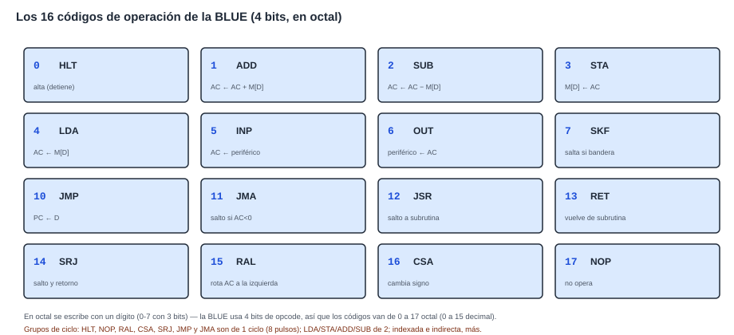
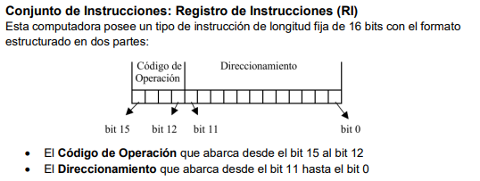
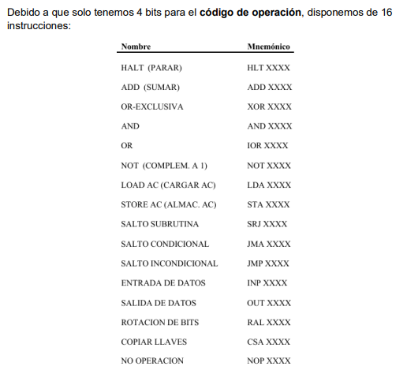
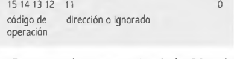

# 4.2.2 Los 16 opcodes octales

> [!abstract] En una frase
> La BLUE tiene **16 instrucciones**, numeradas en **octal** del `00` al `17`: 4 bits de código de operación y 12
> bits de dirección. Ocho se ejecutan en **un ciclo**, dos usan **dos ciclos** (LDA y STA) y dos hablan con
> periféricos (**INP**, **OUT**).

> [!note] Si la primera vez que ves esto
> El **opcode** es el número de la instrucción, como el código de un trámite: `06` siempre significa "traeme el dato
> que está en tal dirección" (`LDA`). No hay que confundirlo con los nemónicos del 8086: **éstos son los 16 de la
> BLUE** y son los que se usan en el pizarrón.

## Los 16 opcodes, en octal



## La tabla completa

| Octal | Mnemónico | Qué hace | Ciclos | Pulsos |
|---|---|---|---|---|
| `00` | **HLT** | detiene la máquina (`RUN = 0`) | 1 | 8 |
| `01` | **ADD** | `AC ← AC + M[dir]` | **2** | 16 |
| `02` | **XOR** | `AC ← AC ⊕ M[dir]` | **2** | 16 |
| `03` | **AND** | `AC ← AC · M[dir]` | **2** | 16 |
| `04` | **IOR** | `AC ← AC + M[dir]` (OR lógica) | **2** | 16 |
| `05` | **NOT** | `AC ← AC'` | 1 | 8 |
| `06` | **LDA** | `AC ← M[dir]` (cargar) | **2** | 16 |
| `07` | **STA** | `M[dir] ← AC` (guardar) | **2** | 16 |
| `10` | **SRJ** | salto relativo (vuelve por el `AC`) | 1 | 8 |
| `11` | **JMA** | salto **absoluto** incondicional | 1 | 8 |
| `12` | **JMP** | salto **indirecto** | 1 | 8 |
| `13` | **INP** | entra un dato de 8 bits del dispositivo `YY` | 2+n | 16+ |
| `14` | **OUT** | sale el byte alto del `AC` al dispositivo `YY` | 2+n | 16+ |
| `15` | **RAL** | rota el `AC` a la izquierda | 1 | 8 |
| `16` | **CSA** | copia las llaves al `AC` (y salta si es 0) | 1 | 8 |
| `17` | **NOP** | no operación | 1 | 8 |

**Las cuentas, agrupadas:**

| Grupo | Instrucciones | ¿Por qué? |
|---|---|---|
| **1 ciclo (8 pulsos)** | HLT, NOT, SRJ, JMA, JMP, RAL, CSA, NOP | no van a memoria a buscar operandos: terminan sin cambiar `STATE` |
| **2 ciclos (16 pulsos)** | **ADD, XOR, AND, IOR, LDA, STA** | necesitan **un acceso más a memoria** para traer el operando (o llevarlo) |
| **2+n pulsos** | INP, OUT | esperan al periférico (`TRA`/listo): el ciclo de ejecución se repite |

> [!important] Ojo con la numeración
> Después de `07` **no** sigue `08`: es **octal**, así que sigue `10`. Escribir `08`, `09` o `15` como decimal es el
> error más común de esta tabla.

## El formato de la instrucción

```
  15        12 11                          0
 ┌────────────┬────────────────────────────┐
 │  OPCODE 4  │      DIRECCIÓN / YY (12)   │
 └────────────┴────────────────────────────┘
```

- **Aritméticas y lógicas** (`01`-`04`): la dirección apunta al **operando** en memoria (`NOT` y `RAL` trabajan sólo sobre el `AC`).
- **LDA / STA** (`06`, `07`): la dirección es el operando; el acceso usa el **2.º ciclo**.
- **Saltos** (`10`, `11`, `12`): la dirección es **a dónde saltar**.
- **E/S** (`13`, `14`): los **bits bajos** son el número de dispositivo; los altos, `00`.
- **Sin operando** (`00`, `15`, `16`, `17`): la dirección se ignora (`000`).

## Ejemplos de codificación

| Instrucción | Binario (4 + 12) | Octal |
|---|---|---|
| `HLT` | `0000 000 000 000 000` | `00 0000` |
| `ADD 100` (decimal 100) | `0001 0000 0110 0100` | `01 0144` |
| `LDA 2048` | `0110 1000 0000 0000` | `06 4000` |
| `STA 4095` | `0111 1111 1111 1111` | `07 7777` |
| `INP 5` | `1101 0000 0000 0101` | `14 0005` (octal) |

## Programa mínimo (sumar 5 + 3)
```
0000  06 0010      LDA 10       (AC ← M[10] = 5)
0001  01 0011      ADD 11       (AC ← AC + M[11] = 8)
0002  07 0012      STA 12       (M[12] ← AC)
0003  00 0000      HLT
...
0010  00 0005      5
0011  00 0003      3
0012  00 0000      resultado
```

> [!warning] Errores típicos
> - Usar nemónicos del 8086 (`SUB`, `JZ`, `MOV`, `IN`/`OUT` con otro formato) en la BLUE.
> - Confundir `JMA` (absoluto) con `JMP` (indirecto) y `SRJ` (relativo).
> - Contar `08` como opcode.
> - Decir que `LDA` es de un ciclo: **necesita dos** (buscar la instrucción y después el dato).

## Figura de clase

### El corte exacto de la instrucción: 15..12 opcode y 11..0 dirección.



*Figura de clase — Resumen «Arquitectura final» (Said), p. 23.*

> [!tip] Qué mirar
> Los dos campos, con sus límites: **`15..12`** = código de operación (**4 bits ⇒ 16 instrucciones**) y **`11..0`** = direccionamiento (**12 bits ⇒ 4 096 posiciones**). Un opcode de 4 bits es exactamente un **dígito octal**, y por eso los nemónicos se escriben del `00` al `17`.

### Los 16 nombres en castellano, con el nemónico de cada uno.



*Figura de clase — Resumen «Arquitectura final» (Said), p. 23.*

> [!tip] Qué mirar
> Es la tabla que conviene tener memorizada con **los dos** nombres, porque en el final se piden en castellano: **HALT** (parar), **ADD** (sumar), **SUB** (restar), **STA** (almacenar), **LDA** (cargar), **INP** (leer), **OUT** (escribir), **SKF** (saltar si bandera), **JMP** (salto incondicional), **JMA** (salto absoluto), **JSR** (salto a subrutina), **RET** (volver de subrutina), **SRJ** (saltar y retornar), **RAL** (rotar a la izquierda), **CSA** (cambio de signo) y **NOP** (no opera).

## Figura del libro



*Fig. 7.6 — Formato de instrucción de la CPU de «X»: 4 bits de código de operación y 12 de dirección o ignorado.* · Quiroga, *Arquitectura de computadoras*, p. 175.

> [!tip] Qué mirar
> Es exactamente el formato de la BLUE: `15..12` opcode y `11..0` dirección ⇒ 16 opcodes y 4096 posiciones. Los 4 bits son los que permiten escribir los opcodes en octal del `00` al `17`.

## Relacionado
[[4.2.3 Programar en BLUE]] · [[4.2.1 Especificación, registros y 4096x16]] ·
[[Las 16 instrucciones de BLUE — ciclo completo pulso por pulso]] · [[Máquina BLUE — arquitectura y conjunto de instrucciones]] · [[Glosario — Unidad 4]]
