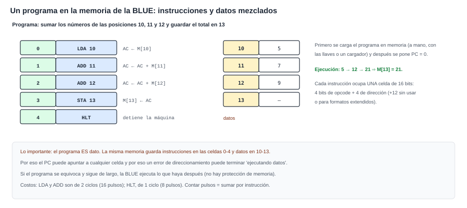
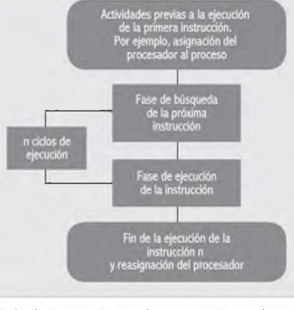

# 4.2.3 Programar en BLUE

> [!abstract] En una frase
> Programar la BLUE es **escribir una lista de instrucciones y datos en memoria**: las instrucciones se ejecutan en
> orden desde la dirección 0 y el `PC` las recorre. No hay variables: hay **direcciones**.

> [!note] Si la primera vez que ves esto
> Es como escribir una **receta para alguien muy obediente y muy literal**: "buscá el número de la dirección 10,
> sumale el de la 11, guardá el resultado en la 12, terminá". Nada de `for` ni `if`: los lazos y las decisiones se
> hacen con **saltos** (`JMA`, `SRJ`) y comparaciones.

## Un programa en memoria



## Los tres patrones que hay que saber

### 1) Suma de dos números (secuencia directa)
```
0000  06 0010   LDA 10        AC ← 5
0001  01 0011   ADD 11        AC ← AC + 3
0002  07 0012   STA 12        M[12] ← AC
0003  00 0000   HLT
0010  00 0005   dato 5
0011  00 0003   dato 3
0012  00 0000   resultado
```

### 2) Lazo sin índices (auto modificación)
La BLUE básica **no tiene registros índice**: para recorrer un arreglo hay que **cambiar la dirección de la
instrucción**. El truco clásico es mantener en memoria una instrucción y modificarla:
```
lazo: LDA 0, dir_dato     (carga el dato apuntado)
      ADD acumulador
      STA acumulador
      ... incrementar la dirección guardada ...
      JMA lazo
```
En la práctica, en el TP se hace con un contador y una condición de corte: **es la limitación que motiva la BLUE
indexada** (allí el lazo se escribe una vez y sólo se incrementa `RIF`).

### 3) Decisión (si … entonces)
```
      LDA dato
      AND mascara         (¿tiene el bit?)
      CSA                 (si el resultado es 0, salta la próxima)
      JMA  caso_si
      JMA  caso_no
```

## Las instrucciones que hacen "magia"
| Instrucción | Para qué se usa en un programa |
|---|---|
| **RAL** | rotar el `AC` a la izquierda: multiplicar por 2 y mover bits |
| **CSA** | limpiar el `AC` y saltar si quedó en 0 (comparación) |
| **SRJ** | llamar a una subrutina o saltar relativamente (corto) |
| **JMA / JMP** | ir a otra dirección de forma absoluta / indirecta (tablas de saltos) |
| **INP / OUT** | leer o escribir 8 bits de un dispositivo |

## Cómo se cuenta lo que tarda un programa
```
tiempo = (instrucciones de 1 ciclo × 1 µs) + (instrucciones de 2 ciclos × 2 µs)
```
Ejemplo: en el programa de la suma, `LDA` son **2** ciclos, `ADD` **2**, `STA` **2** y `HLT` **1** ⇒
`2 + 2 + 2 + 1 = 7` ⇒ **7 µs**. En un lazo de 100 vueltas se multiplica por las vueltas.

## Reglas de estilo del TP
1. **Reservar las direcciones de datos** después del código (por ejemplo desde 100).
2. Comentar **cada línea** con la microoperación (`AC ← AC + M[11]`).
3. Terminar siempre con `HLT` (si no, la máquina sigue leyendo memoria).
4. Verificar los valores finales a mano, instrucción por instrucción.

> [!tip] Lo que se evalúa
> No se evalúa la elegancia: se evalúa que el programa **termine**, que el resultado quede donde se pide y que se
> pueda **explicar qué hace cada instrucción**.

> [!warning] Errores típicos
> - Olvidar el `HLT` y "caer" en la zona de datos.
> - Confundir direcciones **decimales** con **octales** al codificar el campo.
> - Usar `STA` para leer o `LDA` para escribir.
> - Intentar indexar sin tocar la instrucción (la BLUE básica no lo permite).

> [!example] Un programa de 3 instrucciones
> Sumar `M[500] + M[501]` y guardar en `M[502]`: `LDA 500` (16 pulsos) · `ADD 501` (16 pulsos) · `STA 502`
> (16 pulsos) = **48 pulsos = 6 µs**. Un bucle de 10 repeticiones serían **60 µs**: por eso se cuenta en pulsos y
> no en "instrucciones".

## Figura del libro



*Fig. 8.2 — Ciclo de instrucción para las n instrucciones de un programa.* · Quiroga, *Arquitectura de computadoras*, p. 213.

> [!tip] Qué mirar
> Un programa es una cadena de ciclos de instrucción: búsqueda, ejecución y paso a la siguiente. Programar en BLUE es ordenar esas instrucciones y tener en cuenta cuántos pulsos cuesta cada una.

## Relacionado
[[4.2.2 Los 16 opcodes octales]] · [[4.2.1 Especificación, registros y 4096x16]] · [[Programar en BLUE — ejemplos]] ·
[[BLUE indexada (RIF, RID, nuevo formato)]] · [[TP16 Ciclo de instrucción básico]] · [[Glosario — Unidad 4]]
