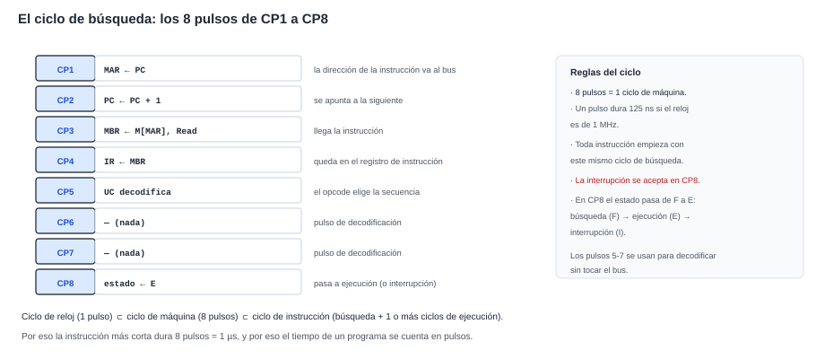

# 4.3.2 Búsqueda: los 8 pulsos

> [!abstract] En una frase
> La **búsqueda** (*fetch*) es la secuencia de **8 pulsos** que trae la instrucción de la memoria al `IR` y deja el
> `PC` apuntando a la siguiente. Es **igual para todas las instrucciones** y se hace siempre.

> [!note] Si la primera vez que ves esto
> Es el momento en que la máquina "**va a leer el renglón siguiente**" de la receta. Como el bus es único, hay que
> hacerlo por partes: primero decir **a qué dirección** ir (CP1), después **actualizar el marcador** para la próxima
> (CP2-CP4), después **recibir** el dato (CP5), después **guardarlo** en el registro de instrucción (CP6), y al
> final **decidir** si se pasa a ejecutar (CP8).

## Los 8 pulsos de la búsqueda



## La tabla de la búsqueda (la que se dibuja en el pizarrón)

| Pulso | Microoperación | Nombre de la señal | Para qué |
|---|---|---|---|
| **CP1** | `MAR ← PC` + **Read** | `PC_out`, `MAR_in`, `Read` | decir a qué dirección se accede |
| **CP2** | `PC + 1 → Y` | `PC_out`, `Y_in` | el PC entra a la ALU por Y |
| **CP3** | `Y + 1 → Z` (ALU) | `ALU: suma`, `Z_in` | se calcula el incremento |
| **CP4** | `Z → PC` | `Z_out`, `PC_in` | el PC ya apunta a la siguiente |
| **CP5** | `MBR ← M[MAR]` (*strobe*) | `MBR_in`, `strobe` | llega la palabra de memoria |
| **CP6** | `MBR → IR` | `MBR_out`, `IR_in` | la instrucción va al registro |
| **CP7** | (E/S) `TRA ← 1` si es `INP`/`OUT` | `TRA_in` | prepara la transferencia |
| **CP8** | `STATE ← 1` si la instrucción lo pide · o `E → STATE` | `STATE_in` | pasa a ejecución (o queda en búsqueda) |

> [!important] Por qué son **dos** pulsos para el `PC + 1`
> Porque hay **un solo bus**: el PC no puede, en el mismo pulso, salir al bus (para ir a `MAR`) y a la vez entrar a
> la ALU. Por eso va **primero** a `MAR` (CP1) y **después** a `Y` (CP2). Es el ejemplo canónico de la regla
> "una transferencia por pulso".

## Y el pulso 8, ¿para qué está?
En la memoria de **ferrita** original, **leer destruye el dato**: había que **reescribirlo**. El 8.º pulso es
justamente esa **reescritura**. De ahí que la búsqueda "real" parezca de 7 pulsos y el ciclo sea de **8**:

```
7 pulsos de operación  +  1 pulso de reescritura  =  8 pulsos = 1 µs
```

## Qué queda al terminar la búsqueda
| Registro | Contenido |
|---|---|
| `IR` | la instrucción (opcode de 4 bits + dirección de 12) |
| `PC` | la dirección de la **siguiente** instrucción |
| `MBR` | la palabra que se trajo (la instrucción) |
| `STATE` | 0 (sigue en búsqueda) o 1 (pasa a ejecutar) |

Con el `IR` cargado, la UC ya puede **decodificar**: el decodificador 1→16 activa la línea de la instrucción
([[4.4.2 estado·pulso·instrucción y el decodificador 1-16]]).

> [!warning] Errores típicos
> - Poner `PC ← PC + 1` en el mismo pulso que `MAR ← PC` (viola la regla del bus único).
> - Confundir `MBR ← M[MAR]` (lectura, CP5) con `M[MAR] ← MBR` (escritura, que es de `STA`).
> - Decir que la búsqueda cambia según la instrucción: **es siempre la misma**.

## Relacionado
[[4.3.3 Ejecución instrucción por instrucción]] · [[4.3.1 Ciclo de reloj, de máquina y de instrucción]] ·
[[Ciclo de búsqueda (7 y 8 pulsos)]] · [[Ciclo de ejecución — todas las operaciones]] · [[Ciclo de máquina]]
