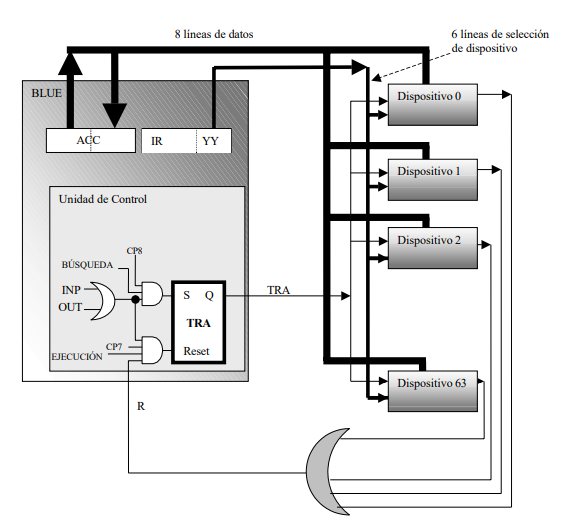
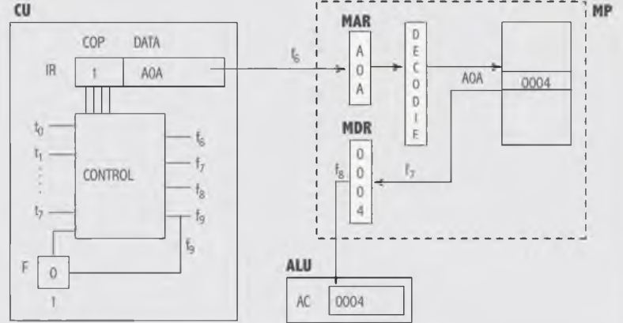
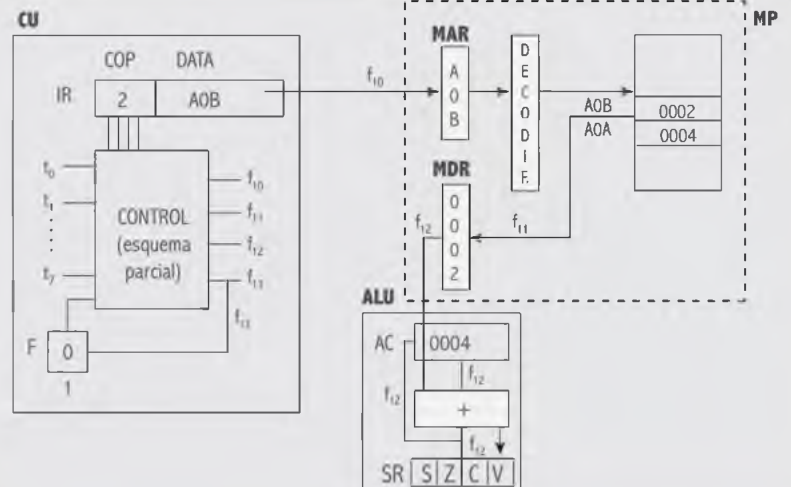

# 4.3.3 Ejecución instrucción por instrucción

> [!abstract] En una frase
> La **ejecución** es la parte que cambia: **8 instrucciones** la resuelven **dentro** del ciclo de búsqueda (no cambian `STATE`), **6** piden un **ciclo de ejecución completo** porque van a buscar un operando a memoria (ADD, XOR, AND, IOR, LDA, STA) y **2** (INP, OUT) esperan al periférico.

> [!note] Si la primera vez que ves esto
> Pensá en el **CP8 de la búsqueda como una bifurcación**: "¿esta instrucción necesita algo más de la memoria?" Si la respuesta es **no** (un salto, un `HLT`, un `NOT`), la máquina termina ahí y vuelve a buscar. Si es **sí**, pone `STATE = 1` y hace **otra vuelta de 8 pulsos** dedicada a traer ese dato.

## La instrucción, pulso por pulso

## Grupo A — las 8 que caben en el ciclo de búsqueda (1 ciclo)

| Instrucción | Qué hace al final | Dónde |
|---|---|---|
| **HLT** (00) | `RUN ← 0` | CP8 |
| **NOP** (17) | nada | — |
| **JMA** (11) | `PC ← IR(dir)` (salto absoluto) | CP8 |
| **JMP** (12) | salto indirecto (la dirección está en memoria) | CP8 |
| **SRJ** (10) | guarda el retorno en el `AC` y salta | CP7-CP8 |
| **CSA** (16) | copia las llaves al `AC` | CP8 |
| **NOT** (05) | `AC → Z` en CP7 y `Z' → AC` en CP8 | CP7-CP8 |
| **RAL** (15) | `AC → Z` y `2·Z → AC` (rotación) | CP7-CP8 |

> [!note] Por qué NOT y RAL usan el par Z → A
> La ALU **sólo** trabaja con las entradas `Y` y `Z`. Entonces el dato tiene que pasar del acumulador a `Z` (CP7), la ALU calcula (`Z'` o `2·Z`) y en CP8 el resultado vuelve al `AC`. Es el mismo truco del `PC + 1`.

## Grupo B — las 6 que necesitan un ciclo de ejecución (2 ciclos, 16 pulsos)

Todas terminan la **búsqueda** con `CP8: E → STATE` y después ejecutan:

### LDA — cargar el acumulador

| Fase | CP1 | CP2 | CP3 | CP4 | CP5 | CP6 | CP7 | CP8 |
|---|---|---|---|---|---|---|---|---|
| Búsqueda | PC→MAR, lectura | +1→Y | — | SUMA→PC | Strobe MBR | MBR→IR | — | **E→STATE** |
| Ejecución | **IR→MAR**, lectura | — | — | — | Strobe MBR | **MBR→A** | — | **F→STATE** |

### STA — almacenar el acumulador

| Fase | CP1 | CP2 | CP3 | CP4 | CP5 | CP6 | CP7 | CP8 |
|---|---|---|---|---|---|---|---|---|
| Búsqueda | PC→MAR, lectura | +1→Y | — | SUMA→PC | Strobe MBR | MBR→IR | — | **E→STATE** |
| Ejecución | **IR→MAR** | — | — | **A→MBR**, **escritura** | — | — | — | **F→STATE** |

### ADD / XOR / AND / IOR — las cuatro aritmético-lógicas

| Fase | CP1 | CP2 | CP3 | CP4 | CP5 | CP6 | CP7 | CP8 |
|---|---|---|---|---|---|---|---|---|
| Búsqueda | PC→MAR, lectura | +1→Y | — | SUMA→PC | Strobe MBR | MBR→IR | — | **E→STATE** |
| Ejecución | **IR→MAR**, lectura | **A→Z** | — | — | Strobe MBR | **MBR→Y** | — | **SUMA/XOR/AND/OR → A**, `F→STATE` |

> [!important] La lógica de las cuatro (la que se valora)
> En **CP2** el acumulador va a `Z`; en **CP6** el dato de memoria va a `Y`. La ALU queda con los **dos operandos** y en **CP8** hace la operación: el resultado cae en el `AC`. **La única diferencia entre ADD, XOR, AND e IOR es qué salida de la ALU se habilita en CP8.**

## Grupo C — las 2 de entrada/salida (16 pulsos o más)
Usan **`TRA`** (transferencia en curso) y la señal **`R`** (periférico listo):

| Fase | CP7 | CP8 |
|---|---|---|
| Búsqueda | **TRA ← 1** (se manda el número de dispositivo por las líneas de selección) | **E → STATE** |
| Ejecución | si **R = 1** → copiar el dato (`INP`: líneas de entrada → `AC`) y **TRA ← 0** | si `TRA = 0` → **F → STATE**; si no, **se repite el ciclo** |

- `INP` (13): los **8 bits bajos** del `AC` ← dato del dispositivo; los altos, en 0.

- `OUT` (14): los **8 bits altos** del `AC` → dispositivo.

- Si el periférico no está listo, **se repite** el ciclo: 16, 24, 32… pulsos. Ése es el defecto de la E/S por consulta y la razón de ser de las **interrupciones**.

## Resumen en una tabla

| Instrucción | Ciclos | Pulsos | ¿Cambia STATE? |
|---|---|---|---|
| HLT, NOP, JMA, JMP, SRJ, CSA, NOT, RAL | 1 | 8 | **no** |
| ADD, XOR, AND, IOR, LDA, STA | 2 | 16 | sí (`E→STATE` y después `F→STATE`) |
| INP, OUT | 2+n | 16+ | sí, y puede repetirse |

> [!warning] Errores típicos
> - Decir que `ADD` es de un ciclo (es de **dos**: necesita traer el operando).
> - Poner el resultado de la ALU en el `MBR` (va al `AC`).
> - Olvidar que en `STA` la **escritura** ocurre en el **CP4**, no en el CP5.
> - Contar 8 pulsos para `LDA` (son 16).

## Figura de clase

### La entrada/salida completa: 8 líneas de dato, 6 de selección y 64 dispositivos.

*Figura de clase — Resumen «Arquitectura final» (Said), p. 30.*

> [!tip] Qué mirar
> Lo que hay que poder dibujar de memoria: **8 líneas de datos** (un byte) y **6 líneas de selección** ⇒ `2⁶ =` **64 dispositivos**, numerados del `0` al **63**. La selección sale de `IR5..IR0` (por eso el dispositivo es un campo de la propia instrucción `INP`/`OUT`) y la unidad de control habilita la transferencia con **`TRA`**, un biestable que se pone al decodificar `INP`/`OUT` y se borra con `R` cuando el dispositivo terminó. Fijate que los periféricos se conectan al **bus de datos**, no a los registros internos: entre ellos están los buffers.

## Figura del libro

*Fig. 7.13 — Fase execute LDA.* · Quiroga, *Arquitectura de computadoras*, p. 182.

*Fig. 7.14 — Fase execute ADA.* · Quiroga, *Arquitectura de computadoras*, p. 183.

## Ejemplo resuelto (contar los pulsos)
`ADD dir` en la BLUE, que necesita **2 ciclos** (búsqueda + ejecución):

| Pulsos | Qué hace |
|---|---|
| CP1-CP8 (búsqueda) | `PC → MAR`, `M[MAR] → MBR`, `MBR → IR`, `PC + 1`, decodifica |
| CP9-CP16 (ejecución) | `IR(dirección) → MAR`, `M[MAR] → MBR`, `AC ← AC + MBR` |

Total **16 pulsos = 2 µs**. Una instrucción de 1 ciclo (como `NOT`) son **8 pulsos = 1 µs**. La cuenta `pulsos × 125 ns` es lo primero que se pregunta.

## Relacionado
[[4.3.2 Búsqueda, los 8 pulsos]] · [[4.4.1 Funciones y señales de control]] · [[Las 16 instrucciones de BLUE — ciclo completo pulso por pulso]] · [[Ciclo de ejecución — todas las operaciones]] · [[Interrupciones y entrada-salida]] · [[Glosario — Unidad 4]]
