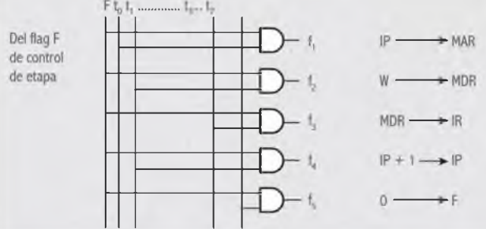
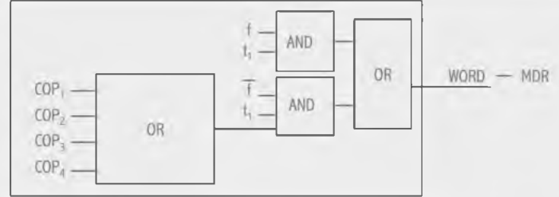

# 4.4.1 Funciones y señales de control

> [!abstract] En una frase
> La Unidad de Control **secuencia** (búsqueda/ejecución), **decodifica** la instrucción, **emite las señales** que abren y cierran las compuertas del bus, y **atiende** las excepciones (halt, reset, interrupciones).

> [!note] Si la primera vez que ves esto
> Es el **director de orquesta**: no toca ningún instrumento (no suma, no guarda), pero dice **quién entra y cuándo**. Cada músico es una compuerta del bus; la partitura son las señales; el compás es el pulso del reloj.

## La UC y sus señales

## Las cuatro funciones

| Función | Qué hace | Con qué |
|---|---|---|
| **1. Secuenciar** | decidir búsqueda o ejecución, y qué pulso toca | los FF `STATE`, `RUN`, `TRA` y el contador de pulsos |
| **2. Decodificar** | saber qué instrucción es | decodificador 1→16 sobre el opcode del `IR` |
| **3. Generar señales** | abrir/cerrar compuertas del bus y de la ALU | compuertas AND y OR |
| **4. Controlar excepciones** | halt, reset, interrupciones | `RUN`, `SI`, `EMR` |

## Las señales (el vocabulario)

| Señal | Qué hace |
|---|---|
| `PC_out` / `PC_in` | habilita el PC a salir al bus / a cargarse |
| `MAR_in` | carga el MAR desde el bus |
| `Read` / `Write` | orden de lectura / escritura a memoria |
| `MBR_in` / `MBR_out` | carga el MBR / lo pone en el bus |
| `IR_in`, `AC_in`, `Z_in`, `Y_in` | cargan cada registro |
| `ALU_op` | qué operación hace la ALU (suma, XOR, AND, OR, NOT, 2·Z…) |
| `STATE_in`, `RUN_in`, `TRA_in` | cambian el estado de la máquina |

> [!important] Cada señal es un **AND** de tres cosas
> `PC_out` en el CP1 de la búsqueda no es una señal suelta: es `STATE' · CP1` (**estado** de búsqueda **y** pulso 1). Si además depende de la instrucción, se agrega el término del decodificador: `STATE · CP1 · LDA`.

## Quién es síncrono y quién asíncrono

- **Señales sincrónicas**: todas las de los pulsos (ocurren con el reloj).

- **Señales asíncronas**: `Reset` (borra todo en cualquier momento) y, en algunas máquinas, la carga del `PC` por interrupción.

- **El reloj**: `RUN` habilita el reloj; con `RUN = 0` (después de `HLT`) la máquina **se detiene** porque no llegan pulsos.

## Cómo se prueba que la UC está bien diseñada

1. **Para cada microoperación** de la tabla del ciclo, existe **una** señal que la habilita.

2. **Ningún pulso habilita dos fuentes** del mismo bus (no hay conflicto).

3. Toda instrucción **termina** en `F → STATE` o en `HLT` (no queda colgada).

> [!warning] Errores típicos
> - Decir que la UC **ejecuta** las operaciones: las ejecuta la ALU; la UC **ordena**.
> - Olvidar que la UC también decide **cuándo no hacer nada** (los CP sin microoperación).
> - Confundir el decodificador de instrucción (1→16) con el de memoria (n→2ⁿ).

## Figura del libro

*Fig. 7.11 — Estructura de una parte del módulo de control para la fase fetch.* · Quiroga, *Arquitectura de computadoras*, p. 179.

*Fig. 7.21 — Diseño parcial del control para la orden de lectura de la memoria.* · Quiroga, *Arquitectura de computadoras*, p. 193.

## Ejemplo resuelto (señales de una instrucción)
Para `LDA dir` (cargar al acumulador), las señales de control por pulso son:

| Pulso | Señal | Efecto |
|---|---|---|
| CP2 | `PCout`, `MARin` | la dirección de la instrucción va al `MAR` |
| CP4 | `MEMout`, `MBRin` | se lee la palabra de memoria |
| CP6 | `MBRout`, `IRin` | la instrucción queda en el `IR` |
| CP10 | `IRout`, `MARin` | la dirección del operando va al `MAR` |
| CP12 | `MEMout`, `MBRin` | se lee el operando |
| CP14 | `MBRout`, `ACin` | el operando queda en el acumulador |

Cada fila son **dos** señales: nunca una sola, porque siempre hay **origen y destino**.

## Relacionado
[[4.4.2 estado·pulso·instrucción y el decodificador 1-16]] · [[4.3.2 Búsqueda, los 8 pulsos]] · [[Cómo se implementa la Unidad de Control]] · [[Unidad de Control]] · [[Unidad de control cableada y microprogramada]] · [[Glosario — Unidad 4]]
