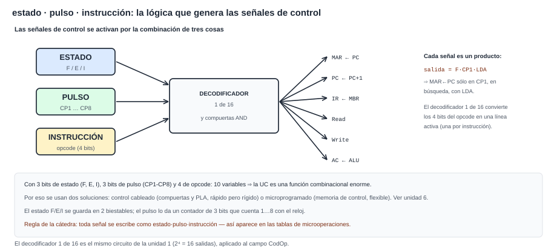
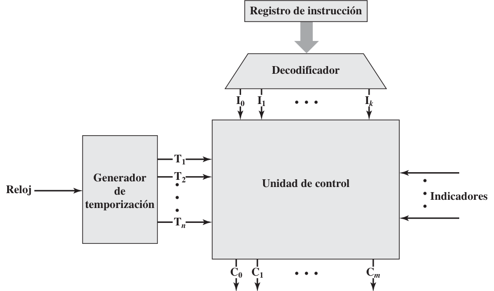

# 4.4.2 estado·pulso·instrucción y el decodificador 1-16

> [!abstract] En una frase
> Toda señal de control de la BLUE se escribe como **`señal = estado · pulso · instrucción`**: el estado dice *en
> qué fase* estamos, el pulso dice *en qué instante*, la instrucción dice *para quién*. El **decodificador 1→16**
> convierte los 4 bits del opcode en **una línea activa** por instrucción.

> [!note] Si la primera vez que ves esto
> Es un **semáforo con tres condiciones**: la luz verde sólo se prende si es de día (estado), si toca el minuto 8
> (pulso) y si el que espera es un auto (instrucción). Las tres cosas a la vez: eso es un **AND** de tres entradas.

## estado · pulso · instrucción



## El decodificador de instrucción

```
        IR (bits 15..12) = opcode de 4 bits
                    │
              ┌─────▼─────┐
              │  1 → 16   │   (4 NOT + 16 AND de 4 entradas)
              └─────┬─────┘
     ┌───────┬──────┴──────┬────────┐
    L_HLT  L_ADD   …      L_IOR   L_NOP      ← una sola activa
```

| Salida | Se activa con | Ejemplo |
|---|---|---|
| `L_HLT` | `opcode = 0000` | `IR15..12 = 0000` |
| `L_ADD` | `opcode = 0001` | `IR15..12 = 0001` |
| … | … | … |
| `L_NOP` | `opcode = 1111` | `IR15..12 = 1111` |

**Costo:** 4 inversores y **16 compuertas AND de 4 entradas** (una por instrucción). Es el mismo circuito que un
decodificador de memoria: `Yi = mi` ([[1.4.1 Decodificador]]).

## La fórmula de la señal

```
señal = (estado) · (pulso) · (línea de instrucción)
```

Ejemplos reales de la BLUE:

| Señal | Expresión | Qué habilita |
|---|---|---|
| `MBR_in` (strobe) en búsqueda | `F · CP5` | cargar el MBR desde memoria |
| `IR_in` | `F · CP6` | pasar el MBR al IR |
| `E → STATE` (pasar a ejecutar) | `F · CP8 · (ADD + XOR + AND + IOR + LDA + STA + INP + OUT)` | ejecución de las de 2 ciclos |
| `A → Z` (aritméticas) | `E · CP2 · (ADD + XOR + AND + IOR)` | primer operando a la ALU |
| `MBR → Y` | `E · CP6 · (ADD + XOR + AND + IOR)` | segundo operando a la ALU |
| `ALU → A` (la suma) | `E · CP8 · ADD` | guardar el resultado |
| `MBR → A` (cargar) | `E · CP6 · LDA` | `LDA` |
| `A → MBR` + `Write` (guardar) | `E · CP4 · STA` | `STA` |
| `IR → MAR` | `E · CP1 · (ADD + XOR + AND + IOR + LDA + STA)` | dirección del operando al MAR |

> [!important] Y las OR
> Las señales que producen **el mismo efecto** se juntan: `MBR_in` puede ser `F·CP5` **o** `E·CP5·(las de 2 ciclos)`.
> Entonces:
> ```
> MBR_in = F·CP5 + E·CP5·(ADD + XOR + AND + IOR + LDA + STA)
> ```
> **Los AND «eligen», las OR «juntan».** Con esas dos reglas se dibuja cualquier UC cableada.

## Cómo se implementa (los dos caminos)
| | **Cableada** | **Microprogramada** |
|---|---|---|
| Cómo | compuertas AND/OR + decodificador | una **ROM** con una palabra de control por pulso |
| Velocidad | más rápida | más lenta (leer la ROM) |
| Cambios | recablear | reprogramar la ROM |
| Se usa en | **BLUE**, RISC | CISC, 8088 |

La BLUE usa cableada: son pocas instrucciones y siempre las mismas.

> [!warning] Errores típicos
> - Poner `·` cuando corresponde `+` (o al revés) al juntar señales.
> - Olvidar el término de la instrucción y activar una señal en todas las instrucciones.
> - Usar el pulso **sin** el estado: `CP8` existe en búsqueda **y** en ejecución; hay que decir cuál.
> - Decir que el decodificador 1→16 simplifica: son 16 AND sin simplificar.

## Figura del libro



*Fig. 16.10 — Unidad de control con entradas decodificadas.* · Stallings, *Organización y arquitectura de computadores*, 7ª ed., p. 642.

## Relacionado
[[4.4.1 Funciones y señales de control]] · [[4.3.3 Ejecución instrucción por instrucción]] ·
[[Cómo se implementa la Unidad de Control]] · [[Unidad de control cableada y microprogramada]] · [[1.4.1 Decodificador]]
