# Unidad 5 — Programación básica y CPU convencional

> [!abstract] Qué es este archivo
> **La Unidad 5 completa en un solo archivo**: los **13 subtemas** pegados uno detrás de otro,
> con todo su contenido: definiciones, tablas, diagramas, ejemplos resueltos, figuras del libro y errores
> típicos. Son **9.342 palabras** y **6 temas**. Está pensado para **leer de corrido** y para
> **imprimir**: no hace falta abrir ninguna otra nota.
>
> - **Repaso rápido** (una página): [[00 Síntesis — Unidad 5]].
> - **Buscar un punto**: el índice de abajo o el de la unidad, [[00 Unidad 5 — temas y subtemas]].
> - Cada subtema conserva su número (`1.4.1`), así coincide con el índice y con las preguntas del final.
> - **Todo junto, las 10 unidades**: [[00 Materia completa (las 10 unidades en un archivo)]].

## Contenido

**5.1 Lenguaje máquina**
- [[#5.1.1 Instrucción, opcode y operandos]]
- [[#5.1.2 Clasificación de las instrucciones]]
- [[#5.1.3 Registros de la CPU]]

**5.2 Formato de la instrucción**
- [[#5.2.1 Los 4 formatos y el campo único de dirección]]
- [[#5.2.2 Cálculo de CodOp según el tamaño de memoria]]

**5.3 Modos de direccionamiento**
- [[#5.3.1 Los 7 modos]]
- [[#5.3.2 Dirección efectiva y costo en accesos]]

**5.4 La BLUE indexada**
- [[#5.4.1 RIF, RID y RB]]
- [[#5.4.2 Modificador de 2 bits y los 24 pulsos]]

**5.5 Interrupciones**
- [[#5.5.1 IRQ, SI y CP8]]
- [[#5.5.2 Máscara, pila y RTI]]

**5.6 El 8086**
- [[#5.6.1 BIU, EU y segmentación]]
- [[#5.6.2 La pila y el registro SP]]

---

## 5.1 Lenguaje máquina

### 5.1.1 Instrucción, opcode y operandos

> [!abstract] En una frase
> Una instrucción tiene **dos partes**: el **código de operación** (qué hay que hacer) y los **operandos** (con qué
> datos). El opcode es un número que la UC **decodifica**; los operandos son **direcciones, registros o valores**.

> [!note] Si la primera vez que ves esto
> Es una **orden de trabajo** en un taller: "atornillar (qué) la pieza A con el tornillo B (con qué)". La orden se
> repite siempre igual (un número: el opcode); lo que cambia es sobre qué la aplicás (los operandos).

#### Los campos de la instrucción

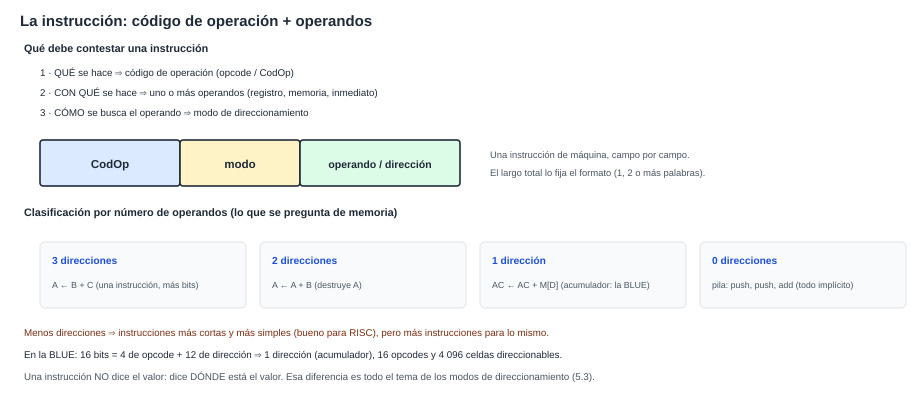

#### Las partes

```
┌──────────────┬───────────────┬───────────────┬───────────────┐
│  opcode      │  operando 1   │  operando 2   │  operando 3   │
│ (qué hacer)  │   (destino)   │  (fuente 1)   │  (fuente 2)   │
└──────────────┴───────────────┴───────────────┴───────────────┘
```

| Parte | Qué indica | Ejemplo |
|---|---|---|
| **opcode** | la operación | `ADD` = sumar |
| **operando destino** | dónde queda el resultado | `AC`, `R1`, `M[100]` |
| **operando fuente** | de dónde sale el dato | `AC`, `M[100]`, el campo `5` |

#### Operandos implícitos vs explícitos
- **Explícito**: está escrito en la instrucción (`ADD 100` → dirección 100).
- **Implícito**: está **sobreentendido** por el hardware. En la BLUE, `ADD 100` significa `AC ← AC + M[100]`: el
  `AC` (destino y primera fuente) **no aparece** en la instrucción. Eso es la **arquitectura de acumulador**.

> [!important] La consecuencia
> Con acumulador, la instrucción es **más corta** (todo el campo se usa para una dirección) pero el programa tiene
> **más instrucciones** (cada resultado hay que guardarlo antes de la próxima operación). Con registros (RISC), la
> instrucción es más larga y el programa más corto.

#### Cuántos operandos puede haber
| Nº de operandos | Ejemplo | Máquina típica |
|---|---|---|
| **0** | `HLT`, `NOP`, `RET` | implícito total |
| **1** | `ADD 100` (BLUE) | acumulador |
| **2** | `ADD R1, R2` | CISC (8086) |
| **3** | `ADD R1, R2, R3` | RISC (MIPS, ARM) |

#### La instrucción de la BLUE
```
15      12 11                              0
┌──────────┬────────────────────────────────┐
│ opcode 4 │  dirección / YY (12 bits)      │
└──────────┴────────────────────────────────┘
```
- 4 bits de opcode ⇒ **16 instrucciones**.
- 12 bits ⇒ **4096 direcciones**.
- **1 operando explícito**; el otro es el `AC` (implícito).

> [!warning] Errores típicos
> - Decir que la dirección de la instrucción **es** el operando: es **dónde está** el operando (o el valor, en
>   modo inmediato).
> - Olvidar los operandos **implícitos** al contar cuántos operandos tiene la máquina.
> - Confundir **opcode** (qué) con **código de instrucción completo** (opcode + operandos).

#### Figura del libro

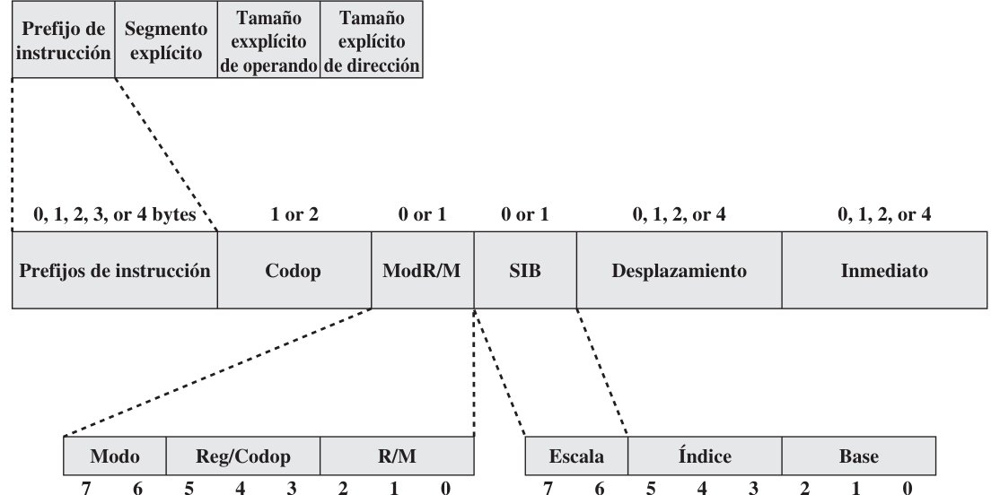

*Fig. 11.8 — Formato de instrucciones del Pentium.* · Stallings, *Organización y arquitectura de computadores*, 7ª ed., p. 451.

> [!example] Desarmar una instrucción
> `LDA 500` en la BLUE: `opcode = 06` (4 bits: `0110`) y `dirección = 500` (12 bits: `0001 1111 0100`) ⇒
> `0110 0001 1111 0100`. Tres cosas en 16 bits: **qué** hacer (opcode), **con qué** (operando) y **dónde** está
> (campo de dirección). Si la instrucción no lleva dirección (como `NOT`), se desperdician 12 bits: de eso trata
> el tema de formatos.

#### Relacionado
[[5.1.2 Clasificación de las instrucciones]] · [[5.2.1 Los 4 formatos y el campo único de dirección]] ·
[[4.2.2 Los 16 opcodes octales]] · [[Lenguaje máquina y clasificación de instrucciones]] · [[Glosario — Unidad 5]]

### 5.1.2 Clasificación de las instrucciones

> [!abstract] En una frase
> Las instrucciones se agrupan en **cinco familias**: **transferencia de datos**, **aritméticas**, **lógicas**,
> **de control** (saltos) y **de entrada/salida**; a las que se suman las de **desplazamiento/rotación** y las de
> **control del sistema** (halt, reset).

> [!note] Si la primera vez que ves esto
> Es como clasificar los verbos de un idioma: los que **mueven** cosas (poner, traer), los que **calculan** (sumar),
> los que **deciden** (si… saltar) y los que **hablan con afuera** (leer, escribir). Con esas cuatro ideas se
> entiende cualquier repertorio, del de la BLUE al de un Ryzen.

#### Los grupos del repertorio

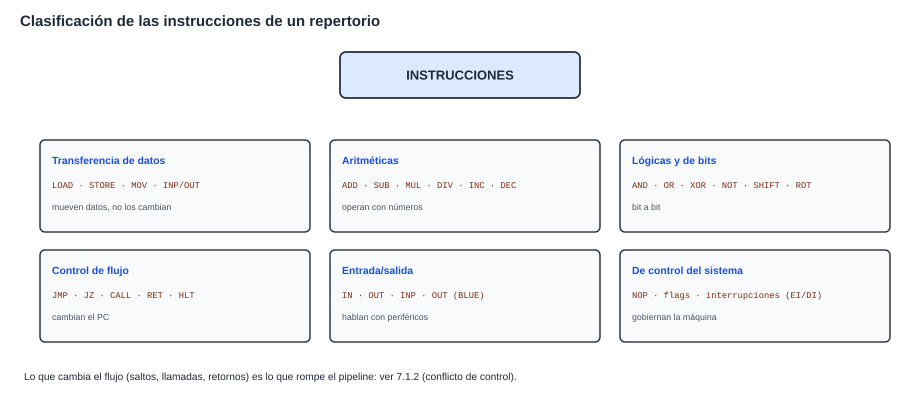

#### Las familias

| Familia | Qué hace | BLUE | 8086 |
|---|---|---|---|
| **Transferencia de datos** | mover datos entre registros y memoria | `LDA`, `STA` | `MOV`, `PUSH`, `POP`, `XCHG` |
| **Aritméticas** | cuentas | `ADD` | `ADD`, `SUB`, `INC`, `DEC`, `MUL`, `DIV` |
| **Lógicas** | operaciones bit a bit | `AND`, `IOR`, `XOR`, `NOT` | `AND`, `OR`, `XOR`, `NOT`, `TEST` |
| **De control (salto)** | romper la secuencia | `JMA`, `JMP`, `SRJ`, `HLT` | `JMP`, `JZ`, `JNZ`, `CALL`, `RET` |
| **Entrada / salida** | hablar con periféricos | `INP`, `OUT` | `IN`, `OUT` |
| **Desplazamiento / rotación** | mover bits | `RAL` | `SHL`, `SHR`, `ROL`, `ROR` |
| **Control del sistema** | estado de la máquina | `HLT`, `NOP`, `CSA` | `HLT`, `NOP`, `INT`, `IRET` |

#### Cómo se reconocen (sin tabla)
- **Mueve** algo de un lado a otro sin transformarlo ⇒ transferencia.
- **Cambia el valor** con una cuenta ⇒ aritmética.
- **Combina bit a bit** ⇒ lógica.
- **Cambia el `PC`** (o lo condiciona) ⇒ control.
- **Toca las líneas de E/S** (o espera `R`) ⇒ entrada/salida.

> [!important] Las condicionales
> Un salto puede ser **incondicional** (`JMA`, `JMP`) o **condicional**: en la BLUE se arman combinando `CSA` (que
> deja el resultado en el `AC` y salta si es 0) con un `JMA`; en el 8086 existen `JZ`, `JNZ`, `JC`, `JNC`… que miran
> los **flags**. La diferencia es que el 8086 tiene el registro de estado y la BLUE no.

#### Clasificación por otra cosa (lo que se pregunta de costado)
| Criterio | Tipos | Ejemplo |
|---|---|---|
| **Nº de operandos** | 0, 1, 2, 3 | `HLT` (0), `ADD 100` (1, BLUE), `ADD R1,R2` (2, 8086) |
| **Longitud** | fija / variable | BLUE: fija (1 palabra) · 8086: variable (1 a 6 bytes) |
| **Qué modifican** | datos / control / estado | `ADD` / `JMA` / `HLT` |
| **Si acceden a memoria** | sí / no | `LDA` / `ADD R1, R2` |

#### Ejemplo: el mismo programa en las cinco familias
```
LDA 10        transferencia   (traer el dato)
ADD 11        aritmética      (sumarlo)
AND mascara   lógica          (limpiar unos bits)
CSA           control         (si es 0, salta)
HLT           control sistema (terminar)
```
Y `INP`/`OUT` si el dato viniera del teclado o fuera a una pantalla.

> [!warning] Errores típicos
> - Meter `NOT` y `RAL` en "aritméticas": son **lógicas** y de **desplazamiento** respectivamente.
> - Decir que `HLT` es un salto (no: apaga la máquina).
> - Olvidar la familia de **E/S** en la clasificación (es una de las cinco clásicas).
> - Confundir `CSA` de la BLUE con un salto condicional del 8086.

#### Figura del libro

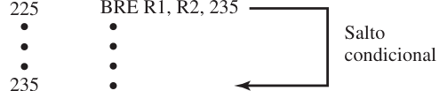

*Fig. 10.6 — Instrucciones de bifurcación (salto relativo `BRR`).* · Stallings, *Organización y arquitectura de computadores*, 7ª ed., p. 394.

> [!tip] Qué mirar
> `BRR` salta a una dirección **relativa**: es la instrucción de control de flujo típica, la que cambia el `PC` en vez de usarlo para buscar la siguiente. Las de transferencia, aritméticas y lógicas no tocan el `PC`.

#### Relacionado
[[5.1.1 Instrucción, opcode y operandos]] · [[5.1.3 Registros de la CPU]] · [[4.2.2 Los 16 opcodes octales]] ·
[[Lenguaje máquina y clasificación de instrucciones]] · [[CISC y RISC]] · [[Glosario — Unidad 5]]

### 5.1.3 Registros de la CPU

> [!abstract] En una frase
> Una CPU convencional (8086) tiene **14 registros de 16 bits** en cuatro grupos: **propósito general** (AX, BX, CX,
> DX), **punteros** (SP, BP), **índices** (SI, DI), **segmento** (CS, DS, SS, ES) más **IP** y **flags**. La BLUE,
> en cambio, tiene sólo **cinco** y un acumulador.

> [!note] Si la primera vez que ves esto
> Son las **manos** de la CPU: pocas y rapidísimas. Todo lo demás (memoria) es la mochila: grande y lenta. Cuantos
> más registros, menos viajes a la mochila; por eso los procesadores modernos tienen decenas.

#### Los registros, en su lugar


#### Los 14 del 8086

| Grupo | Registros | Para qué |
|---|---|---|
| **Propósito general** | `AX`, `BX`, `CX`, `DX` | datos; cada uno con uso "preferido" (acumulador, base, contador, dato) |
| **Punteros** | `SP`, `BP` | tope de la pila / base del marco de pila |
| **Índices** | `SI`, `DI` | origen y destino en copias de arreglos |
| **Segmento** | `CS`, `DS`, `SS`, `ES` | base de código, datos, pila y extra (para los 20 bits) |
| **Instrucción** | `IP` | desplazamiento de la próxima instrucción |
| **Estado** | `FLAGS` | `Z, C, S, O, P, I, D` |

**Los cuatro de propósito general se pueden partir en dos mitades de 8 bits**: `AX` = `AH` + `AL`. Por eso el 8086
es "de 16 bits con acceso a byte".

#### Comparación: BLUE vs 8086 vs RISC
| | **BLUE** | **8086** | **RISC (MIPS)** |
|---|---|---|---|
| Cantidad | 5 + estado | **14** | ~32 |
| Ancho | 12/16 | 16 | 32/64 |
| Acumulador | `AC` (todo pasa por él) | `AX` (preferido, no único) | ninguno |
| Índices | RIF/RID sólo en la **indexada** | `SI`, `DI` + `BX`, `BP` | cualquier registro |
| Segmentos | no | **sí** (4 × 64 KB) | no (espacio plano) |

#### Para qué sirve cada uno en la práctica
- **`AX`**: acumulador de facto; las multiplicaciones y las E/S lo usan.
- **`BX`**: puntero base para estructuras y arreglos.
- **`CX`**: contador de lazos (las instrucciones de repetición lo usan).
- **`DX`**: datos auxiliares; parte alta en multiplicaciones y en E/S.
- **`SP`**: **siempre** apunta al tope de la pila (crece hacia abajo); lo tocan `PUSH`, `POP`, `CALL`, `RET` e
  interrupciones.
- **`BP`**: base del marco de pila de la función actual (variables locales).
- **`SI`/`DI`**: recorrer arreglos (origen/destino en `MOVS`).
- **`CS:IP`**: la instrucción que se ejecuta; **`SS:SP`**, la pila; **`DS`**, los datos.

> [!important] La diferencia conceptual con la BLUE
> En la BLUE **todo** pasa por el `AC` (una sola "mano"). En el 8086 hay **muchas manos**, y por eso puede hacer
> `ADD BX, [SI]` sin tocar el acumulador. Ese es el primer paso hacia RISC.

> [!warning] Errores típicos
> - Decir que los 14 son de propósito general (son 4 grupos distintos).
> - Confundir `SP` (tope de pila) con `BP` (base del marco).
> - Olvidar que `IP` **no se modifica directamente** (lo cambian los saltos).
> - Decir que el 8086 tiene registros de 32 bits (son **16**).

#### Figura del libro

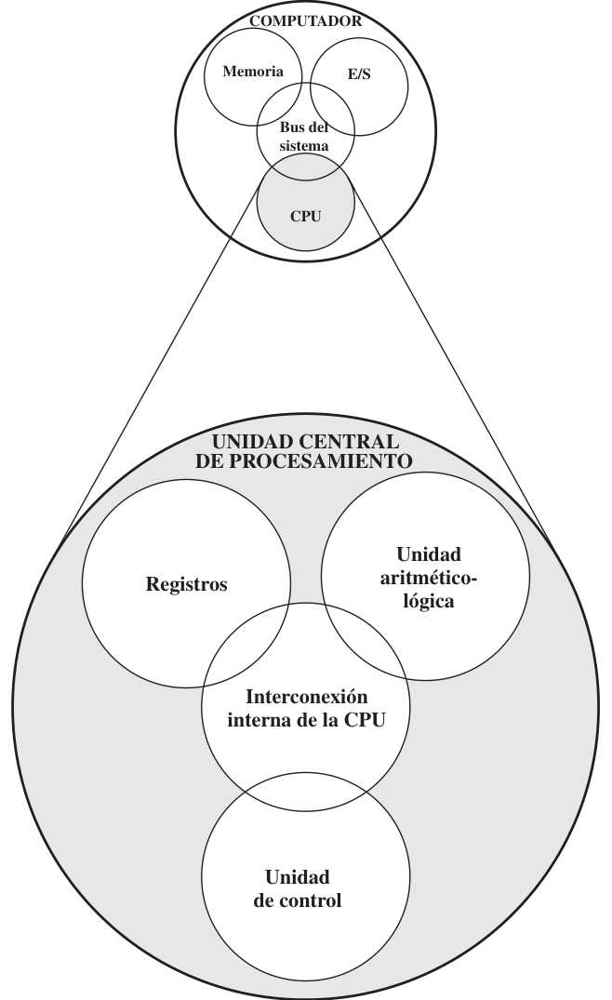

*Fig. 1.5 — La unidad central de procesamiento (CPU).* · Stallings, *Organización y arquitectura de computadores*, 7ª ed., p. 36.

#### Ejemplo resuelto (el viaje de un dato)
`PC = 200` y en `M[200]` está `LDA 500`:
1. `PC → MAR` (200) · `PC + 1` ⇒ `PC = 201`.
2. `M[200] → MBR` → `IR` (el opcode y la dirección 500 quedan en el `IR`).
3. `500 → MAR` → `M[500] → MBR` → `AC`.
Al final: `AC = M[500]`, `MAR = 500`, `MBR` = el dato, `IR` = la instrucción, `PC = 201`. **Cada registro con un
valor distinto y todos explicables**: eso es lo que se pide dibujar.

#### Relacionado
[[3.3.1 AC, PC, IR, MAR y MBR]] · [[3.3.2 Base, índice, puntero de pila y estado]] · [[5.6.1 BIU, EU y segmentación]] ·
[[Registros de la CPU]] · [[Registros base e índice]] · [[Glosario — Unidad 5]]

## 5.2 Formato de la instrucción

### 5.2.1 Los 4 formatos y el campo único de dirección

> [!abstract] En una frase
> Hay cuatro formatos de instrucción según **cuántas direcciones** llevan: **4, 3, 2 y 1**. Cuantas más, más corto
> el programa y más larga (y más compleja) la instrucción. La BLUE usa el de **una dirección** (con el `AC`
> implícito).

> [!note] Si la primera vez que ves esto
> Para calcular `X = A + B` hay dos maneras: con una instrucción que diga **todo** ("X, A, B") o con varias que
> digan **de a poco** ("traé A", "sumale B", "guardá en X"). La primera instrucción es **más larga** pero hay
> **una sola**; las otras son cortas pero hay **tres**.

#### El mismo cálculo en los cuatro formatos

| Formato | Cómo se escribe | Instrucciones |
|---|---|---|
| **4 direcciones** | `ADD X, A, B, próxima` | **1** |
| **3 direcciones** | `ADD X, A, B` | **1** (el `PC` es implícito) |
| **2 direcciones** | `MOV X, A` · `ADD X, B` | **2** |
| **1 dirección** | `LDA A` · `ADD B` · `STA X` | **3** |

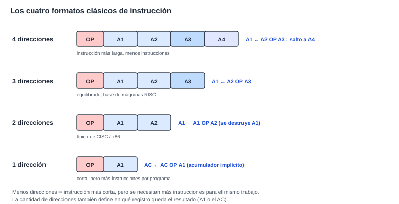

#### Ventajas y desventajas

| Formato | A favor | En contra | Máquina típica |
|---|---|---|---|
| **4 dir.** | programa mínimo | instrucción larguísima; casi nadie la usa | teórico |
| **3 dir.** | equilibrado; el resultado no pisa un operando | instrucción larga | **RISC** (MIPS, ARM) |
| **2 dir.** | buena densidad; el destino es uno de los operandos | pisa un operando | **CISC** (8086, x86) |
| **1 dir.** | instrucción corta; todo el campo es dirección | muchas instrucciones; cuello en el `AC` | **acumulador** (BLUE) |

#### El formato de la BLUE (16 bits)
```
15      12 11                              0
┌──────────┬────────────────────────────────┐
│ opcode 4 │        dirección 12            │
└──────────┴────────────────────────────────┘
```
| Instrucción | Cómo se lee |
|---|---|
| `LDA 100` | `AC ← M[100]` |
| `ADD 101` | `AC ← AC + M[101]` |
| `STA 102` | `M[102] ← AC` |

**Un solo campo de dirección** ⇒ tres instrucciones para el mismo cálculo, pero cada una de **16 bits**.
RISC haría la misma cuenta con **una instrucción de 32 bits**.

#### El formato variable (lo que viene después)
La **BLUE indexada** y el **8086** usan **formatos variables**: la instrucción mide 1 o 2 palabras (o 1 a 6 bytes)
según el modo de direccionamiento que se elija. Ventaja: aprovecha el espacio; desventaja: decodificar es más
complicado (y frena el pipeline).

> [!warning] Errores típicos
> - Decir "más direcciones = mejor" sin mencionar el costo en bits.
> - Contar el `PC` como una dirección explícita en el formato de 3.
> - Creer que la BLUE es de 2 direcciones porque `ADD` usa el `AC`: el `AC` es **implícito**.

#### Ejemplo resuelto (elegir formato)
Calcular `X = A + B` en los cuatro formatos:

| Formato | Programa | Instrucciones |
|---|---|---|
| 3 direcciones | `ADD X, A, B` | 1 |
| 2 direcciones | `MOV X, A` · `ADD X, B` | 2 |
| 1 dirección | `LDA A` · `ADD B` · `STA X` | 3 |
| 0 direcciones (pila) | `PUSH A` · `PUSH B` · `ADD` · `POP X` | 4 |

Más direcciones ⇒ **menos instrucciones** pero **cada una más larga**. La BLUE usa el de **1 dirección** porque su
palabra es de 16 bits: 4 de opcode + 12 de dirección.

#### Figura del libro

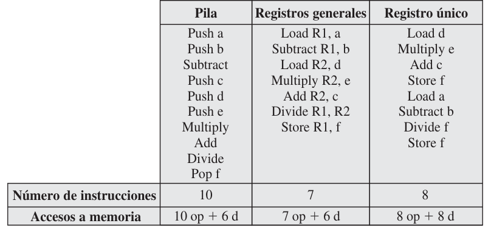

*Fig. 10.15 — Comparación de tres programas para calcular lo mismo (pila, registros generales y registro único).* · Stallings, *Organización y arquitectura de computadores*, 7ª ed., p. 421.

> [!tip] Qué mirar
> Los tres hacen la misma cuenta con 10, 7 y 8 instrucciones. Cuantas menos direcciones lleva cada instrucción, **más instrucciones** hay que escribir: ese es el compromiso de los formatos de 0 a 3 direcciones.

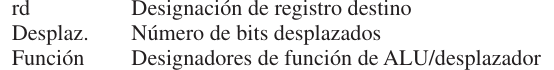

*Fig. 13.8 — Formatos de instrucciones del MIPS (formato de tres operandos).* · Stallings, *Organización y arquitectura de computadores*, 7ª ed., p. 533.

> [!tip] Qué mirar
> Formato de 3 direcciones, todas de registro: `rd`, `rs`, `rt` más un campo de función. Es el formato típico de RISC, donde `LOAD`/`STORE` son las únicas que llevan dirección.

#### Relacionado
[[5.2.2 Cálculo de CodOp según el tamaño de memoria]] · [[5.3.1 Los 7 modos]] · [[Formato de la instrucción (4 formatos)]] ·
[[CISC y RISC]] · [[4.2.2 Los 16 opcodes octales]] · [[Glosario — Unidad 5]]

### 5.2.2 Cálculo de CodOp según el tamaño de memoria

> [!abstract] En una frase
> La palabra de instrucción es un **presupuesto**: si la memoria necesita `d` bits de dirección, al opcode le quedan
> **`CodOp = p − d`** bits, y la máquina puede tener **`2^CodOp` instrucciones**.

> [!note] Si la primera vez que ves esto
> Es una **valija de 16 lugares** donde tenés que meter dos cosas: "qué hacer" y "dónde". Si la memoria es grande,
> la dirección se lleva casi toda la valija y te quedan pocas combinaciones para las instrucciones. La solución
> histórica: **formatos variables** (una segunda palabra que aporte más dirección).

#### k + d = instrucción

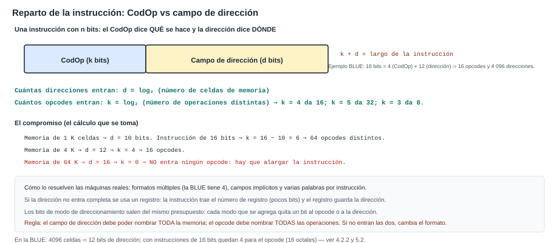

#### La fórmula y el procedimiento
```
d  = log₂(celdas de memoria)          ← bits de dirección
CodOp = p − d                          ← p = bits de la palabra de instrucción
instrucciones posibles = 2^CodOp
```

#### Ejemplos (los que se toman)

| Memoria | Celda | `d` | Palabra | `CodOp` | Instrucciones |
|---|---|---|---|---|---|
| 4096 celdas (**BLUE**) | 16 bits | **12** | 16 | **4** | **16** |
| 4 K celdas | 1 B | 12 | 16 | 4 | 16 |
| 512 MB | 4 B | **27** | 32 | **5** | 32 |
| 1 GB | 4 B | **28** | 32 | **4** | 16 |
| 64 K celdas | 1 B | 16 | 16 | **0** | ✗ no entra |
| 1 M celdas | 1 B | 20 | 32 | 12 | 4096 |

> [!important] El caso de la BLUE, paso a paso
> 4096 celdas ⇒ `d = log₂ 4096 = 12`; palabra de 16 ⇒ `CodOp = 16 − 12 = 4` ⇒ `2⁴ = 16` instrucciones: exactamente
> los `00` a `17` octales.

#### Qué se hace cuando no alcanza
| Solución | Cómo | Costo |
|---|---|---|
| **Palabra más larga** | 16 → 32 bits | más memoria por instrucción |
| **Formato variable** | 2.ª palabra con más dirección | decodificación compleja |
| **Registros índice** | campo corto + registro que suma | hardware extra (la BLUE indexada) |
| **Segmentos** | base + desplazamiento | direccionamiento en dos pasos (8086) |
| **Banco de registros** | la dirección apunta a un registro, no a memoria | menos datos en memoria (RISC) |

#### Ejercicio tipo final
> "Una máquina tiene memoria de 256 KB con celdas de 2 bytes y palabra de instrucción de 24 bits. ¿Cuántas
> instrucciones distintas puede tener?"

`256 KB = 2¹⁸` bytes ⇒ `2¹⁸ / 2 = 2¹⁷` celdas ⇒ `d = 17` ⇒ `CodOp = 24 − 17 = 7` ⇒ **2⁷ = 128 instrucciones**.

> [!warning] Errores típicos
> - Olvidar dividir por el tamaño de celda.
> - Usar `CodOp = d − p` (es al revés).
> - Dar como respuesta `CodOp` cuando piden **cantidad** de instrucciones (hay que hacer `2^CodOp`).
> - Mezclar bits con bytes en la resta.

#### Figura del libro

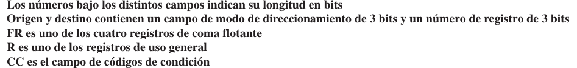

*Fig. 11.6 — Formatos de instrucciones utilizados en el PDP-11.* · Stallings, *Organización y arquitectura de computadores*, 7ª ed., p. 448.

> [!tip] Qué mirar
> La instrucción mide 16 bits y se reparte en campos de 3 y de 3: cuantos más bits se le den al opcode, menos direcciones quedan. De acá salen los cálculos de «¿cuánto CodOp entra con esta memoria?».

#### Relacionado
[[5.2.1 Los 4 formatos y el campo único de dirección]] · [[2.7.2 CodOp vs campo de dirección]] ·
[[Espacio de direccionamiento y cálculo de CodOp-Dirección]] · [[TP17 Formato básico de instrucciones]] · [[Glosario — Unidad 5]]

## 5.3 Modos de direccionamiento

### 5.3.1 Los 7 modos

> [!abstract] En una frase
> El **modo de direccionamiento** es la regla que dice cómo se calcula la **dirección efectiva (EA)** del operando:
> puede ser el propio campo (inmediato), el campo (directo), el contenido del campo (indirecto), un registro, el
> contenido de un registro, una suma registro + desplazamiento, o el tope de la pila.

> [!note] Si la primera vez que ves esto
> Es como pedir una pizza de **siete maneras**: "traeme la pizza" (inmediato: ya la tenés), "andá a Rivadavia 100"
> (directo), "andá a la dirección que está escrita en el papel" (indirecto), "usá la que tenés en la mano"
> (registro), "la dirección está en la mano" (registro indirecto), "Rivadavia 100 + 3" (desplazamiento) o "la de
> arriba del montón" (pila).

#### Los modos, dibujados

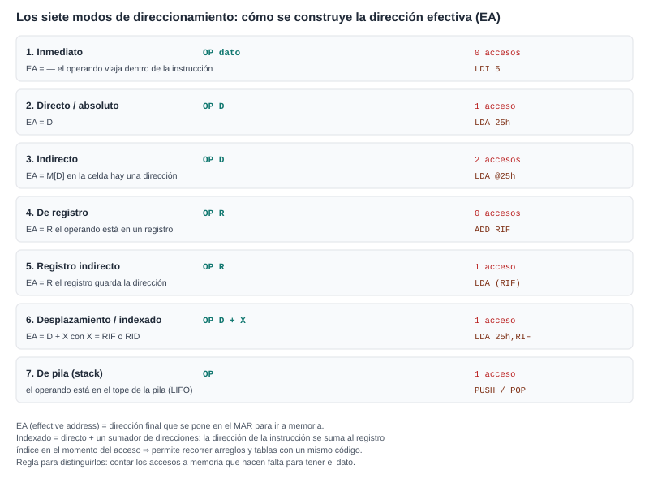

#### La tabla de los siete

| # | Modo | Dirección efectiva | Ejemplo | Accesos |
|---|---|---|---|---|
| 1 | **Inmediato** | no hay EA: el operando **es** el campo | `LDI 5` | **0** |
| 2 | **Directo (absoluto)** | `EA = campo` | `LDA 100` | 1 |
| 3 | **Indirecto** | `EA = M[campo]` | `LDA @100` | **2** |
| 4 | **De registro** | el operando está **en un registro** | `ADD R1` | **0** |
| 5 | **Registro indirecto** | `EA = R` (el registro **es** el puntero) | `LDA (R1)` | 1 |
| 6 | **De desplazamiento / indexado** | `EA = R + desplazamiento` | `LDA 2(RIF)` | 1 |
| 7 | **De pila** | el operando está en el **tope** (`SP`) | `PUSH` / `POP` | 1 |

#### Para qué sirve cada uno
| Modo | Ventaja | Desventaja |
|---|---|---|
| Inmediato | rapidísimo, no toca memoria | el dato está limitado a los bits del campo |
| Directo | simple y claro | direcciona sólo lo que entra en el campo |
| Indirecto | direcciona **toda** la memoria con un campo chico | el más lento (2 accesos) |
| De registro | sin tráfico de bus | hay pocos registros |
| Reg. indirecto | el registro es un **puntero** (listas, vectores) | igual hay acceso a memoria |
| Desplazamiento | **arreglos y estructuras**; código reutilizable | cálculo extra; desplazamiento corto |
| De pila | automatiza subrutinas y contextos | riesgo de desbordamiento |

> [!important] Los dos que resuelven los arreglos
> **Desplazamiento** (`EA = registro + d`) permite recorrer un arreglo cambiando **sólo el registro**, sin reescribir
> la instrucción. **Registro indirecto** permite apuntar a cualquier parte con un puntero. Sin estos dos, un lazo
> sobre 100 elementos obliga a **modificar el programa** (lo que hacía la BLUE básica).

#### Cómo se escribe en la BLUE y en el 8086
| Modo | BLUE (básica) | BLUE indexada | 8086 |
|---|---|---|---|
| Directo | `LDA 100` | `LDA 100` | `MOV AX, [100]` |
| Indirecto | — | — | `MOV AX, [BX]` (reg. indirecto) |
| Indexado | — | `LDA 3, RIF` | `MOV AX, [BX+SI+4]` |
| Inmediato | — (no hay) | — (no hay) | `MOV AX, 5` |
| E/S | `INP YY` | `INP YY` | `IN AX, DX` |

> [!warning] Errores típicos
> - Confundir **directo** con **indirecto**: en el directo el campo **es** la dirección; en el indirecto el campo
>   **contiene** la dirección (una "dirección de la dirección").
> - Confundir **de registro** (el dato está en el registro) con **registro indirecto** (el registro tiene la
>   dirección).
> - Decir que el inmediato "accede a memoria" (no accede: el dato viaja en la instrucción).

#### Figura del libro

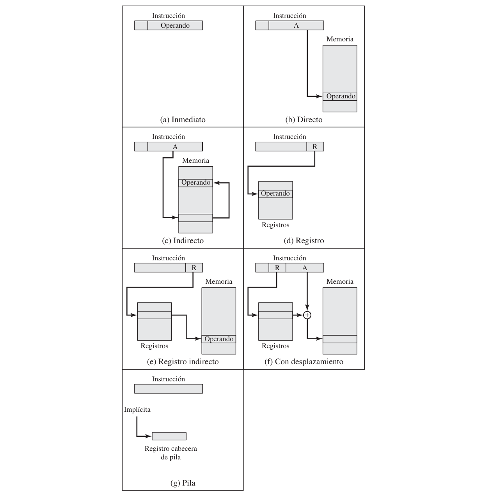

*Fig. 11.1 — Modos de direccionamiento.* · Stallings, *Organización y arquitectura de computadores*, 7ª ed., p. 431.

> [!example] El mismo dato en 7 modos
> `M[20] = 100`, `M[100] = 42`, `R1 = 30`, `RIF = 100`, `SP = 200`. Inmediato ⇒ operando `20`; directo ⇒ `M[20] = 100`;
> indirecto ⇒ `M[100] = 42`; de registro ⇒ `30`; reg. indirecto ⇒ `M[30]`; indexado ⇒ `M[130]`; de pila
> ⇒ `M[200]`. **Siete caminos, un solo dato final**: por eso el modo es parte de la instrucción.

#### Relacionado
[[5.3.2 Dirección efectiva y costo en accesos]] · [[5.4.1 RIF, RID y RB]] · [[Modos de direccionamiento]] ·
[[TP19 Modos de direccionamiento]] · [[Glosario — Unidad 5]]

### 5.3.2 Dirección efectiva y costo en accesos

> [!abstract] En una frase
> La **dirección efectiva (EA)** es la dirección **final** que se pone en el `MAR`. Cada modo la obtiene con una
> cuenta distinta, y esa cuenta define **cuántos accesos a memoria** cuesta el operando (0, 1 o 2).

> [!note] Si la primera vez que ves esto
> La EA es el **número de la casa** al que finalmente hay que ir. Según el modo, ese número lo sabés de una, lo
> tenés que buscar en una guía (un acceso más) o lo calculás sumando dos datos (un cálculo más).

#### La dirección efectiva, con costos

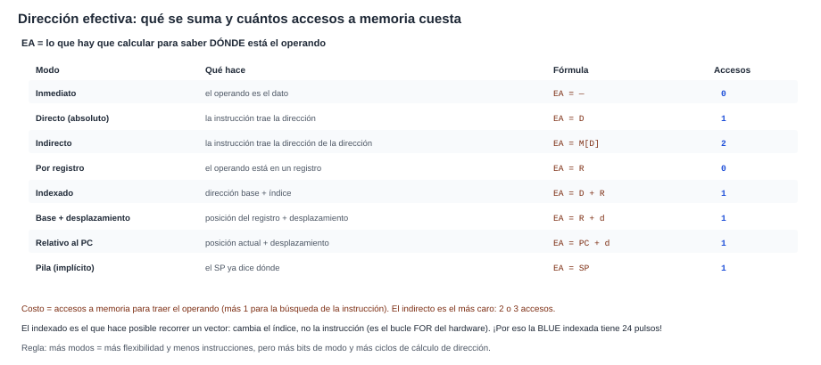

#### La tabla (con el mismo dato, para comparar)

Supongamos `M[20] = 0100`, `M[100] = 0042`, `R1 = 0030`, `RIF = 100`, `SP = 200`, `M[200] = 0077`.

| Modo | Cálculo | EA | Resultado en `AC` | Accesos |
|---|---|---|---|---|
| **Inmediato** | el operando es el campo | — | `AC = 0030` | **0** |
| **Directo** | `EA = 30` | 30 | `AC = M[30]` | 1 |
| **Indirecto** | `EA = M[30] = 50` | 50 | `AC = M[50]` | **2** |
| **De registro** | el operando es `R1` | — | `AC = 0030` | **0** |
| **Reg. indirecto** | `EA = R2 = 100` | 100 | `AC = 0042` | 1 |
| **Desplazamiento** | `EA = RIF + 2 = 102` | 102 | `AC = M[102]` | 1 |
| **De pila** | `EA = SP = 200` | 200 | `AC = 0077` | 1 |

> [!important] La regla del costo
> **0 accesos** = el dato viene en la instrucción o en un registro · **1 acceso** = una lectura normal ·
> **2 accesos** = primero hay que leer la dirección y después el dato (indirecto).
> Por eso el indirecto es el más lento y el inmediato el más rápido.

#### Cuándo conviene cada uno (criterio de diseño)
- **Constantes** en el programa ⇒ **inmediato**.
- **Variable global** de dirección conocida ⇒ **directo**.
- **Puntero, lista enlazada, paso por referencia** ⇒ **indirecto / registro indirecto**.
- **Arreglo, tabla, campo de una estructura** ⇒ **desplazamiento**.
- **Subrutinas y contexto** ⇒ **pila**.

#### La misma cuenta en la BLUE y en el 8086
| Situación | BLUE indexada | 8086 |
|---|---|---|
| Recorrer `V[0..99]` | `LDA 0, RIF` + `RIF ← RIF + 1` | `MOV AX, [SI]` + `INC SI` |
| Acceder al campo 4 de una estructura | `LDA 4, RIF` | `MOV AX, [BX+4]` |
| Leer un puntero | — (no hay indirecto) | `MOV BX, [BX]` |

> [!tip] Cómo se pregunta
> "Calcule la EA y diga cuántos accesos cuesta" → escribir **la fórmula del modo**, sustituir los valores del
> enunciado y contar. Siempre conviene **dibujar la memoria** con las direcciones usadas.

#### Cuánto tarda (unidad de tiempo del final)
Si cada acceso a memoria cuesta `t` y el cálculo de la EA en la ALU es despreciable:
`inmediato = 0` · `directo = 1t` · `indirecto = 2t` · `registro = 0` · `desplazamiento = 1t`.
En un lazo de 100 vueltas, la diferencia entre `1t` y `2t` es **100 accesos**: ésa es la cuenta que se valora.

> [!warning] Errores típicos
> - Contar **1 acceso** para el inmediato (el dato está en la instrucción, que ya se buscó).
> - Sumar un acceso extra en el desplazamiento (la suma la hace la ALU, no la memoria).
> - Confundir el acceso a la **instrucción** (siempre 1, en la búsqueda) con el acceso al **operando**.
> - Olvidar que en el indirecto el primer acceso devuelve una **dirección**, no un dato.

#### Figura del libro

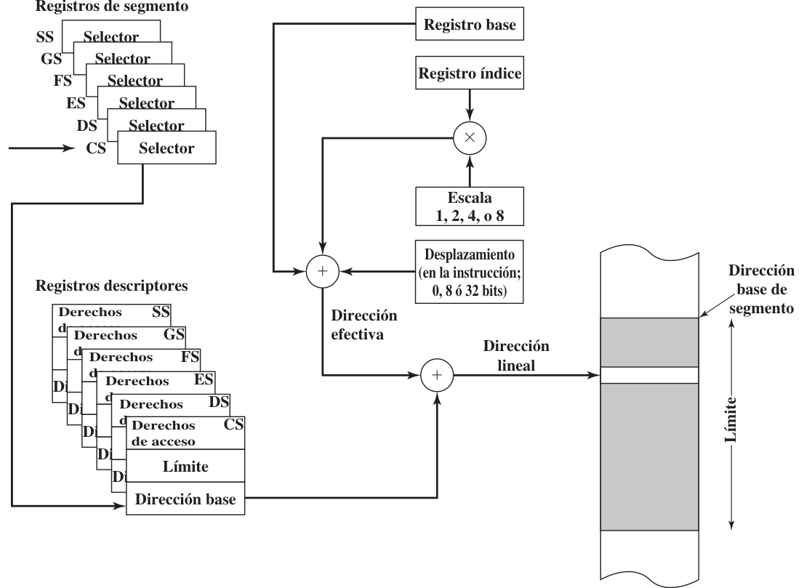

*Fig. 11.2 — Cálculos en el modo de direccionamiento del Pentium.* · Stallings, *Organización y arquitectura de computadores*, 7ª ed., p. 438.

#### Ejemplo resuelto (contar accesos)
`AC = 0030`, `RIF = 100`, `M[30] = 50`, `M[100] = M[130] = 0077` (campo de dirección `30`):
| Modo | EA | Accesos |
|---|---|---|
| Inmediato | — (el 30 es el dato) | **0** |
| Directo | 30 | **1** |
| Indirecto | `M[30] = 50` | **2** |
| Indexado (`RIF = 100`) | `100 + 30 = 130` | **1** (más el cálculo) |
La regla: **0** si el dato viene en la instrucción o en un registro, **1** si hay que ir a memoria una vez, **2** si
primero hay que **buscar la dirección**.

#### Relacionado
[[5.3.1 Los 7 modos]] · [[5.4.1 RIF, RID y RB]] · [[Modos de direccionamiento]] ·
[[TP19 Modos de direccionamiento]] · [[TP18 Direccionamiento de memoria]] · [[Glosario — Unidad 5]]

## 5.4 La BLUE indexada

### 5.4.1 RIF, RID y RB

> [!abstract] En una frase
> **RB** (registro base) se suma **siempre** a la dirección y sirve para **reubicar** el programa; **RIF** (índice de
> **fuente**) y **RID** (índice de **destino**) se suman **sólo cuando la instrucción lo pide** y sirven para
> **recorrer arreglos** sin reescribir el código.

> [!note] Si la primera vez que ves esto
> Tres punteros con tres oficios: el **base** es el **edificio** (donde está el programa: si lo mudan, cambiás el
> edificio y listo); el de **fuente** es el **dedo** que marca de dónde leo; el de **destino**, el dedo que marca
> dónde escribo. Al sumarlos al campo de la instrucción, movés el dedo sin tocar la instrucción.

#### Los tres registros nuevos

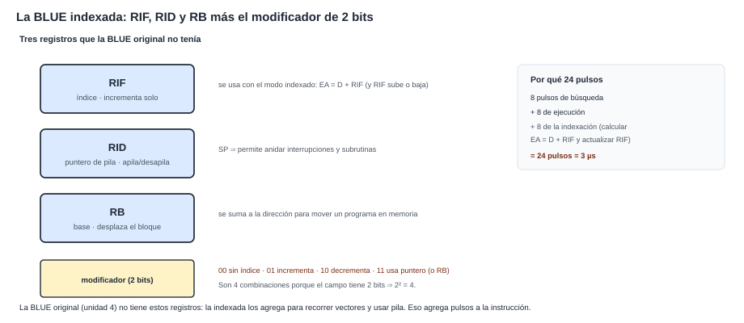

#### Los tres registros

| Registro | Se suma… | Lo maneja | Para qué |
|---|---|---|---|
| **RB** | **siempre** | el sistema (no el programador) | **reubicación**: mover todo el programa sin tocar una instrucción |
| **RIF** | si el modificador = `01` o `11` | el programador | apuntar al **origen** (leer de un arreglo) |
| **RID** | si el modificador = `10` o `11` | el programador | apuntar al **destino** (escribir en otro arreglo) |

**Los tres son de 12 bits** (el mismo ancho que el campo de dirección y que el `MAR`).

#### La dirección efectiva
```
EA = RB + campo + (0 | RIF | RID | RIF + RID)
      └── fijo ──┘   └──── según el modificador de 2 bits ────┘
```

> [!important] Por qué el base no lo toca el programador
> Porque existe para que el **sistema operativo** pueda cargar el programa en **otra parte** de la memoria sin
> recompilarlo. Si el programador lo usara para sus arreglos, esa función se perdería.

#### Ejemplo: copiar un vector (la razón de ser de RIF y RID)
```
      RB  = 1000        base del programa
      RIF = 0           origen  (V1)
      RID = 100         destino (V2, 100 posiciones más adelante)

lazo: LDA  0, RIF       AC ← M[RB + 0 + RIF] = V1[i]
      STA  0, RID       M[RB + 0 + RID] ← AC = V2[i]
      RIF = RIF + 1     (instrucción de incremento)
      RID = RID + 1
      SRJ  lazo         repetir 100 veces (control con un contador)
```
Con la **BLUE básica** esto obligaba a **modificar las instrucciones** `LDA`/`STA` en memoria en cada vuelta. Con
los índices, la instrucción **no se toca**: sólo cambian los registros.

#### Lo que se gana y lo que se paga

| | BLUE básica | BLUE indexada |
|---|---|---|
| Direccionamiento | directo (1 modo) | **4 modos** (los 2 bits del modificador) |
| Arreglos | hay que auto modificarse | lazo con `RIF`/`RID` |
| Espacio | 4096 palabras | 64 K (campo de 16 bits en 2 palabras) |
| Instrucciones | 16 | **32** |
| Pulsos por instrucción con memoria | 16 | **24** |

> [!warning] Errores típicos
> - Decir que `RIF` y `RID` son "lo mismo": **RIF = fuente (de dónde leo), RID = destino (dónde escribo)**.
> - Sumar el base **sólo** en los modos indexados: el base se suma **siempre**.
> - Confundir el registro base con el `BP` del 8086 (aquél es de marco de pila).
> - Olvidar que la dirección sigue siendo de 12 bits **después** de la suma (con vuelta al principio si se pasa).

#### Relacionado
[[5.4.2 Modificador de 2 bits y los 24 pulsos]] · [[BLUE indexada (RIF, RID, nuevo formato)]] ·
[[Registros base e índice]] · [[5.3.1 Los 7 modos]] · [[Glosario — Unidad 5]]

### 5.4.2 Modificador de 2 bits y los 24 pulsos

> [!abstract] En una frase
> La palabra de la indexada mide **32 bits** (5 de opcode + **2 de modificador** + 9 de campo + 16 de dirección) y
> **necesita 2 ciclos de búsqueda + 1 de ejecución = 24 pulsos** para una instrucción con memoria.

> [!note] Si la primera vez que ves esto
> El **modificador** es un pequeño menú de 4 opciones que dice *qué* sumar a la dirección: nada, `RIF`, `RID` o los
> dos. Es lo que convierte un direccionamiento directo en indexado, sin cambiar de instrucción.

#### De dónde salen los 24 pulsos


#### El modificador (2 bits)

| Modificador | Modo | Dirección efectiva |
|---|---|---|
| `00` | directo / **no indexado** | `EA = RB + campo` |
| `01` | indexado por **fuente** | `EA = RB + campo + RIF` |
| `10` | indexado por **destino** | `EA = RB + campo + RID` |
| `11` | indexado por **fuente y destino** | `EA = RB + campo + RIF + RID` |

#### El formato nuevo (2 palabras = 32 bits)
```
palabra 1:  ┌────────┬──────┬───────────┐
            │ opcode │ mod  │  campo 9  │
            │  5     │  2   │           │
            └────────┴──────┴───────────┘
palabra 2:  ┌──────────────────────────────┐
            │      dirección (16 bits)     │
            └──────────────────────────────┘
```
- **9 bits de campo** en la primera palabra: es el **desplazamiento** (0-511).
- **16 bits** en la segunda: la **dirección** (hasta 64 K).
- **Opcode de 5 bits** ⇒ **32 instrucciones** (el doble que la básica).

#### Los 24 pulsos de una instrucción indexada (ej. `LDA 3, X`)
| Ciclo | Qué hace | Pulsos |
|---|---|---|
| **1.º** (búsqueda, 1.ª palabra) | trae opcode + mod + campo | 8 |
| **2.º** (búsqueda, 2.ª palabra) | trae la dirección, la suma al base y a los índices (**calcula la EA**) | 8 |
| **3.º** (ejecución) | usa la EA: trae el dato (o lo escribe) | 8 |
| **Total** | | **24** |

> [!important] La comparación que se pide
> La misma `LDA` en la **BLUE básica** cuesta **16 pulsos**; en la **indexada**, **24**. Se paga **50 % más de
> tiempo** por instrucción a cambio de: arreglos sin auto modificación, 64 K de memoria, 32 instrucciones y
> reubicación con `RB`. **El indirecto** de la indexada llega a **32 pulsos** (un acceso más).

#### Tabla de costos completa
| Instrucción | Básica | Indexada (mod 00) | Indexada (mod ≠ 00) | Indexada (indirecto) |
|---|---|---|---|---|
| Sin memoria (HLT, NOP, NOT, RAL…) | 8 | 16 | 16 | — |
| Con memoria (ADD, LDA, STA) | 16 | 16 | **24** | **32** |
| E/S (INP, OUT) | 16+ | 16+ | 24+ | — |

#### Cómo se justifica el costo
1. **Menos instrucciones en el programa**: un lazo sobre 100 elementos usa **una** `LDA` en vez de 100.
2. **Menos memoria ocupada** por el programa (aunque cada instrucción ocupe 2 palabras).
3. **Reubicación gratis** con `RB`.
En tiempo total, para lazos largos, la indexada **gana**: el costo por instrucción sube 50 %, pero la cantidad de
instrucciones baja mucho más.

> [!warning] Errores típicos
> - Decir que son 24 pulsos **para todas** las instrucciones (las que no van a memoria son 16).
> - Confundir los 2 bits del modificador con los 4 del opcode.
> - Sumar `RIF` cuando el modificador es `00` (no se suma nada).
> - Decir que la palabra sigue siendo de 16 bits (son **dos**).

#### Figura del libro

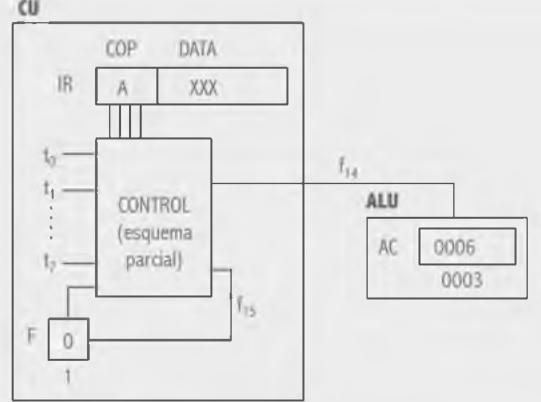

*Fig. 7.15 — Fase execute SHR.* · Quiroga, *Arquitectura de computadoras*, p. 184.

#### Ejemplo resuelto (24 pulsos)
`LDA` indexada por `RIF` con `RIF = 100`, campo `30`, `RB = 0`:
- `EA = RB + campo + RIF = 0 + 30 + 100 = 130`.
- Ciclos: **2 de búsqueda** (la instrucción ocupa **2 palabras** de 16 bits: opcode+mod+campo y la dirección) +
  **1 de ejecución** = **3 ciclos de 8 pulsos = 24 pulsos**.
- Tiempo: `24 × 125 ns = 3 µs`.
- Si el modificador fuera `00` (no indexado), la instrucción sigue siendo de 2 palabras ⇒ **también 24 pulsos**:
  el costo está en el **formato**, no en el modo.

#### Relacionado
[[5.4.1 RIF, RID y RB]] · [[Ciclo de LDA indexada (los 24 pulsos)]] · [[BLUE vs BLUE indexada — qué cambia y por qué]] ·
[[BLUE indexada (RIF, RID, nuevo formato)]] · [[Glosario — Unidad 5]]

## 5.5 Interrupciones

### 5.5.1 IRQ, SI y CP8

> [!abstract] En una frase
> Una interrupción se detecta en **un solo lugar del ciclo**: la señal **`IRQ · SI · CP8`**; si está activa, la
> máquina **termina la instrucción en curso** y en vez de buscar la siguiente **salta a la rutina de servicio**.

> [!note] Si la primera vez que ves esto
> Es el **timbre de la puerta**. No lo mirás todo el día (`polling`); cuando suena, terminás la frase que estabas
> escribiendo y atendés. `SI` es el **interruptor general del timbre**: si está en 0, aunque toquen, no suena.

#### IRQ · SI · CP8

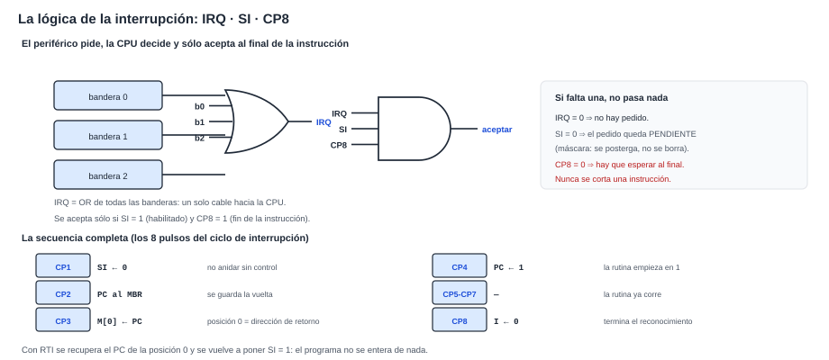

#### Las tres letras
| Señal | Nombre | Quién lo pone | Qué significa |
|---|---|---|---|
| **`IRQ`** | *interrupt request* | el **periférico** (por una línea del bus) | "necesito atención" |
| **`SI`** | *set interrupt* / habilitación | la **CPU** (un bit de estado, lo tocan `CSI`/`CEI`) | "acepto interrupciones" |
| **`CP8`** | pulso 8 del ciclo | el **reloj** | "recién acá se pregunta" |

**La condición:** `IRQ = 1` **y** `SI = 1` **y** `CP8 = 1` ⇒ interrupción.

#### Por qué justo en `CP8`
En `CP8` la instrucción **ya terminó** (el estado se actualizó en `CP8` de la ejecución) y todavía **no se buscó**
la próxima. Es el único instante en que se puede desviar el `PC` sin dejar nada a medias:

```
CP1..CP8  instrucción en curso (termina normalmente)
CP8       ¿IRQ·SI = 1?  ── sí ──▶  TRA ← 1  (pedido de transferencia)
                              ▼
          se guarda PC en la pila y se carga la dirección de la rutina
                              ▼
          se ejecuta la rutina de servicio (ISR)
                              ▼
          RTI vuelve a la instrucción siguiente
```

#### Polling del flag (`TRA`)
La BLUE no tiene línea dedicada de interrupción en su versión básica: el periférico **activa un flag** y la CPU lo
**consulta** con una instrucción de E/S. El registro **`TRA`** (*transfer*) indica que hay un pedido de
transferencia pendiente:

| Camino | Cómo funciona | Costo |
|---|---|---|
| **Consulta (polling)** | la CPU lee el flag en un lazo; si está en 1, va a la rutina | gasta tiempo preguntando |
| **Interrupción** | `IRQ·SI·CP8` desvía sola; la CPU sigue trabajando mientras tanto | casi nada |

> [!important] Cuándo usar cada uno
> **Polling**: periféricos lentos y predecibles, o cuando el sistema no puede permitirse el hardware de interrupción.
> **Interrupción**: cuando el evento es **asíncrono** (teclado, disco, timer) y no se sabe cuándo llega.

#### El código típico con polling
```
lazo: INP  1         AC ← estado del periférico
      AND  mascara   ¿está listo el bit 0?
      CSA            si AC = 0 …
      JMA lazo       … volver a preguntar
      LDA dato       listo: procesar
      ...
```
Con interrupción todo ese lazo **desaparece**: el programa principal corre y el periférico interrumpe cuando
corresponde.

> [!warning] Errores típicos
> - Decir que la interrupción se atiende **en medio** de una instrucción (siempre se espera al final).
> - Olvidar que hacen falta **`IRQ` y `SI`**: con `SI = 0` (interrupciones deshabilitadas) no pasa nada.
> - Confundir `SI` con la línea de E/S: es un **bit de estado interno**.
> - Creer que el polling "no tiene costo" (consume ciclos de CPU).

#### Figura del libro

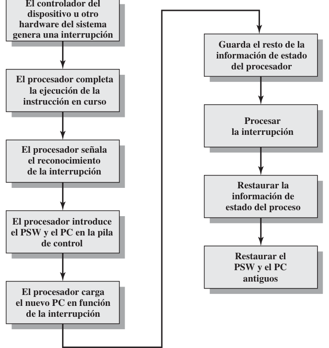

*Fig. 7.6 — Procedimiento de interrupción simple.* · Stallings, *Organización y arquitectura de computadores*, 7ª ed., p. 244.

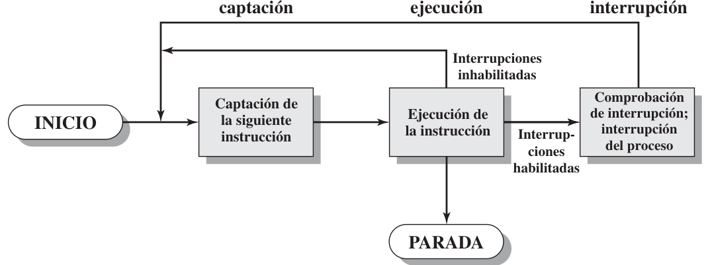

*Fig. 3.9 — Ciclo de instrucción con interrupciones.* · Stallings, *Organización y arquitectura de computadores*, 7ª ed., p. 91.

#### Ejemplo resuelto (la condición de aceptación)
La señal es **`IRQ · SI · CP8`**:
- `IRQ = 1` (el periférico pidió), `SI = 1` (las interrupciones están habilitadas) y llega **`CP8`** (fin del ciclo
  de instrucción actual) ⇒ se acepta.
- Si `SI = 0` (máscara puesta) o `IRQ = 0`, **no pasa nada**: la instrucción sigue normalmente.
- Al aceptarla: `SI ← 0` (se deshabilitan las demás), se guarda el `PC` en `M[0]` y se salta a la rutina.
- Cuenta: si la rutina tarda **21 µs** y se ejecuta cada milisegundo ⇒ **2,1 %** de la CPU.

#### Relacionado
[[5.5.2 Máscara, pila y RTI]] · [[Interrupciones y entrada-salida]] · [[4.3.2 Búsqueda, los 8 pulsos]] · [[Glosario — Unidad 5]]

### 5.5.2 Máscara, pila y RTI

> [!abstract] En una frase
> Atender bien una interrupción exige **tres cosas**: **guardar el contexto** (en la pila), **respetar la máscara**
> (qué se puede interrumpir y qué no) y **volver con `RTI`**, que restaura todo. Durante la rutina de servicio, las
> interrupciones se **deshabilitan** solas.

> [!note] Si la primera vez que ves esto
> Estás escribiendo una carta, suena el timbre: **dejás el señalador donde estaba** (guardás el PC), atendés,
> volvés y **seguís desde el señalador** (`RTI`). El `RTI` es lo que evita tener que "acordarte" dónde estabas.

#### La pila y el retorno

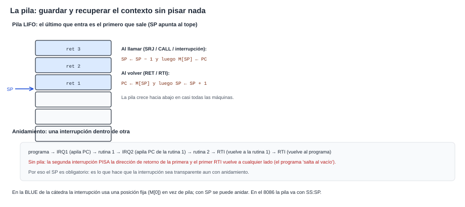

#### Qué se guarda en la pila
| Se guarda | Por qué |
|---|---|
| **`PC` (dirección de vuelta)** | para saber dónde continuar |
| **Registro de estado / `AC`** | la rutina va a usarlos y no debe cambiar el resultado del programa |
| **Registros que use la rutina** (RIF, RID, `AC`…) | "contexto" completo |

**Orden:** primero el `PC` (normalmente lo hace el hardware), después los registros (lo hace el software).

#### La máscara
| Concepto | Qué es |
|---|---|
| **Habilitación general (`SI`)** | bit que dice si se aceptan interrupciones |
| **Máscara por dispositivo** | cada línea tiene un bit; en 0, esa interrupción se **ignora** |
| **Prioridad** | si llegan dos a la vez, gana la de mayor prioridad |

Al entrar a una rutina, el hardware (o la primera instrucción `CDI`) pone **`SI = 0`** para que la propia rutina no
sea interrumpida. Al salir, **`RTI`** lo vuelve a `1`. Eso evita la recursión descontrolada.

#### `RTI` — *return from interrupt*
```
RTI ≡  sacar de la pila los registros en orden inverso
       sacar de la pila el PC
       habilitar interrupciones (SI ← 1)
```
Es el **espejo exacto** de lo que hizo la entrada a la rutina. Si el orden de `POP` no es el inverso del de
`PUSH`, se vuelve a una dirección basura: es el error clásico de los ejercicios.

#### El ciclo completo
```
   programa principal          rutina de servicio (ISR)
        │                            ▲
        │ CP8: IRQ·SI = 1            │
        ▼                            │
   PUSH PC ───────────────────────▶ │   PUSH AC / estado
        │                            │   (SI ← 0 automático)
        ▼                            │   ... procesar el evento ...
   PC ← dirección de la ISR          │   limpiar el flag del periférico
        │                            │   POP estado / AC
        ▼                            │   RTI  (POP PC, SI ← 1)
   ejecuta la ISR ──────────────────▶┘
        │
        ▼
   sigue con la instrucción siguiente al punto de interrupción
```

> [!important] No olvidar **limpiar el flag del periférico**
> Si la rutina no desactiva el pedido (`IRQ` queda en 1), al volver y habilitar `SI` la máquina **vuelve a
> interrumpir de inmediato**: entra en un lazo infinito de interrupciones. Es la falla más común en los finales.

#### Interrupciones por hardware vs por software
| | Hardware | Software |
|---|---|---|
| Origen | una línea (`IRQ`) | una instrucción (`INT n`) |
| Cuándo | asíncrona | en el punto del programa |
| Uso | periféricos, timer | llamadas al sistema (`INT 21h`) |

> [!warning] Errores típicos
> - Volver con `JMP` o `RET` en vez de `RTI` (no se restaura ni el `PC` ni la habilitación).
> - Guardar los registros en un orden y sacarlos en el mismo orden (va **al revés**).
> - Omitir el `PUSH` del registro de estado: la rutina "rompe" los flags del programa interrumpido.
> - No limpiar el flag del periférico antes del `RTI`.

#### Figura del libro

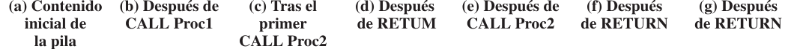

*Fig. 10.8 — Uso de una pila para implementar el anidamiento de subrutinas* · Stallings, *Organización y arquitectura de computadores*, 7ª ed., p. 397.

#### Ejemplo resuelto (guardar y volver)
Llega una interrupción cuando `PC = 300`:
1. El hardware guarda `M[0] ← 300` (dirección de vuelta) y salta a la rutina.
2. La rutina guarda en la pila lo que va a usar (`AC`, `RIF`, …): `PUSH AC` ⇒ `SP ← SP − 1`, `M[SP] ← AC`.
3. Al terminar, `POP` recupera en orden inverso y **`RTI`** hace `PC ← M[0] = 300` ⇒ el programa sigue donde
   estaba, como si nada.
- Si dentro de la rutina se quiere permitir otra interrupción, hay que volver a poner `SI = 1`
  (**anidamiento**); si no, la segunda espera.

#### Relacionado
[[5.5.1 IRQ, SI y CP8]] · [[Interrupciones y entrada-salida]] · [[3.2.2 Operaciones aritméticas, lógicas y flags]] ·
[[5.6.2 La pila y el registro SP]] · [[Glosario — Unidad 5]]

## 5.6 El 8086

### 5.6.1 BIU, EU y segmentación

> [!abstract] En una frase
> El 8086 direcciona **1 MB con registros de 16 bits** mediante **segmentos**: `dirección física = segmento × 16 +
> desplazamiento`. Y se divide en **BIU** (busca instrucciones) y **EU** (las ejecuta), que trabajan **en paralelo**.

> [!note] Si la primera vez que ves esto
> Con 16 bits sólo podés contar hasta 65 535 casas, pero la ciudad tiene un millón. La solución: **barrios**
> (segmentos) de 64 K casas cada uno; decís "barrio 5, casa 100" y se calcula la dirección real. Y hay dos
> empleados: uno que **trae** los pedidos (BIU) y otro que los **ejecuta** (EU), cada uno en su escritorio.

#### BIU y EU en paralelo

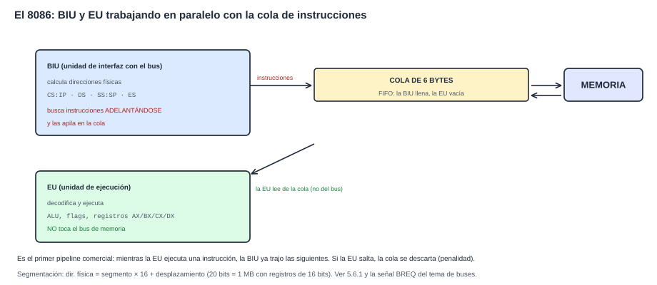

#### La segmentación
```
dirección física (20 bits) = (segmento << 4) + desplazamiento
                          = segmento × 16 + desplazamiento
```
| Registro de segmento | Con | Apunta a |
|---|---|---|
| `CS` | `IP` | el **código** (la próxima instrucción) |
| `DS` | `SI`, `DI`, `BX`, un campo | los **datos** |
| `SS` | `SP`, `BP` | la **pila** |
| `ES` | `DI` | segmento **extra** (destino en copias) |

**Ejemplo:** `CS = 1000h`, `IP = 0023h` ⇒ física = `1000h × 16 + 0023h = 10023h`.

- Segmento de **64 KB** (un desplazamiento de 16 bits).
- Los segmentos **pueden solaparse** (por eso se dice que el 8086 "no tiene protección de memoria").
- Direcciones físicas posibles: `2²⁰ = 1 MB`.

#### La división BIU / EU
| Unidad | Nombre | Qué hace | Registros |
|---|---|---|---|
| **BIU** | *Bus Interface Unit* | calcula direcciones físicas, lee/escribe memoria y trae instrucciones | `CS`, `DS`, `SS`, `ES`, `IP` |
| **EU** | *Execution Unit* | decodifica y **ejecuta** | `AX`, `BX`, `CX`, `DX`, `SP`, `BP`, `SI`, `DI`, `FLAGS` |

**La cola de instrucciones (*instruction queue*)**: 6 bytes. Mientras la EU ejecuta una instrucción, la BIU llena la
cola con las siguientes. Eso es el primer **solapamiento** (prefetch) de la historia del x86.

> [!important] Por qué importa
> El **pipeline** de las unidades siguientes (y del final) empieza acá: dos unidades haciendo dos cosas distintas
> al mismo tiempo. La limitación del 8086 es que si la EU necesita un dato de memoria, la BIU **deja de buscar**
> (un solo bus): el paralelismo no es perfecto.

#### Costo en ciclos (reloj de 5 MHz)
| Instrucción | Ciclos |
|---|---|
| `MOV` registro-registro | 2 |
| `MOV` registro-memoria | 8-9 |
| `ADD` registro-registro | 3 |
| `MUL` | ~70-118 |

Por eso, el 8086 tarda **mucho** más en las que tocan memoria: la cola amortigua la **búsqueda** de la instrucción,
pero no la del **operando**.

#### Comparación con la BLUE
| | BLUE | 8086 |
|---|---|---|
| Direcciones | 12 bits, planas | 20 bits, segmentadas |
| Formato | fijo (1 o 2 palabras) | **variable** (1 a 6 bytes) |
| Unidades | una sola UC | **BIU + EU** |
| Pipeline | no | **cola de 6 bytes** |
| Modos | 1 (directo) | varios (registro, indirecto, indexado, base) |

> [!warning] Errores típicos
> - Sumar `segmento + desplazamiento` en vez de `segmento × 16 + desplazamiento` (desplazado 4 bits).
> - Decir que el 8086 direcciona 64 KB (64 KB es **un segmento**; el total es **1 MB**).
> - Confundir qué registros son de la BIU y cuáles de la EU.
> - Creer que la cola de 6 bytes es un *pipeline* completo (es sólo *prefetch* de instrucciones).

#### Figura del libro

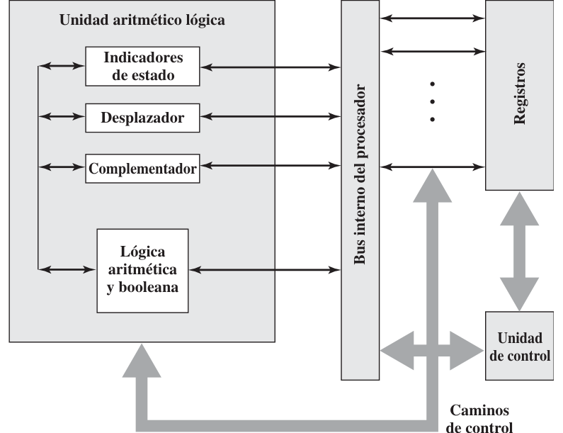

*Fig. 12.2 — Estructura interna del procesador.* · Stallings, *Organización y arquitectura de computadores*, 7ª ed., p. 462.

> [!example] Por qué el 8086 es más rápido que la BLUE
> La **BIU** trae instrucciones y la **EU** las ejecuta **a la vez**. Con la cola de 6 bytes llena, mientras la EU
> suma, la BIU ya está buscando la instrucción siguiente: si no es un salto, se **ahorra** el ciclo de búsqueda. Es
> el mismo `k + (n − 1)` del pipeline (ver [[7.1.3 Cálculo de speedup y límites]]).

#### Relacionado
[[5.6.2 La pila y el registro SP]] · [[5.1.3 Registros de la CPU]] · [[TP21 intro al emu8086]] ·
[[Pipeline]] · [[Glosario — Unidad 5]]

### 5.6.2 La pila y el registro SP

> [!abstract] En una frase
> La **pila** del 8086 es una zona de memoria con dos operaciones, **`PUSH`** (deja un dato arriba) y **`POP`**
> (lo saca), organizada como **LIFO** y apuntada por **`SS:SP`**. El `SP` **decrece** al apilar y **crece** al
> desapilar. Es la clave de las subrutinas, las interrupciones y las variables locales.

> [!note] Si la primera vez que ves esto
> Es una **pila de platos**: el último que ponés es el primero que sacás. En el 8086 la pila **crece hacia abajo**
> (hacia direcciones menores): cada plato nuevo se pone *debajo* de los anteriores.

#### La pila del 8086


#### Cómo funciona
```
SS:SP ──▶ ┌──────────┐  dirección baja  (la pila crece hacia acá)
          │  último  │ ◀── tope (SP)
          ├──────────┤
          │  anterior│
          ├──────────┤
          │   ...    │
          └──────────┘  dirección alta
```

| Instrucción | Qué hace | `SP` |
|---|---|---|
| **`PUSH AX`** | `SP ← SP − 2`; `M[SS:SP] ← AX` | **decrece** |
| **`POP AX`** | `AX ← M[SS:SP]`; `SP ← SP + 2` | **crece** |

> [!important] El orden importa
> `PUSH A` seguido de `PUSH B` obliga a hacer `POP B` y después `POP A`. Si se invierte, se "cruzan" los valores:
> es el mismo error que con `RTI` en las interrupciones.

#### Para qué se usa (las tres razones)
1. **Subrutinas** — `CALL` apila la dirección de vuelta; `RET` la desapila.
   ```
   CALL SUB        ; PUSH IP  (y CS si es far) ; IP ← SUB
   ...
   SUB: ...
        RET        ; POP IP
   ```
2. **Interrupciones** — el hardware apila `FLAGS`, `CS` e `IP`; `IRET` los restaura.
3. **Variables locales y paso de parámetros** — `BP` marca el comienzo del **marco** de la subrutina:
   ```
   PUSH BP          ; guardo el marco anterior
   MOV  BP, SP      ; nuevo marco
   SUB  SP, 4       ; espacio para 2 variables locales
   ...
   MOV  SP, BP      ; deshago
   POP  BP
   RET
   ```

#### Desbordamiento y subdesbordamiento
| Problema | Qué pasa |
|---|---|
| **Desbordamiento** (*overflow*) | se hacen más `PUSH` que espacio hay ⇒ se pisa otra zona de memoria |
| **Subdesbordamiento** (*underflow*) | se hacen más `POP` que `PUSH` ⇒ se sacan datos basura |
| **No hay protección** | el 8086 no avisa: el programa "se cuelga" o da resultados absurdos |

#### Comparación con la pila de la BLUE
| | BLUE | 8086 |
|---|---|---|
| Puntero | `SP` (12 bits) | `SS:SP` (20 bits) |
| Crecimiento | hacia abajo | hacia abajo |
| Quién la usa | instrucciones de pila / interrupciones | `PUSH`, `POP`, `CALL`, `RET`, `INT`, `IRET` |
| Variables locales | no | sí (con `BP`) |

> [!warning] Errores típicos
> - Decir que el `SP` **aumenta** al apilar (decrece).
> - Olvidar que `PUSH`/`POP` mueven **2 bytes** (son de 16 bits).
> - Confundir `CALL` (subrutina, guarda `IP`) con `JMP` (salto, no guarda nada).
> - No restaurar `SP` al final de una subrutina que reservó espacio local.

#### Figura del libro


*Fig. 10.13 — Operaciones básicas con la pila.* · Stallings, *Organización y arquitectura de computadores*, 7ª ed., p. 418.

#### Ejemplo resuelto (la pila crece hacia abajo)
Con `SP = 0100H`:
- `PUSH AX` ⇒ `SP ← 00FEH` y `M[00FEH] ← AX` (2 bytes, porque el 8086 trabaja de a 16 bits).
- `PUSH BX` ⇒ `SP ← 00FCH` y `M[00FCH] ← BX`.
- `POP BX` ⇒ `BX ← M[00FCH]`, `SP ← 00FEH`; `POP AX` ⇒ `SP ← 0100H` (vuelve al inicio).
- Por eso el 8086 usa `SS:SP`: el **segmento de pila** más el puntero. Y por eso el **desborde de pila** es un
  error real: si `SP` baja más allá del segmento, pisa datos.

#### Relacionado
[[5.6.1 BIU, EU y segmentación]] · [[5.5.2 Máscara, pila y RTI]] · [[TP21 intro al emu8086]] ·
[[3.3.2 Base, índice, puntero de pila y estado]] · [[Glosario — Unidad 5]]

---

## Al terminar la unidad
- Una pasada rápida: [[00 Síntesis — Unidad 5]].
- Los subtemas por separado: [[00 Unidad 5 — temas y subtemas]].
- Seguir de corrido: [[00 Materia completa (las 10 unidades en un archivo)]].
- Practicar: [[Banco de preguntas del final]] · [[Autoevaluación]] · [[Prácticas resueltas]].
