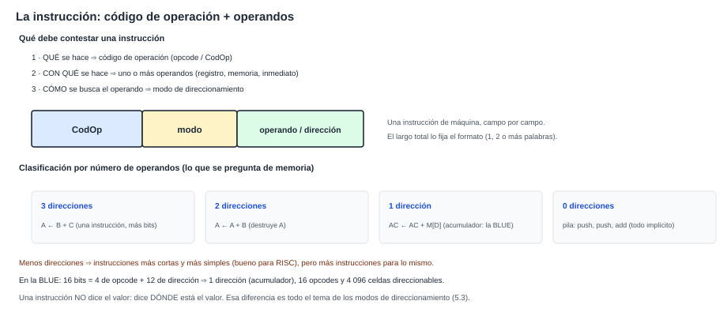

# 5.1.1 Instrucción: opcode y operandos

> [!abstract] En una frase
> Una instrucción tiene **dos partes**: el **código de operación** (qué hay que hacer) y los **operandos** (con qué
> datos). El opcode es un número que la UC **decodifica**; los operandos son **direcciones, registros o valores**.

> [!note] Si la primera vez que ves esto
> Es una **orden de trabajo** en un taller: "atornillar (qué) la pieza A con el tornillo B (con qué)". La orden se
> repite siempre igual (un número: el opcode); lo que cambia es sobre qué la aplicás (los operandos).

## Los campos de la instrucción



## Las partes

```
┌──────────────┬───────────────┬───────────────┬───────────────┐
│  opcode      │  operando 1   │  operando 2   │  operando 3   │
│ (qué hacer)  │   (destino)   │  (fuente 1)   │  (fuente 2)   │
└──────────────┴───────────────┴───────────────┴───────────────┘
```

| Parte | Qué indica | Ejemplo |
|---|---|---|
| **opcode** | la operación | `ADD` = sumar |
| **operando destino** | dónde queda el resultado | `AC`, `R1`, `M[100]` |
| **operando fuente** | de dónde sale el dato | `AC`, `M[100]`, el campo `5` |

## Operandos implícitos vs explícitos
- **Explícito**: está escrito en la instrucción (`ADD 100` → dirección 100).
- **Implícito**: está **sobreentendido** por el hardware. En la BLUE, `ADD 100` significa `AC ← AC + M[100]`: el
  `AC` (destino y primera fuente) **no aparece** en la instrucción. Eso es la **arquitectura de acumulador**.

> [!important] La consecuencia
> Con acumulador, la instrucción es **más corta** (todo el campo se usa para una dirección) pero el programa tiene
> **más instrucciones** (cada resultado hay que guardarlo antes de la próxima operación). Con registros (RISC), la
> instrucción es más larga y el programa más corto.

## Cuántos operandos puede haber
| Nº de operandos | Ejemplo | Máquina típica |
|---|---|---|
| **0** | `HLT`, `NOP`, `RET` | implícito total |
| **1** | `ADD 100` (BLUE) | acumulador |
| **2** | `ADD R1, R2` | CISC (8086) |
| **3** | `ADD R1, R2, R3` | RISC (MIPS, ARM) |

## La instrucción de la BLUE
```
15      12 11                              0
┌──────────┬────────────────────────────────┐
│ opcode 4 │  dirección / YY (12 bits)      │
└──────────┴────────────────────────────────┘
```
- 4 bits de opcode ⇒ **16 instrucciones**.
- 12 bits ⇒ **4096 direcciones**.
- **1 operando explícito**; el otro es el `AC` (implícito).

> [!warning] Errores típicos
> - Decir que la dirección de la instrucción **es** el operando: es **dónde está** el operando (o el valor, en
>   modo inmediato).
> - Olvidar los operandos **implícitos** al contar cuántos operandos tiene la máquina.
> - Confundir **opcode** (qué) con **código de instrucción completo** (opcode + operandos).

## Relacionado
[[5.1.2 Clasificación de las instrucciones]] · [[5.2.1 Los 4 formatos y el campo único de dirección]] ·
[[4.2.2 Los 16 opcodes octales]] · [[Lenguaje máquina y clasificación de instrucciones]]
