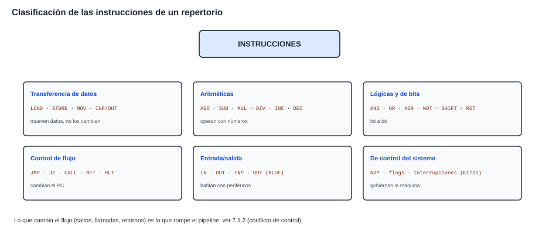
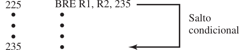

# 5.1.2 Clasificación de las instrucciones

> [!abstract] En una frase
> Las instrucciones se agrupan en **cinco familias**: **transferencia de datos**, **aritméticas**, **lógicas**, **de control** (saltos) y **de entrada/salida**; a las que se suman las de **desplazamiento/rotación** y las de **control del sistema** (halt, reset).

> [!note] Si la primera vez que ves esto
> Es como clasificar los verbos de un idioma: los que **mueven** cosas (poner, traer), los que **calculan** (sumar), los que **deciden** (si… saltar) y los que **hablan con afuera** (leer, escribir). Con esas cuatro ideas se entiende cualquier repertorio, del de la BLUE al de un Ryzen.

## Los grupos del repertorio



## Las familias

| Familia | Qué hace | BLUE | 8086 |
|---|---|---|---|
| **Transferencia de datos** | mover datos entre registros y memoria | `LDA`, `STA` | `MOV`, `PUSH`, `POP`, `XCHG` |
| **Aritméticas** | cuentas | `ADD` | `ADD`, `SUB`, `INC`, `DEC`, `MUL`, `DIV` |
| **Lógicas** | operaciones bit a bit | `AND`, `IOR`, `XOR`, `NOT` | `AND`, `OR`, `XOR`, `NOT`, `TEST` |
| **De control (salto)** | romper la secuencia | `JMA`, `JMP`, `SRJ`, `HLT` | `JMP`, `JZ`, `JNZ`, `CALL`, `RET` |
| **Entrada / salida** | hablar con periféricos | `INP`, `OUT` | `IN`, `OUT` |
| **Desplazamiento / rotación** | mover bits | `RAL` | `SHL`, `SHR`, `ROL`, `ROR` |
| **Control del sistema** | estado de la máquina | `HLT`, `NOP`, `CSA` | `HLT`, `NOP`, `INT`, `IRET` |

## Cómo se reconocen (sin tabla)

- **Mueve** algo de un lado a otro sin transformarlo ⇒ transferencia.

- **Cambia el valor** con una cuenta ⇒ aritmética.

- **Combina bit a bit** ⇒ lógica.

- **Cambia el `PC`** (o lo condiciona) ⇒ control.

- **Toca las líneas de E/S** (o espera `R`) ⇒ entrada/salida.

> [!important] Las condicionales
> Un salto puede ser **incondicional** (`JMA`, `JMP`) o **condicional**: en la BLUE se arman combinando `CSA` (que deja el resultado en el `AC` y salta si es 0) con un `JMA`; en el 8086 existen `JZ`, `JNZ`, `JC`, `JNC`… que miran los **flags**. La diferencia es que el 8086 tiene el registro de estado y la BLUE no.

## Clasificación por otra cosa (lo que se pregunta de costado)

| Criterio | Tipos | Ejemplo |
|---|---|---|
| **Nº de operandos** | 0, 1, 2, 3 | `HLT` (0), `ADD 100` (1, BLUE), `ADD R1,R2` (2, 8086) |
| **Longitud** | fija / variable | BLUE: fija (1 palabra) · 8086: variable (1 a 6 bytes) |
| **Qué modifican** | datos / control / estado | `ADD` / `JMA` / `HLT` |
| **Si acceden a memoria** | sí / no | `LDA` / `ADD R1, R2` |

## Ejemplo: el mismo programa en las cinco familias
```
LDA 10        transferencia   (traer el dato)
ADD 11        aritmética      (sumarlo)
AND mascara   lógica          (limpiar unos bits)
CSA           control         (si es 0, salta)
HLT           control sistema (terminar)
```
Y `INP`/`OUT` si el dato viniera del teclado o fuera a una pantalla.

> [!warning] Errores típicos
> - Meter `NOT` y `RAL` en "aritméticas": son **lógicas** y de **desplazamiento** respectivamente.
> - Decir que `HLT` es un salto (no: apaga la máquina).
> - Olvidar la familia de **E/S** en la clasificación (es una de las cinco clásicas).
> - Confundir `CSA` de la BLUE con un salto condicional del 8086.

## Figura del libro



*Fig. 10.6 — Instrucciones de bifurcación (salto relativo `BRR`).* · Stallings, *Organización y arquitectura de computadores*, 7ª ed., p. 394.

> [!tip] Qué mirar
> `BRR` salta a una dirección **relativa**: es la instrucción de control de flujo típica, la que cambia el `PC` en vez de usarlo para buscar la siguiente. Las de transferencia, aritméticas y lógicas no tocan el `PC`.

## Relacionado
[[5.1.1 Instrucción, opcode y operandos]] · [[5.1.3 Registros de la CPU]] · [[4.2.2 Los 16 opcodes octales]] · [[Lenguaje máquina y clasificación de instrucciones]] · [[CISC y RISC]] · [[Glosario — Unidad 5]]
