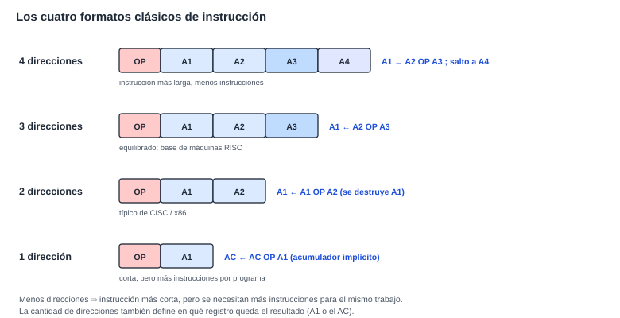
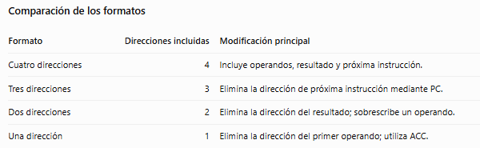
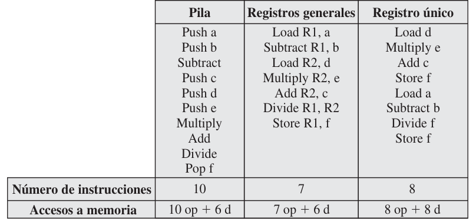
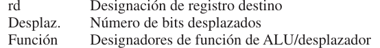

# 5.2.1 Los 4 formatos y el campo único de dirección

> [!abstract] En una frase
> Hay cuatro formatos de instrucción según **cuántas direcciones** llevan: **4, 3, 2 y 1**. Cuantas más, más corto el programa y más larga (y más compleja) la instrucción. La BLUE usa el de **una dirección** (con el `AC` implícito).

> [!note] Si la primera vez que ves esto
> Para calcular `X = A + B` hay dos maneras: con una instrucción que diga **todo** ("X, A, B") o con varias que digan **de a poco** ("traé A", "sumale B", "guardá en X"). La primera instrucción es **más larga** pero hay **una sola**; las otras son cortas pero hay **tres**.

## El mismo cálculo en los cuatro formatos

| Formato | Cómo se escribe | Instrucciones |
|---|---|---|
| **4 direcciones** | `ADD X, A, B, próxima` | **1** |
| **3 direcciones** | `ADD X, A, B` | **1** (el `PC` es implícito) |
| **2 direcciones** | `MOV X, A` · `ADD X, B` | **2** |
| **1 dirección** | `LDA A` · `ADD B` · `STA X` | **3** |



## Ventajas y desventajas

| Formato | A favor | En contra | Máquina típica |
|---|---|---|---|
| **4 dir.** | programa mínimo | instrucción larguísima; casi nadie la usa | teórico |
| **3 dir.** | equilibrado; el resultado no pisa un operando | instrucción larga | **RISC** (MIPS, ARM) |
| **2 dir.** | buena densidad; el destino es uno de los operandos | pisa un operando | **CISC** (8086, x86) |
| **1 dir.** | instrucción corta; todo el campo es dirección | muchas instrucciones; cuello en el `AC` | **acumulador** (BLUE) |

## El formato de la BLUE (16 bits)
```
15      12 11                              0
┌──────────┬────────────────────────────────┐
│ opcode 4 │        dirección 12            │
└──────────┴────────────────────────────────┘
```

| Instrucción | Cómo se lee |
|---|---|
| `LDA 100` | `AC ← M[100]` |
| `ADD 101` | `AC ← AC + M[101]` |
| `STA 102` | `M[102] ← AC` |

**Un solo campo de dirección** ⇒ tres instrucciones para el mismo cálculo, pero cada una de **16 bits**. RISC haría la misma cuenta con **una instrucción de 32 bits**.

## El formato variable (lo que viene después)
La **BLUE indexada** y el **8086** usan **formatos variables**: la instrucción mide 1 o 2 palabras (o 1 a 6 bytes) según el modo de direccionamiento que se elija. Ventaja: aprovecha el espacio; desventaja: decodificar es más complicado (y frena el pipeline).

> [!warning] Errores típicos
> - Decir "más direcciones = mejor" sin mencionar el costo en bits.
> - Contar el `PC` como una dirección explícita en el formato de 3.
> - Creer que la BLUE es de 2 direcciones porque `ADD` usa el `AC`: el `AC` es **implícito**.

## Ejemplo resuelto (elegir formato)
Calcular `X = A + B` en los cuatro formatos:

| Formato | Programa | Instrucciones |
|---|---|---|
| 3 direcciones | `ADD X, A, B` | 1 |
| 2 direcciones | `MOV X, A` · `ADD X, B` | 2 |
| 1 dirección | `LDA A` · `ADD B` · `STA X` | 3 |
| 0 direcciones (pila) | `PUSH A` · `PUSH B` · `ADD` · `POP X` | 4 |

Más direcciones ⇒ **menos instrucciones** pero **cada una más larga**. La BLUE usa el de **1 dirección** porque su palabra es de 16 bits: 4 de opcode + 12 de dirección.

## Figura de clase

### La comparación en cuatro renglones: qué se elimina al bajar de formato.



*Figura de clase — Resumen «Arquitectura final» (Said), p. 33.*

> [!tip] Qué mirar
> La tabla que responde «¿qué se pierde al pasar de 4 a 1 dirección?»: **4 direcciones** incluye todo (operandos, resultado y próxima instrucción); **3** elimina la próxima instrucción (la resuelve el `PC`); **2** elimina la dirección del resultado (se sobrescribe un operando); **1** elimina también el primer operando (queda implícito en el `AC`). Cada eliminación acorta la instrucción y **alarga el programa**, que es el compromiso que se pregunta.

## Figura del libro



*Fig. 10.15 — Comparación de tres programas para calcular lo mismo (pila, registros generales y registro único).* · Stallings, *Organización y arquitectura de computadores*, 7ª ed., p. 421.

> [!tip] Qué mirar
> Los tres hacen la misma cuenta con 10, 7 y 8 instrucciones. Cuantas menos direcciones lleva cada instrucción, **más instrucciones** hay que escribir: ese es el compromiso de los formatos de 0 a 3 direcciones.



*Fig. 13.8 — Formatos de instrucciones del MIPS (formato de tres operandos).* · Stallings, *Organización y arquitectura de computadores*, 7ª ed., p. 533.

> [!tip] Qué mirar
> Formato de 3 direcciones, todas de registro: `rd`, `rs`, `rt` más un campo de función. Es el formato típico de RISC, donde `LOAD`/`STORE` son las únicas que llevan dirección.

## Relacionado
[[5.2.2 Cálculo de CodOp según el tamaño de memoria]] · [[5.3.1 Los 7 modos]] · [[Formato de la instrucción (4 formatos)]] · [[CISC y RISC]] · [[4.2.2 Los 16 opcodes octales]] · [[Glosario — Unidad 5]]
