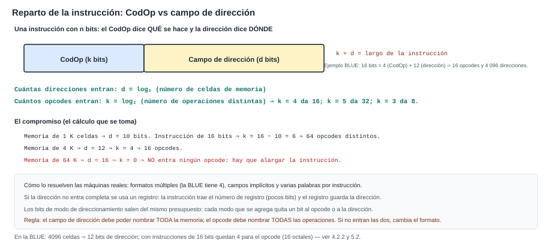
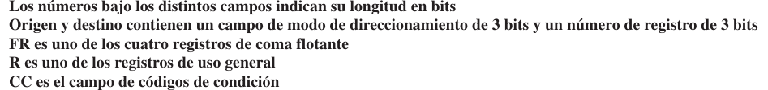

# 5.2.2 Cálculo de CodOp según el tamaño de memoria

> [!abstract] En una frase
> La palabra de instrucción es un **presupuesto**: si la memoria necesita `d` bits de dirección, al opcode le quedan **`CodOp = p − d`** bits, y la máquina puede tener **`2^CodOp` instrucciones**.

> [!note] Si la primera vez que ves esto
> Es una **valija de 16 lugares** donde tenés que meter dos cosas: "qué hacer" y "dónde". Si la memoria es grande, la dirección se lleva casi toda la valija y te quedan pocas combinaciones para las instrucciones. La solución histórica: **formatos variables** (una segunda palabra que aporte más dirección).

## k + d = instrucción



## La fórmula y el procedimiento
```
d  = log₂(celdas de memoria)          ← bits de dirección
CodOp = p − d                          ← p = bits de la palabra de instrucción
instrucciones posibles = 2^CodOp
```

## Ejemplos (los que se toman)

| Memoria | Celda | `d` | Palabra | `CodOp` | Instrucciones |
|---|---|---|---|---|---|
| 4096 celdas (**BLUE**) | 16 bits | **12** | 16 | **4** | **16** |
| 4 K celdas | 1 B | 12 | 16 | 4 | 16 |
| 512 MB | 4 B | **27** | 32 | **5** | 32 |
| 1 GB | 4 B | **28** | 32 | **4** | 16 |
| 64 K celdas | 1 B | 16 | 16 | **0** | ✗ no entra |
| 1 M celdas | 1 B | 20 | 32 | 12 | 4096 |

> [!important] El caso de la BLUE, paso a paso
> 4096 celdas ⇒ `d = log₂ 4096 = 12`; palabra de 16 ⇒ `CodOp = 16 − 12 = 4` ⇒ `2⁴ = 16` instrucciones: exactamente los `00` a `17` octales.

## Qué se hace cuando no alcanza

| Solución | Cómo | Costo |
|---|---|---|
| **Palabra más larga** | 16 → 32 bits | más memoria por instrucción |
| **Formato variable** | 2.ª palabra con más dirección | decodificación compleja |
| **Registros índice** | campo corto + registro que suma | hardware extra (la BLUE indexada) |
| **Segmentos** | base + desplazamiento | direccionamiento en dos pasos (8086) |
| **Banco de registros** | la dirección apunta a un registro, no a memoria | menos datos en memoria (RISC) |

## Ejercicio tipo final
> "Una máquina tiene memoria de 256 KB con celdas de 2 bytes y palabra de instrucción de 24 bits. ¿Cuántas instrucciones distintas puede tener?"

`256 KB = 2¹⁸` bytes ⇒ `2¹⁸ / 2 = 2¹⁷` celdas ⇒ `d = 17` ⇒ `CodOp = 24 − 17 = 7` ⇒ **2⁷ = 128 instrucciones**.

> [!warning] Errores típicos
> - Olvidar dividir por el tamaño de celda.
> - Usar `CodOp = d − p` (es al revés).
> - Dar como respuesta `CodOp` cuando piden **cantidad** de instrucciones (hay que hacer `2^CodOp`).
> - Mezclar bits con bytes en la resta.

## Figura del libro



*Fig. 11.6 — Formatos de instrucciones utilizados en el PDP-11.* · Stallings, *Organización y arquitectura de computadores*, 7ª ed., p. 448.

> [!tip] Qué mirar
> La instrucción mide 16 bits y se reparte en campos de 3 y de 3: cuantos más bits se le den al opcode, menos direcciones quedan. De acá salen los cálculos de «¿cuánto CodOp entra con esta memoria?».

## Relacionado
[[5.2.1 Los 4 formatos y el campo único de dirección]] · [[2.7.2 CodOp vs campo de dirección]] · [[Espacio de direccionamiento y cálculo de CodOp-Dirección]] · [[TP17 Formato básico de instrucciones]] · [[Glosario — Unidad 5]]
