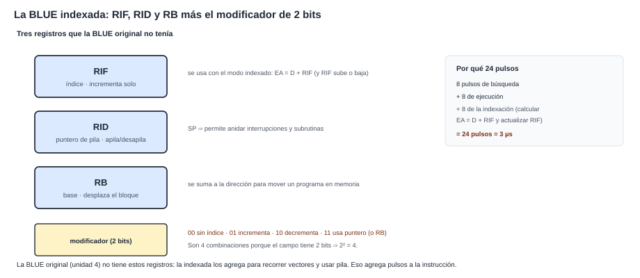
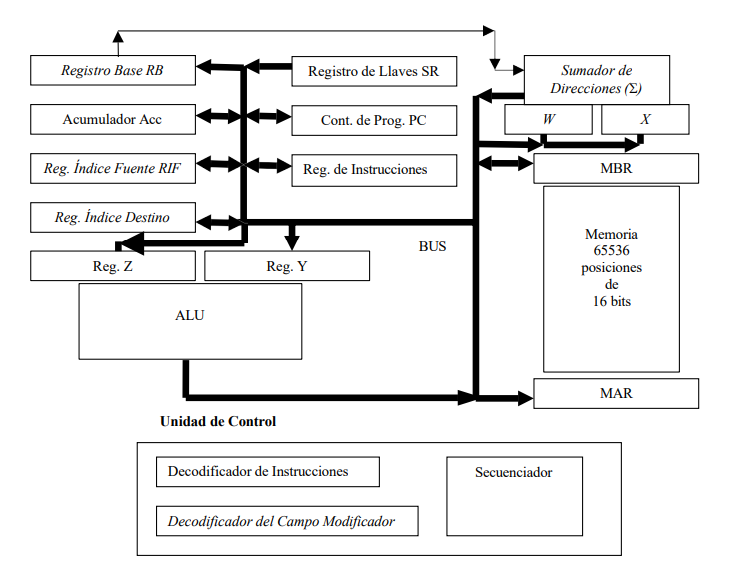

# 5.4.1 RIF, RID y RB

> [!abstract] En una frase
> **RB** (registro base) se suma **siempre** a la dirección y sirve para **reubicar** el programa; **RIF** (índice de
> **fuente**) y **RID** (índice de **destino**) se suman **sólo cuando la instrucción lo pide** y sirven para
> **recorrer arreglos** sin reescribir el código.

> [!note] Si la primera vez que ves esto
> Tres punteros con tres oficios: el **base** es el **edificio** (donde está el programa: si lo mudan, cambiás el
> edificio y listo); el de **fuente** es el **dedo** que marca de dónde leo; el de **destino**, el dedo que marca
> dónde escribo. Al sumarlos al campo de la instrucción, movés el dedo sin tocar la instrucción.

## Los tres registros nuevos



## Los tres registros

| Registro | Se suma… | Lo maneja | Para qué |
|---|---|---|---|
| **RB** | **siempre** | el sistema (no el programador) | **reubicación**: mover todo el programa sin tocar una instrucción |
| **RIF** | si el modificador = `01` o `11` | el programador | apuntar al **origen** (leer de un arreglo) |
| **RID** | si el modificador = `10` o `11` | el programador | apuntar al **destino** (escribir en otro arreglo) |

**Los tres son de 12 bits** (el mismo ancho que el campo de dirección y que el `MAR`).

## La dirección efectiva
```
EA = RB + campo + (0 | RIF | RID | RIF + RID)
      └── fijo ──┘   └──── según el modificador de 2 bits ────┘
```

> [!important] Por qué el base no lo toca el programador
> Porque existe para que el **sistema operativo** pueda cargar el programa en **otra parte** de la memoria sin
> recompilarlo. Si el programador lo usara para sus arreglos, esa función se perdería.

## Ejemplo: copiar un vector (la razón de ser de RIF y RID)
```
      RB  = 1000        base del programa
      RIF = 0           origen  (V1)
      RID = 100         destino (V2, 100 posiciones más adelante)

lazo: LDA  0, RIF       AC ← M[RB + 0 + RIF] = V1[i]
      STA  0, RID       M[RB + 0 + RID] ← AC = V2[i]
      RIF = RIF + 1     (instrucción de incremento)
      RID = RID + 1
      SRJ  lazo         repetir 100 veces (control con un contador)
```
Con la **BLUE básica** esto obligaba a **modificar las instrucciones** `LDA`/`STA` en memoria en cada vuelta. Con
los índices, la instrucción **no se toca**: sólo cambian los registros.

## Lo que se gana y lo que se paga

| | BLUE básica | BLUE indexada |
|---|---|---|
| Direccionamiento | directo (1 modo) | **4 modos** (los 2 bits del modificador) |
| Arreglos | hay que auto modificarse | lazo con `RIF`/`RID` |
| Espacio | 4096 palabras | 64 K (campo de 16 bits en 2 palabras) |
| Instrucciones | 16 | **32** |
| Pulsos por instrucción con memoria | 16 | **24** |

> [!warning] Errores típicos
> - Decir que `RIF` y `RID` son "lo mismo": **RIF = fuente (de dónde leo), RID = destino (dónde escribo)**.
> - Sumar el base **sólo** en los modos indexados: el base se suma **siempre**.
> - Confundir el registro base con el `BP` del 8086 (aquél es de marco de pila).
> - Olvidar que la dirección sigue siendo de 12 bits **después** de la suma (con vuelta al principio si se pasa).

## Figura de clase

### Todo el modelo indexado en una figura: los tres registros, el sumador y los dos decodificadores.



*Figura de clase — Resumen «Arquitectura final» (Said), p. 36.*

> [!tip] Qué mirar
> Es el plano general de la unidad 5.4: el **campo de dirección** de la instrucción entra al **sumador de direcciones** junto con **RB** (siempre) y con **RIF** o **RID** (según los bits `W` y `X` del modificador); el resultado va al `MAR` y de ahí a una memoria de **65 536 posiciones** (`16` bits de dirección). Los registros **`W`** y **`X`** que aparecen en el sumador son los dos bits del **modificador**. Abajo hay **dos** decodificadores: el de instrucciones (opcode de 5 bits, 32 instrucciones) y el **del campo modificador** — esa segunda decodificación es la que no existe en la BLUE original.

## Relacionado
[[5.4.2 Modificador de 2 bits y los 24 pulsos]] · [[BLUE indexada (RIF, RID, nuevo formato)]] ·
[[Registros base e índice]] · [[5.3.1 Los 7 modos]] · [[Glosario — Unidad 5]]
