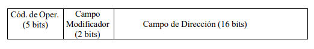
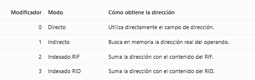
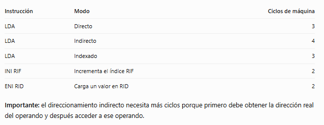
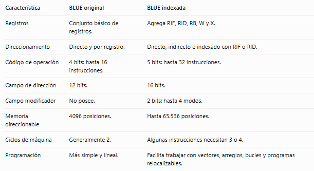
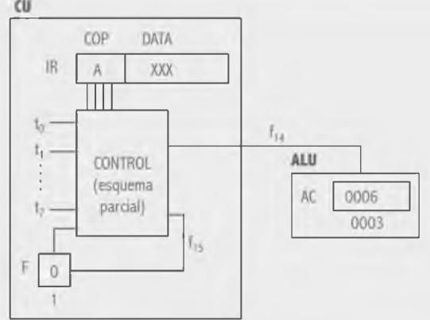

# 5.4.2 Modificador de 2 bits y los 24 pulsos

> [!abstract] En una frase
> La palabra de la indexada mide **32 bits** (5 de opcode + **2 de modificador** + 9 de campo + 16 de dirección) y
> **necesita 2 ciclos de búsqueda + 1 de ejecución = 24 pulsos** para una instrucción con memoria.

> [!note] Si la primera vez que ves esto
> El **modificador** es un pequeño menú de 4 opciones que dice *qué* sumar a la dirección: nada, `RIF`, `RID` o los
> dos. Es lo que convierte un direccionamiento directo en indexado, sin cambiar de instrucción.

## De dónde salen los 24 pulsos


## El modificador (2 bits)

| Modificador | Modo | Dirección efectiva |
|---|---|---|
| `00` | directo / **no indexado** | `EA = RB + campo` |
| `01` | indexado por **fuente** | `EA = RB + campo + RIF` |
| `10` | indexado por **destino** | `EA = RB + campo + RID` |
| `11` | indexado por **fuente y destino** | `EA = RB + campo + RIF + RID` |

## El formato nuevo (2 palabras = 32 bits)
```
palabra 1:  ┌────────┬──────┬───────────┐
            │ opcode │ mod  │  campo 9  │
            │  5     │  2   │           │
            └────────┴──────┴───────────┘
palabra 2:  ┌──────────────────────────────┐
            │      dirección (16 bits)     │
            └──────────────────────────────┘
```
- **9 bits de campo** en la primera palabra: es el **desplazamiento** (0-511).
- **16 bits** en la segunda: la **dirección** (hasta 64 K).
- **Opcode de 5 bits** ⇒ **32 instrucciones** (el doble que la básica).

## Los 24 pulsos de una instrucción indexada (ej. `LDA 3, X`)
| Ciclo | Qué hace | Pulsos |
|---|---|---|
| **1.º** (búsqueda, 1.ª palabra) | trae opcode + mod + campo | 8 |
| **2.º** (búsqueda, 2.ª palabra) | trae la dirección, la suma al base y a los índices (**calcula la EA**) | 8 |
| **3.º** (ejecución) | usa la EA: trae el dato (o lo escribe) | 8 |
| **Total** | | **24** |

> [!important] La comparación que se pide
> La misma `LDA` en la **BLUE básica** cuesta **16 pulsos**; en la **indexada**, **24**. Se paga **50 % más de
> tiempo** por instrucción a cambio de: arreglos sin auto modificación, 64 K de memoria, 32 instrucciones y
> reubicación con `RB`. **El indirecto** de la indexada llega a **32 pulsos** (un acceso más).

## Tabla de costos completa
| Instrucción | Básica | Indexada (mod 00) | Indexada (mod ≠ 00) | Indexada (indirecto) |
|---|---|---|---|---|
| Sin memoria (HLT, NOP, NOT, RAL…) | 8 | 16 | 16 | — |
| Con memoria (ADD, LDA, STA) | 16 | 16 | **24** | **32** |
| E/S (INP, OUT) | 16+ | 16+ | 24+ | — |

## Cómo se justifica el costo
1. **Menos instrucciones en el programa**: un lazo sobre 100 elementos usa **una** `LDA` en vez de 100.
2. **Menos memoria ocupada** por el programa (aunque cada instrucción ocupe 2 palabras).
3. **Reubicación gratis** con `RB`.
En tiempo total, para lazos largos, la indexada **gana**: el costo por instrucción sube 50 %, pero la cantidad de
instrucciones baja mucho más.

> [!warning] Errores típicos
> - Decir que son 24 pulsos **para todas** las instrucciones (las que no van a memoria son 16).
> - Confundir los 2 bits del modificador con los 4 del opcode.
> - Sumar `RIF` cuando el modificador es `00` (no se suma nada).
> - Decir que la palabra sigue siendo de 16 bits (son **dos**).

## Figura de clase

### La instrucción indexada ocupa dos palabras: 5 + 2 + 9 y 16 bits de dirección.



*Figura de clase — Resumen «Arquitectura final» (Said), p. 34.*

> [!tip] Qué mirar
> La instrucción deja de ser de **una** palabra: son **dos** (32 bits en total). La primera lleva el **opcode de 5 bits** (`32` instrucciones), el **modificador de 2 bits** y **9 bits** que el ejemplo no usa; la segunda, los **16 bits de dirección**. De ahí sale la cuenta de los 24 pulsos: leer **dos** palabras de instrucción ya cuesta **dos ciclos de búsqueda** (16 pulsos) antes de ejecutar.

### Los cuatro modos, en una tabla de cuatro renglones.



*Figura de clase — Resumen «Arquitectura final» (Said), p. 35.*

> [!tip] Qué mirar
> El modificador es un menú de **cuatro** opciones (`2 bits ⇒ 2² = 4`): `00` **directo** (usa el campo tal cual), `01` **indirecto** (el campo apunta a la dirección real: un acceso más, **32 pulsos**), `10` **indexado RIF** (suma el índice de fuente) y `11` **indexado RID** (suma el índice de destino). El **base** no aparece acá porque **se suma siempre**, en los cuatro modos.

### `LDA 3` (indexada): dos ciclos de ejecución después de las dos búsquedas.


*Figura de clase — Resumen «Arquitectura final» (Said), p. 37.*

> [!tip] Qué mirar
> El caso completo de los **24 pulsos**, pulso por pulso: **dos** ciclos de búsqueda iguales (traer la palabra 1 y la palabra 2 de la instrucción) y **dos** ciclos de ejecución, uno para calcular la dirección efectiva (`Σ` = campo + RIF + RB, que va al `MAR`) y otro para traer el dato de memoria al `AC`. Comparalo con `LDA` en la BLUE original, que necesita **un solo** ciclo de ejecución.

### Los ciclos de máquina según el modo: la tabla que se pregunta.



*Figura de clase — Resumen «Arquitectura final» (Said), p. 41.*

> [!tip] Qué mirar
> Los números para el final: **LDA directo 3**, **LDA indirecto 4**, **LDA indexado 3**, **INI 2** y **ENI 2**. Ojo con el directo: en la BLUE **original** `LDA` directo son **2** ciclos (16 pulsos), pero en la **indexada** son **3** (24 pulsos) porque la instrucción ocupa **dos palabras** y hay que buscarlas a las dos. El indirecto agrega un ciclo más: primero se obtiene la dirección real del operando y **después** se accede al dato.

### La BLUE original contra la indexada, característica por característica.



*Figura de clase — Resumen «Arquitectura final» (Said), p. 42.*

> [!tip] Qué mirar
> La tabla de cierre de la unidad, ideal para el «compará las dos versiones»: **registros** (se agregan `RIF`, `RID`, `RB`, `W` y `X`), **direccionamiento** (directo e indirecto → directo, indirecto e indexado), **opcode** (4 → 5 bits, 16 → 32 instrucciones), **campo de dirección** (12 → 16 bits, 4 096 → 65 536 posiciones), **modificador** (no existía → 2 bits, 4 modos), **ciclos** (2 → 3 o 4) y **programación** (más simple y lineal contra vectores, arreglos y programas reubicables).

## Figura del libro



*Fig. 7.15 — Fase execute SHR.* · Quiroga, *Arquitectura de computadoras*, p. 184.

## Ejemplo resuelto (24 pulsos)
`LDA` indexada por `RIF` con `RIF = 100`, campo `30`, `RB = 0`:
- `EA = RB + campo + RIF = 0 + 30 + 100 = 130`.
- Ciclos: **2 de búsqueda** (la instrucción ocupa **2 palabras** de 16 bits: opcode+mod+campo y la dirección) +
  **1 de ejecución** = **3 ciclos de 8 pulsos = 24 pulsos**.
- Tiempo: `24 × 125 ns = 3 µs`.
- Si el modificador fuera `00` (no indexado), la instrucción sigue siendo de 2 palabras ⇒ **también 24 pulsos**:
  el costo está en el **formato**, no en el modo.

## Relacionado
[[5.4.1 RIF, RID y RB]] · [[Ciclo de LDA indexada (los 24 pulsos)]] · [[BLUE vs BLUE indexada — qué cambia y por qué]] ·
[[BLUE indexada (RIF, RID, nuevo formato)]] · [[Glosario — Unidad 5]]
