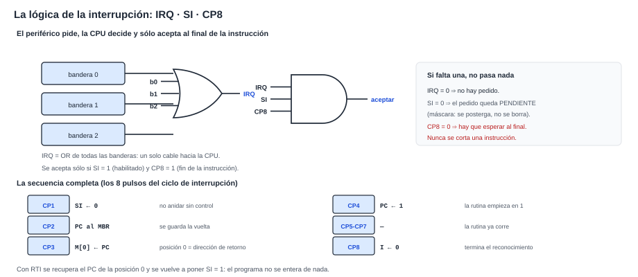
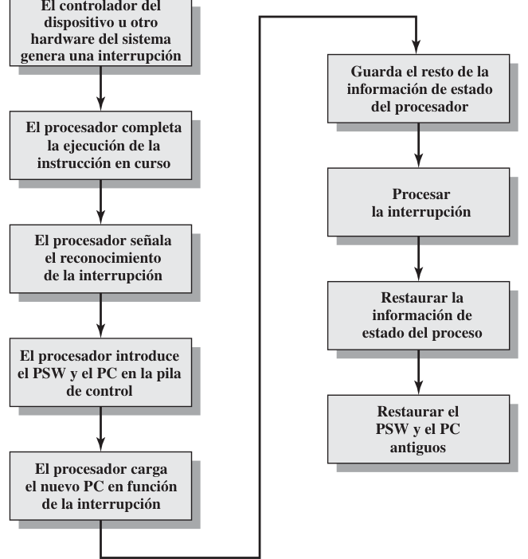
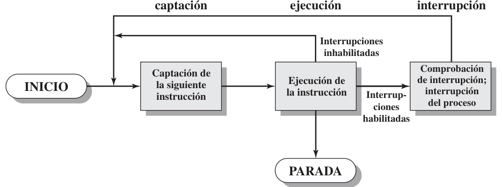

# 5.5.1 IRQ, SI y CP8

> [!abstract] En una frase
> Una interrupción se detecta en **un solo lugar del ciclo**: la señal **`IRQ · SI · CP8`**; si está activa, la
> máquina **termina la instrucción en curso** y en vez de buscar la siguiente **salta a la rutina de servicio**.

> [!note] Si la primera vez que ves esto
> Es el **timbre de la puerta**. No lo mirás todo el día (`polling`); cuando suena, terminás la frase que estabas
> escribiendo y atendés. `SI` es el **interruptor general del timbre**: si está en 0, aunque toquen, no suena.

## IRQ · SI · CP8



## Las tres letras
| Señal | Nombre | Quién lo pone | Qué significa |
|---|---|---|---|
| **`IRQ`** | *interrupt request* | el **periférico** (por una línea del bus) | "necesito atención" |
| **`SI`** | *set interrupt* / habilitación | la **CPU** (un bit de estado, lo tocan `CSI`/`CEI`) | "acepto interrupciones" |
| **`CP8`** | pulso 8 del ciclo | el **reloj** | "recién acá se pregunta" |

**La condición:** `IRQ = 1` **y** `SI = 1` **y** `CP8 = 1` ⇒ interrupción.

## Por qué justo en `CP8`
En `CP8` la instrucción **ya terminó** (el estado se actualizó en `CP8` de la ejecución) y todavía **no se buscó**
la próxima. Es el único instante en que se puede desviar el `PC` sin dejar nada a medias:

```
CP1..CP8  instrucción en curso (termina normalmente)
CP8       ¿IRQ·SI = 1?  ── sí ──▶  TRA ← 1  (pedido de transferencia)
                              ▼
          se guarda PC en la pila y se carga la dirección de la rutina
                              ▼
          se ejecuta la rutina de servicio (ISR)
                              ▼
          RTI vuelve a la instrucción siguiente
```

## Polling del flag (`TRA`)
La BLUE no tiene línea dedicada de interrupción en su versión básica: el periférico **activa un flag** y la CPU lo
**consulta** con una instrucción de E/S. El registro **`TRA`** (*transfer*) indica que hay un pedido de
transferencia pendiente:

| Camino | Cómo funciona | Costo |
|---|---|---|
| **Consulta (polling)** | la CPU lee el flag en un lazo; si está en 1, va a la rutina | gasta tiempo preguntando |
| **Interrupción** | `IRQ·SI·CP8` desvía sola; la CPU sigue trabajando mientras tanto | casi nada |

> [!important] Cuándo usar cada uno
> **Polling**: periféricos lentos y predecibles, o cuando el sistema no puede permitirse el hardware de interrupción.
> **Interrupción**: cuando el evento es **asíncrono** (teclado, disco, timer) y no se sabe cuándo llega.

## El código típico con polling
```
lazo: INP  1         AC ← estado del periférico
      AND  mascara   ¿está listo el bit 0?
      CSA            si AC = 0 …
      JMA lazo       … volver a preguntar
      LDA dato       listo: procesar
      ...
```
Con interrupción todo ese lazo **desaparece**: el programa principal corre y el periférico interrumpe cuando
corresponde.

> [!warning] Errores típicos
> - Decir que la interrupción se atiende **en medio** de una instrucción (siempre se espera al final).
> - Olvidar que hacen falta **`IRQ` y `SI`**: con `SI = 0` (interrupciones deshabilitadas) no pasa nada.
> - Confundir `SI` con la línea de E/S: es un **bit de estado interno**.
> - Creer que el polling "no tiene costo" (consume ciclos de CPU).

## Figura del libro



*Fig. 7.6 — Procedimiento de interrupción simple.* · Stallings, *Organización y arquitectura de computadores*, 7ª ed., p. 244.



*Fig. 3.9 — Ciclo de instrucción con interrupciones.* · Stallings, *Organización y arquitectura de computadores*, 7ª ed., p. 91.

## Ejemplo resuelto (la condición de aceptación)
La señal es **`IRQ · SI · CP8`**:
- `IRQ = 1` (el periférico pidió), `SI = 1` (las interrupciones están habilitadas) y llega **`CP8`** (fin del ciclo
  de instrucción actual) ⇒ se acepta.
- Si `SI = 0` (máscara puesta) o `IRQ = 0`, **no pasa nada**: la instrucción sigue normalmente.
- Al aceptarla: `SI ← 0` (se deshabilitan las demás), se guarda el `PC` en `M[0]` y se salta a la rutina.
- Cuenta: si la rutina tarda **21 µs** y se ejecuta cada milisegundo ⇒ **2,1 %** de la CPU.

## Relacionado
[[5.5.2 Máscara, pila y RTI]] · [[Interrupciones y entrada-salida]] · [[4.3.2 Búsqueda, los 8 pulsos]]
