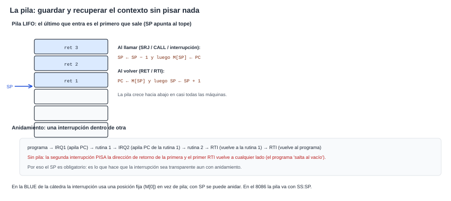
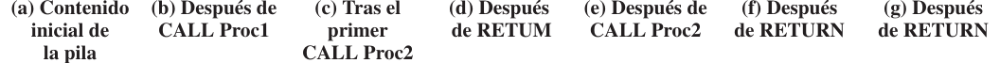

# 5.5.2 Máscara, pila y RTI

> [!abstract] En una frase
> Atender bien una interrupción exige **tres cosas**: **guardar el contexto** (en la pila), **respetar la máscara**
> (qué se puede interrumpir y qué no) y **volver con `RTI`**, que restaura todo. Durante la rutina de servicio, las
> interrupciones se **deshabilitan** solas.

> [!note] Si la primera vez que ves esto
> Estás escribiendo una carta, suena el timbre: **dejás el señalador donde estaba** (guardás el PC), atendés,
> volvés y **seguís desde el señalador** (`RTI`). El `RTI` es lo que evita tener que "acordarte" dónde estabas.

## La pila y el retorno



## Qué se guarda en la pila
| Se guarda | Por qué |
|---|---|
| **`PC` (dirección de vuelta)** | para saber dónde continuar |
| **Registro de estado / `AC`** | la rutina va a usarlos y no debe cambiar el resultado del programa |
| **Registros que use la rutina** (RIF, RID, `AC`…) | "contexto" completo |

**Orden:** primero el `PC` (normalmente lo hace el hardware), después los registros (lo hace el software).

## La máscara
| Concepto | Qué es |
|---|---|
| **Habilitación general (`SI`)** | bit que dice si se aceptan interrupciones |
| **Máscara por dispositivo** | cada línea tiene un bit; en 0, esa interrupción se **ignora** |
| **Prioridad** | si llegan dos a la vez, gana la de mayor prioridad |

Al entrar a una rutina, el hardware (o la primera instrucción `CDI`) pone **`SI = 0`** para que la propia rutina no
sea interrumpida. Al salir, **`RTI`** lo vuelve a `1`. Eso evita la recursión descontrolada.

## `RTI` — *return from interrupt*
```
RTI ≡  sacar de la pila los registros en orden inverso
       sacar de la pila el PC
       habilitar interrupciones (SI ← 1)
```
Es el **espejo exacto** de lo que hizo la entrada a la rutina. Si el orden de `POP` no es el inverso del de
`PUSH`, se vuelve a una dirección basura: es el error clásico de los ejercicios.

## El ciclo completo
```
   programa principal          rutina de servicio (ISR)
        │                            ▲
        │ CP8: IRQ·SI = 1            │
        ▼                            │
   PUSH PC ───────────────────────▶ │   PUSH AC / estado
        │                            │   (SI ← 0 automático)
        ▼                            │   ... procesar el evento ...
   PC ← dirección de la ISR          │   limpiar el flag del periférico
        │                            │   POP estado / AC
        ▼                            │   RTI  (POP PC, SI ← 1)
   ejecuta la ISR ──────────────────▶┘
        │
        ▼
   sigue con la instrucción siguiente al punto de interrupción
```

> [!important] No olvidar **limpiar el flag del periférico**
> Si la rutina no desactiva el pedido (`IRQ` queda en 1), al volver y habilitar `SI` la máquina **vuelve a
> interrumpir de inmediato**: entra en un lazo infinito de interrupciones. Es la falla más común en los finales.

## Interrupciones por hardware vs por software
| | Hardware | Software |
|---|---|---|
| Origen | una línea (`IRQ`) | una instrucción (`INT n`) |
| Cuándo | asíncrona | en el punto del programa |
| Uso | periféricos, timer | llamadas al sistema (`INT 21h`) |

> [!warning] Errores típicos
> - Volver con `JMP` o `RET` en vez de `RTI` (no se restaura ni el `PC` ni la habilitación).
> - Guardar los registros en un orden y sacarlos en el mismo orden (va **al revés**).
> - Omitir el `PUSH` del registro de estado: la rutina "rompe" los flags del programa interrumpido.
> - No limpiar el flag del periférico antes del `RTI`.

## Figura del libro



*Fig. 10.8 — Uso de una pila para implementar el anidamiento de subrutinas* · Stallings, *Organización y arquitectura de computadores*, 7ª ed., p. 397.

## Ejemplo resuelto (guardar y volver)
Llega una interrupción cuando `PC = 300`:
1. El hardware guarda `M[0] ← 300` (dirección de vuelta) y salta a la rutina.
2. La rutina guarda en la pila lo que va a usar (`AC`, `RIF`, …): `PUSH AC` ⇒ `SP ← SP − 1`, `M[SP] ← AC`.
3. Al terminar, `POP` recupera en orden inverso y **`RTI`** hace `PC ← M[0] = 300` ⇒ el programa sigue donde
   estaba, como si nada.
- Si dentro de la rutina se quiere permitir otra interrupción, hay que volver a poner `SI = 1`
  (**anidamiento**); si no, la segunda espera.

## Relacionado
[[5.5.1 IRQ, SI y CP8]] · [[Interrupciones y entrada-salida]] · [[3.2.2 Operaciones aritméticas, lógicas y flags]] ·
[[5.6.2 La pila y el registro SP]]
