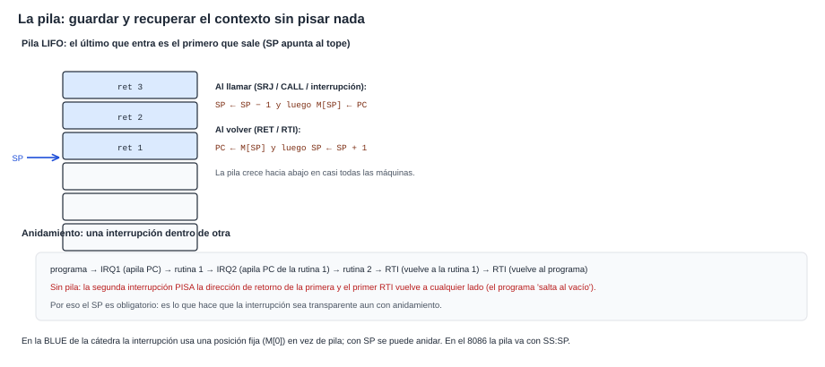

# 5.6.2 La pila y el registro SP

> [!abstract] En una frase
> La **pila** del 8086 es una zona de memoria con dos operaciones, **`PUSH`** (deja un dato arriba) y **`POP`**
> (lo saca), organizada como **LIFO** y apuntada por **`SS:SP`**. El `SP` **decrece** al apilar y **crece** al
> desapilar. Es la clave de las subrutinas, las interrupciones y las variables locales.

> [!note] Si la primera vez que ves esto
> Es una **pila de platos**: el último que ponés es el primero que sacás. En el 8086 la pila **crece hacia abajo**
> (hacia direcciones menores): cada plato nuevo se pone *debajo* de los anteriores.

## La pila del 8086



## Cómo funciona
```
SS:SP ──▶ ┌──────────┐  dirección baja  (la pila crece hacia acá)
          │  último  │ ◀── tope (SP)
          ├──────────┤
          │  anterior│
          ├──────────┤
          │   ...    │
          └──────────┘  dirección alta
```

| Instrucción | Qué hace | `SP` |
|---|---|---|
| **`PUSH AX`** | `SP ← SP − 2`; `M[SS:SP] ← AX` | **decrece** |
| **`POP AX`** | `AX ← M[SS:SP]`; `SP ← SP + 2` | **crece** |

> [!important] El orden importa
> `PUSH A` seguido de `PUSH B` obliga a hacer `POP B` y después `POP A`. Si se invierte, se "cruzan" los valores:
> es el mismo error que con `RTI` en las interrupciones.

## Para qué se usa (las tres razones)
1. **Subrutinas** — `CALL` apila la dirección de vuelta; `RET` la desapila.
   ```
   CALL SUB        ; PUSH IP  (y CS si es far) ; IP ← SUB
   ...
   SUB: ...
        RET        ; POP IP
   ```
2. **Interrupciones** — el hardware apila `FLAGS`, `CS` e `IP`; `IRET` los restaura.
3. **Variables locales y paso de parámetros** — `BP` marca el comienzo del **marco** de la subrutina:
   ```
   PUSH BP          ; guardo el marco anterior
   MOV  BP, SP      ; nuevo marco
   SUB  SP, 4       ; espacio para 2 variables locales
   ...
   MOV  SP, BP      ; deshago
   POP  BP
   RET
   ```

## Desbordamiento y subdesbordamiento
| Problema | Qué pasa |
|---|---|
| **Desbordamiento** (*overflow*) | se hacen más `PUSH` que espacio hay ⇒ se pisa otra zona de memoria |
| **Subdesbordamiento** (*underflow*) | se hacen más `POP` que `PUSH` ⇒ se sacan datos basura |
| **No hay protección** | el 8086 no avisa: el programa "se cuelga" o da resultados absurdos |

## Comparación con la pila de la BLUE
| | BLUE | 8086 |
|---|---|---|
| Puntero | `SP` (12 bits) | `SS:SP` (20 bits) |
| Crecimiento | hacia abajo | hacia abajo |
| Quién la usa | instrucciones de pila / interrupciones | `PUSH`, `POP`, `CALL`, `RET`, `INT`, `IRET` |
| Variables locales | no | sí (con `BP`) |

> [!warning] Errores típicos
> - Decir que el `SP` **aumenta** al apilar (decrece).
> - Olvidar que `PUSH`/`POP` mueven **2 bytes** (son de 16 bits).
> - Confundir `CALL` (subrutina, guarda `IP`) con `JMP` (salto, no guarda nada).
> - No restaurar `SP` al final de una subrutina que reservó espacio local.

## Figura del libro


*Fig. 10.13 — Operaciones básicas con la pila.* · Stallings, *Organización y arquitectura de computadores*, 7ª ed., p. 418.

## Ejemplo resuelto (la pila crece hacia abajo)
Con `SP = 0100H`:
- `PUSH AX` ⇒ `SP ← 00FEH` y `M[00FEH] ← AX` (2 bytes, porque el 8086 trabaja de a 16 bits).
- `PUSH BX` ⇒ `SP ← 00FCH` y `M[00FCH] ← BX`.
- `POP BX` ⇒ `BX ← M[00FCH]`, `SP ← 00FEH`; `POP AX` ⇒ `SP ← 0100H` (vuelve al inicio).
- Por eso el 8086 usa `SS:SP`: el **segmento de pila** más el puntero. Y por eso el **desborde de pila** es un
  error real: si `SP` baja más allá del segmento, pisa datos.

## Relacionado
[[5.6.1 BIU, EU y segmentación]] · [[5.5.2 Máscara, pila y RTI]] · [[TP21 intro al emu8086]] ·
[[3.3.2 Base, índice, puntero de pila y estado]]
