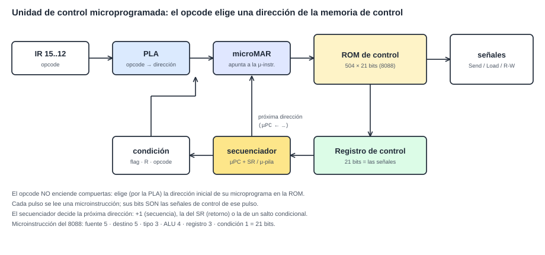

# Síntesis — Unidad 6: Control microprogramado

> [!abstract] Qué es este archivo
> **Toda la Unidad 6 en un solo lugar**: la UC **cableada** (compuertas, estado, reloj, señales), la UC
> **microprogramada** (memoria de control, microinstrucción, secuenciador) y la **comparación** con el caso real
> del **8088 (504 × 21 bits)**. Con recetas de examen, errores que cuestan puntos y autoevaluación.

> [!tip] Cómo usarlo
> 1. Leer **§1 a §6** de corrido (25 minutos).
> 2. Tapar y recitar las **dos tablas de comparación** y la **ecuación de señal**.
> 3. Resolver **§9 recetas** con lápiz.
> 4. Contestar las **§11 preguntas** sin mirar.

## Índice
1. [[#1. Qué hace la Unidad de Control]]
2. [[#2. La UC cableada: estado, reloj y decodificación]]
3. [[#3. La generación de señales]]
4. [[#4. La UC microprogramada: memoria de control y microinstrucción]]
5. [[#5. El secuenciamiento]]
6. [[#6. Cableada vs microprogramada]]
7. [[#7. El caso real: el 8088]]
8. [[#8. Tablas de memoria rápida]]
9. [[#9. Recetas de examen]]
10. [[#10. Errores que cuestan puntos]]
11. [[#11. Autoevaluación]]

---

## 1. Qué hace la Unidad de Control

Los registros, la ALU y la memoria **no hacen nada solos**: la UC es la que **aprieta los botones en orden y a
tiempo**.

| Función | Qué hace | Con qué |
|---|---|---|
| **Sincronizar** | marca el ritmo | reloj → `CP1…CP8` |
| **Decodificar** | sabe qué instrucción es | `IR15..12` → decodificador 1→16 |
| **Secuenciar** | búsqueda o ejecución | FF `STATE`, FF `RUN`, FF `TRA` |
| **Generar** | activa las señales | compuertas AND / OR |

**La UC no calcula: manda.** Las cuentas las hace la ALU; la UC elige **qué salida** de la ALU se habilita.
👉 [[6.1.1 Circuito, compuertas y señales]]

## 2. La UC cableada: estado, reloj y decodificación

### Los tres flip-flops
| FF | A 1 con | A 0 con | Para qué |
|---|---|---|---|
| **`RUN`** | `START` | `STOP`, `HLT`, **overflow** | enciende la máquina |
| **`STATE`** | `F · CP8 · REF` | `E · CP8` | `F` = búsqueda · `E` = ejecución |
| **`TRA`** | `F · CP7 · (INP + OUT)` | fin de la E/S | E/S en curso |

### El reloj
Cadena de **8 retardos de 125 ns** ⇒ `CP1…CP8`, con **realimentación** al final.
**1 ciclo de máquina = 8 pulsos = 1 µs.**

### El decodificador
`IR15..12` → **1→16** = **4 NOT + 16 AND de 4 entradas**, una línea activa por instrucción
(`HLT`=0000 … `NOP`=1111).


## 3. La generación de señales

```
señal = estado · pulso · instrucción        (y después: OR de todos los casos que dan la misma señal)
```

| Señal | Ecuación |
|---|---|
| `Send PC, Load MAR` | `F · CP1` |
| `Read` (búsqueda) | `F · CP1` |
| `Send MBR, Load IR` | `F · CP6` |
| `E → STATE` | `F · CP8 · REF` |
| `Send IR, Load MAR` | `E · CP1 · REF` |
| `Send A, Load Z` | `E · CP2 · ARITH` |
| `Send MBR, Load Y` | `E · CP6 · ARITH` |
| `Send SUM, Load A` | `E · CP8 · ADD` |
| `Send MBR, Load A` | `E · CP6 · LDA` |
| `Send A, Load MBR` + `Write` | `E · CP4 · STA` |
| `Send IR, Load PC` | `CP8 · (JMP + JMA·A15 + SRJ)` |

### Las familias
```
REF   = LDA + STA + ADD + XOR + AND + IOR
ARITH = ADD + XOR + AND + IOR
DTA   = REF
```
### La OR
```
MBR_in = F·CP5  +  E·CP5·REF
```
**Los AND eligen, las OR juntan.** La UC cableada es una **suma de productos** (tabla de verdad → función →
compuertas).
👉 [[6.1.1 Circuito, compuertas y señales]]

## 4. La UC microprogramada: memoria de control y microinstrucción

| Nombre | Qué es |
|---|---|
| **Microorden** | una señal elemental |
| **Microinstrucción** | una **palabra** de la memoria de control (varias microórdenes juntas) |
| **Microprograma** | secuencia de microinstrucciones que ejecuta **una** instrucción de máquina |
| **Memoria de control** | la **ROM** que guarda todos los microprogramas |
| **Firmware** | el contenido de esa ROM |

### Los bloques
```
IR (opcode) ─► PLA ─► microMAR ─► MEMORIA DE CONTROL ─► registro de control ─► señales
                        ▲                  │
                        └── secuenciador ◄─┘
```

| Bloque | Función |
|---|---|
| **PLA** | opcode → **dirección inicial** |
| **microMAR** | guarda la dirección actual |
| **Memoria de control** | ROM: dirección → palabra de control |
| **Registro de control** | sostiene las señales durante el pulso |
| **Secuenciador** | calcula la próxima dirección |

### El formato (8088)
```
┌───────┬────────┬─────┬──────┬────────┬───────────┐
│fuente │destino │tipo │ ALU  │registro│ condición │
│  5    │   5    │  3  │  4   │   3    │     1     │
└───────┴────────┴─────┴──────┴────────┴───────────┘   = 21 bits
```

### Horizontal vs vertical
| | Horizontal | Vertical |
|---|---|---|
| Bits por señal | **1 = 1 señal** | codificados |
| Velocidad | **más rápida** | más lenta (decodificar) |
| Palabra | ancha | angosta |
| Microprograma | corto | largo |

### El microprograma de la búsqueda
| µdir | Microoperación | Señales |
|---|---|---|
| 0 | `MAR ← PC` | `PCout`, `MARin` |
| 1 | `MBR ← M[MAR]` ; `PC ← PC + 1` | `MEMR`, `MBRin`, `PCinc` |
| 2 | `IR ← MBR` | `MBRout`, `IRin` |
| 3 | mapeo al microprograma del opcode | — |

👉 [[6.2.1 Memoria de control y microinstrucción]]

## 5. El secuenciamiento

| # | Mecanismo | Cuándo | Cómo |
|---|---|---|---|
| 1 | **Incremento** | secuencia lineal | contador `µPC + 1` |
| 2 | **Salto condicional** | según flag o `R` | **MUX** a la entrada del microPC |
| 3 | **Mapeo** | al empezar la ejecución | **PLA**: `µdir = f(opcode)` |
| 4 | **Microsubrutina** | rutinas comunes (búsqueda) | registro **`SR`** o micro-pila |

**Truco del mapeo mínimo:** meter el opcode en la dirección ⇒ `µdir = base + (opcode << 2)`.
Con `opcode = 0110` (`LDA`) y `base = 64`: `64 + 24 = 88`.

**`SR`** guarda **una** dirección de retorno (un nivel); la micro-pila permite anidar.
👉 [[6.2.2 Secuenciamiento y microPC]]

## 6. Cableada vs microprogramada



| | **Cableada** | **Microprogramada** |
|---|---|---|
| Secuencia guardada en | compuertas (fija) | **ROM de control** |
| Velocidad | **más rápida** (sin acceso de control) | más lenta (**1 acceso de ROM por paso**) |
| Flexibilidad | nula | **alta** (se reescribe la ROM) |
| Costo de diseño | crece rápido con el ISA | ordenado y barato |
| Instrucciones complejas | difíciles | naturales |
| Uso | **RISC**, BLUE | **CISC**, 8088 |

**Cierre:** cableada = **rápida y rígida** (RISC) · microprogramada = **lenta y flexible** (CISC) · **hoy:
híbrido** (el x86 traduce a microoperaciones y ejecuta con un núcleo cableado con pipeline).

👉 [[6.3.1 Cableada vs microprogramada]]

## 7. El caso real: el 8088

| Dato | Valor |
|---|---|
| Palabras de la memoria de control | **504** |
| Ancho de la microinstrucción | **21 bits** (`5+5+3+4+3+1`) |
| Bits totales | `504 × 21 = 10 584` ≈ **1,3 KB** |
| MicroPC | **9 bits** (`log₂ 504 ≈ 9`) ⇒ 512 direcciones, **8 libres** |
| Microprocedimientos | ~**90** (≈ 5,6 palabras por rutina) |
| Traducción del opcode | **PLA** |
| Además | **BIU + EU** con **FIFO de 4 bytes** y segmentación (`segmento × 16 + desplazamiento`) |

👉 [[6.3.2 El 8088, ROM de control 504x21]]

## 8. Tablas de memoria rápida

### Los nombres, de menor a mayor
| Escala | Nombre |
|---|---|
| 1 señal | microorden |
| 1 palabra de la ROM | microinstrucción |
| 1 rutina (una instrucción de máquina) | microprograma |
| toda la ROM | memoria de control |

### Las fórmulas de la unidad
| Qué | Fórmula |
|---|---|
| Señal de control | `señal = estado · pulso · instrucción` |
| Juntar señales | `+` (OR) |
| Ciclo de máquina | 8 pulsos × 125 ns = **1 µs** |
| Ancho de la µinstrucción (8088) | `5+5+3+4+3+1 = 21` |
| Bits de la ROM | `palabras × ancho` |
| Bits del microPC | `log₂(palabras)` |
| Mapeo mínimo | `µdir = base + (opcode << n)` |

### Los tres FF de la BLUE
`RUN` (corriendo) · `STATE` (`F`/`E`) · `TRA` (E/S en curso).

## 9. Recetas de examen

> [!example] Receta 1 — "Diseñe la UC cableada de una señal"
> 1. Decir **en qué estado** ocurre (`F` o `E`).
> 2. Decir **en qué pulso** (`CP1…CP8`).
> 3. Decir **en qué instrucciones**: la línea del decodificador o la **familia** (`REF`, `ARITH`).
> 4. Escribir la AND: `E · CP6 · LDA`.
> 5. Si la señal aparece en varios casos, **juntar con OR** y avisar: "no se duplica el cable".

> [!example] Receta 2 — "¿Cómo se construye una UC microprogramada?"
> 1. **Memoria de control** (ROM) con una palabra por microinstrucción.
> 2. **PLA** que traduce el opcode a la dirección inicial.
> 3. **microPC** + **secuenciador** (4 mecanismos: +1, condicional, mapeo, microsubrutina).
> 4. **Registro de control** a la salida, para estabilizar las señales.
> 5. Cerrar con el ejemplo del 8088 (504 × 21).

> [!example] Receta 3 — "Calcule el tamaño de la memoria de control"
> 1. Contar las microinstrucciones de **todas** las rutinas: `N`.
> 2. Ancho = suma de los campos (`21` en el 8088).
> 3. `bits = N × ancho`; si piden bytes, dividir por 8.
> 4. MicroPC: `log₂ N` redondeado **hacia arriba**.

> [!example] Receta 4 — "Compare cableada y microprogramada"
> 1. Tabla de 5 filas: cómo guarda · velocidad · flexibilidad · costo · uso.
> 2. Explicar el **acceso extra** de la microprogramada (la causa de la lentitud).
> 3. Relacionar con **CISC/RISC**.
> 4. Cerrar con el **híbrido** actual.

> [!example] Receta 5 — "¿Por qué el 8088 es microprogramado?"
> 1. Tiene **muchas** instrucciones y formatos variables (CISC).
> 2. Debe mantener **compatibilidad** con el 8080 ⇒ corregir por ROM, no por rediseño.
> 3. Una cableada con ~90 rutinas sería inmanejable.
> 4. Costo: más lenta ⇒ se compensa con **BIU/EU** y la **FIFO**.

## 10. Errores que cuestan puntos

| Error | Lo correcto |
|---|---|
| "La UC hace las operaciones" | las hace la **ALU**; la UC **habilita** |
| Confundir **instrucción** y **microinstrucción** | una instrucción = **varias** microinstrucciones |
| Decir que la microprogramada es **más rápida** | es más **flexible**; la rápida es la **cableada** |
| Olvidar el **estado** en la ecuación | `CP1` existe en `F` **y** en `E` |
| Poner `·` donde va `+` | AND **elige**, OR **junta** |
| "La memoria de control es RAM" | es **ROM** (firmware) |
| Confundir **PLA** y **memoria de control** | PLA **traduce**, la ROM **almacena** |
| Decir 504 **bits** en el 8088 | 504 **palabras** de **21 bits** (10 584 bits) |
| Sumar 20 bits en la microinstrucción | `5+5+3+4+3+1 = 21` |
| Confundir **microPC** con **PC** | el PC apunta al programa; el microPC, a la µinstrucción |
| Decir que `SR` es una pila completa | es **un** nivel de retorno |
| Olvidar el **mapeo del opcode** | sin él la UC no sabe dónde empezar |
| Decir "RISC no tiene UC" | tiene, **cableada** |
| Decir que `RUN` y `STATE` son lo mismo | `RUN` enciende; `STATE` elige la fase |
| Creer que `overflow` genera interrupción en la BLUE | **apaga** `RUN` |

## 11. Autoevaluación

1. ¿Cuáles son las **cuatro funciones** de la UC y con qué bloque cumple cada una?
2. Nombrá los **tres flip-flops** de la BLUE y qué los pone en 1 y en 0.
3. ¿Cuántos pulsos tiene un ciclo de máquina y cuánto dura? ¿Cómo se generan los pulsos?
4. ¿Cuántas compuertas necesita el decodificador 1→16 de la BLUE y por qué esa cantidad?
5. Escribí la ecuación de `Send MBR, Load IR` y la de `Send IR, Load MAR`. ¿Qué cambia entre las dos?
6. ¿Qué son `REF`, `ARITH` y `DTA` y para qué sirven al diseñar?
7. ¿Por qué una señal que aparece en varios casos se implementa con **OR** y no con un cable por caso?
8. Definí **microorden**, **microinstrucción**, **microprograma** y **memoria de control**, de menor a mayor.
9. ¿Qué hace el **registro de control** a la salida de la memoria de control y qué pasaría sin él?
10. Enumerá los **cuatro mecanismos de secuenciamiento** y un ejemplo de cada uno.
11. ¿Qué guarda el **`SR`** y en qué se diferencia del `PC`?
12. El 8088 tiene 504 palabras de 21 bits: ¿cuántos bits de ROM son y cuántos bits necesita el microPC?
13. ¿Por qué el 8088 es **microprogramado** y la BLUE **cableada**? Relacionarlo con CISC y RISC.
14. ¿Cuándo conviene cada tipo de UC? Dame dos criterios en conflicto.
15. Explicá el **híbrido actual**: ¿por qué un x86 es CISC por fuera y RISC por dentro?

---

## Relacionado
[[00 Unidad 6 — temas y subtemas]] · [[00 Síntesis — Unidad 5]] · [[00 Unidad 7 — temas y subtemas]] ·
[[00 Índice de la materia (las 10 unidades)]] · [[Cómo se implementa la Unidad de Control]]
