# Unidad 6 — Control microprogramado

> [!abstract] Qué es este archivo
> **La Unidad 6 completa en un solo archivo**: los **5 subtemas** pegados uno detrás de otro,
> con todo su contenido: definiciones, tablas, diagramas, ejemplos resueltos, figuras del libro y errores
> típicos. Son **4.778 palabras** y **3 temas**. Está pensado para **leer de corrido** y para
> **imprimir**: no hace falta abrir ninguna otra nota.
>
> - **Repaso rápido** (una página): [[00 Síntesis — Unidad 6]].
> - **Buscar un punto**: el índice de abajo o el de la unidad, [[00 Unidad 6 — temas y subtemas]].
> - Cada subtema conserva su número (`1.4.1`), así coincide con el índice y con las preguntas del final.
> - **Todo junto, las 10 unidades**: [[00 Materia completa (las 10 unidades en un archivo)]].
>
> *Archivo generado con `tools/unir_unidades.py`: no editarlo a mano, editar el subtema y regenerar.*

## Contenido

**6.1 Control cableado**
- [[#6.1.1 Circuito, compuertas y señales]]

**6.2 Control microprogramado**
- [[#6.2.1 Memoria de control y microinstrucción]]
- [[#6.2.2 Secuenciamiento y microPC]]

**6.3 Comparación y caso real**
- [[#6.3.1 Cableada vs microprogramada]]
- [[#6.3.2 El 8088, ROM de control 504x21]]

---

## 6.1 Control cableado

### 6.1.1 Circuito, compuertas y señales

> [!abstract] En una frase
> La UC cableada es un **circuito combinacional y secuencial**: tres flip-flops de **estado** (`RUN`, `STATE`,
> `TRA`) + un **reloj** que reparte 8 pulsos + un **decodificador** del opcode, y a la salida una AND por señal con
> `señal = estado · pulso · instrucción`, juntadas con **OR**.

> [!note] Si la primera vez que ves esto
> Pensalo como una **receta de cocina sin libro**: las instrucciones están "escritas" en el cableado. Cada cable
> dice "si estás friendo (estado), y toca el minuto 3 (pulso), y el plato es milanesa (instrucción), entonces subí
> el fuego". Cambiar la receta obliga a **volver a soldar**.

#### Las cuatro funciones de la UC
| Función | Qué hace | Con qué |
|---|---|---|
| **Sincronizar** | marca el ritmo | reloj maestro → `CP1…CP8` |
| **Decodificar** | sabe qué instrucción es | `IR15..12` → decodificador 1→16 |
| **Secuenciar** | decide búsqueda o ejecución | FF `STATE`, FF `RUN` |
| **Generar** | activa las señales | compuertas AND/OR |

#### Los tres flip-flops de estado

| FF | Se pone en 1 con | Se pone en 0 con | Para qué |
|---|---|---|---|
| **`RUN`** | `START` | `STOP`, `HLT` (CP7), **overflow** | mientras está en 1 el reloj avanza; en 0 la máquina se congela |
| **`STATE`** | `F · CP8 · REF` (fin de búsqueda de una instrucción con memoria) | `E · CP8` (fin de la ejecución) | `F` = búsqueda · `E` = ejecución |
| **`TRA`** | `F · CP7 · (INP + OUT)` | fin de la E/S | hay una operación de E/S en curso |

> [!important] `RUN` y el overflow
> El **overflow** apaga `RUN`: es una **parada por error** (no por programa). Es la razón por la que la BLUE no
> tiene una instrucción de "trap": la protección está cableada.

#### El reloj: 8 pulsos por cadena de retardos
```
            ┌──►CP1  ┌──►CP2        ┌──►CP8
   pulso ───┤125ns├──┤125ns├─ ... ──┤125ns├──┐
            └─────┘  └─────┘        └─────┘  │
                ▲                            │
                └──────── realimentación ◄────┘   (si RUN = 1 · o si STATE = E)
```
- Cada derivación de la cadena da **una línea** `CP1…CP8`, todas del mismo ancho (125 ns).
- Al terminar la octava, el pulso **realimenta** y empieza otro ciclo de máquina.
- **Un ciclo de máquina = 8 pulsos = 1 µs.** La instrucción de 2 ciclos = 2 µs.

#### La decodificación del opcode
`IR15..12` (4 bits) → **decodificador 1→16** = 4 inversores + **16 AND de 4 entradas**:

| Salida | Opcode | Salida | Opcode |
|---|---|---|---|
| `HLT` | `0000` | `SRJ` | `1000` |
| `ADD` | `0001` | `JMA` | `1001` |
| `XOR` | `0010` | `JMP` | `1010` |
| `AND` | `0011` | `INP` | `1011` |
| `IOR` | `0100` | `OUT` | `1100` |
| `NOT` | `0101` | `RAL` | `1101` |
| `LDA` | `0110` | `CSA` | `1110` |
| `STA` | `0111` | `NOP` | `1111` |

**Una sola línea activa a la vez** ⇒ esa línea es el "factor instrucción" de las ecuaciones.

#### La generación de señales


```
señal = (estado) · (pulso) · (línea de instrucción)
```

| Señal de control | Ecuación | Qué habilita |
|---|---|---|
| `Send PC, Load MAR` | `F · CP1` | poner el `PC` en el bus y cargar el `MAR` |
| `Read` (búsqueda) | `F · CP1` | orden de lectura de la instrucción |
| `Send MBR, Load IR` | `F · CP6` | pasar la instrucción al `IR` |
| `E → STATE` | `F · CP8 · REF` | pasar a ejecutar |
| `Send IR, Load MAR` | `E · CP1 · REF` | dirección del operando al `MAR` |
| `Send A, Load Z` | `E · CP2 · ARITH` | primer operando a la ALU |
| `Send MBR, Load Y` | `E · CP6 · ARITH` | segundo operando a la ALU |
| `Send SUM, Load A` | `E · CP8 · ADD` | guardar el resultado |
| `Send MBR, Load A` | `E · CP6 · LDA` | cargar el dato |
| `Send A, Load MBR` + `Write` | `E · CP4 · STA` | guardar en memoria |
| `Send IR, Load PC` | `CP8 · (JMP + JMA·A15 + SRJ)` | salto |

##### Las familias que ahorran cableado
```
REF   = LDA + STA + ADD + XOR + AND + IOR     ← todas las que tocan memoria con un operando
ARITH = ADD + XOR + AND + IOR                 ← las que usan la ALU con dos operandos
DTA   = REF                                   ← las que traen o llevan un dato
```
Usarlas cambia **una** ecuación por un grupo de líneas:
`Send IR, Load MAR = E · CP1 · REF` en lugar de seis términos.

> [!important] Las OR: el paso que más se olvida
> Cuando **la misma señal** se activa desde varios lugares distintos, no se duplican cables: se juntan con una OR.
> ```
> MBR_in = F·CP5  +  E·CP5·REF
> ```
> **Los AND eligen; las OR juntan.** La UC cableada es, literalmente, una **suma de productos** gigante: el mismo
> formato de la 3.ª tanda del final (tabla de verdad → función → compuertas).

#### Ejemplo resuelto: la `LDA` completa en ecuaciones
`LDA 100` = `AC ← M[100]`, 2 ciclos (16 pulsos):

| Ciclo | Pulsos | Ecuaciones activas |
|---|---|---|
| **Búsqueda** | 1-2 | `F·CP1`: `PC→MAR`, `Read` · `F·CP2`: `+1→Y` · `F·CP3`: ALU · `F·CP4`: `Z→PC` |
| | 5-6 | `F·CP5`: `MBR_in` · `F·CP6`: `MBR→IR` |
| | 8 | `F·CP8·REF`: `E→STATE` |
| **Ejecución** | 1 | `E·CP1·REF`: `IR→MAR`, `Read` |
| | 5 | `E·CP5·REF`: `MBR_in` |
| | 6 | `E·CP6·LDA`: `MBR→A` |
| | 8 | `E·CP8`: `E→STATE` = 0 (vuelve a buscar) |

**Verificación:** 7 señales distintas, ninguna se repite en el mismo pulso, y las que aparecen dos veces
(`MBR_in`, `Read`) quedan juntadas con OR. ✔

#### Cuántas compuertas cuesta (orden de magnitud)
| Bloque | Cantidad |
|---|---|
| Decodificador 1→16 | 4 NOT + 16 AND de 4 entradas |
| Estado | 3 flip-flops + compuertas de control |
| Reloj | 8 retardos + realimentación |
| Señales | ~1 AND por señal (2-4 entradas) + ~1 OR por señal |

La cableada crece **rápido** con la cantidad de instrucciones: cada instrucción nueva multiplica los términos.

> [!warning] Errores típicos
> - Decir que la UC **hace** las cuentas: las hace la ALU; la UC **habilita** las salidas correctas.
> - Olvidar el **estado** en la ecuación (`CP1` existe en los dos ciclos).
> - Poner `+` donde va `·` al combinar estado, pulso e instrucción.
> - Creer que `RUN` y `STATE` son lo mismo: `RUN` enciende la máquina, `STATE` elige la fase.
> - Decir que `overflow` genera una interrupción (acá **apaga** `RUN`, no hay vector).

#### Figura del libro

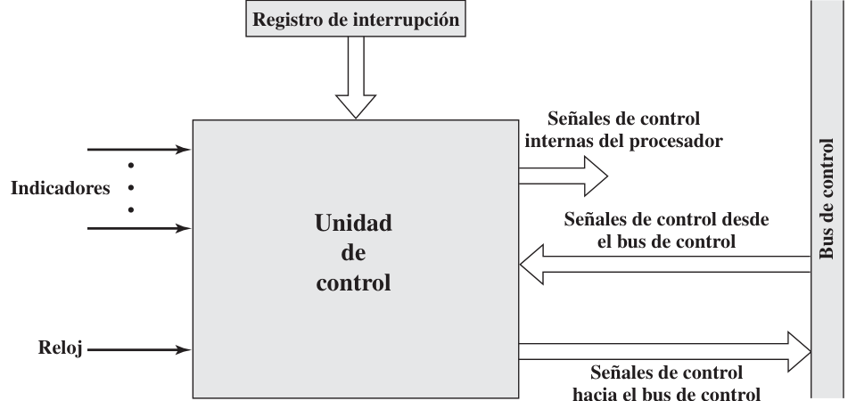

*Fig. 16.4 — Diagrama de bloques de la unidad de control.* · Stallings, *Organización y arquitectura de computadores*, 7ª ed., p. 631.

#### Relacionado
[[00 Tema 6.1 — índice]] · [[4.4.2 estado·pulso·instrucción y el decodificador 1-16]] ·
[[6.2.1 Memoria de control y microinstrucción]] · [[Cómo se implementa la Unidad de Control]] ·
[[4.3.2 Búsqueda, los 8 pulsos]] · [[Glosario — Unidad 6]]

## 6.2 Control microprogramado

### 6.2.1 Memoria de control y microinstrucción

> [!abstract] En una frase
> La **memoria de control** es una ROM donde cada **palabra (microinstrucción)** contiene, en bits, las **señales
> que hay que activar en un pulso**; el conjunto de palabras que ejecuta una instrucción de máquina es su
> **microprograma**.

> [!note] Si la primera vez que ves esto
> Es **cambiar el cableado por un libro de recetas**: en vez de que la cocina esté soldada para hacer milanesas,
> hay un cuaderno que dice paso 1, paso 2, paso 3. Cambiar el menú es cambiar el cuaderno, no la cocina.

#### Los cinco nombres que hay que distinguir

| Nombre | Qué es | Escala |
|---|---|---|
| **Microorden** | una señal elemental ("`PC → MAR`") | la más chica |
| **Microinstrucción** | una **palabra** de la memoria de control = un conjunto de microórdenes | 1 fila de la ROM |
| **Microprograma** | secuencia de microinstrucciones que ejecuta **una** instrucción de máquina | 1 rutina |
| **Memoria de control** | la ROM que guarda **todos** los microprogramas | el "libro" completo |
| **Firmware** | el contenido de esa memoria (software metido en hardware) | — |

> [!important] La confusión que cuesta puntos
> **Instrucción** = la del programa (`LDA 100`). **Microinstrucción** = una fila de la ROM de control. Una
> instrucción se ejecuta con **varias** microinstrucciones, nunca una sola.

#### La estructura

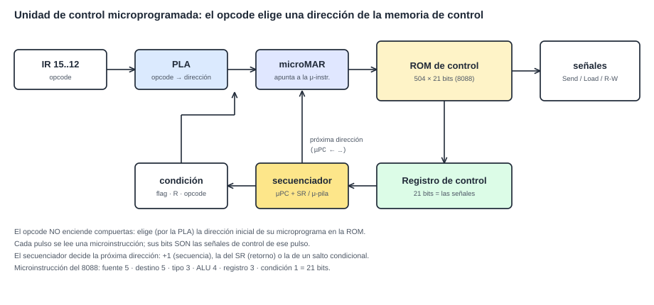

```
IR (opcode) ─► PLA ─► microMAR ─► MEMORIA DE CONTROL ─► registro de control ─► señales
                        ▲                  │
                        └── secuenciador ◄─┘
```

| Bloque | Función |
|---|---|
| **PLA** (o ROM de traducción) | convierte el **opcode** en la **dirección inicial** del microprograma |
| **microMAR** / registro de dirección de control | guarda la dirección de la microinstrucción actual |
| **Memoria de control** | ROM: dirección → palabra de control |
| **Registro de control** | retiene los bits de la palabra mientras dura el pulso (las señales deben ser estables) |
| **Secuenciador** | calcula la **próxima** dirección (ver 6.2.2) |

#### El formato de la microinstrucción (los campos)
```
┌──────────┬──────────┬─────────┬────────┬─────────┬──────────┬────────────┐
│ fuente   │ destino  │  tipo   │  ALU   │ registro│ condición│  próxima   │
│  (5)     │   (5)    │   (3)   │  (4)   │   (3)   │   (1)    │ dirección  │
└──────────┴──────────┴─────────┴────────┴─────────┴──────────┴────────────┘
```
| Campo | Para qué |
|---|---|
| **fuente** | de qué registro sale el dato (hacia el bus) |
| **destino** | a qué registro entra |
| **tipo** | naturaleza de la operación (transferencia, memoria, E/S…) |
| **ALU** | operación de la ALU |
| **registro** | registro auxiliar (contador, índice…) |
| **condición** | si el salto es condicional y con qué flag |
| **próxima dirección** | a dónde sigue (cuando la ROM la incluye) |

#### Horizontal vs vertical

| | **Horizontal** | **Vertical** |
|---|---|---|
| Bits por señal | **1 bit = 1 señal** | campos **codificados** |
| Ancho de la palabra | grande (muchos bits) | chico |
| Velocidad | **más rápida** (no hay que decodificar) | más lenta (hay que decodificar) |
| Paralelismo | alto: varias microórdenes a la vez | bajo: casi una por palabra |
| Microprograma | **corto** | **largo** |

**Compromiso:** el horizontal gasta **memoria de control**; el vertical gasta **tiempo y palabras**. Los diseños
reales son intermedios (campos codificados sólo donde conviene).

#### Ejemplo: el microprograma de la búsqueda
| µdirección | Microoperación | Señales | ¿Igual a la BLUE? |
|---|---|---|---|
| 0 | `MAR ← PC` | `PCout`, `MARin` | CP1 ✔ |
| 1 | `MBR ← M[MAR]` ; `PC ← PC + 1` | `MEMR`, `MBRin`, `PCinc` | CP5 + CP2-CP4 ✔ |
| 2 | `IR ← MBR` | `MBRout`, `IRin` | CP6 ✔ |
| 3 | **mapeo**: salto a la rutina del opcode | opcode del `IR` | CP8 ✔ |

Es **el mismo ciclo de búsqueda de 8 pulsos**, pero escrito como 4 filas de ROM en vez de 8 pulsos cableados: en
la microprogramada, cada palabra **no** ocupa un pulso fijo — el secuenciador puede tardar los pulsos que haga
falta en cada una.

#### Cuánto mide la memoria de control (cálculo típico)
```
microinstrucciones = Σ pasos de todos los microprogramas
bits totales       = microinstrucciones × ancho de la palabra
bits del microPC   ≥ log₂(microinstrucciones)
```
**Ejemplo (8088):** `504` palabras × `21` bits = **10 584 bits** ≈ **1,3 KB** de ROM, y el microPC necesita
`log₂ 504 = 9` bits.

> [!warning] Errores típicos
> - Decir que la memoria de control es RAM: es **ROM** (se escribe al fabricar/actualizar, no en ejecución).
> - Confundir **PLA** (traduce el opcode a una dirección) con **memoria de control** (guarda las palabras).
> - Olvidar el **registro de control** a la salida y usar las señales directo de la ROM (se inestabilizan).
> - Decir que una microinstrucción = una instrucción.
> - Sumar mal el ancho: `5+5+3+4+3+1 = 21`, no 20.

#### Figura del libro

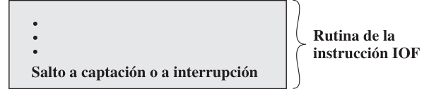

*Fig. 17.2 — Organización de la memoria de control.* · Stallings, *Organización y arquitectura de computadores*, 7ª ed., p. 649.

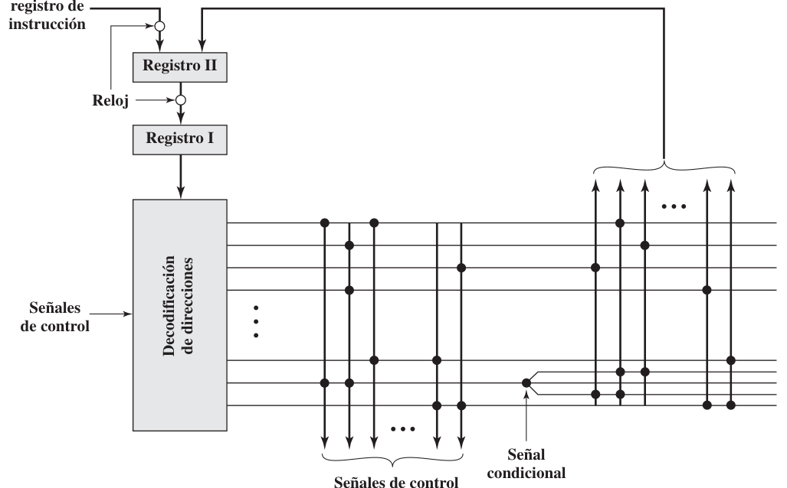

*Fig. 17.5 — Unidad de control microprogramada de Wilkes.* · Stallings, *Organización y arquitectura de computadores*, 7ª ed., p. 652.

#### Relacionado
[[6.2.2 Secuenciamiento y microPC]] · [[6.1.1 Circuito, compuertas y señales]] ·
[[6.3.2 El 8088, ROM de control 504x21]] · [[Unidad de control cableada y microprogramada]] · [[Glosario — Unidad 6]]

### 6.2.2 Secuenciamiento y microPC

> [!abstract] En una frase
> El **secuenciador** es el "PC de la UC": guarda en el **microPC** la dirección de la microinstrucción actual y
> calcula la próxima con **cuatro mecanismos**: **incremento**, **salto condicional**, **mapeo del opcode** y
> **microsubrutinas** (con el registro `SR` o una micro-pila).

> [!note] Si la primera vez que ves esto
> Es el **marcapáginas del cuaderno de recetas**. Normalmente pasa a la página siguiente (+1); si la receta dice
> "si el horno está caliente, andá a la página 20", salta; cuando termina una receta común, vuelve a la página que
> había dejado anotada.

#### El secuenciamiento

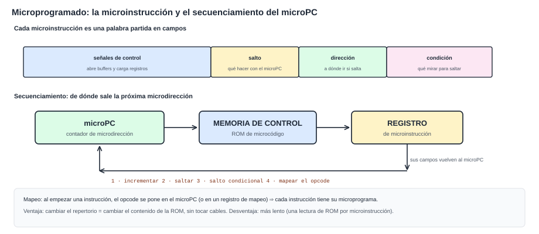

#### El bucle del secuenciador
```
                    ┌───────────────────────┐
                    ▼                       │
   condición ─► [ MUX ] ─► microPC ─► ROM ───┴──► microinstrucción ─► señales
                  ▲           │
        +1 ◄──────┘           └──► dirección de la actual
        mapeo (opcode) ◄────────── IR
        retorno (SR) ◄──────────── micro-pila
```

#### Los cuatro mecanismos

| # | Mecanismo | Cuándo se usa | Cómo se implementa |
|---|---|---|---|
| 1 | **Incremento** (`+1`) | secuencia lineal de microoperaciones | un contador (microPC + 1) |
| 2 | **Salto condicional** | decidir según un **flag** o `R` del periférico | **MUX** en la entrada del microPC, seleccionado por la condición |
| 3 | **Mapeo del opcode** | al empezar la **ejecución**: ir a la rutina de esa instrucción | **PLA**: `dirección = f(opcode)` |
| 4 | **Microsubrutina** | secuencias comunes (búsqueda, cálculo de la EA) llamadas desde varias rutinas | registro **`SR`** o **micro-pila** para el retorno |

> [!important] El mapeo, con el truco del cableado mínimo
> Para no construir una PLA grande se **meten los bits del opcode dentro de la dirección**:
> `µdirección = (1) · opcode · (00)` ⇒ con 4 bits de opcode y 2 ceros ya se salta de 4 en 4 a la zona de ese
> opcode. Menos compuertas, un poco de memoria desperdiciada.

#### Qué decide cada mecanismo, en el ciclo de una instrucción
| Momento | Quién manda |
|---|---|
| Arranca la búsqueda | microPC = dirección fija de la rutina de búsqueda |
| Termina la búsqueda | **mapeo**: microPC = dirección inicial del opcode |
| Dentro de una instrucción de 2 ciclos | **incremento** (+1) |
| `JMA` con `A15 = 1` | **salto condicional**: la condición elige entre la rama del salto y la secuencia |
| Fin de la instrucción | **retorno** de la microsubrutina de búsqueda (con `SR`) |

#### Ejemplo resuelto: mapeo con 4 bits de opcode
> "La memoria de control tiene 504 palabras y el opcode es de 4 bits. ¿Cómo se arma la dirección inicial sin una
> PLA grande?"

1. Se reserva una zona de 16 entradas consecutivas (una por opcode): `base = 1000000` (binario).
2. `µdirección = base + opcode · 4` ⇒ `1000000 + (opcode << 2)`.
3. `LDA` (`0110`) ⇒ `1000000 + 011000 = 1011000` = **88** ⇒ la rutina de `LDA` empieza en la µdirección 88.
4. Cada rutina tiene hasta **4** palabras antes de necesitar un salto (por eso los 2 ceros).

**Verificación:** el campo de opcode ocupa 4 bits y la dirección 9 bits, así que sobran 5 bits para la base:
el truco entra sin problema. ✔

#### El registro `SR` y la micro-pila
| | **`SR` (un solo nivel)** | **micro-pila** |
|---|---|---|
| Guarda | 1 dirección de retorno | varias |
| Alcanza para | una microsubrutina a la vez (la búsqueda) | microsubrutinas anidadas |
| Costo | 1 registro | `n` registros o memoria |

`SR` = *subroutine register*: antes de saltar a la rutina se guarda la dirección siguiente; al terminar, se
restaura. Es el mismo `CALL`/`RET` que ya conocés, **un nivel más abajo**.

#### Comparación con la UC cableada
| | Cableada | Microprogramada |
|---|---|---|
| "Quién decide el paso siguiente" | los biestables de estado + el reloj | el **secuenciador** con el microPC |
| Costo de un paso | 1 pulso de 125 ns | 1 acceso a la memoria de control (más lento) |
| Cambiar la secuencia | recablear | reescribir la ROM |

> [!warning] Errores típicos
> - Confundir **microPC** con el **PC**: el `PC` apunta a la instrucción del programa; el microPC, a la
>   microinstrucción.
> - Olvidar el **mapeo** (sin él la UC no sabe dónde empieza la rutina de cada opcode).
> - Usar sólo `+1` y no explicar los saltos condicionales.
> - Decir que `SR` es una pila completa (es **un** nivel).
> - Olvidar que la condición puede venir de `R` (periférico), no sólo de los flags de la ALU.

#### Figura del libro

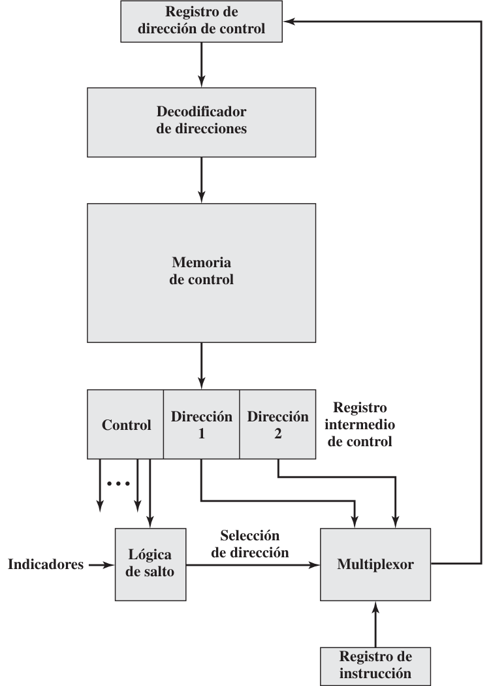

*Fig. 17.6 — Lógica de control de salto con dos campos de dirección.* · Stallings, *Organización y arquitectura de computadores*, 7ª ed., p. 657.

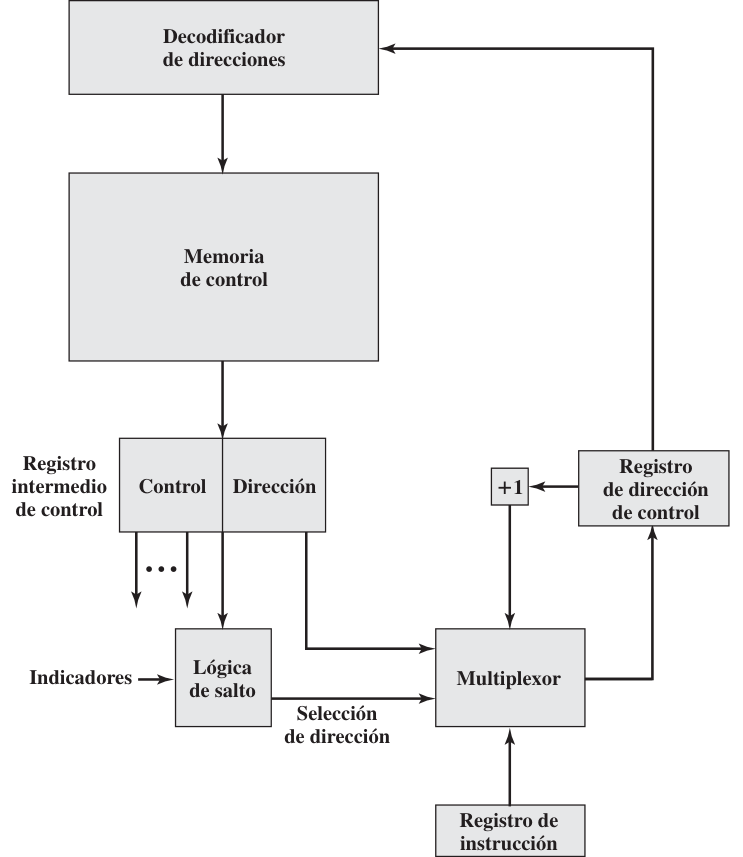

*Fig. 17.7 — Lógica de control de salto con un único campo de dirección.* · Stallings, *Organización y arquitectura de computadores*, 7ª ed., p. 658.

#### Relacionado
[[6.2.1 Memoria de control y microinstrucción]] · [[6.3.2 El 8088, ROM de control 504x21]] ·
[[3.2.2 Operaciones aritméticas, lógicas y flags]] · [[Multiplexor]] · [[Unidad de control cableada y microprogramada]] · [[Glosario — Unidad 6]]

## 6.3 Comparación y caso real

### 6.3.1 Cableada vs microprogramada

> [!abstract] En una frase
> La **cableada** es **más rápida** pero **rígida** (cambiarla es rediseñar); la **microprogramada** es **más
> lenta** pero **flexible** (cambiarla es reescribir la ROM). Esa única disyuntiva explica por qué **RISC eligió
> cableado** y **CISC se hizo microprogramado**.

> [!note] Si la primera vez que ves esto
> Compará una **calculadora de mesa** (cableada: hace cuatro cosas, rapidísimo, no se le puede agregar nada) con
> una **computadora con recetas** (microprogramada: hace de todo, un paso más lenta por receta, pero le cambiás la
> receta y hace otra cosa).

#### Las dos, lado a lado

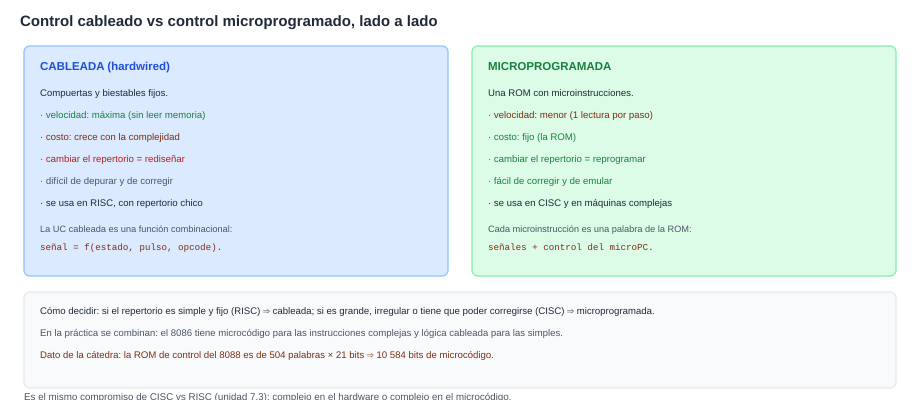

#### La tabla de examen

| | **Cableada** | **Microprogramada** |
|---|---|---|
| **Cómo guarda la secuencia** | en compuertas (fija) | en una **ROM de control** (cambiable) |
| **Velocidad** | **más rápida**: no hay que leer control | más lenta: **1 acceso a la memoria de control por paso** |
| **Flexibilidad** | nula una vez construida | alta: se reescribe la ROM |
| **Costo de diseño** | crece rápido con el ISA | ordenado y barato para ISA grande |
| **Instrucciones complejas** | difíciles de cablear | naturales |
| **Se usa en** | **RISC**, máquinas chicas (**BLUE**) | **CISC** (8088, x86) |
| **Cuánto ocupa** | compuertas | ROM (1,3 KB en el 8088) |

#### El porqué, en tres frases
1. **Velocidad:** la cableada produce la señal en el retardo de una compuerta; la microprogramada debe leer la ROM
   (y sostenerla en un registro). Un acceso de ROM por microinstrucción.
2. **Flexibilidad:** corregir un error en el 8088 es cambiar la ROM; en la BLUE sería volver a diseñar el circuito.
3. **Escala:** con 16 instrucciones la cableada es chica; con 200 (x86) el cableado es inmanejable.

#### CISC y RISC: la consecuencia histórica
| | **CISC** (microprogramado) | **RISC** (cableado) |
|---|---|---|
| Instrucciones | muchas y complejas | pocas y simples |
| Largo | variable | fijo |
| Quién ejecuta una instrucción | varias microinstrucciones | idealmente **1 ciclo** |
| UC | microprogramada | cableada |
| Ejemplo | 8086/8088, x86 | MIPS, ARM, RISC-V |

**Hoy es híbrido:** los x86 modernos traducen el CISC a microoperaciones **internas** (tipo RISC) y las ejecutan
con un núcleo **cableado** con pipeline. La disyuntiva de 1980 sigue existiendo, pero **dentro** del chip.

#### Comparación de tiempo (ejemplo numérico)
> "Una instrucción necesita 6 microoperaciones. En la cableada cada una cuesta 125 ns; en la microprogramada,
> 125 ns de reloj **más** 100 ns de acceso a la memoria de control. ¿Cuánto tarda cada una?"

| | Cálculo | Tiempo |
|---|---|---|
| **Cableada** | `6 × 125 ns` | **750 ns** |
| **Microprogramada** | `6 × (125 + 100) ns` | **1 350 ns** |

**Conclusión:** la microprogramada tarda **1,8 veces más** en esa instrucción; a cambio, agregar una instrucción
nueva no cuesta ni una compuerta.

#### Cuándo conviene cada una (regla de decisión)
| Situación | Conviene |
|---|---|
| Máquina chica, repertorio fijo, se quiere velocidad | **cableada** |
| Muchas instrucciones, compatibilidad hacia atrás, se corrigen errores | **microprogramada** |
| Se necesita **pipeline** agresivo (1 ciclo por instrucción) | **cableada** |
| El ISA debe sobrevivir a varias generaciones de hardware | **microprogramada** |

> [!warning] Errores típicos
> - Decir que la microprogramada es **más rápida** por ser "más moderna" (es al revés).
> - Confundir **flexible** con **rápida**: son objetivos en conflicto.
> - Decir que RISC "no tiene UC" (tiene, **cableada**).
> - Olvidar el híbrido actual al cerrar la respuesta.
> - Comparar sin mencionar el **acceso extra** a la memoria de control.

#### Figura del libro

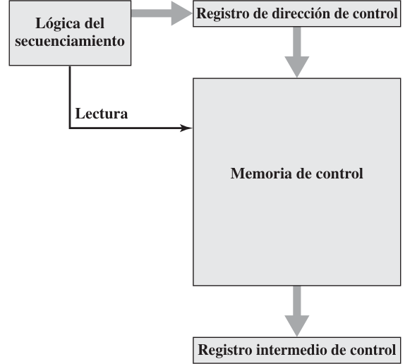

*Fig. 17.3 — Microarquitectura de una unidad de control.* · Stallings, *Organización y arquitectura de computadores*, 7ª ed., p. 649.

> [!example] Cambiar una instrucción
> En **cableada** hay que **rediseñar el circuito** (agregar compuertas). En **microprogramada** se **agregan 21
> bits** al microprograma que ya está en la ROM de control: se cambia el contenido, no el hardware. Ése es el
> argumento del examen: **flexibilidad** contra **velocidad**.

#### Relacionado
[[6.3.2 El 8088, ROM de control 504x21]] · [[6.2.2 Secuenciamiento y microPC]] · [[CISC y RISC]] ·
[[Unidad de control cableada y microprogramada]] · [[Técnicas para aumentar la velocidad]] · [[Glosario — Unidad 6]]

### 6.3.2 El 8088, ROM de control 504x21

> [!abstract] En una frase
> La UC del **8088 es microprogramada**: una **ROM de control de 504 palabras de 21 bits** guarda unos **90
> microprocedimientos**; el opcode, por una **PLA**, da la dirección inicial, y cada microinstrucción dice *fuente
> (5) · destino (5) · tipo (3) · ALU (4) · registro (3) · condición (1)*.

> [!note] Si la primera vez que ves esto
> Es la misma idea de [[6.2.1 Memoria de control y microinstrucción]], pero con **números reales**: 504 recetas de
> 21 bits cada una dentro de un chip que además parte el trabajo entre **BIU** (busca) y **EU** (ejecuta).

#### 504 × 21

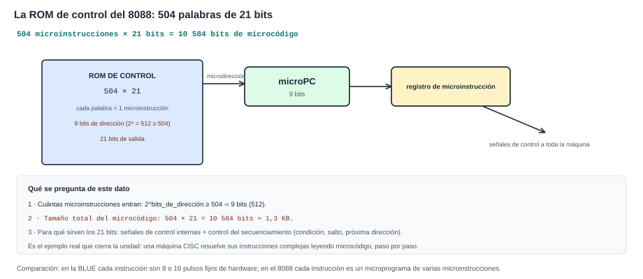

#### Los números

| Dato | Valor | De dónde sale |
|---|---|---|
| Palabras de la memoria de control | **504** | apuntes de cátedra (sección del 8088) |
| Ancho de la microinstrucción | **21 bits** | `5+5+3+4+3+1` |
| Bits totales de la ROM | **10 584** ≈ **1,3 KB** | `504 × 21` |
| Bits del microPC | **9** | `log₂ 504 ≈ 8,98` ⇒ 9 |
| Microprocedimientos | ~**90** | ≈ `504 / 90 ≈ 5,6` palabras por rutina |
| Traducción de opcode | **PLA** | opcode → dirección inicial |

#### El formato de la microinstrucción (campo por campo)
```
 5        5        3      4       3        1
┌───────┬────────┬─────┬──────┬────────┬───────────┐
│fuente │destino │tipo │ ALU  │registro│ condición │
└───────┴────────┴─────┴──────┴────────┴───────────┘
  20..16   15..11  10..8  7..4    3..1      0
```

| Campo | Bits | Qué elige |
|---|---|---|
| **fuente** | 5 | qué registro sale al bus (hasta 32 opciones) |
| **destino** | 5 | qué registro lo recibe (hasta 32) |
| **tipo** | 3 | clase de microoperación: transferencia, memoria, E/S, incremento, reset… |
| **ALU** | 4 | operación de la ALU (hasta 16: `ADD`, `AND`, …) |
| **registro** | 3 | registro auxiliar del contador/índice |
| **condición** | 1 | si el salto es condicional o no |

**Cálculo:** `5 + 5 + 3 + 4 + 3 + 1 = 21` ✔

#### Cómo se ejecuta una instrucción en el 8088
```
CP: búsqueda (microprograma común, una sola vez por instrucción)
      │
      ├─ BIU trae los bytes y los encola en la FIFO de 4 bytes
      ▼
   IR tiene el opcode
      │
      ├─ PLA traduce opcode → dirección inicial del microprocedimiento
      ▼
   el secuenciador recorre las microinstrucciones (µPC +1, saltos, SR)
      │
      ▼
   cada microinstrucción, en un pulso, activa fuente/destino/tipo/ALU/registro
```
- **BIU** (*Bus Interface Unit*): calcula la dirección física (`segmento × 16 + desplazamiento`) y llena la **FIFO
  de 4 bytes**.
- **EU** (*Execution Unit*): ejecuta; pide microoperaciones a la ROM de control.
- La **FIFO** es lo que permite que la EU no espere a la memoria en cada instrucción (primer *prefetch* del x86).

#### Por qué 504 y no más
| Si se quisiera… | Consecuencia |
|---|---|
| instrucciones nuevas | más microprocedimientos ⇒ más palabras |
| palabras más anchas (horizontales) | menos microoperaciones por rutina, ROM más ancha |
| ahorrar ROM | microprogramas **verticales** (campos codificados) ⇒ más lentos |
| no usar ROM | UC **cableada** ⇒ imposible con ~90 rutinas y compatibilidad hacia atrás |

> [!important] El dato que impresiona en el oral
> El 8088 tiene **un solo bus de datos de 8 bits** (el 8086 lo tiene de 16): la palabra de instrucción de 16 bits
> llega en **dos** accesos. Eso, sumado a una microprogramada, es lo que lo hace lento frente a un RISC, y es
> exactamente lo que atacan las técnicas de la Unidad 7.

#### Ejercicio tipo final
> "El microPC del 8088 tiene 9 bits y la memoria de control 504 palabras. ¿Cuántas direcciones quedan sin usar y
> cuántas microinstrucciones podría direccionar un microPC de 9 bits?"

- `2⁹ = 512` direcciones posibles; se usan `504` ⇒ **8 quedan libres** (reserva para futuras versiones o
  microsubrutinas).
- La ROM se direcciona con `log₂ 504 = 9` bits; con 9 bits **se podrían** direccionar **512** palabras.

> [!warning] Errores típicos
> - Decir 504 **bits** (son 504 **palabras** de 21 bits).
> - Sumar el ancho mal: `5+5+3+4+3+1 = 21`, no 20 ni 22.
> - Confundir la **PLA** (traduce) con la **ROM de control** (almacena).
> - Decir que el 8088 es cableado (es **microprogramado**; el 8086/8088 es el ejemplo CISC de la unidad).
> - Olvidar la FIFO de 4 bytes de la BIU y la segmentación al explicar cómo se ejecuta.

#### Figura del libro

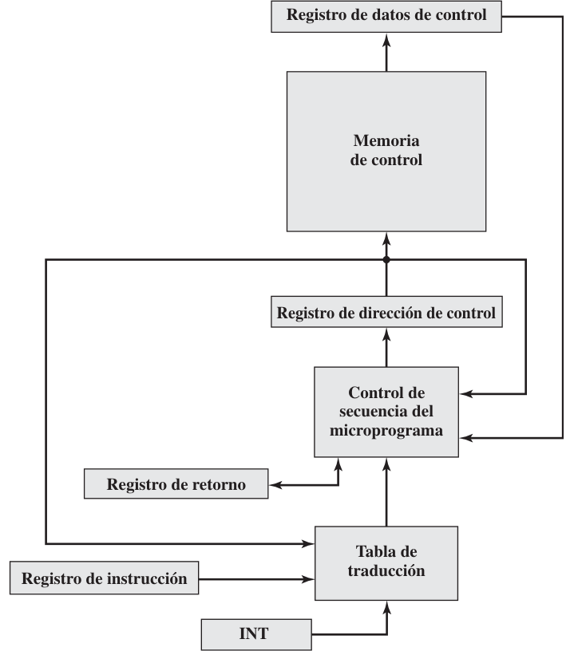

*Fig. 17.14 — Organización de la unidad de control del LSI-11.* · Stallings, *Organización y arquitectura de computadores*, 7ª ed., p. 670.

> [!example] 504 × 21 = 10 584
> 504 microinstrucciones × 21 bits = **10 584 bits** ≈ **1,3 KB** de ROM de control. Dirección de la ROM:
> `2⁹ = 512` (504 usadas) ⇒ **9 bits**. Cablear lo mismo serían cientos de compuertas y un rediseño por cada
> instrucción nueva.

#### Relacionado
[[6.2.1 Memoria de control y microinstrucción]] · [[6.2.2 Secuenciamiento y microPC]] ·
[[5.6.1 BIU, EU y segmentación]] · [[El 8086 como CPU convencional (TP21)]] · [[CISC y RISC]] · [[Glosario — Unidad 6]]

---

## Al terminar la unidad
- Una pasada rápida: [[00 Síntesis — Unidad 6]].
- Los subtemas por separado: [[00 Unidad 6 — temas y subtemas]].
- Seguir de corrido: [[00 Materia completa (las 10 unidades en un archivo)]].
- Practicar: [[Banco de preguntas del final]] · [[Autoevaluación]] · [[Prácticas resueltas]].
