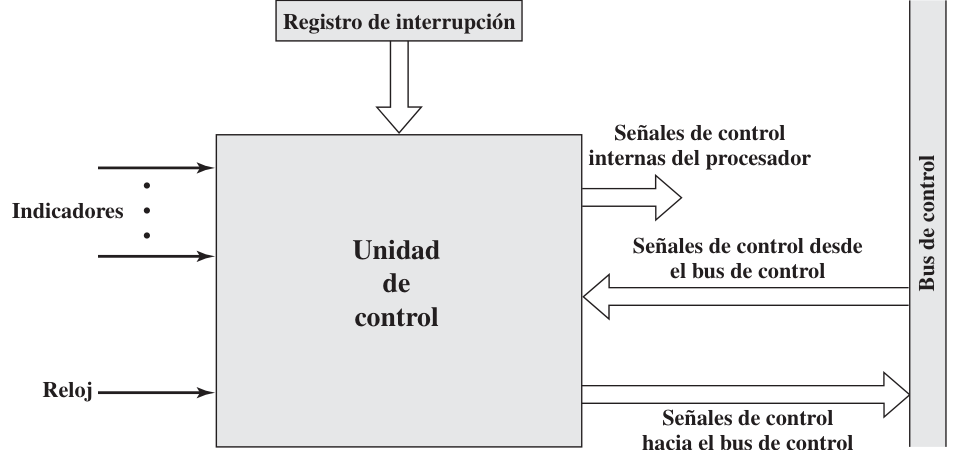

# 6.1.1 Circuito, compuertas y señales

> [!abstract] En una frase
> La UC cableada es un **circuito combinacional y secuencial**: tres flip-flops de **estado** (`RUN`, `STATE`,
> `TRA`) + un **reloj** que reparte 8 pulsos + un **decodificador** del opcode, y a la salida una AND por señal con
> `señal = estado · pulso · instrucción`, juntadas con **OR**.

> [!note] Si la primera vez que ves esto
> Pensalo como una **receta de cocina sin libro**: las instrucciones están "escritas" en el cableado. Cada cable
> dice "si estás friendo (estado), y toca el minuto 3 (pulso), y el plato es milanesa (instrucción), entonces subí
> el fuego". Cambiar la receta obliga a **volver a soldar**.

## Las cuatro funciones de la UC
| Función | Qué hace | Con qué |
|---|---|---|
| **Sincronizar** | marca el ritmo | reloj maestro → `CP1…CP8` |
| **Decodificar** | sabe qué instrucción es | `IR15..12` → decodificador 1→16 |
| **Secuenciar** | decide búsqueda o ejecución | FF `STATE`, FF `RUN` |
| **Generar** | activa las señales | compuertas AND/OR |

## Los tres flip-flops de estado

| FF | Se pone en 1 con | Se pone en 0 con | Para qué |
|---|---|---|---|
| **`RUN`** | `START` | `STOP`, `HLT` (CP7), **overflow** | mientras está en 1 el reloj avanza; en 0 la máquina se congela |
| **`STATE`** | `F · CP8 · REF` (fin de búsqueda de una instrucción con memoria) | `E · CP8` (fin de la ejecución) | `F` = búsqueda · `E` = ejecución |
| **`TRA`** | `F · CP7 · (INP + OUT)` | fin de la E/S | hay una operación de E/S en curso |

> [!important] `RUN` y el overflow
> El **overflow** apaga `RUN`: es una **parada por error** (no por programa). Es la razón por la que la BLUE no
> tiene una instrucción de "trap": la protección está cableada.

## El reloj: 8 pulsos por cadena de retardos
```
            ┌──►CP1  ┌──►CP2        ┌──►CP8
   pulso ───┤125ns├──┤125ns├─ ... ──┤125ns├──┐
            └─────┘  └─────┘        └─────┘  │
                ▲                            │
                └──────── realimentación ◄────┘   (si RUN = 1 · o si STATE = E)
```
- Cada derivación de la cadena da **una línea** `CP1…CP8`, todas del mismo ancho (125 ns).
- Al terminar la octava, el pulso **realimenta** y empieza otro ciclo de máquina.
- **Un ciclo de máquina = 8 pulsos = 1 µs.** La instrucción de 2 ciclos = 2 µs.

## La decodificación del opcode
`IR15..12` (4 bits) → **decodificador 1→16** = 4 inversores + **16 AND de 4 entradas**:

| Salida | Opcode | Salida | Opcode |
|---|---|---|---|
| `HLT` | `0000` | `SRJ` | `1000` |
| `ADD` | `0001` | `JMA` | `1001` |
| `XOR` | `0010` | `JMP` | `1010` |
| `AND` | `0011` | `INP` | `1011` |
| `IOR` | `0100` | `OUT` | `1100` |
| `NOT` | `0101` | `RAL` | `1101` |
| `LDA` | `0110` | `CSA` | `1110` |
| `STA` | `0111` | `NOP` | `1111` |

**Una sola línea activa a la vez** ⇒ esa línea es el "factor instrucción" de las ecuaciones.

## La generación de señales


```
señal = (estado) · (pulso) · (línea de instrucción)
```

| Señal de control | Ecuación | Qué habilita |
|---|---|---|
| `Send PC, Load MAR` | `F · CP1` | poner el `PC` en el bus y cargar el `MAR` |
| `Read` (búsqueda) | `F · CP1` | orden de lectura de la instrucción |
| `Send MBR, Load IR` | `F · CP6` | pasar la instrucción al `IR` |
| `E → STATE` | `F · CP8 · REF` | pasar a ejecutar |
| `Send IR, Load MAR` | `E · CP1 · REF` | dirección del operando al `MAR` |
| `Send A, Load Z` | `E · CP2 · ARITH` | primer operando a la ALU |
| `Send MBR, Load Y` | `E · CP6 · ARITH` | segundo operando a la ALU |
| `Send SUM, Load A` | `E · CP8 · ADD` | guardar el resultado |
| `Send MBR, Load A` | `E · CP6 · LDA` | cargar el dato |
| `Send A, Load MBR` + `Write` | `E · CP4 · STA` | guardar en memoria |
| `Send IR, Load PC` | `CP8 · (JMP + JMA·A15 + SRJ)` | salto |

### Las familias que ahorran cableado
```
REF   = LDA + STA + ADD + XOR + AND + IOR     ← todas las que tocan memoria con un operando
ARITH = ADD + XOR + AND + IOR                 ← las que usan la ALU con dos operandos
DTA   = REF                                   ← las que traen o llevan un dato
```
Usarlas cambia **una** ecuación por un grupo de líneas:
`Send IR, Load MAR = E · CP1 · REF` en lugar de seis términos.

> [!important] Las OR: el paso que más se olvida
> Cuando **la misma señal** se activa desde varios lugares distintos, no se duplican cables: se juntan con una OR.
> ```
> MBR_in = F·CP5  +  E·CP5·REF
> ```
> **Los AND eligen; las OR juntan.** La UC cableada es, literalmente, una **suma de productos** gigante: el mismo
> formato de la 3.ª tanda del final (tabla de verdad → función → compuertas).

## Ejemplo resuelto: la `LDA` completa en ecuaciones
`LDA 100` = `AC ← M[100]`, 2 ciclos (16 pulsos):

| Ciclo | Pulsos | Ecuaciones activas |
|---|---|---|
| **Búsqueda** | 1-2 | `F·CP1`: `PC→MAR`, `Read` · `F·CP2`: `+1→Y` · `F·CP3`: ALU · `F·CP4`: `Z→PC` |
| | 5-6 | `F·CP5`: `MBR_in` · `F·CP6`: `MBR→IR` |
| | 8 | `F·CP8·REF`: `E→STATE` |
| **Ejecución** | 1 | `E·CP1·REF`: `IR→MAR`, `Read` |
| | 5 | `E·CP5·REF`: `MBR_in` |
| | 6 | `E·CP6·LDA`: `MBR→A` |
| | 8 | `E·CP8`: `E→STATE` = 0 (vuelve a buscar) |

**Verificación:** 7 señales distintas, ninguna se repite en el mismo pulso, y las que aparecen dos veces
(`MBR_in`, `Read`) quedan juntadas con OR. ✔

## Cuántas compuertas cuesta (orden de magnitud)
| Bloque | Cantidad |
|---|---|
| Decodificador 1→16 | 4 NOT + 16 AND de 4 entradas |
| Estado | 3 flip-flops + compuertas de control |
| Reloj | 8 retardos + realimentación |
| Señales | ~1 AND por señal (2-4 entradas) + ~1 OR por señal |

La cableada crece **rápido** con la cantidad de instrucciones: cada instrucción nueva multiplica los términos.

> [!warning] Errores típicos
> - Decir que la UC **hace** las cuentas: las hace la ALU; la UC **habilita** las salidas correctas.
> - Olvidar el **estado** en la ecuación (`CP1` existe en los dos ciclos).
> - Poner `+` donde va `·` al combinar estado, pulso e instrucción.
> - Creer que `RUN` y `STATE` son lo mismo: `RUN` enciende la máquina, `STATE` elige la fase.
> - Decir que `overflow` genera una interrupción (acá **apaga** `RUN`, no hay vector).

## Figura del libro



*Fig. 16.4 — Diagrama de bloques de la unidad de control.* · Stallings, *Organización y arquitectura de computadores*, 7ª ed., p. 631.

## Relacionado
[[00 Tema 6.1 — índice]] · [[4.4.2 estado·pulso·instrucción y el decodificador 1-16]] ·
[[6.2.1 Memoria de control y microinstrucción]] · [[Cómo se implementa la Unidad de Control]] ·
[[4.3.2 Búsqueda, los 8 pulsos]]
