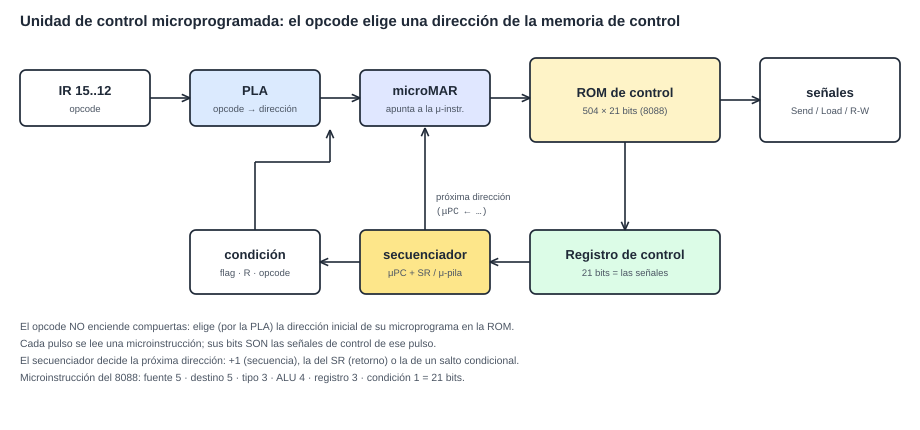
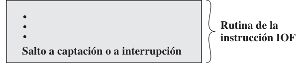
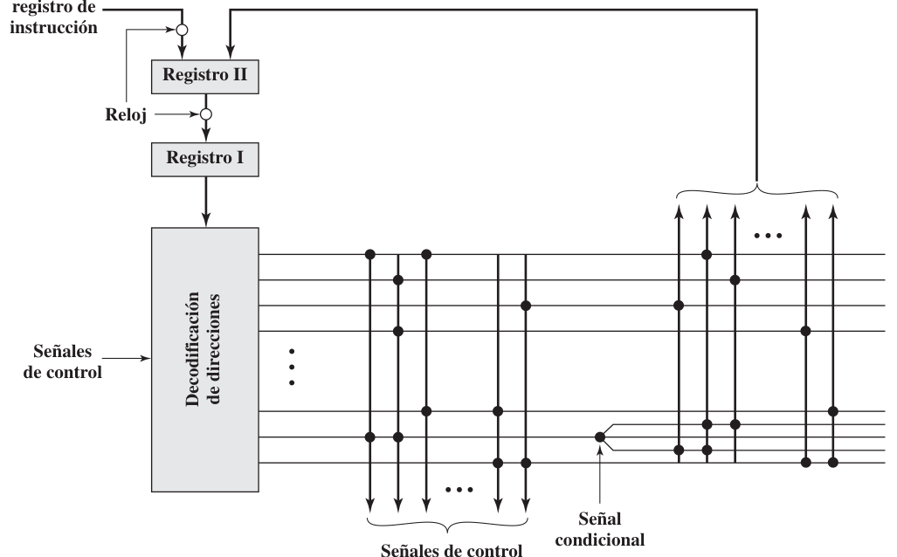

# 6.2.1 Memoria de control y microinstrucción

> [!abstract] En una frase
> La **memoria de control** es una ROM donde cada **palabra (microinstrucción)** contiene, en bits, las **señales
> que hay que activar en un pulso**; el conjunto de palabras que ejecuta una instrucción de máquina es su
> **microprograma**.

> [!note] Si la primera vez que ves esto
> Es **cambiar el cableado por un libro de recetas**: en vez de que la cocina esté soldada para hacer milanesas,
> hay un cuaderno que dice paso 1, paso 2, paso 3. Cambiar el menú es cambiar el cuaderno, no la cocina.

## Los cinco nombres que hay que distinguir

| Nombre | Qué es | Escala |
|---|---|---|
| **Microorden** | una señal elemental ("`PC → MAR`") | la más chica |
| **Microinstrucción** | una **palabra** de la memoria de control = un conjunto de microórdenes | 1 fila de la ROM |
| **Microprograma** | secuencia de microinstrucciones que ejecuta **una** instrucción de máquina | 1 rutina |
| **Memoria de control** | la ROM que guarda **todos** los microprogramas | el "libro" completo |
| **Firmware** | el contenido de esa memoria (software metido en hardware) | — |

> [!important] La confusión que cuesta puntos
> **Instrucción** = la del programa (`LDA 100`). **Microinstrucción** = una fila de la ROM de control. Una
> instrucción se ejecuta con **varias** microinstrucciones, nunca una sola.

## La estructura



```
IR (opcode) ─► PLA ─► microMAR ─► MEMORIA DE CONTROL ─► registro de control ─► señales
                        ▲                  │
                        └── secuenciador ◄─┘
```

| Bloque | Función |
|---|---|
| **PLA** (o ROM de traducción) | convierte el **opcode** en la **dirección inicial** del microprograma |
| **microMAR** / registro de dirección de control | guarda la dirección de la microinstrucción actual |
| **Memoria de control** | ROM: dirección → palabra de control |
| **Registro de control** | retiene los bits de la palabra mientras dura el pulso (las señales deben ser estables) |
| **Secuenciador** | calcula la **próxima** dirección (ver 6.2.2) |

## El formato de la microinstrucción (los campos)
```
┌──────────┬──────────┬─────────┬────────┬─────────┬──────────┬────────────┐
│ fuente   │ destino  │  tipo   │  ALU   │ registro│ condición│  próxima   │
│  (5)     │   (5)    │   (3)   │  (4)   │   (3)   │   (1)    │ dirección  │
└──────────┴──────────┴─────────┴────────┴─────────┴──────────┴────────────┘
```
| Campo | Para qué |
|---|---|
| **fuente** | de qué registro sale el dato (hacia el bus) |
| **destino** | a qué registro entra |
| **tipo** | naturaleza de la operación (transferencia, memoria, E/S…) |
| **ALU** | operación de la ALU |
| **registro** | registro auxiliar (contador, índice…) |
| **condición** | si el salto es condicional y con qué flag |
| **próxima dirección** | a dónde sigue (cuando la ROM la incluye) |

## Horizontal vs vertical

| | **Horizontal** | **Vertical** |
|---|---|---|
| Bits por señal | **1 bit = 1 señal** | campos **codificados** |
| Ancho de la palabra | grande (muchos bits) | chico |
| Velocidad | **más rápida** (no hay que decodificar) | más lenta (hay que decodificar) |
| Paralelismo | alto: varias microórdenes a la vez | bajo: casi una por palabra |
| Microprograma | **corto** | **largo** |

**Compromiso:** el horizontal gasta **memoria de control**; el vertical gasta **tiempo y palabras**. Los diseños
reales son intermedios (campos codificados sólo donde conviene).

## Ejemplo: el microprograma de la búsqueda
| µdirección | Microoperación | Señales | ¿Igual a la BLUE? |
|---|---|---|---|
| 0 | `MAR ← PC` | `PCout`, `MARin` | CP1 ✔ |
| 1 | `MBR ← M[MAR]` ; `PC ← PC + 1` | `MEMR`, `MBRin`, `PCinc` | CP5 + CP2-CP4 ✔ |
| 2 | `IR ← MBR` | `MBRout`, `IRin` | CP6 ✔ |
| 3 | **mapeo**: salto a la rutina del opcode | opcode del `IR` | CP8 ✔ |

Es **el mismo ciclo de búsqueda de 8 pulsos**, pero escrito como 4 filas de ROM en vez de 8 pulsos cableados: en
la microprogramada, cada palabra **no** ocupa un pulso fijo — el secuenciador puede tardar los pulsos que haga
falta en cada una.

## Cuánto mide la memoria de control (cálculo típico)
```
microinstrucciones = Σ pasos de todos los microprogramas
bits totales       = microinstrucciones × ancho de la palabra
bits del microPC   ≥ log₂(microinstrucciones)
```
**Ejemplo (8088):** `504` palabras × `21` bits = **10 584 bits** ≈ **1,3 KB** de ROM, y el microPC necesita
`log₂ 504 = 9` bits.

> [!warning] Errores típicos
> - Decir que la memoria de control es RAM: es **ROM** (se escribe al fabricar/actualizar, no en ejecución).
> - Confundir **PLA** (traduce el opcode a una dirección) con **memoria de control** (guarda las palabras).
> - Olvidar el **registro de control** a la salida y usar las señales directo de la ROM (se inestabilizan).
> - Decir que una microinstrucción = una instrucción.
> - Sumar mal el ancho: `5+5+3+4+3+1 = 21`, no 20.

## Figura del libro



*Fig. 17.2 — Organización de la memoria de control.* · Stallings, *Organización y arquitectura de computadores*, 7ª ed., p. 649.



*Fig. 17.5 — Unidad de control microprogramada de Wilkes.* · Stallings, *Organización y arquitectura de computadores*, 7ª ed., p. 652.

## Relacionado
[[6.2.2 Secuenciamiento y microPC]] · [[6.1.1 Circuito, compuertas y señales]] ·
[[6.3.2 El 8088, ROM de control 504x21]] · [[Unidad de control cableada y microprogramada]]
