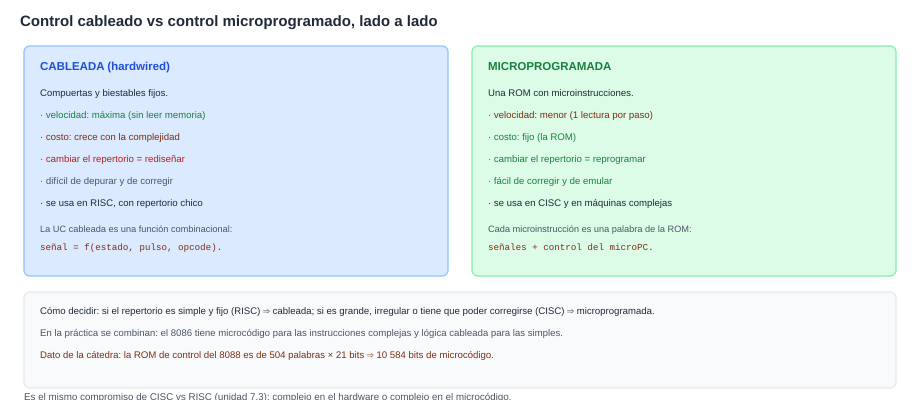

# 6.3.1 Cableada vs microprogramada

> [!abstract] En una frase
> La **cableada** es **más rápida** pero **rígida** (cambiarla es rediseñar); la **microprogramada** es **más
> lenta** pero **flexible** (cambiarla es reescribir la ROM). Esa única disyuntiva explica por qué **RISC eligió
> cableado** y **CISC se hizo microprogramado**.

> [!note] Si la primera vez que ves esto
> Compará una **calculadora de mesa** (cableada: hace cuatro cosas, rapidísimo, no se le puede agregar nada) con
> una **computadora con recetas** (microprogramada: hace de todo, un paso más lenta por receta, pero le cambiás la
> receta y hace otra cosa).

## Las dos, lado a lado

## La tabla de examen

| | **Cableada** | **Microprogramada** |
|---|---|---|
| **Cómo guarda la secuencia** | en compuertas (fija) | en una **ROM de control** (cambiable) |
| **Velocidad** | **más rápida**: no hay que leer control | más lenta: **1 acceso a la memoria de control por paso** |
| **Flexibilidad** | nula una vez construida | alta: se reescribe la ROM |
| **Costo de diseño** | crece rápido con el ISA | ordenado y barato para ISA grande |
| **Instrucciones complejas** | difíciles de cablear | naturales |
| **Se usa en** | **RISC**, máquinas chicas (**BLUE**) | **CISC** (8088, x86) |
| **Cuánto ocupa** | compuertas | ROM (1,3 KB en el 8088) |

## El porqué, en tres frases
1. **Velocidad:** la cableada produce la señal en el retardo de una compuerta; la microprogramada debe leer la ROM
   (y sostenerla en un registro). Un acceso de ROM por microinstrucción.
2. **Flexibilidad:** corregir un error en el 8088 es cambiar la ROM; en la BLUE sería volver a diseñar el circuito.
3. **Escala:** con 16 instrucciones la cableada es chica; con 200 (x86) el cableado es inmanejable.

## CISC y RISC: la consecuencia histórica
| | **CISC** (microprogramado) | **RISC** (cableado) |
|---|---|---|
| Instrucciones | muchas y complejas | pocas y simples |
| Largo | variable | fijo |
| Quién ejecuta una instrucción | varias microinstrucciones | idealmente **1 ciclo** |
| UC | microprogramada | cableada |
| Ejemplo | 8086/8088, x86 | MIPS, ARM, RISC-V |

**Hoy es híbrido:** los x86 modernos traducen el CISC a microoperaciones **internas** (tipo RISC) y las ejecutan
con un núcleo **cableado** con pipeline. La disyuntiva de 1980 sigue existiendo, pero **dentro** del chip.

## Comparación de tiempo (ejemplo numérico)
> "Una instrucción necesita 6 microoperaciones. En la cableada cada una cuesta 125 ns; en la microprogramada,
> 125 ns de reloj **más** 100 ns de acceso a la memoria de control. ¿Cuánto tarda cada una?"

| | Cálculo | Tiempo |
|---|---|---|
| **Cableada** | `6 × 125 ns` | **750 ns** |
| **Microprogramada** | `6 × (125 + 100) ns` | **1 350 ns** |

**Conclusión:** la microprogramada tarda **1,8 veces más** en esa instrucción; a cambio, agregar una instrucción
nueva no cuesta ni una compuerta.

## Cuándo conviene cada una (regla de decisión)
| Situación | Conviene |
|---|---|
| Máquina chica, repertorio fijo, se quiere velocidad | **cableada** |
| Muchas instrucciones, compatibilidad hacia atrás, se corrigen errores | **microprogramada** |
| Se necesita **pipeline** agresivo (1 ciclo por instrucción) | **cableada** |
| El ISA debe sobrevivir a varias generaciones de hardware | **microprogramada** |

> [!warning] Errores típicos
> - Decir que la microprogramada es **más rápida** por ser "más moderna" (es al revés).
> - Confundir **flexible** con **rápida**: son objetivos en conflicto.
> - Decir que RISC "no tiene UC" (tiene, **cableada**).
> - Olvidar el híbrido actual al cerrar la respuesta.
> - Comparar sin mencionar el **acceso extra** a la memoria de control.

## Relacionado
[[6.3.2 El 8088, ROM de control 504x21]] · [[6.2.2 Secuenciamiento y microPC]] · [[CISC y RISC]] ·
[[Unidad de control cableada y microprogramada]] · [[Técnicas para aumentar la velocidad]]
