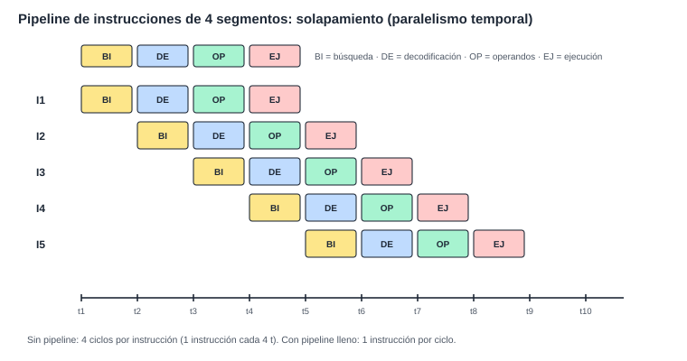
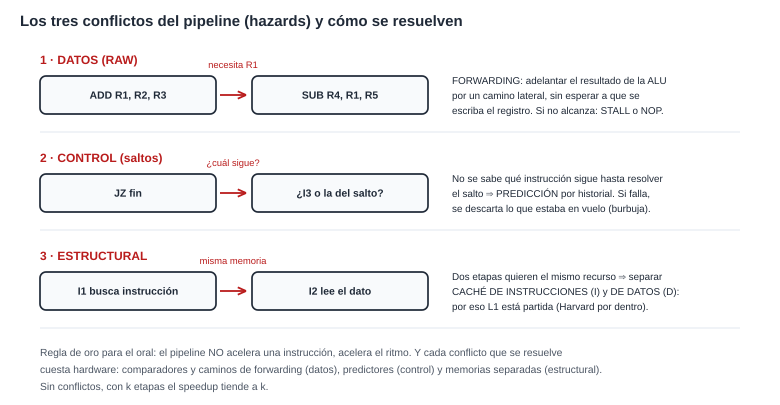
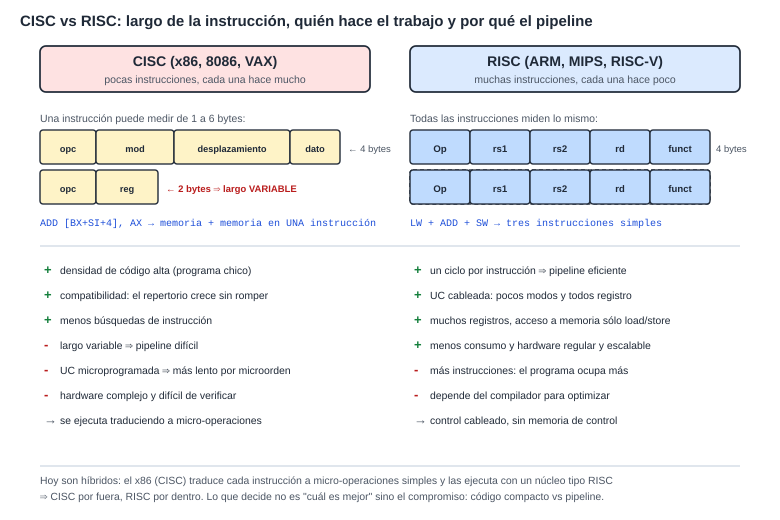
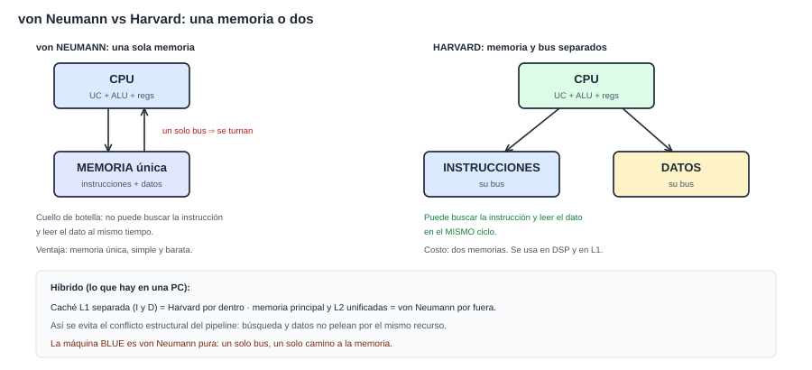

# Síntesis — Unidad 7: CPU y arquitecturas

> [!abstract] Qué es este archivo
> **Toda la Unidad 7 en un solo lugar**: pipeline y sus conflictos, el cálculo del speedup real, las técnicas para ir más rápido, CISC vs RISC, y von Neumann/Harvard con los buses. Con recetas de examen, errores que cuestan puntos y autoevaluación.

> [!tip] Cómo usarlo
> 1. Leer **§1 a §6** (30 minutos).
> 2. Hacer **a mano** el ejemplo de stalls de §3 y el de `AMAT` de §5.
> 3. Recitar la **tabla CISC/RISC** sin mirar.
> 4. Contestar **§10** de memoria.

## Índice

1. [[#1. Pipeline: etapas y escalera]]

2. [[#2. Los tres conflictos]]

3. [[#3. Speedup real, CPI y penalidades]]

4. [[#4. Técnicas para aumentar la velocidad]]

5. [[#5. Caché y predicción de saltos]]

6. [[#6. CISC y RISC]]

7. [[#7. von Neumann, Harvard y buses]]

8. [[#8. Tablas de memoria rápida]]

9. [[#9. Recetas de examen y errores]]

10. [[#10. Autoevaluación]]

---

## 1. Pipeline: etapas y escalera

| Etapa | Qué hace | Recurso |
|---|---|---|
| 1 **Búsqueda** | traer la instrucción | memoria |
| 2 **Decodificación** | saber qué es | decodificador/UC |
| 3 **Cálculo de dirección** | `EA` del operando | sumador |
| 4 **Búsqueda de operandos** | leer registros | banco de registros |
| 5 **Ejecución** | operar y escribir | ALU |



```
sin pipeline: k·n          con pipeline: k + (n − 1)         S = k·n / (k + n − 1) → k
```

| k | n | Serie | Pipeline | S |
|---|---|---|---|---|
| 5 | 3 | 15 | **7** | 2,14 |
| 5 | 100 | 500 | **104** | 4,81 |
| 5 | 1 000 | 5 000 | **1 004** | 4,98 |

**El ejemplo de la cátedra:** 8 pulsos, 3 operaciones ⇒ `24` pulsos en serie contra **8** solapados. **La frase:** no acelera **una** instrucción; aumenta el **ritmo de producción**. 👉 [[7.1.1 Etapas y diagrama en escalera]]

## 2. Los tres conflictos



| Conflicto | Cuándo | Solución |
|---|---|---|
| **Estructural** | dos etapas quieren el mismo recurso | **caché I y D**, duplicar hardware, bancos |
| **De datos (RAW)** | necesito un resultado que no está | **forwarding**, **stall**, `NOP`, renombrar |
| **De control** | no sé cuál sigue (salto) | **predicción**, *delay slot*, BTB |

> [!important] Los dos detalles que puntúan
> 1. El caso **load-use** **no** lo resuelve el forwarding ⇒ **1 ciclo de stall**.
> 2. Un salto mal predicho **descarta** lo que estaba en vuelo (no es gratis).

👉 [[7.1.2 Hazards y sus soluciones]]

## 3. Speedup real, CPI y penalidades

```
T_real = (k + n − 1 + P) · t          S = k·n / (k + n − 1 + P)          CPI = T_real / n
```

> [!example] 5 etapas, 100 instrucciones, 20 `LW` con 1 stall cada una, 1 GHz
> | | |
> |---|---|
> | Ciclos ideales | `5 + 99 = 104` |
> | + stalls | `+20` ⇒ **124** |
> | Tiempo | `124 × 1 ns =` **124 ns** |
> | Speedup real | `500 / 124 =` **4,03** (ideal 4,81) |
> | CPI | **1,24** |

**Saltos:** 15 % de saltos, mitad tomados, penalidad 2 ⇒ `7,5 × 2 = 15` ciclos ⇒ `S = 500/119 = 4,20`. **Con todo junto:** `104 + 20 + 15 = 139` ⇒ `S = 3,60`, `CPI = 1,39`.

| Fuente de pérdida | Fórmula |
|---|---|
| Llenado | `k − 1` |
| Stall | nº de casos × ciclos |
| Salto tomado / mal predicho | nº × penalidad |

👉 [[7.1.3 Cálculo de speedup y límites]]

## 4. Técnicas para aumentar la velocidad

| Técnica | Qué agrega | Techo | Costo |
|---|---|---|---|
| **Superpipeline** | más etapas | más **frecuencia** | más latencia y penalidad por salto |
| **Superscalar** | `m` instrucciones/ciclo | `CPI = 1/m` ideal | duplicar recursos y detectar dependencias |
| **SMT** | 2 hilos por núcleo | 1,2-1,3× | registros y lógica extra |
| **Multicore** | `n` núcleos | `n×` (Amdahl) | coherencia de caché, software |

**Ejemplo:** 4 núcleos × 2-wide × 2 hilos SMT = **16 instrucciones/ciclo** teóricas; a 3 GHz, `48·10⁹` instr/s **teóricas** ⇒ en la práctica, la mitad o menos.

**Otras que se nombran:** más frecuencia, menos pulsos por instrucción (RISC), UC cableada, más registros, aceleradores (GPU/NPU), DMA. 👉 [[7.2.1 Superscalar, superpipeline, SMT y multicore]]

## 5. Caché y predicción de saltos

```
AMAT = acierto + (tasa de fallos × penalidad)
```

| Caso | Cálculo | AMAT |
|---|---|---|
| L1 (1 ciclo, 5 % fallos, 100 ciclos) | `1 + 0,05×100` | **6** |
| L1 + L2 (L2: 10 ciclos, 20 % fallan a DRAM) | `1 + 0,05×(10+0,2×100)` | **2,5** |
| Sin caché | — | **100** |

### Predicción de saltos

| Predictor | Acierto |
|---|---|
| Estático "no salta" | 50-70 % |
| Estático por dirección (atrás se toma) | mejor en lazos |
| Dinámico 2 bits | 85-90 % |
| Historial/correlación | **95 %+** |

> [!example] 1 000 instrucciones, 20 % saltos, 90 % acierto, penalidad 5
> Fallos: `200 × 10 % = 20` ⇒ `20 × 5 = 100` ciclos ⇒ `CPI = 1,10` Con 95 %: `10 × 5 = 50` ⇒ `CPI = 1,05` (mitad de la pérdida)

**CPI combinado:** `1 + fallos_caché×penalidad/n + saltos_fallidos×penalidad/n` ⇒ con 2 % × 100 y 0,10 × 5 da `1 + 2,00 + 0,10 =` **3,10**: el pipeline de 5 etapas rinde **1,6×**, no 5×. 👉 [[7.2.2 Caché y predicción de saltos]]

## 6. CISC y RISC



| | **CISC** | **RISC** |
|---|---|---|
| Instrucciones | pocas y **complejas** | muchas y **simples** |
| Largo | **variable** | **fijo** (4 B) |
| Memoria | cualquier instrucción | **sólo** `LOAD`/`STORE` |
| Registros | pocos | **muchos** |
| UC | **microprogramada** | **cableada** |
| Ciclos | 2-10 | **≈1** |
| Pipeline | difícil | **natural** |
| Código | más **denso** | más largo |
| Ejemplos | x86, 8086 | ARM, MIPS, RISC-V |

**La cadena causal:** simple ⇒ cableado ⇒ **1 ciclo** ⇒ pipeline ⇒ `CPI ≈ 1`. **El 80/20:** el compilador usa el **20 %** del repertorio en el **80 %** del código ⇒ la complejidad extra **no paga**.

> [!example] `a = b + c`
> **CISC:** `ADD [a], [b], [c]` ⇒ 1 instrucción, varios ciclos. **RISC:** `LW R1,b` · `LW R2,c` · `ADD R3,R1,R2` · `SW a,R3` ⇒ 4 instrucciones, 4 ciclos.
>
> Vector de 100 elementos: CISC `500 instr × CPI 3 = 1 500` ciclos vs RISC `800 × 1,1 = 880` ⇒ **RISC 1,7× más rápido con 60 % más instrucciones**.

👉 [[7.3.1 Tabla comparativa y ejemplos]] · [[7.3.2 UC cableada vs microprogramada y load-store]]

## 7. von Neumann, Harvard y buses



| | **von Neumann** | **Harvard** |
|---|---|---|
| Memorias | **1** | **2** |
| En el mismo ciclo | instrucción **o** dato | instrucción **y** dato |
| Problema | **cuello de botella** | costo (doble memoria) |
| Ejemplo | **BLUE**, memoria principal | DSP, microcontroladores, **L1 I/D** |

**Híbrido de una PC:** L1 **separada** (Harvard) + L2 y memoria **unificadas** (von Neumann).

### Buses


```
ancho de banda = (bits del bus de datos / 8) × frecuencia
```

| Ejemplo | Cálculo | Resultado |
|---|---|---|
| 64 bits @ 200 MHz | `8 B × 200·10⁶` | **1,6 GB/s** |
| 32 bits @ 400 MHz | `4 B × 400·10⁶` | **1,6 GB/s** (¡igual!) |
| 1 MB por ese bus | `10⁶ / 1,6·10⁹` | **≈0,62 ms** |

**Tres grupos de líneas:** direcciones (un sentido) · datos (bidireccional) · control. **Conceptos:** maestro/esclavo · **arbitraje** · handshake · wait states · ráfaga (burst). 👉 [[7.4.1 von Neumann vs Harvard]] · [[7.4.2 Buses internos y externos]]

## 8. Tablas de memoria rápida

### Las fórmulas de la unidad

| Qué | Fórmula |
|---|---|
| Ciclos con pipeline | `k + (n − 1)` |
| Speedup ideal | `k·n / (k + n − 1) → k` |
| Speedup real | `k·n / (k + n − 1 + P)` |
| CPI | `ciclos / n` |
| AMAT | `acierto + fallos × penalidad` |
| Pérdida por saltos | `nº saltos × tasa de fallo × penalidad` |
| Ancho de banda del bus | `(bits/8) × frecuencia` |
| Superscalar ideal | `CPI = 1 / m` |

### Los números que hay que saber

| Dato | Valor |
|---|---|
| Etapas del pipeline clásico | **5** |
| Speedup máximo | `k` (el nº de etapas) |
| Penalidad típica de salto | 2-5 ciclos (10+ en pipelines profundos) |
| Acierto de un buen predictor | 90-95 % |
| Fallo de caché a DRAM | 100+ ciclos |
| SMT | 2 hilos por núcleo (~1,3×) |

## 9. Recetas de examen y errores

> [!example] Receta 1 — "Calcule ciclos y speedup de un pipeline"
> 1. `k` = etapas, `n` = instrucciones.
> 2. Ideal: `k + n − 1`; serie: `k·n`; `S` y **comentar que tiende a `k`**.
> 3. Si hay stalls o saltos: **sumarlos** a los ciclos y recalcular.
> 4. Pasar a tiempo con `t = 1/f`.

> [!example] Receta 2 — "¿Qué conflicto es y cómo se resuelve?"
> 1. ¿Es por **recurso** compartido? ⇒ estructural ⇒ caché I/D, duplicar.
> 2. ¿Falta un **resultado**? ⇒ datos ⇒ forwarding; si es **load-use**, stall.
> 3. ¿Falta saber la **próxima instrucción**? ⇒ control ⇒ predicción / delay slot.
> 4. Nombrar la penalidad en ciclos.

> [!example] Receta 3 — "AMAT y CPI con caché y saltos"
> 1. `AMAT = acierto + fallos × penalidad` (con niveles, anidar).
> 2. Pérdida por saltos = `saltos × (1 − acierto) × penalidad`.
> 3. `CPI = 1 + pérdida_caché/n + pérdida_saltos/n`.
> 4. Comparar con el CPI ideal y concluir.

> [!example] Receta 4 — "CISC vs RISC"
> 1. Tabla de 6 filas: instrucciones, largo, memoria, registros, UC, ciclos.
> 2. Ejemplo de código (`a = b + c`) en los dos.
> 3. Cerrar con el 80/20 y el **híbrido** actual.

> [!example] Receta 5 — "Ancho de banda del bus"
> 1. `bits/8` = bytes por transferencia.
> 2. × frecuencia = B/s.
> 3. Para un bloque: `tiempo = bytes / ancho de banda`.
> 4. Aclarar que es **caudal**, no latencia; y que el bus es **compartido** (arbitraje).

### Errores que cuestan puntos

| Error | Lo correcto |
|---|---|
| "Una instrucción tarda menos con pipeline" | tarda lo mismo; mejora el **rendimiento** |
| Usar `k·n` con pipeline | `k + n − 1` |
| Prometer speedup `> k` | el techo es `k` |
| Olvidar stalls y saltos | `S` real ≠ `S` ideal |
| Decir que forwarding resuelve todo | **load-use** pide stall |
| Confundir conflicto estructural con datos | recurso vs resultado |
| "RISC tiene menos instrucciones" | tiene **más**, pero **simples** |
| "Menos instrucciones = más rápido" | importa el **CPI** |
| Ignorar el costo del `load/store` | más instrucciones y registros |
| "La PC es Harvard" o "es von Neumann" | es **híbrida** (L1 separada) |
| Calcular el bus con bits de **dirección** | con bits de **datos** |
| "Serial = lento" | PCIe es serial y rapidísimo |
| Confundir ancho de banda con latencia | caudal vs demora |
| Sumar ganancias sin límites (`4-wide × 4 núcleos`) | es un **techo teórico** |

## 10. Autoevaluación

1. ¿Cuáles son las 5 etapas y qué recurso usa cada una?

2. ¿Por qué la primera instrucción **no** sale antes con pipeline?

3. Con `k = 4`, `n = 15`: ciclos con y sin pipeline, y speedup.

4. Nombrá los tres conflictos con un ejemplo y una solución de cada uno.

5. ¿Cuándo **no** alcanza el forwarding? ¿Cuántos ciclos se pierden?

6. ¿Qué es un *delay slot* y quién lo llena?

7. Calculá el CPI de: 200 instrucciones, 10 stalls, 12 saltos tomados con penalidad 2 (k = 5).

8. Superscalar, superpipeline, SMT y multicore: ¿qué agrega cada uno y cuál es su límite?

9. ¿Por qué SMT da sólo ~1,3× y multicore puede dar más?

10. `AMAT` con acierto 2 ciclos, 4 % de fallos y 80 ciclos de penalidad. ídem con L2 intermedia.

11. ¿Cuánto cuesta un predictor del 85 % con 200 saltos y penalidad 4? ¿Y del 95 %?

12. ¿Por qué un fallo de caché congela el pipeline?

13. Armá la tabla CISC vs RISC de memoria (6 filas).

14. Escribí `a = b + c` en los dos estilos y contá instrucciones.

15. ¿Por qué RISC usa control cableado? Encadená: simple → cableado → 1 ciclo → pipeline.

16. ¿Qué problema resuelve el `load/store` y qué cuesta?

17. von Neumann vs Harvard: ¿cuál es el cuello de botella y cómo se mitiga hoy?

18. Ancho de banda de un bus de 128 bits a 400 MHz, y tiempo para transferir 4 MB.

19. ¿Qué es el arbitraje del bus y quién puede ser maestro?

20. ¿Por qué PCIe es serial y aun así más rápido que PCI paralelo?

---

## Relacionado
[[00 Unidad 7 completa (lectura de corrido)]] · [[00 Unidad 7 — temas y subtemas]] · [[00 Unidad 6 — temas y subtemas]] · [[00 Unidad 8 — temas y subtemas]] · [[00 Índice de la materia (las 10 unidades)]] · [[Pipeline]] · [[CISC y RISC]]
