# Unidad 7 — CPU y arquitecturas

> [!abstract] Qué es este archivo
> **La Unidad 7 completa en un solo archivo**: los **9 subtemas** pegados uno detrás de otro,
> con todo su contenido: definiciones, tablas, diagramas, ejemplos resueltos, figuras del libro y errores
> típicos. Son **8.615 palabras** y **4 temas**. Está pensado para **leer de corrido** y para
> **imprimir**: no hace falta abrir ninguna otra nota.
>
> - **Repaso rápido** (una página): [[00 Síntesis — Unidad 7]].
> - **Buscar un punto**: el índice de abajo o el de la unidad, [[00 Unidad 7 — temas y subtemas]].
> - Cada subtema conserva su número (`1.4.1`), así coincide con el índice y con las preguntas del final.
> - **Todo junto, las 10 unidades**: [[00 Materia completa (las 10 unidades en un archivo)]].
>
> *Archivo generado con `tools/unir_unidades.py`: no editarlo a mano, editar el subtema y regenerar.*

## Contenido

**7.1 Pipeline**
- [[#7.1.1 Etapas y diagrama en escalera]]
- [[#7.1.2 Hazards y sus soluciones]]
- [[#7.1.3 Cálculo de speedup y límites]]

**7.2 Técnicas para aumentar la velocidad**
- [[#7.2.1 Superscalar, superpipeline, SMT y multicore]]
- [[#7.2.2 Caché y predicción de saltos]]

**7.3 CISC y RISC**
- [[#7.3.1 Tabla comparativa y ejemplos]]
- [[#7.3.2 UC cableada vs microprogramada y load-store]]

**7.4 Arquitecturas y buses**
- [[#7.4.1 von Neumann vs Harvard]]
- [[#7.4.2 Buses internos y externos]]

---

## 7.1 Pipeline

### 7.1.1 Etapas y diagrama en escalera

> [!abstract] En una frase
> El pipeline parte la ejecución de una instrucción en **5 etapas** —**búsqueda, decodificación, cálculo de
> direcciones, búsqueda de operandos y ejecución**— cada una con su propio hardware, y las hace avanzar **como una
> línea de montaje**: `n` instrucciones tardan **`k + (n − 1)`** ciclos.

> [!note] Si la primera vez que ves esto
> Una lavandería con **una** persona: lavar 30 min, secar 30, doblar 30 ⇒ cada carga tarda 90 min. Con **tres**
> personas (una lava, otra seca, otra dobla) la primera carga sigue tardando 90 min, pero **sale una carga nueva
> cada 30 min**. Eso es el pipeline: no mejora **una** tarea, mejora el **ritmo**.

#### Las cinco etapas

| # | Etapa | Qué hace | En la BLUE | Recurso que usa |
|---|---|---|---|---|
| 1 | **Búsqueda** (*fetch*) | traer la instrucción de memoria | `PC → MAR`, lectura, `MBR → IR` (CP1-CP6) | memoria |
| 2 | **Decodificación** | averiguar qué instrucción es | la UC decodifica `IR15..12` | decodificador / UC |
| 3 | **Cálculo de dirección** | hallar la dirección efectiva del operando | el sumador de direcciones de la indexada (`EA = D + RIF`) | sumador |
| 4 | **Búsqueda de operandos** | leer los operandos | `MBR → Y`, `AC → Z` | banco de registros |
| 5 | **Ejecución** | operar y escribir el resultado | la ALU en CP8 (`SUM → A`) | ALU |

> [!important] Por qué las etapas se eligen así
> Porque cada una usa un **recurso distinto**. Si dos etapas necesitaran el mismo hardware no podrían solaparse:
> eso es un **conflicto estructural** (7.1.2). El caso clásico: búsqueda y datos comparten la memoria ⇒ hace falta
> **caché I y D separadas**.

#### El diagrama en escalera

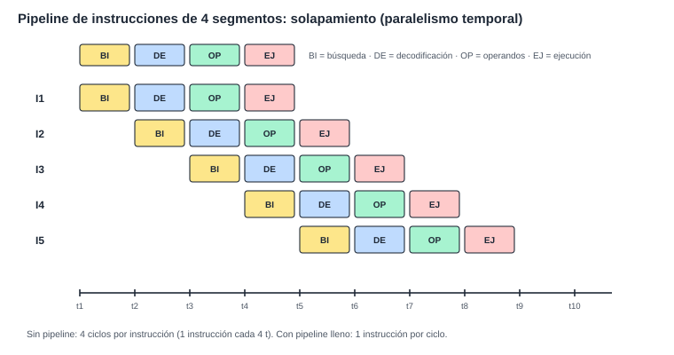

Con `k = 5` etapas e instrucciones `I1`, `I2`, `I3`:

| Ciclo | 1 | 2 | 3 | 4 | 5 | 6 | 7 |
|---|---|---|---|---|---|---|---|
| **I1** | B | D | CD | BO | E | | |
| **I2** | | B | D | CD | BO | E | |
| **I3** | | | B | D | CD | BO | E |

- **I1 termina en el ciclo 5** (igual que sin pipeline: **la latencia no mejora**).
- **I3 termina en el ciclo 7**; sin pipeline habría sido el **15**.
- **Desde el ciclo 5 sale una instrucción por ciclo** ⇒ ése es el ritmo de producción.

#### La cuenta

```
sin pipeline:  k · n            ciclos
con pipeline:  k + (n − 1)      ciclos
speedup:       S = k·n / (k + n − 1)   →  k
```

| k | n | Sin pipeline | Con pipeline | S |
|---|---|---|---|---|
| 5 | 3 | 15 | **7** | 2,14 |
| 5 | 10 | 50 | **14** | 3,57 |
| 5 | 100 | 500 | **104** | 4,81 |
| 5 | 1 000 | 5 000 | **1 004** | 4,98 |

**El ejemplo de la cátedra:** "en **8 pulsos** pude hacer **3 operaciones**, cuando sin pipeline necesitaba **8 por
cada una**" ⇒ `24` pulsos contra `8`; y a partir del pulso 6 ya sale una por pulso.

> [!example] Ejemplo resuelto
> "Un pipeline de 4 etapas ejecuta 12 instrucciones a 500 MHz. ¿Cuántos ciclos, cuánto tarda y qué speedup da?"
>
> 1. Ciclos: `4 + (12 − 1) = 15`.
> 2. Período: `1 / 500 MHz = 2 ns` ⇒ `15 × 2 ns =` **30 ns**.
> 3. Sin pipeline: `4 × 12 = 48` ciclos ⇒ `96 ns`.
> 4. `S = 48 / 15 =` **3,2** (techo: 4).

#### Lo que el pipeline **no** hace
| Se dice | Es |
|---|---|
| "Cada instrucción tarda menos" | **No**: tarda lo mismo (o un poco más por los registros de etapa) |
| "El speedup es `k` siempre" | **No**: tiende a `k` sólo con `n ≫ k` y **sin conflictos** |
| "Es multiprocesamiento" | **No**: es paralelismo **temporal** dentro de un solo flujo (**SISD**) |
| "Sirve para cualquier programa" | **No**: necesita instrucciones **independientes** que se puedan solapar |

#### Los registros de etapa
Entre etapa y etapa hay un **registro** que guarda lo que produjo la anterior. Eso agrega:
- **1 ciclo de latencia** por etapa (el dato tiene que asentarse antes de que lo use la siguiente).
- La necesidad de **señales de habilitación** (para congelar una etapa cuando hay un conflicto).
Por eso el pipeline profundo mejora el **throughput** pero **empeora** la latencia individual y el costo de un
salto mal predicho.

> [!warning] Errores típicos
> - Usar `k·n` para el caso con pipeline (es `k + n − 1`).
> - Decir que la primera instrucción sale antes (sale en el ciclo `k`, igual que sin pipeline).
> - Olvidar los **registros de etapa** al explicar por qué la latencia empeora.
> - Poner etapas que usan **el mismo** recurso (imposible solapar).
> - Contar el pipeline como MIMD en Flynn (es **SISD**).

#### Figura de clase

##### Las cinco etapas con su sigla y su función.

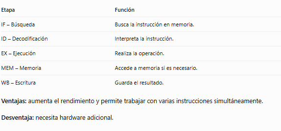

*Figura de clase — Resumen «Arquitectura final» (Said), p. 42.*

> [!tip] Qué mirar
> Las etapas con las **siglas** que se piden al enumerarlas: **IF** (búsqueda: trae la instrucción), **ID** (decodificación: la interpreta), **EX** (ejecución: opera), **MEM** (memoria: accede si hace falta) y **WB** (escritura: guarda el resultado). La figura también resume el balance del tema en dos líneas: **ventaja**, se solapan varias instrucciones y sube el rendimiento; **desventaja**, hace falta hardware adicional (los registros de etapa y el control de los riesgos).

#### Figura del libro

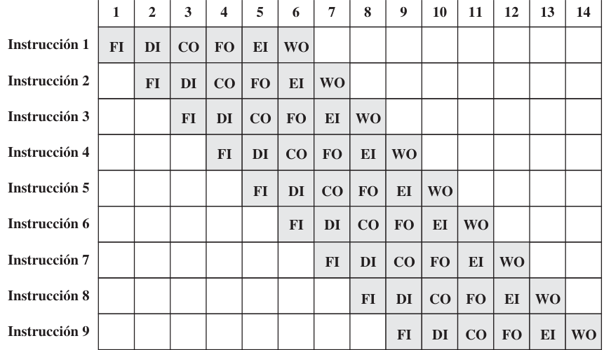

*Fig. 12.10 — Diagrama de tiempos del funcionamiento de un cauce de instrucciones.* · Stallings, *Organización y arquitectura de computadores*, 7ª ed., p. 474.

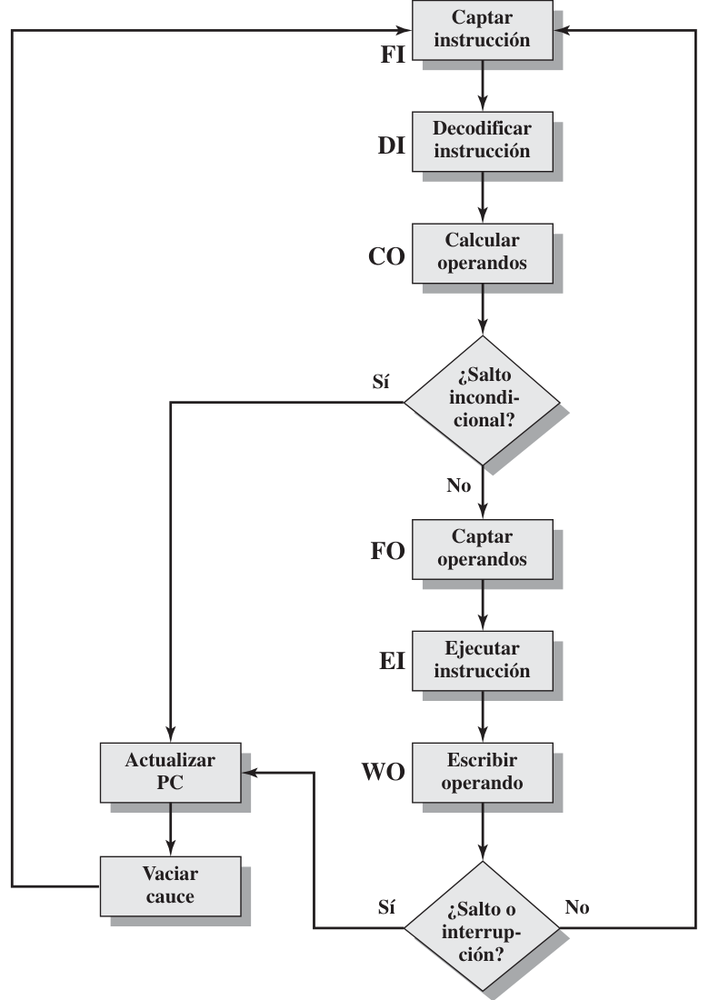

*Fig. 12.12 — Cauce de instrucciones de un procesador, con seis etapas.* · Stallings, *Organización y arquitectura de computadores*, 7ª ed., p. 475.

#### Relacionado
[[7.1.2 Hazards y sus soluciones]] · [[7.1.3 Cálculo de speedup y límites]] · [[Pipeline]] ·
[[4.3.2 Búsqueda, los 8 pulsos]] · [[8.1.1 Etapas segmentadas y suma de vectores]] · [[Glosario — Unidad 7]]

### 7.1.2 Hazards y sus soluciones

> [!abstract] En una frase
> Un **conflicto** (*hazard*) es una situación que impide que la próxima instrucción entre al pipeline en su ciclo:
> **estructural** (dos etapas quieren el mismo recurso), **de datos** (necesito un resultado que todavía no está) o
> **de control** (no sé qué instrucción sigue porque hay un salto).

> [!note] Si la primera vez que ves esto
> Es el **embotellamiento** de la línea de montaje. Se frena porque dos puestos se pelean la misma herramienta
> (estructural), porque falta una pieza que todavía se está fabricando (datos) o porque el jefe no dijo qué modelo
> se arma después (control). Cada conflicto tiene **su** solución.

#### Los tres, con su solución

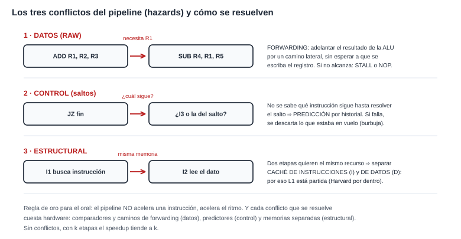

| Conflicto | Cuándo ocurre | Ejemplo | Solución |
|---|---|---|---|
| **Estructural** | dos etapas piden **el mismo recurso** en el mismo ciclo | búsqueda y acceso a datos quieren la memoria | **caché I y D separadas**, duplicar hardware, bancos de memoria |
| **De datos (RAW)** | una instrucción **necesita el resultado** de otra que aún no lo escribió | `ADD R1, R2, R3` y después `SUB R4, R1, R5` | **forwarding** (*bypass*), **stall**, insertar `NOP`, renombrar registros |
| **De control** | no se sabe cuál es la próxima instrucción | `JMP`, `JZ`, `CALL` | **predicción**, *delay slot*, *branch target buffer* |

#### Conflicto de datos, con números
```
I1:  ADD R1, R2, R3      (escribe R1 en la etapa E)
I2:  SUB R4, R1, R5      (necesita R1 en la etapa BO)
```
Si `I2` lee `R1` antes de que `I1` lo escriba, lee **basura**.

| Solución | Qué hace | Costo |
|---|---|---|
| **Stall** (burbuja) | congela `I2` hasta que `I1` escriba | 1-2 ciclos perdidos |
| **NOP** del compilador | relleno inútil | tamaño de código |
| **Forwarding / bypass** | **adelanta** el resultado por un camino lateral: `I2` lo toma de la salida de la ALU | hardware extra, **0 ciclos** |
| **Renombrar registros** | `I1` escribe en otro registro físico | hardware, pero elimina falsas dependencias |

> [!important] El caso que **sí** necesita stall
> El forwarding no puede resolver la dependencia **load → uso**: el dato de un `LW` recién está al final de la
> etapa de memoria. Ahí hace falta **1 ciclo de stall** aunque haya forwarding. Es la respuesta clásica cuando
> preguntan "¿cuándo **no** alcanza el forwarding?".

#### Conflicto de control: el costo del salto
Mientras la etapa de búsqueda ya trajo la instrucción siguiente, la de decodificación descubre que **era un salto**.
Hay dos caminos:

| Estrategia | Idea | Costo |
|---|---|---|
| **Congelar** hasta saber | esperar | **penalidad alta** (2-3 ciclos) |
| **Predecir "no salta"** | seguir de largo | si salta, se tira lo que estaba en vuelo |
| **Salto retardado** (*delay slot*) | el compilador pone una instrucción **útil** en el hueco | 0 ciclos, 1 instrucción de código |
| **Predicción dinámica** (7.2.2) | historial de saltos + BTB | acierta ~90-95 % |
| **Ejecución especulativa** | ejecuta la rama predicha y deshace si falla | hardware complejo |

La **penalidad** por conflicto de control es lo que más castiga a un pipeline **profundo**: con 20 etapas, tirar es
tirar veinte ciclos de trabajo.

#### Tabla de diagnóstico (para el oral)
| Si el enunciado dice… | Es un conflicto… | Se resuelve con… |
|---|---|---|
| "dos instrucciones usan la memoria a la vez" | **estructural** | caché I/D o bancos |
| "necesito el resultado de la anterior" | **datos** | forwarding / stall |
| "después de un salto no sé qué sigue" | **control** | predicción / delay slot |
| "hay un `LW` seguido de un uso del dato" | **datos** (load-use) | **stall** de 1 ciclo |
| "el programa tiene muchos lazos" | **control** frecuente | predicción con historial |

> [!warning] Errores típicos
> - Confundir el conflicto **estructural** con el de **datos** (el primero es de **recursos**).
> - Decir que el forwarding resuelve **todo**: el caso *load-use* pide stall.
> - Creer que un stall "borra" la instrucción (sólo **congela** la etapa).
> - Olvidar que un salto mal predicho **descarta** lo que estaba en vuelo (no es gratis).
> - Decir que el conflicto de control se arregla "con más registros".

#### Figura del libro

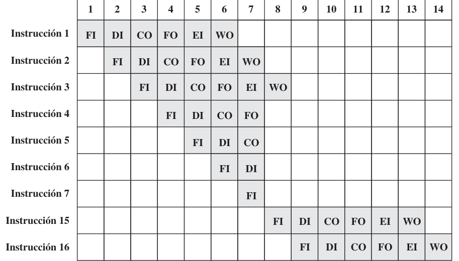

*Fig. 12.11 — Efecto de un salto condicional en el funcionamiento de un cauce* · Stallings, *Organización y arquitectura de computadores*, 7ª ed., p. 474.

#### Cuando no hay con qué adelantar: relleno con NOP

Si el hazard **no se puede resolver** (no hay otra instrucción útil para poner en el hueco ni se puede adelantar el
dato), la solución que siempre funciona es **insertar NOP** (*no operation*): instrucciones que ocupan el ciclo sin
cambiar nada. El pipeline queda correcto pero **pierde tiempo**: cada NOP es un ciclo regalado.

| Solución al hazard | Costo | Cuándo se usa |
|---|---|---|
| **Detener** el pipeline (*stall*) | 1 ciclo por cada ciclo de espera | siempre funciona, es la más simple |
| **Rellenar con NOP** | igual que el stall, pero explícito en el código | cuando lo hace el compilador |
| **Reordenar** instrucciones | 0 ciclos | si hay instrucciones independientes cerca |
| **Adelantamiento** (*forwarding*) | 0 ciclos, agrega hardware | para ALU → ALU |
| **Predecir** el salto | 0 ciclos si acierta | en saltos |

> [!example] Contar los NOP
> `LOAD R1, M` (usa la memoria en la etapa 4) seguida de `ADD R2, R1` necesita **2 NOP** entre ellas si no hay
> forwarding; con forwarding, **1**. En un bucle de 100 iteraciones eso son **200 ciclos perdidos**: exactamente la
> penalidad que se suma en [[7.1.3 Cálculo de speedup y límites]].


#### Relacionado
[[7.1.1 Etapas y diagrama en escalera]] · [[7.1.3 Cálculo de speedup y límites]] · [[7.2.2 Caché y predicción de saltos]] ·
[[Pipeline]] · [[2.5.1 Jerarquía y localidad]] · [[Glosario — Unidad 7]]

### 7.1.3 Cálculo de speedup y límites

> [!abstract] En una frase
> El speedup **ideal** es `k·n / (k + n − 1)` y tiende a `k`; el speedup **real** se calcula sumando los **ciclos
> perdidos** por stalls y saltos mal predichos: `T = (k + n − 1 + penalidades) · t`.

> [!note] Si la primera vez que ves esto
> El cálculo del pipeline es como calcular un viaje en auto: el tiempo ideal es la distancia dividida la velocidad,
> pero después hay que **sumar los semáforos**. La fórmula `k + n − 1` es el tiempo sin semáforos; los hazards son
> los semáforos.

#### El techo es k

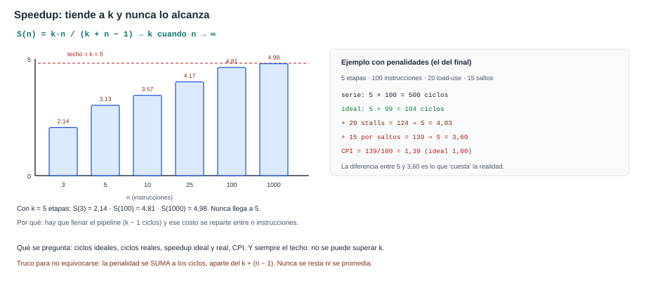

#### Las tres fórmulas

```
ideal:    T_ideal = (k + n − 1) · t
real:     T_real  = (k + n − 1 + P) · t        P = ciclos perdidos
speedup:  S = T_serie / T_real = k·n / (k + n − 1 + P)
CPI:      CPI = T_real / n
```

donde `t` es el período del reloj (el de la **etapa más lenta**, más el registro de etapa).

#### Ejemplo resuelto 1: stalls de datos
> "Pipeline de 5 etapas, 100 instrucciones, 20 de ellas son `LW` seguidas de un uso inmediato (1 ciclo de stall
> cada una). Frecuencia: 1 GHz. Calcular ciclos, tiempo, speedup y CPI."

| Paso | Cuenta |
|---|---|
| Ciclos ideales | `5 + 99 = 104` |
| Stall por load-use | `20 × 1 = 20` |
| **Ciclos reales** | `104 + 20 =` **124** |
| Tiempo | `124 × 1 ns =` **124 ns** |
| Sin pipeline | `5 × 100 = 500` ciclos ⇒ `500 ns` |
| **Speedup real** | `500 / 124 =` **4,03** (ideal: `500/104 = 4,81`) |
| **CPI** | `124 / 100 =` **1,24** |

**Lectura:** se perdió un **16 %** del rendimiento ideal sólo por 20 stalls. Los stalls **se pagan en CPI**.

#### Ejemplo resuelto 2: saltos
> "El mismo pipeline, con 15 % de instrucciones de salto y una penalidad de 2 ciclos cuando el salto se toma (50 %
> de las veces). ¿Cuántos ciclos se pierden?"

1. Saltos: `0,15 × 100 = 15` instrucciones.
2. Se toman la mitad: `7,5` (redondeamos a 8).
3. Penalidad: `7,5 × 2 = 15` ciclos.
4. **Total con saltos:** `104 + 15 = 119` ⇒ `S = 500/119 = 4,20`.

**Si además hay los stalls del ejemplo 1:** `104 + 20 + 15 = 139` ⇒ `S = 3,60` y `CPI = 1,39`.

#### La tabla de las penalidades

| Fuente de ciclos perdidos | Fórmula | Se paga… |
|---|---|---|
| **Llenado** | `k − 1` | una vez por programa (amortizado) |
| **Stall por dependencia** | nº de casos × ciclos de espera | por instrucción afectada |
| **Salto tomado** | `nº de saltos tomados × penalidad` | por salto |
| **Salto mal predicho** | `nº de fallos × penalidad` | por fallo |
| **Interrupción** | ciclos de guardado de contexto | por evento |

> [!important] El techo no es `k` "y listo"
> `S → k` sólo si `n → ∞` **y** `P → 0`. En la práctica el techo lo pone la **frecuencia de dependencias** del
> código: si cada instrucción depende de la anterior, `P ≈ n` y el pipeline **no gana nada** (queda en `CPI ≈ 1`
> sin solapamiento real).

#### Cuándo conviene un pipeline más profundo
| A favor | En contra |
|---|---|
| Más etapas ⇒ etapas más cortas ⇒ **más frecuencia** | Más registros de etapa ⇒ más latencia |
| Más instrucciones en vuelo | Cada conflicto tira **más** trabajo |
| | La penalidad de salto crece **con `k`** |

**Regla:** profundizar conviene si el programa tiene **pocas dependencias y pocos saltos** (código vectorial,
compilado para pipeline). En código con muchos saltos (interpretadores, lógica), el pipeline profundo se castiga.

#### Cómo se relaciona con lo demás
| Técnica | Qué le suma al speedup |
|---|---|
| **Forwarding** | reduce `P` de datos |
| **Predicción de saltos** | reduce `P` de control |
| **Caché I/D** | elimina conflictos estructurales y esperas de memoria |
| **Superscalar** | más de una instrucción por ciclo ⇒ `CPI < 1` (7.2.1) |
| **Superpipeline** | más `k`, más frecuencia, más penalidad (7.2.1) |

> [!warning] Errores típicos
> - Calcular el speedup con la fórmula ideal cuando el enunciado da stalls o saltos.
> - Olvidar el **llenado** (`k − 1` ciclos) en programas cortos: con `n = 3` el speedup es **2,14**, no 5.
> - Sumar los ciclos de stall **después** de calcular el speedup.
> - Confundir `CPI` con "ciclos por etapa" (es ciclos **por instrucción**).
> - Decir que más etapas siempre es mejor.

#### Figura del libro

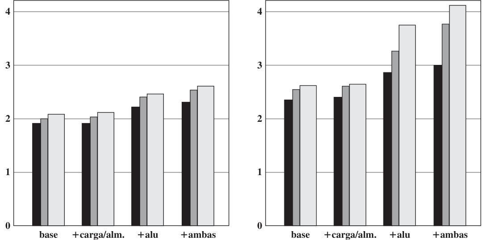

*Fig. 14.5 — Incremento de velocidad de diversas organizaciones de una máquina,* · Stallings, *Organización y arquitectura de computadores*, 7ª ed., p. 562.

#### Relacionado
[[7.1.2 Hazards y sus soluciones]] · [[7.2.1 Superscalar, superpipeline, SMT y multicore]] ·
[[7.1.1 Etapas y diagrama en escalera]] · [[Pipeline]] · [[8.4.1 Multicore, coherencia de caché y ley de Amdahl]] · [[Glosario — Unidad 7]]

## 7.2 Técnicas para aumentar la velocidad

### 7.2.1 Superscalar, superpipeline, SMT y multicore

> [!abstract] En una frase
> Para pasar de **menos de una** instrucción por ciclo hay cuatro caminos que se combinan: **superpipeline** (más
> etapas ⇒ más frecuencia), **superscalar** (**varias** instrucciones por ciclo), **SMT** (varios hilos en un
> núcleo) y **multicore** (varios núcleos).

> [!note] Si la primera vez que ves esto
> Una línea de montaje de autos: el **superpipeline** acorta cada puesto (más autos por hora comprimiendo el
> ritmo); el **superscalar** pone **varias líneas en paralelo** dentro de la misma fábrica; el **SMT** hace que dos
> pedidos distintos compartan la misma línea; el **multicore** construye **otra fábrica** al lado.

#### Cuatro formas de ir más rápido

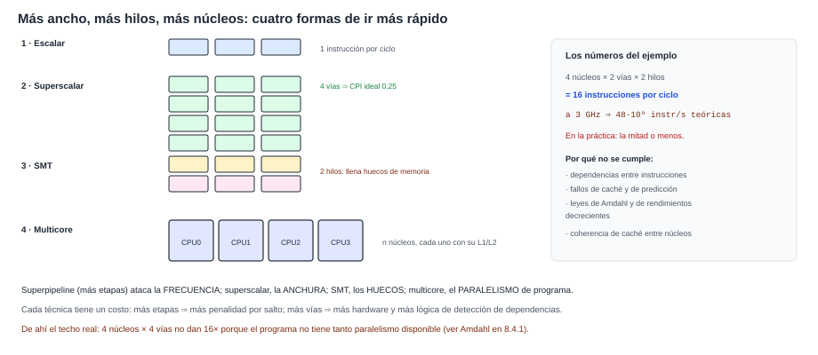

#### Las cuatro, comparadas

| Técnica | Qué agrega | Ganancia típica | Costo / límite |
|---|---|---|---|
| **Superpipeline** | más **etapas** (más finas) | más **frecuencia** | más latencia, más penalidad por conflicto |
| **Superscalar** | `m` instrucciones **por ciclo** | hasta `m×` | necesita **muchos recursos duplicados** + detectar dependencias |
| **SMT** (*hyper-threading*) | 2 hilos comparten **un** núcleo | 1,2-1,3× | más registros y lógica de selección |
| **Multicore** | `n` núcleos con su caché | hasta `n×` (Amdahl) | coherencia de caché, software paralelo |

#### Superscalar: lo que cuesta emitir dos por ciclo
```
     ┌──► pipeline 1 ──► instrucción A
──┬──┤
  │  └──► pipeline 2 ──► instrucción B
  └─ la unidad de emisión decide cuáles dos instrucciones pueden ir juntas
```
| Requisito | Por qué |
|---|---|
| **Dos (o cuatro) decodificadores** | hay que decodificar 2 instrucciones en el mismo ciclo |
| **Detectar dependencias en el mismo ciclo** | si `B` depende de `A`, no pueden ir juntas |
| **Suficientes unidades funcionales** | 2 ALU, 2 accesos a memoria… |
| **Registros de etapa duplicados** | guardar los dos caminos |

**Ejemplo:** un procesador **4-wide** (4 instrucciones por ciclo) a 2 GHz haría
`4 × 2·10⁹ = 8·10⁹` instrucciones/s **en el mejor caso** (`CPI = 0,25`). En la práctica, las dependencias y los
saltos lo bajan a `CPI ≈ 0,6-1`.

| Ancho | CPI ideal | MIPS a 2 GHz |
|---|---|---|
| 1 (escalar) | 1 | 2 000 |
| 2 | 0,5 | 4 000 |
| 4 | 0,25 | 8 000 |

> [!important] Por qué un superscalar no da `m×` nunca
> Porque el **código tiene dependencias**: si la instrucción 2 necesita lo que produce la 1, no se pueden emitir
> juntas. La ganancia real depende del **ILP** (paralelismo a nivel de instrucciones) que tenga el programa.

#### Superpipeline
Más etapas ⇒ cada etapa hace menos ⇒ el **reloj sube**. Pero:
- **más latencia** por instrucción (más registros de etapa),
- **mayor penalidad** por salto (hay más instrucciones en vuelo que se tiran).

| Pipeline | Etapas | Frecuencia | Penalidad de salto |
|---|---|---|---|
| Clásico | 5 | 1 GHz | 2 ciclos |
| Profundo | 20 | 3 GHz | **10-15 ciclos** |

Es lo que se hizo en los Pentium 4 (31 etapas) y lo que se abandonó después: el castigo por saltos mal predichos
era peor que la ganancia en frecuencia.

#### SMT: dos hilos, un núcleo
El núcleo tiene **dos juegos de registros** y alterna entre los hilos: cuando un hilo está **esperando memoria**, el
otro usa las unidades ociosas.
- **Ganancia:** 1,2-1,3× (el sistema operativo ve **2 procesadores lógicos** por núcleo).
- **Diferencia con multicore:** en SMT los hilos **comparten** todo el hardware de ejecución; en multicore, cada uno
  tiene su núcleo completo.

#### Multicore
Varios núcleos con **su** pipeline y **su** caché L1/L2, compartiendo la L3 y la memoria (y por eso el problema de
**coherencia de caché** de la Unidad 8). Su techo lo pone la **ley de Amdahl**.

> [!example] Ejemplo resuelto (las cuatro juntas)
> "Un chip tiene 4 núcleos, cada uno 2-wide, con SMT (2 hilos), a 3 GHz. ¿Cuántas instrucciones por ciclo puede
> emitir como máximo y cuántas por segundo?"
>
> 1. Por núcleo: `2` (ancho) `× 2` (hilos SMT) = **4** instrucciones por ciclo (si los recursos alcanzan).
> 2. Total del chip: `4 núcleos × 4 =` **16** instrucciones por ciclo.
> 3. Por segundo: `16 × 3·10⁹ =` **48·10⁹** instrucciones/s **teóricas**.
> 4. Real: con `CPI` efectivo de ~1 por hilo, del orden de **10-12·10⁹** ⇒ el techo teórico **no** se alcanza.

#### Cómo se elige cada una (criterio de diseño)
| Situación | Conviene |
|---|---|
| Código con mucho ILP, una sola tarea | **superscalar + superpipeline** |
| Muchas esperas de memoria (servidor, base de datos) | **SMT** (tapa la espera) |
| Muchas tareas independientes | **multicore** |
| Consumo ajustado (móvil) | pocos núcleos, **big.LITTLE** (núcleos grandes + chicos) |

> [!warning] Errores típicos
> - Decir que superscalar "duplica la velocidad" (el código con dependencias no lo permite).
> - Confundir **SMT** (2 hilos, 1 núcleo) con **multicore** (2 núcleos).
> - Creer que más etapas siempre es mejor (la penalidad de salto crece con `k`).
> - Sumar las ganancias multiplicando sin límites: `4-wide × 4 núcleos × 3 GHz` es un **techo teórico**, no un
>   resultado.
> - Olvidar que **todo esto necesita software paralelo** para aprovecharse.

#### Figura del libro

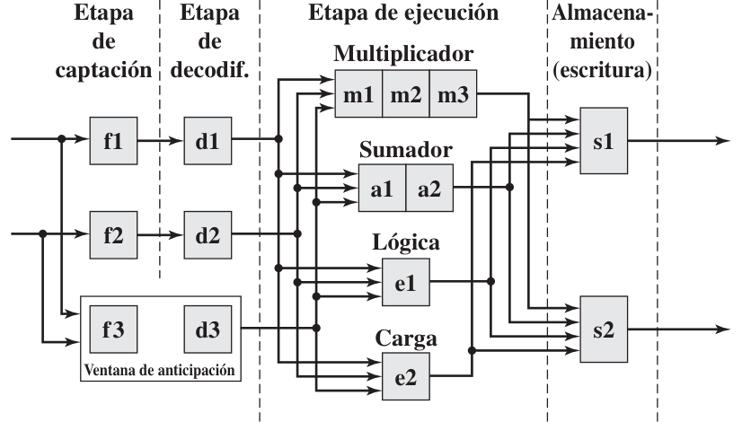

*Fig. 14.15 — Un procesador superescalar con un cauce doble.* · Stallings, *Organización y arquitectura de computadores*, 7ª ed., p. 582.

![Estructura de cauces del PowerPC 601 [POTT94].](../../assets/libro-stallings-f14-11.png)

*Fig. 14.11 — Estructura de cauces del PowerPC 601 [POTT94].* · Stallings, *Organización y arquitectura de computadores*, 7ª ed., p. 573.

#### Relacionado
[[7.2.2 Caché y predicción de saltos]] · [[7.1.3 Cálculo de speedup y límites]] · [[8.4.1 Multicore, coherencia de caché y ley de Amdahl]] ·
[[Técnicas para aumentar la velocidad]] · [[CISC y RISC]] · [[Glosario — Unidad 7]]

### 7.2.2 Caché y predicción de saltos

> [!abstract] En una frase
> De las dos esperas que arruinan un pipeline —**la memoria** y **los saltos**—, la **caché** tapa la primera
> (convierte un acceso de 100 ciclos en 1) y la **predicción de saltos** tapa la segunda (apuesta cuál es la próxima
> instrucción).

> [!note] Si la primera vez que ves esto
> La caché es tener **los útiles a mano** en vez de bajar al sótano cada vez. La predicción es **adivinar** qué
> viene: si acertás seguís leyendo sin frenar; si no, tenés que volver atrás (y eso cuesta ciclos).

#### El predictor de 2 bits

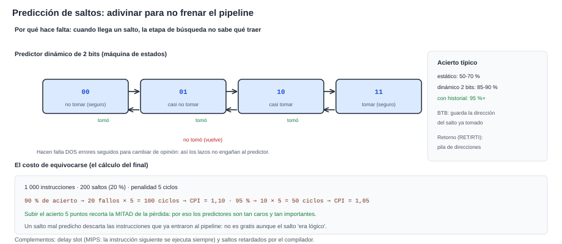

#### Parte 1: la caché

**Funciona por localidad** (temporal y espacial): si usaste un dato, lo vas a volver a usar; si usaste una dirección,
las vecinas también.

```
AMAT = tiempo de acierto + (tasa de fallos × penalidad de fallo)
```

> [!example] Ejemplo resuelto
> "Caché L1 con acierto de 1 ciclo, tasa de fallos del 5 % y penalidad de 100 ciclos. ¿AMAT?"

| Cálculo | Resultado |
|---|---|
| `AMAT = 1 + 0,05 × 100` | **6 ciclos** |
| Sin caché | **100 ciclos** |
| Ganancia | `100 / 6 ≈` **16,7×** |

**Con dos niveles** (L1 + L2): `AMAT = 1 + 0,05 × (10 + 0,20 × 100) = 1 + 0,05 × 30 =` **2,5 ciclos**.

| Concepto | Efecto en el pipeline |
|---|---|
| **Caché I y D separadas** | elimina el **conflicto estructural** de la etapa de búsqueda vs la de datos |
| **Acierto** | la etapa de memoria tarda 1 ciclo ⇒ el pipeline **no** se frena |
| **Fallo** | hay un **stall** de muchos ciclos (se congela el pipeline) |
| **Multinivel** | L1 chica y rápida, L2/L3 grandes y lentas |

> [!important] El dato que hay que saber
> Un fallo de caché a memoria principal cuesta **decenas o cientos** de ciclos: es la **espera más cara** de todas.
> Por eso los procesadores gastan más transistores en caché que en la ALU.

#### Parte 2: la predicción de saltos

**El problema:** en la etapa de búsqueda todavía **no se sabe** si la instrucción que se está decodificando es un
salto, ni si se va a tomar. Hay que **apostar**.

| Tipo | Cómo | Acierto típico |
|---|---|---|
| **Estática: "no salta"** (*predict not taken*) | seguir de largo | ~50-70 % |
| **Estática por dirección** | los saltos **hacia atrás** (lazos) se toman; los **hacia adelante**, no | mejor en lazos |
| **Dinámica de 2 bits** | contador por salto: 2 fallos seguidos para cambiar de opinión | ~85-90 % |
| **BTB** (*branch target buffer*) | caché con la **dirección destino** del salto ya calculada | ahorra el cálculo |
| **Historial + correlación** | usa el patrón de los últimos saltos | **95 %+** |

##### El costo del fallo
```
ciclos perdidos = (nº de saltos) × (tasa de fallo) × (penalidad)
```

> [!example] Ejemplo resuelto
> "Un programa de 1 000 instrucciones tiene 20 % de saltos; el predictor acierta el 90 % y la penalidad es de 5
> ciclos. ¿Cuánto sube el CPI?"

1. Saltos: `0,20 × 1 000 = 200`.
2. Fallos: `10 %` ⇒ **20** saltos mal predichos.
3. Ciclos perdidos: `20 × 5 =` **100**.
4. `CPI = (1 000 + 100) / 1 000 =` **1,10** ⇒ el pipeline perdió un **10 %**.

**Con un predictor del 95 %:** `10 × 5 = 50` ciclos ⇒ `CPI = 1,05`. **Duplicar la precisión reduce a la mitad la
pérdida**: por eso se invierte tanto en el predictor.

#### Las dos juntas, en el CPI final
```
CPI_real = 1 + (fallos de caché × penalidad) / n + (saltos mal predichos × penalidad) / n
```

| Fuente | Ejemplo de aporte al CPI |
|---|---|
| Base (ideal) | 1,00 |
| Fallos de caché (2 % × 100) | +2,00 |
| Saltos (20 % × 10 % × 5) | +0,10 |
| **Total** | **3,10** |

> [!important] La conclusión que se espera
> Con `CPI` de 3,10, tener un pipeline de 5 etapas **no** da 5×: da **1,6×**. Las **esperas** se comen el
> paralelismo. Por eso las técnicas de 7.2.1 (más ancho, más hilos) sirven justamente para **tapar** esas esperas
> con otro trabajo.

> [!warning] Errores típicos
> - Calcular `AMAT` sin multiplicar la tasa de fallos por la penalidad.
> - Confundir **tasa de acierto** con **tasa de fallo** (si acierta 95 %, falla 5 %).
> - Decir que la caché "aumenta la capacidad de la memoria" (guarda **copias** de lo usado).
> - Olvidar que un fallo de caché **congela** el pipeline (stall), no sólo "tarda más".
> - Creer que la predicción elimina la penalidad (la **reduce**, no la elimina).
> - Mezclar el predictor **estático** (fijo en el diseño/compilador) con el **dinámico** (aprende en ejecución).

#### Figura del libro


*Fig. 12.17 — Diagrama de estados de la predicción de saltos.* · Stallings, *Organización y arquitectura de computadores*, 7ª ed., p. 482.

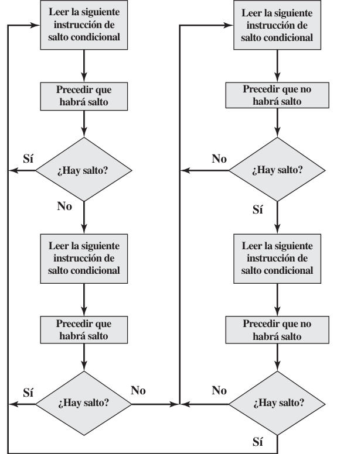

*Fig. 12.16 — Diagrama de flujo de la predicción de saltos.* · Stallings, *Organización y arquitectura de computadores*, 7ª ed., p. 482.

#### Relacionado
[[7.2.1 Superscalar, superpipeline, SMT y multicore]] · [[7.1.2 Hazards y sus soluciones]] ·
[[2.5.3 AMAT y cálculo de mejora]] · [[Jerarquía de memorias]] · [[Técnicas para aumentar la velocidad]] · [[Glosario — Unidad 7]]

## 7.3 CISC y RISC

### 7.3.1 Tabla comparativa y ejemplos

> [!abstract] En una frase
> **CISC** apuesta a **pocas instrucciones complejas** de largo variable que operan sobre memoria (x86, 8086);
> **RISC** apuesta a **muchas instrucciones simples**, todas del **mismo largo**, con acceso a memoria **sólo**
> por `load`/`store` y **muchos registros** (ARM, MIPS, RISC-V).

> [!note] Si la primera vez que ves esto
> Es el **cuchillo multiuso** contra el **juego de cuchillos especializados**. El multiuso hace de todo con una sola
> pieza (menos instrucciones, cada una hace mucho); el juego corta mejor, pero hay que saber cuál agarrar (más
> instrucciones, cada una hace poquito). Las CPU actuales son **híbridas**: hablan multiuso por fuera y trabajan con
> especializados por dentro.

#### La tabla de examen

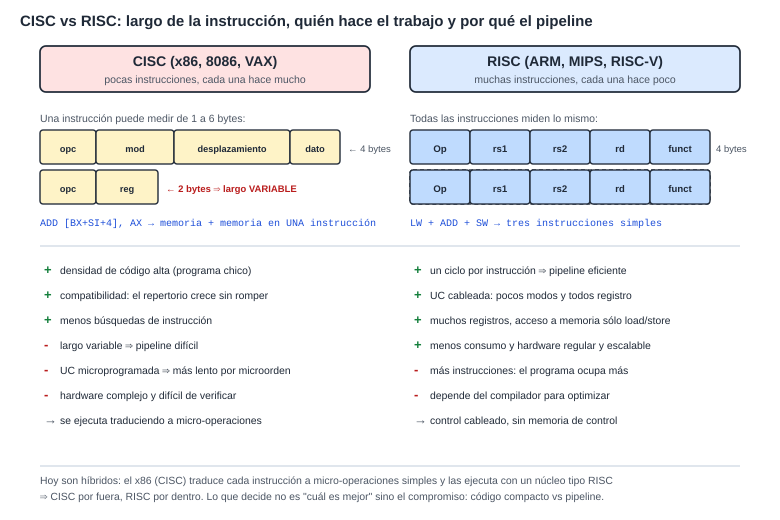

| | **CISC** | **RISC** |
|---|---|---|
| Filosofía | pocas instrucciones, **complejas** | muchas instrucciones, **simples** |
| Longitud de la instrucción | **variable** (1 a 6 bytes o más) | **fija** (4 bytes) |
| Modos de direccionamiento | muchos | **pocos** (registro + desplazamiento) |
| Acceso a memoria | cualquier instrucción puede operar sobre memoria | **sólo** `LOAD` / `STORE` |
| Operandos | 1 o 2, muchos implícitos | **3 registros explícitos** |
| Registros | pocos | **muchos** (32 o más) |
| Unidad de control | **microprogramada** | **cableada** |
| Pipeline | difícil | **natural** |
| Ciclos por instrucción | varios (2-10) | **casi 1** |
| Densidad de código | **alta** | menor |
| Compilador | complejo (muchas opciones) | **simple** |
| Consumo / área | mayor | menor |
| Ejemplos | **x86**, 8086/8088, VAX, IBM 360 | **ARM**, MIPS, PowerPC, RISC-V |

#### El mismo programa en los dos estilos
Sea `a = b + c` (los tres en memoria):

**CISC (x86):**
```
ADD  [a], [b], [c]      ; 1 instrucción, 3 operandos de memoria
```
- **1 instrucción**… pero de varios ciclos y de largo variable.
- La UC **microprogramada** la descompone internamente en varias microoperaciones.

**RISC (MIPS):**
```
LW   R1, b(R0)          ; R1 ← b
LW   R2, c(R0)          ; R2 ← c
ADD  R3, R1, R2         ; R3 ← R1 + R2
SW   a(R0), R3          ; a  ← R3
```
- **4 instrucciones**, todas del mismo largo y de 1 ciclo.
- Más código, pero **predecible** ⇒ pipeline perfecto.

> [!important] Lo que hay que decir al comparar
> El CISC gana en **densidad de código** (el programa ocupa menos memoria) y el RISC gana en **simplicidad para el
> hardware**. Con la memoria barata y el pipeline dominante, **la balanza se inclinó a RISC**… y el x86 sobrevive
> porque **traduce** a microoperaciones simples por dentro.

#### La historia, en cuatro líneas
| Época | Qué pasó |
|---|---|
| **60-70** | La memoria es carísima ⇒ se agregan instrucciones complejas para acortar programas (**CISC**) |
| **80** | Se descubre que el compilador usa **el 20 % del repertorio en el 80 % del código** ⇒ sobra complejidad |
| **80-90** | **RISC**: repertorio chico, `load/store`, muchos registros, cableado, 1 ciclo ⇒ pipeline |
| **Hoy** | **Híbrido**: x86 traduce a µ-ops (RISC por dentro); ARM y RISC-V son RISC puros |

**La regla 80/20** es el argumento central: si el 80 % del código usa 20 % de las instrucciones, agregar
instrucciones complejas **no** acelera el programa típico; sólo complica el hardware.

#### Qué se pregunta siempre
| Pregunta | Respuesta corta |
|---|---|
| ¿Cuál es más rápido? | **Depende**: RISC por ciclo, CISC por instrucción. El programa real suele favorecer a RISC |
| ¿Cuál ocupa menos memoria? | **CISC** (instrucciones más densas) |
| ¿Cuál tiene pipeline mejor? | **RISC** (largo fijo, 1 ciclo, pocos modos) |
| ¿Cuál tiene el compilador más simple? | **RISC** |
| ¿Por qué x86 no desapareció? | **Compatibilidad**: hay décadas de software compilado |
| ¿CISC desapareció? | No: **sobrevive** como interfaz externa con núcleo tipo RISC |

> [!warning] Errores típicos
> - Decir "RISC tiene menos instrucciones que CISC": tiene **más** instrucciones, pero **más simples**. Lo
>   "reducido" es la **complejidad**, no la cantidad.
> - Decir que RISC es siempre más rápido (depende del programa y de la implementación).
> - Olvidar el `load/store` como la restricción **clave** de RISC.
> - Mezclar CISC/RISC con **cableada/microprogramada**: van juntas por historia, pero no son lo mismo (un RISC
>   *podría* ser microprogramado).
> - Creer que un CISC no puede tener pipeline (el Pentium y todos los x86 lo tienen: traducen primero).

#### Figura del libro

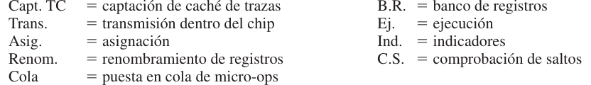

*Fig. 14.8 — Cauce segmentado del Pentium 4.* · Stallings, *Organización y arquitectura de computadores*, 7ª ed., p. 566.

> [!example] CISC contra RISC con números
> Sumar 100 elementos: **CISC** con `500 instrucciones` (5 por elemento) y `CPI ≈ 3` ⇒ **1500 ciclos**; **RISC**
> con `800` (8 por elemento, más simples) y `CPI ≈ 1,1` ⇒ **880 ciclos**. RISC gana **1,7×** aun haciendo más
> instrucciones: lo que importa es `instrucciones × CPI`.

#### Relacionado
[[7.3.2 UC cableada vs microprogramada y load-store]] · [[CISC y RISC]] · [[00 Unidad 6 — temas y subtemas]] ·
[[Técnicas para aumentar la velocidad]] · [[5.1.2 Clasificación de las instrucciones]] · [[Glosario — Unidad 7]]

### 7.3.2 UC cableada vs microprogramada y load-store

> [!abstract] En una frase
> **RISC elige control cableado** porque cada instrucción debe resolverse en **un ciclo** (leer una ROM de control
> costaría un ciclo más) y **limita la memoria a `load`/`store`** porque así la etapa de memoria es **corta y
> uniforme**, que es la condición para que todas las etapas duren lo mismo y el pipeline funcione.

> [!note] Si la primera vez que ves esto
> El pipeline es una línea de montaje donde **cada puesto tarda lo mismo**. Un `load/store` único hace que el puesto
> de memoria haga **siempre lo mismo** (traer o llevar un dato). Si cualquier instrucción pudiera tocar memoria, el
> puesto tendría a veces mucho trabajo y a veces nada: **la línea se trabaría**.

#### La cadena causal

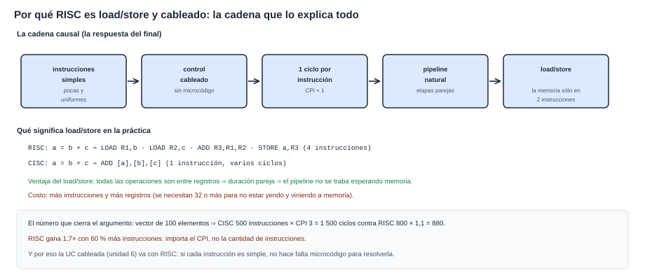

#### El control: cableado vs microprogramado

| | **Cableada** (RISC) | **Microprogramada** (CISC) |
|---|---|---|
| Velocidad | **1 ciclo** por instrucción | **2 o más**: leer la ROM de control |
| Flexibilidad | ninguna (recablear) | alta (reescribir la ROM) |
| Costo de diseño | alto con repertorio grande | ordenado para repertorios grandes |
| Se usa en | ARM, MIPS, RISC-V | x86, 8086/8088 |

👉 El desarrollo completo está en [[6.3.1 Cableada vs microprogramada]] y [[6.2.1 Memoria de control y microinstrucción]].

> [!important] La cadena de razonamiento que se pide
> instrucciones **simples** ⇒ se pueden generar con **compuertas** (cableada) ⇒ **1 ciclo** ⇒ **pipeline** ⇒
> **CPI ≈ 1**. Si el repertorio fuera complejo, haría falta **microprograma** ⇒ varios ciclos ⇒ el pipeline se
> rompe (una instrucción que dura 10 ciclos obliga a frenar la línea).

#### El `load/store`: la restricción que ordena todo

| Modelo | Instrucciones que tocan memoria | Etapa de memoria |
|---|---|---|
| **CISC** | casi todas (`ADD [a],[b],[c]`) | variable: a veces lee 2 datos y escribe 1 |
| **RISC** | **sólo** `LW` / `SW` | **fija**: un acceso por instrucción |

Consecuencias para el pipeline:

| Requisito del pipeline | Cómo lo cumple `load/store` |
|---|---|
| Etapas **parejas** | la etapa de memoria siempre tarda lo mismo (1 acceso) |
| Instrucciones de **largo fijo** | sin campos extra de direcciones de memoria |
| Cálculo de dirección **simple** | casi todos los accesos son `registro + desplazamiento` |
| Pocos **conflictos estructurales** | sólo `LW`/`SW` compiten por la memoria |

**El costo:** más instrucciones (hay que mover explícitamente) y más código. **El beneficio:** un `CPI` de 1 y un
pipeline que no se traba.

#### Comparación de CPI y código (ejemplo numérico)
Programa: sumar dos vectores de 100 elementos y guardar el resultado.

| Estilo | Instrucciones del lazo | Instrucciones totales | CPI | Ciclos |
|---|---|---|---|---|
| **CISC** (operando en memoria) | `MOV` + `ADD [ ], [ ]` + `INC` + `CMP` + `JNZ` ≈ 5 | ~500 | **3** | **1 500** |
| **RISC** (`load/store`) | `LW` + `LW` + `ADD` + `SW` + `INC×3` + `BNE` ≈ 8 | ~800 | **1,1** | **880** |

**Resultado:** el RISC ejecuta **más instrucciones** (800 contra 500) y aun así tarda **menos ciclos** (880 contra
1 500). Ésa es exactamente la sorpresa de los años 80: **no importa cuántas instrucciones, sino cuántos ciclos por
instrucción.**

**Verificación:** `800 × 1,1 = 880` ✔ · `500 × 3 = 1 500` ✔ ⇒ el RISC gana por **1,7×** con **60 % más** de
instrucciones.

#### El híbrido actual
```
x86 (CISC) ──► decodificador que traduce ──► micro-operaciones tipo RISC ──► núcleo cableado con pipeline
```
- El **ISA** que ve el programador es CISC (compatibilidad).
- El **motor** que ejecuta es RISC (velocidad).
- La **ROM de microcódigo** sigue existiendo para instrucciones raras y para corregir errores después de fabricar
  (¡se puede parchear un CPU con una actualización de microcódigo!).

> [!warning] Errores típicos
> - Decir que CISC **no puede** tener pipeline (todos los x86 lo tienen, con traducción previa).
> - Creer que cableada/microprogramada **es** lo mismo que RISC/CISC (es una **tendencia**, no una identidad).
> - Olvidar el **costo** del `load/store`: más instrucciones y más presión en los registros.
> - Decir que "menos instrucciones = más rápido" sin mirar el CPI.
> - Confundir el **microcódigo** del x86 (interno) con el **programa** del usuario.

#### Figura del libro

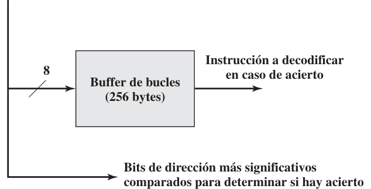

*Fig. 12.15 — Buffer de bucles.* · Stallings, *Organización y arquitectura de computadores*, 7ª ed., p. 480.

> [!example] La cadena causal
> Instrucciones **simples y de tamaño fijo** ⇒ se decodifican en paralelo ⇒ **pipeline** ⇒ hace falta que casi
> todas tarden lo mismo ⇒ **load/store** (sólo `LOAD` y `STORE` tocan memoria). Si se rompe un eslabón, el pipeline
> pierde: por eso RISC es "un paquete".

#### Relacionado
[[7.3.1 Tabla comparativa y ejemplos]] · [[6.3.2 El 8088, ROM de control 504x21]] · [[6.3.1 Cableada vs microprogramada]] ·
[[7.1.2 Hazards y sus soluciones]] · [[CISC y RISC]] · [[Glosario — Unidad 7]]

## 7.4 Arquitecturas y buses

### 7.4.1 von Neumann vs Harvard

> [!abstract] En una frase
> **von Neumann**: **una sola** memoria y un solo bus para instrucciones y datos ⇒ simple, barato, pero con un
> **cuello de botella** (no se puede buscar la instrucción y leer el dato a la vez). **Harvard**: memorias y buses
> **separados** ⇒ las dos cosas van en el mismo ciclo, a cambio de **duplicar** la memoria.

> [!note] Si la primera vez que ves esto
> von Neumann es una **puerta** para entrar y salir: si alguien entra, el otro espera. Harvard son **dos puertas**:
> uno entra mientras el otro sale. Cuesta más (dos puertas), pero no hay cola.

#### Los dos esquemas

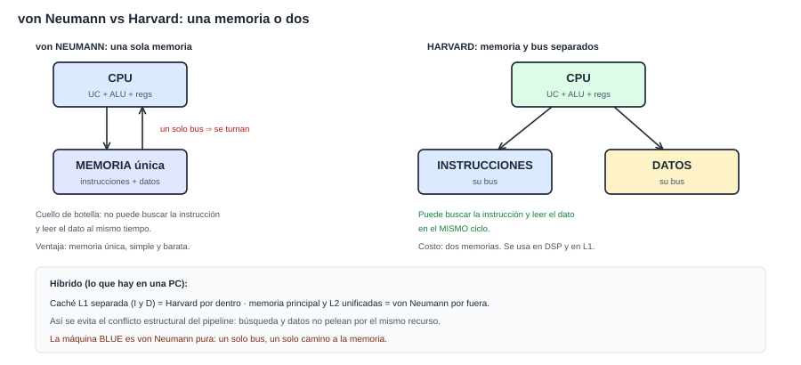

| | **von Neumann** | **Harvard** |
|---|---|---|
| Memoria | **una**, compartida | **dos** (instrucciones y datos) |
| Bus | uno | **dos** |
| En el mismo ciclo | o busca instrucción **o** accede al dato | **las dos cosas** |
| Ventaja | simple, barata, flexible (el programa puede automodificarse) | **más rápida** (sin conflicto) |
| Desventaja | **cuello de botella** | más costosa, menos flexible |
| Ejemplos | **BLUE**, PCs (memoria principal), la mayoría de los ISA | DSP, microcontroladores, **caché L1 I/D** |

#### El cuello de botella
```
CPU ──► bus único ──► MEMORIA (instrucciones + datos)

ciclo 1: buscar instrucción
ciclo 2: leer operando          ← tiene que esperar el turno
ciclo 3: escribir resultado
```
Todo lo que se gana con etapas más rápidas se pierde **esperando el bus**. Se lo llama **cuello de botella de von
Neumann** y es la razón histórica por la que se agregaron **cachés** y **bancos de memoria**.

**Mitigaciones (todas conocidas):** caché (evita ir a memoria), caché **I y D separadas** (Harvard por dentro),
bancos entrelazados, *prefetch* (la BIU del 8086 con su cola de 6 bytes).

#### El híbrido: cómo es una PC de verdad
```
        ┌──────── CPU ────────┐
        │  L1 de instrucciones│   ← Harvard
        │  L1 de datos        │   ← Harvard
        │  L2 unificada       │   ← von Neumann
        └──────────┬──────────┘
                   │ bus del sistema
              memoria principal          ← von Neumann
```
**"Harvard modificado"**: separado en el **primer nivel** (donde el conflicto estructural duele) y unificado más
abajo (donde la memoria es grande y cara).

> [!important] Cómo se conecta con el pipeline
> El conflicto **estructural** de la etapa de búsqueda contra la de datos **desaparece** si hay caché I y D. Ésa es
> la razón por la que **todo** procesador con pipeline usa Harvard en L1, aunque el ISA sea von Neumann.

#### Comparación para el final

| Pregunta | von Neumann | Harvard |
|---|---|---|
| ¿Cuántas memorias? | 1 | 2 |
| ¿Se puede ejecutar código de los datos? | sí (y es un riesgo de seguridad) | no (más seguro) |
| ¿Qué cuesta más? | — | el doble de memoria y buses |
| ¿Dónde se usa? | memoria principal, máquinas didácticas (BLUE) | DSP, microcontroladores, L1 |
| ¿Qué problema resuelve? | simplicidad | conflicto estructural del pipeline |

> [!warning] Errores típicos
> - Decir que la PC es **puramente** Harvard o **puramente** von Neumann (es **híbrida**).
> - Confundir Harvard con "tener caché" (Harvard es **separar** instrucciones y datos).
> - Olvidar que la BLUE (y el modelo del teórico) es von Neumann **pura**.
> - Decir que Harvard es "más moderna" (nació **antes**, en los años 40, con la máquina de Harvard Mark I).
> - Creer que el cuello de botella se arregla **sólo** subiendo la frecuencia del bus.

> [!example] Un solo bus o dos
> **von Neumann**: `LDA` usa el mismo camino para la instrucción y para el dato ⇒ **2 accesos consecutivos**.
> **Harvard**: dos buses ⇒ instrucción y dato viajan **a la vez** ⇒ menos conflicto, pero más cables y el programa
> no puede vivir en el mismo espacio que los datos. La BLUE y el 8086 son von Neumann; los DSP y las cachés L1
> separadas son Harvard.

#### Figura del libro

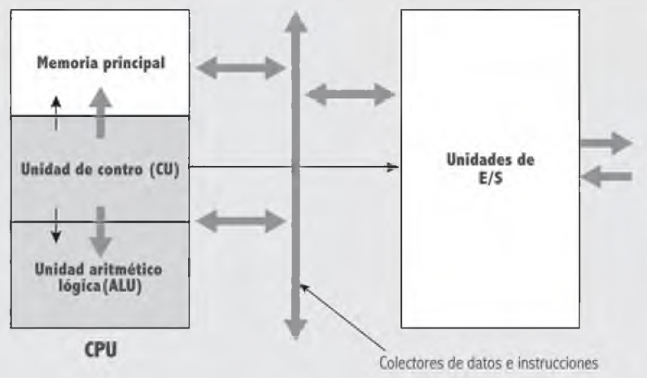

*Fig. 1.3 — Esquema básico de una computadora von Neumann.* · Quiroga, *Arquitectura de computadoras*, p. 32.

> [!tip] Qué mirar
> Un **solo** juego de colectores (buses) entre la CPU y la memoria, y por ahí pasan tanto las instrucciones como los datos. Ese es el cuello de botella que Harvard evita separando memorias y buses.

#### Relacionado
[[7.4.2 Buses internos y externos]] · [[7.1.2 Hazards y sus soluciones]] · [[4.1.1 Unidades funcionales de una computadora]] ·
[[2.5.2 Caché: mapeos y políticas]] · [[5.6.1 BIU, EU y segmentación]] · [[Glosario — Unidad 7]]

### 7.4.2 Buses internos y externos

> [!abstract] En una frase
> Un **bus** es un conjunto de conductores compartidos con **tres grupos de líneas** —**direcciones, datos y
> control**—; el **interno** conecta los bloques dentro del chip y el **externo** (del sistema) conecta CPU, memoria
> y periféricos. Su **ancho de banda** es `(bits / 8) × frecuencia`.

> [!note] Si la primera vez que ves esto
> El bus es la **autopista** del computador: cuántos carriles (bits de datos), cuántos km/h (frecuencia) y las
> señales de tránsito (control). Y como es **compartida**, hay un **guardia** que decide quién pasa: el
> **arbitraje**.

#### Los tres grupos de líneas
| Grupo | Función | Sentido | Cuántas |
|---|---|---|---|
| **Direcciones** | **cuál** es la posición de memoria o el periférico | **un solo sentido** (CPU → memoria) | tantas como bits de dirección |
| **Datos** | **qué** se transfiere | **bidireccional** | 8, 16, 32, 64 bits |
| **Control** | **cómo**: `Read`, `Write`, reloj, `IRQ`, `Ready`, selección | según la línea | varias |

**De la BLUE:** el bus tiene **12 líneas de dirección** (4096 celdas) y **16 de datos** ⇒ es un bus único
compartido por CPU, memoria y periféricos ([[3.1.2 Bus único y buffers de 3 estados]]).

#### Interno vs externo

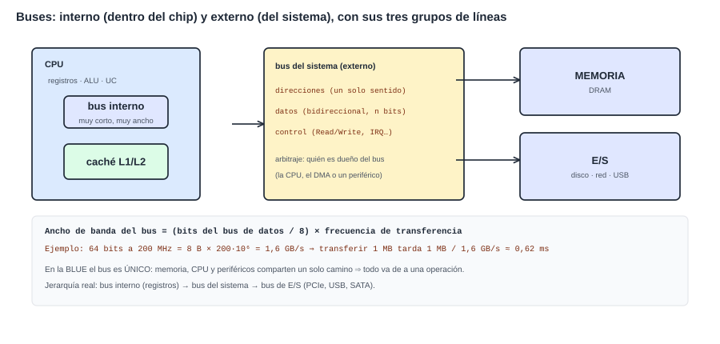

| | **Bus interno** | **Bus externo** (del sistema) |
|---|---|---|
| Dónde está | dentro del chip | en la placa madre |
| Conecta | registros, ALU, UC, caché | CPU ↔ memoria ↔ E/S |
| Ancho | muy grande (varios cientos de bits) | 64 bits típico |
| Velocidad | la del reloj del núcleo | menor (con multiplicadores) |
| Quién lo maneja | la UC | **arbitraje** entre maestros |

#### El cálculo del ancho de banda
```
ancho de banda = (bits del bus de datos / 8) × frecuencia de transferencia
tiempo de transferencia = bytes a transferir / ancho de banda
```

> [!example] Ejemplo resuelto 1
> "Bus de datos de 64 bits a 200 MHz. ¿Ancho de banda? ¿Cuánto tarda en transferir 1 MB?"
>
> 1. `64 bits = 8 bytes` por transferencia.
> 2. `8 B × 200·10⁶ = 1,6·10⁹ B/s =` **1,6 GB/s**.
> 3. `1 MB / 1,6 GB/s = 1,048·10⁶ / 1,6·10⁹ =` **0,655 ms** (≈ 0,62 ms con 1 MB = 10⁶ B).

> [!example] Ejemplo resuelto 2
> "El mismo bus, pero de **32 bits** a **400 MHz**. ¿Mejor o peor?"
>
> - `4 B × 400·10⁶ =` **1,6 GB/s** ⇒ **lo mismo**. Duplicar la frecuencia con la mitad del ancho **no cambia** el
>   caudal; cambiar los dos sí.
> - **Conclusión:** el ancho de banda depende **del producto** `ancho × frecuencia`, no de uno solo.

#### Los conceptos que se preguntan
| Concepto | Qué es |
|---|---|
| **Maestro** (*master*) | el que **inicia** la transferencia (CPU, DMA, un periférico) |
| **Esclavo** (*slave*) | el que **responde** (memoria, registro de un periférico) |
| **Arbitraje** | quién tiene el bus cuando hay varios maestros: **centralizado** o **distribuido** |
| **Ciclo de bus** | una transferencia completa (dirección + dato + *handshake*) |
| **Handshake** | protocolo de "estoy listo / recibido" (`Ready`, `Ack`) |
| **Espera** (*wait state*) | ciclos extra porque el esclavo es lento |
| **Ráfaga** (*burst*) | varias transferencias con **una sola** dirección inicial ⇒ más eficiente |

#### La jerarquía real de buses
| Nivel | Ejemplo | Ancho típico |
|---|---|---|
| **Interno del núcleo** | ALU ↔ registros | cientos de bits |
| **Caché ↔ núcleo** | L1 | 128-512 bits |
| **Del sistema** | CPU ↔ DRAM | 64 bits × varios canales |
| **De E/S** | PCIe, USB, SATA | seriales de alta velocidad (PCIe x16 ≈ 32 GB/s) |

> [!important] Por qué hoy casi todo es **serial**
> Un bus paralelo de 32 líneas tiene **desfasajes** entre líneas a frecuencias altas (unos cables llegan antes que
> otros). Un enlace **serial** de muy alta frecuencia es más fácil de sincronizar: por eso PCIe reemplazó a PCI y
> SATA a IDE. **"Serial" no significa "lento"**: significa un solo carril, pero a GHz.

> [!warning] Errores típicos
> - Confundir **ancho de banda** con **latencia** (el bus puede tener mucho caudal y mucha demora).
> - Calcular el ancho de banda con los bits de **dirección** (se calcula con los de **datos**).
> - Olvidar que el bus es **compartido**: si dos maestros lo piden, uno espera (arbitraje).
> - Decir que un bus más ancho siempre es mejor (si el resto del sistema no lo aprovecha, no cambia nada).
> - Creer que serial = lento.

#### Figura del libro

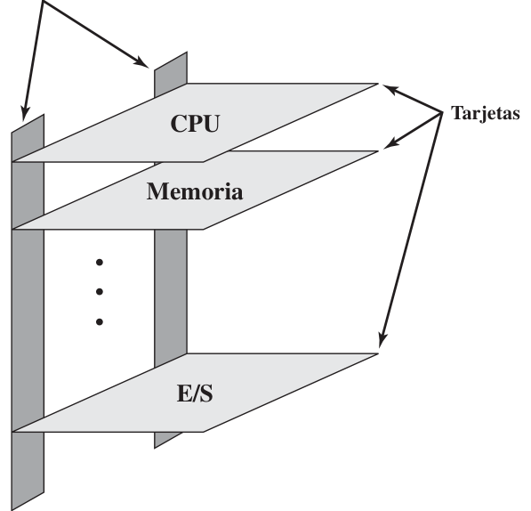

*Fig. 3.17 — Implementación física típica de una arquitectura de bus.* · Stallings, *Organización y arquitectura de computadores*, 7ª ed., p. 101.

#### Dónde está el bus en la placa: FSB, puente norte y DMI

En una PC real el "bus externo" no es un solo cable: hay un **chipset** en el medio.

| Nombre | Qué conecta | Nota |
|---|---|---|
| **FSB** (*Front-Side Bus*) | **CPU ↔ memoria** (a través del **puente norte**) | es el bus del sistema clásico; su frecuencia se mide en MHz y define la velocidad de la RAM |
| **Puente norte** (*Northbridge*) | CPU, memoria y video | lo que la cátedra llama "ruta de comunicación entre la memoria y la CPU" |
| **Puente sur** (*Southbridge*) | discos, USB, audio, red | más lento, cuelga del norte |
| **DMI / QPI** | reemplazan al FSB en las PC actuales: el controlador de memoria pasó **dentro de la CPU** | por eso hoy "FSB" ya no existe como tal |

> [!important] Para el final
> Si preguntan *"¿por dónde circula la dirección de memoria?"*: por el **bus de direcciones** del FSB (o del DMI
> en las PC nuevas), desde el **MAR** hasta la memoria. Y si preguntan por qué el FSB limitaba el rendimiento: porque
> **todas** las transferencias de memoria y de E/S pasaban por un único bus compartido.


#### Relacionado
[[7.4.1 von Neumann vs Harvard]] · [[3.1.2 Bus único y buffers de 3 estados]] · [[3.1.1 Notación de transferencia entre registros]] ·
[[8.3.1 Bancos de memoria y ancho de banda]] · [[Técnicas para aumentar la velocidad]] · [[Glosario — Unidad 7]]

---

## Al terminar la unidad
- Una pasada rápida: [[00 Síntesis — Unidad 7]].
- Los subtemas por separado: [[00 Unidad 7 — temas y subtemas]].
- Seguir de corrido: [[00 Materia completa (las 10 unidades en un archivo)]].
- Practicar: [[Banco de preguntas del final]] · [[Autoevaluación]] · [[Prácticas resueltas]].
