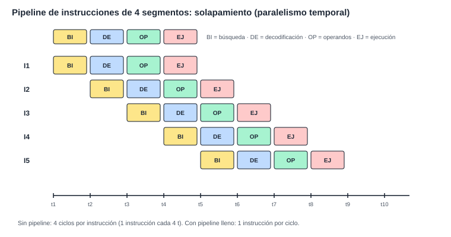
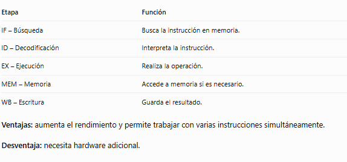
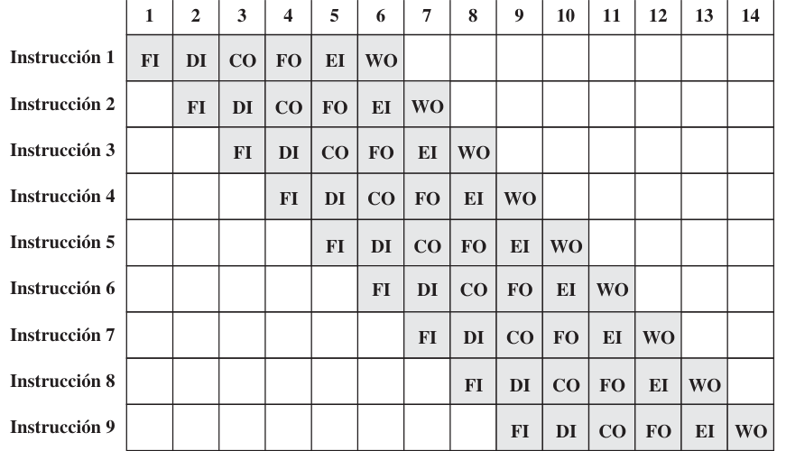
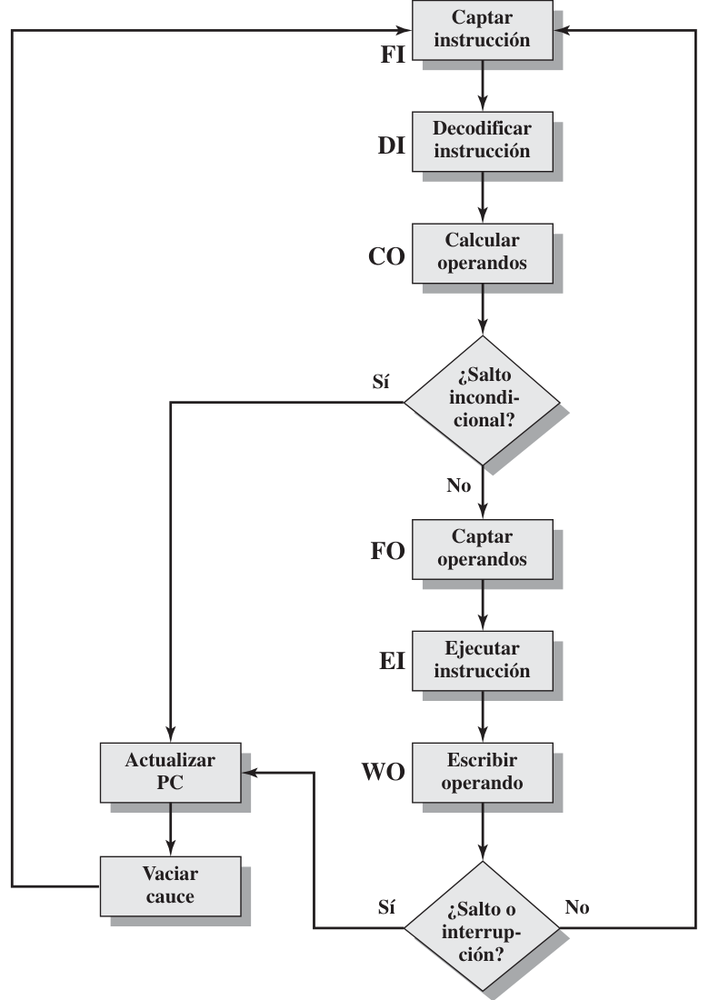

# 7.1.1 Etapas y diagrama en escalera

> [!abstract] En una frase
> El pipeline parte la ejecución de una instrucción en **5 etapas** —**búsqueda, decodificación, cálculo de direcciones, búsqueda de operandos y ejecución**— cada una con su propio hardware, y las hace avanzar **como una línea de montaje**: `n` instrucciones tardan **`k + (n − 1)`** ciclos.

> [!note] Si la primera vez que ves esto
> Una lavandería con **una** persona: lavar 30 min, secar 30, doblar 30 ⇒ cada carga tarda 90 min. Con **tres** personas (una lava, otra seca, otra dobla) la primera carga sigue tardando 90 min, pero **sale una carga nueva cada 30 min**. Eso es el pipeline: no mejora **una** tarea, mejora el **ritmo**.

## Las cinco etapas

| # | Etapa | Qué hace | En la BLUE | Recurso que usa |
|---|---|---|---|---|
| 1 | **Búsqueda** (*fetch*) | traer la instrucción de memoria | `PC → MAR`, lectura, `MBR → IR` (CP1-CP6) | memoria |
| 2 | **Decodificación** | averiguar qué instrucción es | la UC decodifica `IR15..12` | decodificador / UC |
| 3 | **Cálculo de dirección** | hallar la dirección efectiva del operando | el sumador de direcciones de la indexada (`EA = D + RIF`) | sumador |
| 4 | **Búsqueda de operandos** | leer los operandos | `MBR → Y`, `AC → Z` | banco de registros |
| 5 | **Ejecución** | operar y escribir el resultado | la ALU en CP8 (`SUM → A`) | ALU |

> [!important] Por qué las etapas se eligen así
> Porque cada una usa un **recurso distinto**. Si dos etapas necesitaran el mismo hardware no podrían solaparse: eso es un **conflicto estructural** (7.1.2). El caso clásico: búsqueda y datos comparten la memoria ⇒ hace falta **caché I y D separadas**.

## El diagrama en escalera



Con `k = 5` etapas e instrucciones `I1`, `I2`, `I3`:

| Ciclo | 1 | 2 | 3 | 4 | 5 | 6 | 7 |
|---|---|---|---|---|---|---|---|
| **I1** | B | D | CD | BO | E | | |
| **I2** | | B | D | CD | BO | E | |
| **I3** | | | B | D | CD | BO | E |

- **I1 termina en el ciclo 5** (igual que sin pipeline: **la latencia no mejora**).

- **I3 termina en el ciclo 7**; sin pipeline habría sido el **15**.

- **Desde el ciclo 5 sale una instrucción por ciclo** ⇒ ése es el ritmo de producción.

## La cuenta

```
sin pipeline:  k · n            ciclos
con pipeline:  k + (n − 1)      ciclos
speedup:       S = k·n / (k + n − 1)   →  k
```

| k | n | Sin pipeline | Con pipeline | S |
|---|---|---|---|---|
| 5 | 3 | 15 | **7** | 2,14 |
| 5 | 10 | 50 | **14** | 3,57 |
| 5 | 100 | 500 | **104** | 4,81 |
| 5 | 1 000 | 5 000 | **1 004** | 4,98 |

**El ejemplo de la cátedra:** "en **8 pulsos** pude hacer **3 operaciones**, cuando sin pipeline necesitaba **8 por cada una**" ⇒ `24` pulsos contra `8`; y a partir del pulso 6 ya sale una por pulso.

> [!example] Ejemplo resuelto
> "Un pipeline de 4 etapas ejecuta 12 instrucciones a 500 MHz. ¿Cuántos ciclos, cuánto tarda y qué speedup da?"
>
> 1. Ciclos: `4 + (12 − 1) = 15`.
> 2. Período: `1 / 500 MHz = 2 ns` ⇒ `15 × 2 ns =` **30 ns**.
> 3. Sin pipeline: `4 × 12 = 48` ciclos ⇒ `96 ns`.
> 4. `S = 48 / 15 =` **3,2** (techo: 4).

## Lo que el pipeline **no** hace

| Se dice | Es |
|---|---|
| "Cada instrucción tarda menos" | **No**: tarda lo mismo (o un poco más por los registros de etapa) |
| "El speedup es `k` siempre" | **No**: tiende a `k` sólo con `n ≫ k` y **sin conflictos** |
| "Es multiprocesamiento" | **No**: es paralelismo **temporal** dentro de un solo flujo (**SISD**) |
| "Sirve para cualquier programa" | **No**: necesita instrucciones **independientes** que se puedan solapar |

## Los registros de etapa
Entre etapa y etapa hay un **registro** que guarda lo que produjo la anterior. Eso agrega:

- **1 ciclo de latencia** por etapa (el dato tiene que asentarse antes de que lo use la siguiente).

- La necesidad de **señales de habilitación** (para congelar una etapa cuando hay un conflicto). Por eso el pipeline profundo mejora el **throughput** pero **empeora** la latencia individual y el costo de un salto mal predicho.

> [!warning] Errores típicos
> - Usar `k·n` para el caso con pipeline (es `k + n − 1`).
> - Decir que la primera instrucción sale antes (sale en el ciclo `k`, igual que sin pipeline).
> - Olvidar los **registros de etapa** al explicar por qué la latencia empeora.
> - Poner etapas que usan **el mismo** recurso (imposible solapar).
> - Contar el pipeline como MIMD en Flynn (es **SISD**).

## Figura de clase

### Las cinco etapas con su sigla y su función.



*Figura de clase — Resumen «Arquitectura final» (Said), p. 42.*

> [!tip] Qué mirar
> Las etapas con las **siglas** que se piden al enumerarlas: **IF** (búsqueda: trae la instrucción), **ID** (decodificación: la interpreta), **EX** (ejecución: opera), **MEM** (memoria: accede si hace falta) y **WB** (escritura: guarda el resultado). La figura también resume el balance del tema en dos líneas: **ventaja**, se solapan varias instrucciones y sube el rendimiento; **desventaja**, hace falta hardware adicional (los registros de etapa y el control de los riesgos).

## Figura del libro



*Fig. 12.10 — Diagrama de tiempos del funcionamiento de un cauce de instrucciones.* · Stallings, *Organización y arquitectura de computadores*, 7ª ed., p. 474.



*Fig. 12.12 — Cauce de instrucciones de un procesador, con seis etapas.* · Stallings, *Organización y arquitectura de computadores*, 7ª ed., p. 475.

## Relacionado
[[7.1.2 Hazards y sus soluciones]] · [[7.1.3 Cálculo de speedup y límites]] · [[Pipeline]] · [[4.3.2 Búsqueda, los 8 pulsos]] · [[8.1.1 Etapas segmentadas y suma de vectores]] · [[Glosario — Unidad 7]]
