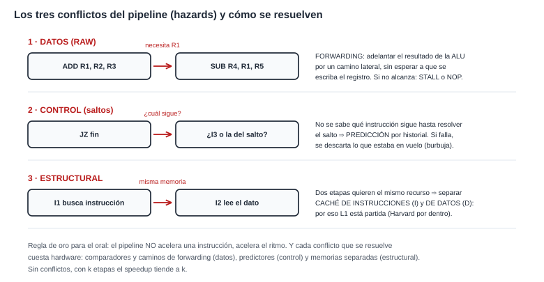

# 7.1.2 Hazards y sus soluciones

> [!abstract] En una frase
> Un **conflicto** (*hazard*) es una situación que impide que la próxima instrucción entre al pipeline en su ciclo:
> **estructural** (dos etapas quieren el mismo recurso), **de datos** (necesito un resultado que todavía no está) o
> **de control** (no sé qué instrucción sigue porque hay un salto).

> [!note] Si la primera vez que ves esto
> Es el **embotellamiento** de la línea de montaje. Se frena porque dos puestos se pelean la misma herramienta
> (estructural), porque falta una pieza que todavía se está fabricando (datos) o porque el jefe no dijo qué modelo
> se arma después (control). Cada conflicto tiene **su** solución.

## Los tres, con su solución



| Conflicto | Cuándo ocurre | Ejemplo | Solución |
|---|---|---|---|
| **Estructural** | dos etapas piden **el mismo recurso** en el mismo ciclo | búsqueda y acceso a datos quieren la memoria | **caché I y D separadas**, duplicar hardware, bancos de memoria |
| **De datos (RAW)** | una instrucción **necesita el resultado** de otra que aún no lo escribió | `ADD R1, R2, R3` y después `SUB R4, R1, R5` | **forwarding** (*bypass*), **stall**, insertar `NOP`, renombrar registros |
| **De control** | no se sabe cuál es la próxima instrucción | `JMP`, `JZ`, `CALL` | **predicción**, *delay slot*, *branch target buffer* |

## Conflicto de datos, con números
```
I1:  ADD R1, R2, R3      (escribe R1 en la etapa E)
I2:  SUB R4, R1, R5      (necesita R1 en la etapa BO)
```
Si `I2` lee `R1` antes de que `I1` lo escriba, lee **basura**.

| Solución | Qué hace | Costo |
|---|---|---|
| **Stall** (burbuja) | congela `I2` hasta que `I1` escriba | 1-2 ciclos perdidos |
| **NOP** del compilador | relleno inútil | tamaño de código |
| **Forwarding / bypass** | **adelanta** el resultado por un camino lateral: `I2` lo toma de la salida de la ALU | hardware extra, **0 ciclos** |
| **Renombrar registros** | `I1` escribe en otro registro físico | hardware, pero elimina falsas dependencias |

> [!important] El caso que **sí** necesita stall
> El forwarding no puede resolver la dependencia **load → uso**: el dato de un `LW` recién está al final de la
> etapa de memoria. Ahí hace falta **1 ciclo de stall** aunque haya forwarding. Es la respuesta clásica cuando
> preguntan "¿cuándo **no** alcanza el forwarding?".

## Conflicto de control: el costo del salto
Mientras la etapa de búsqueda ya trajo la instrucción siguiente, la de decodificación descubre que **era un salto**.
Hay dos caminos:

| Estrategia | Idea | Costo |
|---|---|---|
| **Congelar** hasta saber | esperar | **penalidad alta** (2-3 ciclos) |
| **Predecir "no salta"** | seguir de largo | si salta, se tira lo que estaba en vuelo |
| **Salto retardado** (*delay slot*) | el compilador pone una instrucción **útil** en el hueco | 0 ciclos, 1 instrucción de código |
| **Predicción dinámica** (7.2.2) | historial de saltos + BTB | acierta ~90-95 % |
| **Ejecución especulativa** | ejecuta la rama predicha y deshace si falla | hardware complejo |

La **penalidad** por conflicto de control es lo que más castiga a un pipeline **profundo**: con 20 etapas, tirar es
tirar veinte ciclos de trabajo.

## Tabla de diagnóstico (para el oral)
| Si el enunciado dice… | Es un conflicto… | Se resuelve con… |
|---|---|---|
| "dos instrucciones usan la memoria a la vez" | **estructural** | caché I/D o bancos |
| "necesito el resultado de la anterior" | **datos** | forwarding / stall |
| "después de un salto no sé qué sigue" | **control** | predicción / delay slot |
| "hay un `LW` seguido de un uso del dato" | **datos** (load-use) | **stall** de 1 ciclo |
| "el programa tiene muchos lazos" | **control** frecuente | predicción con historial |

> [!warning] Errores típicos
> - Confundir el conflicto **estructural** con el de **datos** (el primero es de **recursos**).
> - Decir que el forwarding resuelve **todo**: el caso *load-use* pide stall.
> - Creer que un stall "borra" la instrucción (sólo **congela** la etapa).
> - Olvidar que un salto mal predicho **descarta** lo que estaba en vuelo (no es gratis).
> - Decir que el conflicto de control se arregla "con más registros".

## Relacionado
[[7.1.1 Etapas y diagrama en escalera]] · [[7.1.3 Cálculo de speedup y límites]] · [[7.2.2 Caché y predicción de saltos]] ·
[[Pipeline]] · [[2.5.1 Jerarquía y localidad]]
