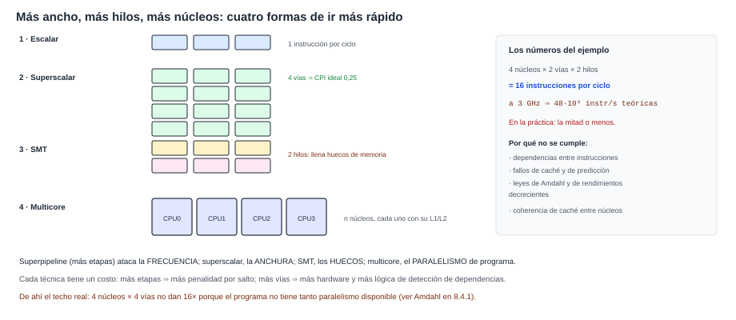
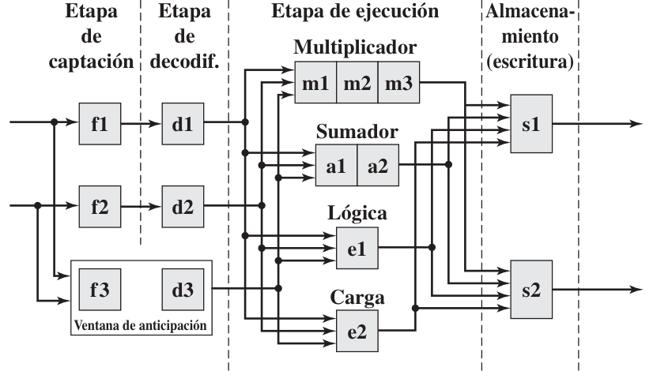

# 7.2.1 Superscalar, superpipeline, SMT y multicore

> [!abstract] En una frase
> Para pasar de **menos de una** instrucción por ciclo hay cuatro caminos que se combinan: **superpipeline** (más
> etapas ⇒ más frecuencia), **superscalar** (**varias** instrucciones por ciclo), **SMT** (varios hilos en un
> núcleo) y **multicore** (varios núcleos).

> [!note] Si la primera vez que ves esto
> Una línea de montaje de autos: el **superpipeline** acorta cada puesto (más autos por hora comprimiendo el
> ritmo); el **superscalar** pone **varias líneas en paralelo** dentro de la misma fábrica; el **SMT** hace que dos
> pedidos distintos compartan la misma línea; el **multicore** construye **otra fábrica** al lado.

## Cuatro formas de ir más rápido



## Las cuatro, comparadas

| Técnica | Qué agrega | Ganancia típica | Costo / límite |
|---|---|---|---|
| **Superpipeline** | más **etapas** (más finas) | más **frecuencia** | más latencia, más penalidad por conflicto |
| **Superscalar** | `m` instrucciones **por ciclo** | hasta `m×` | necesita **muchos recursos duplicados** + detectar dependencias |
| **SMT** (*hyper-threading*) | 2 hilos comparten **un** núcleo | 1,2-1,3× | más registros y lógica de selección |
| **Multicore** | `n` núcleos con su caché | hasta `n×` (Amdahl) | coherencia de caché, software paralelo |

## Superscalar: lo que cuesta emitir dos por ciclo
```
     ┌──► pipeline 1 ──► instrucción A
──┬──┤
  │  └──► pipeline 2 ──► instrucción B
  └─ la unidad de emisión decide cuáles dos instrucciones pueden ir juntas
```
| Requisito | Por qué |
|---|---|
| **Dos (o cuatro) decodificadores** | hay que decodificar 2 instrucciones en el mismo ciclo |
| **Detectar dependencias en el mismo ciclo** | si `B` depende de `A`, no pueden ir juntas |
| **Suficientes unidades funcionales** | 2 ALU, 2 accesos a memoria… |
| **Registros de etapa duplicados** | guardar los dos caminos |

**Ejemplo:** un procesador **4-wide** (4 instrucciones por ciclo) a 2 GHz haría
`4 × 2·10⁹ = 8·10⁹` instrucciones/s **en el mejor caso** (`CPI = 0,25`). En la práctica, las dependencias y los
saltos lo bajan a `CPI ≈ 0,6-1`.

| Ancho | CPI ideal | MIPS a 2 GHz |
|---|---|---|
| 1 (escalar) | 1 | 2 000 |
| 2 | 0,5 | 4 000 |
| 4 | 0,25 | 8 000 |

> [!important] Por qué un superscalar no da `m×` nunca
> Porque el **código tiene dependencias**: si la instrucción 2 necesita lo que produce la 1, no se pueden emitir
> juntas. La ganancia real depende del **ILP** (paralelismo a nivel de instrucciones) que tenga el programa.

## Superpipeline
Más etapas ⇒ cada etapa hace menos ⇒ el **reloj sube**. Pero:
- **más latencia** por instrucción (más registros de etapa),
- **mayor penalidad** por salto (hay más instrucciones en vuelo que se tiran).

| Pipeline | Etapas | Frecuencia | Penalidad de salto |
|---|---|---|---|
| Clásico | 5 | 1 GHz | 2 ciclos |
| Profundo | 20 | 3 GHz | **10-15 ciclos** |

Es lo que se hizo en los Pentium 4 (31 etapas) y lo que se abandonó después: el castigo por saltos mal predichos
era peor que la ganancia en frecuencia.

## SMT: dos hilos, un núcleo
El núcleo tiene **dos juegos de registros** y alterna entre los hilos: cuando un hilo está **esperando memoria**, el
otro usa las unidades ociosas.
- **Ganancia:** 1,2-1,3× (el sistema operativo ve **2 procesadores lógicos** por núcleo).
- **Diferencia con multicore:** en SMT los hilos **comparten** todo el hardware de ejecución; en multicore, cada uno
  tiene su núcleo completo.

## Multicore
Varios núcleos con **su** pipeline y **su** caché L1/L2, compartiendo la L3 y la memoria (y por eso el problema de
**coherencia de caché** de la Unidad 8). Su techo lo pone la **ley de Amdahl**.

> [!example] Ejemplo resuelto (las cuatro juntas)
> "Un chip tiene 4 núcleos, cada uno 2-wide, con SMT (2 hilos), a 3 GHz. ¿Cuántas instrucciones por ciclo puede
> emitir como máximo y cuántas por segundo?"
>
> 1. Por núcleo: `2` (ancho) `× 2` (hilos SMT) = **4** instrucciones por ciclo (si los recursos alcanzan).
> 2. Total del chip: `4 núcleos × 4 =` **16** instrucciones por ciclo.
> 3. Por segundo: `16 × 3·10⁹ =` **48·10⁹** instrucciones/s **teóricas**.
> 4. Real: con `CPI` efectivo de ~1 por hilo, del orden de **10-12·10⁹** ⇒ el techo teórico **no** se alcanza.

## Cómo se elige cada una (criterio de diseño)
| Situación | Conviene |
|---|---|
| Código con mucho ILP, una sola tarea | **superscalar + superpipeline** |
| Muchas esperas de memoria (servidor, base de datos) | **SMT** (tapa la espera) |
| Muchas tareas independientes | **multicore** |
| Consumo ajustado (móvil) | pocos núcleos, **big.LITTLE** (núcleos grandes + chicos) |

> [!warning] Errores típicos
> - Decir que superscalar "duplica la velocidad" (el código con dependencias no lo permite).
> - Confundir **SMT** (2 hilos, 1 núcleo) con **multicore** (2 núcleos).
> - Creer que más etapas siempre es mejor (la penalidad de salto crece con `k`).
> - Sumar las ganancias multiplicando sin límites: `4-wide × 4 núcleos × 3 GHz` es un **techo teórico**, no un
>   resultado.
> - Olvidar que **todo esto necesita software paralelo** para aprovecharse.

## Figura del libro



*Fig. 14.15 — Un procesador superescalar con un cauce doble.* · Stallings, *Organización y arquitectura de computadores*, 7ª ed., p. 582.

![Estructura de cauces del PowerPC 601 [POTT94].](../../../assets/libro-stallings-f14-11.png)

*Fig. 14.11 — Estructura de cauces del PowerPC 601 [POTT94].* · Stallings, *Organización y arquitectura de computadores*, 7ª ed., p. 573.

## Relacionado
[[7.2.2 Caché y predicción de saltos]] · [[7.1.3 Cálculo de speedup y límites]] · [[8.4.1 Multicore, coherencia de caché y ley de Amdahl]] ·
[[Técnicas para aumentar la velocidad]] · [[CISC y RISC]] · [[Glosario — Unidad 7]]
