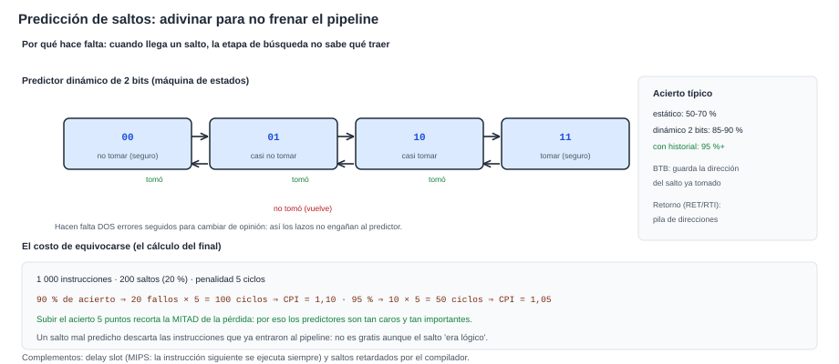
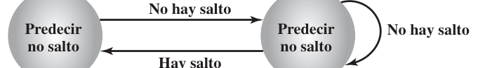
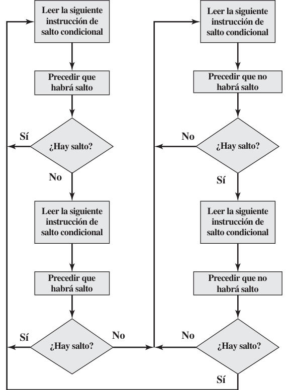

# 7.2.2 Caché y predicción de saltos

> [!abstract] En una frase
> De las dos esperas que arruinan un pipeline —**la memoria** y **los saltos**—, la **caché** tapa la primera (convierte un acceso de 100 ciclos en 1) y la **predicción de saltos** tapa la segunda (apuesta cuál es la próxima instrucción).

> [!note] Si la primera vez que ves esto
> La caché es tener **los útiles a mano** en vez de bajar al sótano cada vez. La predicción es **adivinar** qué viene: si acertás seguís leyendo sin frenar; si no, tenés que volver atrás (y eso cuesta ciclos).

## El predictor de 2 bits



## Parte 1: la caché

**Funciona por localidad** (temporal y espacial): si usaste un dato, lo vas a volver a usar; si usaste una dirección, las vecinas también.

```
AMAT = tiempo de acierto + (tasa de fallos × penalidad de fallo)
```

> [!example] Ejemplo resuelto
> "Caché L1 con acierto de 1 ciclo, tasa de fallos del 5 % y penalidad de 100 ciclos. ¿AMAT?"

| Cálculo | Resultado |
|---|---|
| `AMAT = 1 + 0,05 × 100` | **6 ciclos** |
| Sin caché | **100 ciclos** |
| Ganancia | `100 / 6 ≈` **16,7×** |

**Con dos niveles** (L1 + L2): `AMAT = 1 + 0,05 × (10 + 0,20 × 100) = 1 + 0,05 × 30 =` **2,5 ciclos**.

| Concepto | Efecto en el pipeline |
|---|---|
| **Caché I y D separadas** | elimina el **conflicto estructural** de la etapa de búsqueda vs la de datos |
| **Acierto** | la etapa de memoria tarda 1 ciclo ⇒ el pipeline **no** se frena |
| **Fallo** | hay un **stall** de muchos ciclos (se congela el pipeline) |
| **Multinivel** | L1 chica y rápida, L2/L3 grandes y lentas |

> [!important] El dato que hay que saber
> Un fallo de caché a memoria principal cuesta **decenas o cientos** de ciclos: es la **espera más cara** de todas. Por eso los procesadores gastan más transistores en caché que en la ALU.

## Parte 2: la predicción de saltos

**El problema:** en la etapa de búsqueda todavía **no se sabe** si la instrucción que se está decodificando es un salto, ni si se va a tomar. Hay que **apostar**.

| Tipo | Cómo | Acierto típico |
|---|---|---|
| **Estática: "no salta"** (*predict not taken*) | seguir de largo | ~50-70 % |
| **Estática por dirección** | los saltos **hacia atrás** (lazos) se toman; los **hacia adelante**, no | mejor en lazos |
| **Dinámica de 2 bits** | contador por salto: 2 fallos seguidos para cambiar de opinión | ~85-90 % |
| **BTB** (*branch target buffer*) | caché con la **dirección destino** del salto ya calculada | ahorra el cálculo |
| **Historial + correlación** | usa el patrón de los últimos saltos | **95 %+** |

### El costo del fallo
```
ciclos perdidos = (nº de saltos) × (tasa de fallo) × (penalidad)
```

> [!example] Ejemplo resuelto
> "Un programa de 1 000 instrucciones tiene 20 % de saltos; el predictor acierta el 90 % y la penalidad es de 5 ciclos. ¿Cuánto sube el CPI?"

1. Saltos: `0,20 × 1 000 = 200`.

2. Fallos: `10 %` ⇒ **20** saltos mal predichos.

3. Ciclos perdidos: `20 × 5 =` **100**.

4. `CPI = (1 000 + 100) / 1 000 =` **1,10** ⇒ el pipeline perdió un **10 %**.

**Con un predictor del 95 %:** `10 × 5 = 50` ciclos ⇒ `CPI = 1,05`. **Duplicar la precisión reduce a la mitad la pérdida**: por eso se invierte tanto en el predictor.

## Las dos juntas, en el CPI final
```
CPI_real = 1 + (fallos de caché × penalidad) / n + (saltos mal predichos × penalidad) / n
```

| Fuente | Ejemplo de aporte al CPI |
|---|---|
| Base (ideal) | 1,00 |
| Fallos de caché (2 % × 100) | +2,00 |
| Saltos (20 % × 10 % × 5) | +0,10 |
| **Total** | **3,10** |

> [!important] La conclusión que se espera
> Con `CPI` de 3,10, tener un pipeline de 5 etapas **no** da 5×: da **1,6×**. Las **esperas** se comen el paralelismo. Por eso las técnicas de 7.2.1 (más ancho, más hilos) sirven justamente para **tapar** esas esperas con otro trabajo.

> [!warning] Errores típicos
> - Calcular `AMAT` sin multiplicar la tasa de fallos por la penalidad.
> - Confundir **tasa de acierto** con **tasa de fallo** (si acierta 95 %, falla 5 %).
> - Decir que la caché "aumenta la capacidad de la memoria" (guarda **copias** de lo usado).
> - Olvidar que un fallo de caché **congela** el pipeline (stall), no sólo "tarda más".
> - Creer que la predicción elimina la penalidad (la **reduce**, no la elimina).
> - Mezclar el predictor **estático** (fijo en el diseño/compilador) con el **dinámico** (aprende en ejecución).

## Figura del libro



*Fig. 12.17 — Diagrama de estados de la predicción de saltos.* · Stallings, *Organización y arquitectura de computadores*, 7ª ed., p. 482.



*Fig. 12.16 — Diagrama de flujo de la predicción de saltos.* · Stallings, *Organización y arquitectura de computadores*, 7ª ed., p. 482.

## Relacionado
[[7.2.1 Superscalar, superpipeline, SMT y multicore]] · [[7.1.2 Hazards y sus soluciones]] · [[2.5.3 AMAT y cálculo de mejora]] · [[Jerarquía de memorias]] · [[Técnicas para aumentar la velocidad]] · [[Glosario — Unidad 7]]
