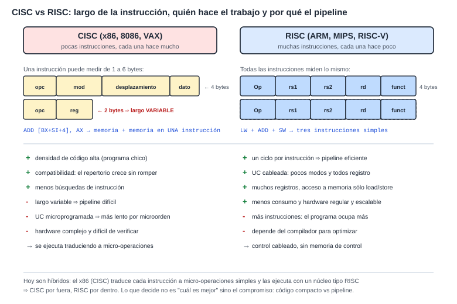

# 7.3.1 Tabla comparativa y ejemplos

> [!abstract] En una frase
> **CISC** apuesta a **pocas instrucciones complejas** de largo variable que operan sobre memoria (x86, 8086);
> **RISC** apuesta a **muchas instrucciones simples**, todas del **mismo largo**, con acceso a memoria **sólo**
> por `load`/`store` y **muchos registros** (ARM, MIPS, RISC-V).

> [!note] Si la primera vez que ves esto
> Es el **cuchillo multiuso** contra el **juego de cuchillos especializados**. El multiuso hace de todo con una sola
> pieza (menos instrucciones, cada una hace mucho); el juego corta mejor, pero hay que saber cuál agarrar (más
> instrucciones, cada una hace poquito). Las CPU actuales son **híbridas**: hablan multiuso por fuera y trabajan con
> especializados por dentro.

## La tabla de examen



| | **CISC** | **RISC** |
|---|---|---|
| Filosofía | pocas instrucciones, **complejas** | muchas instrucciones, **simples** |
| Longitud de la instrucción | **variable** (1 a 6 bytes o más) | **fija** (4 bytes) |
| Modos de direccionamiento | muchos | **pocos** (registro + desplazamiento) |
| Acceso a memoria | cualquier instrucción puede operar sobre memoria | **sólo** `LOAD` / `STORE` |
| Operandos | 1 o 2, muchos implícitos | **3 registros explícitos** |
| Registros | pocos | **muchos** (32 o más) |
| Unidad de control | **microprogramada** | **cableada** |
| Pipeline | difícil | **natural** |
| Ciclos por instrucción | varios (2-10) | **casi 1** |
| Densidad de código | **alta** | menor |
| Compilador | complejo (muchas opciones) | **simple** |
| Consumo / área | mayor | menor |
| Ejemplos | **x86**, 8086/8088, VAX, IBM 360 | **ARM**, MIPS, PowerPC, RISC-V |

## El mismo programa en los dos estilos
Sea `a = b + c` (los tres en memoria):

**CISC (x86):**
```
ADD  [a], [b], [c]      ; 1 instrucción, 3 operandos de memoria
```
- **1 instrucción**… pero de varios ciclos y de largo variable.
- La UC **microprogramada** la descompone internamente en varias microoperaciones.

**RISC (MIPS):**
```
LW   R1, b(R0)          ; R1 ← b
LW   R2, c(R0)          ; R2 ← c
ADD  R3, R1, R2         ; R3 ← R1 + R2
SW   a(R0), R3          ; a  ← R3
```
- **4 instrucciones**, todas del mismo largo y de 1 ciclo.
- Más código, pero **predecible** ⇒ pipeline perfecto.

> [!important] Lo que hay que decir al comparar
> El CISC gana en **densidad de código** (el programa ocupa menos memoria) y el RISC gana en **simplicidad para el
> hardware**. Con la memoria barata y el pipeline dominante, **la balanza se inclinó a RISC**… y el x86 sobrevive
> porque **traduce** a microoperaciones simples por dentro.

## La historia, en cuatro líneas
| Época | Qué pasó |
|---|---|
| **60-70** | La memoria es carísima ⇒ se agregan instrucciones complejas para acortar programas (**CISC**) |
| **80** | Se descubre que el compilador usa **el 20 % del repertorio en el 80 % del código** ⇒ sobra complejidad |
| **80-90** | **RISC**: repertorio chico, `load/store`, muchos registros, cableado, 1 ciclo ⇒ pipeline |
| **Hoy** | **Híbrido**: x86 traduce a µ-ops (RISC por dentro); ARM y RISC-V son RISC puros |

**La regla 80/20** es el argumento central: si el 80 % del código usa 20 % de las instrucciones, agregar
instrucciones complejas **no** acelera el programa típico; sólo complica el hardware.

## Qué se pregunta siempre
| Pregunta | Respuesta corta |
|---|---|
| ¿Cuál es más rápido? | **Depende**: RISC por ciclo, CISC por instrucción. El programa real suele favorecer a RISC |
| ¿Cuál ocupa menos memoria? | **CISC** (instrucciones más densas) |
| ¿Cuál tiene pipeline mejor? | **RISC** (largo fijo, 1 ciclo, pocos modos) |
| ¿Cuál tiene el compilador más simple? | **RISC** |
| ¿Por qué x86 no desapareció? | **Compatibilidad**: hay décadas de software compilado |
| ¿CISC desapareció? | No: **sobrevive** como interfaz externa con núcleo tipo RISC |

> [!warning] Errores típicos
> - Decir "RISC tiene menos instrucciones que CISC": tiene **más** instrucciones, pero **más simples**. Lo
>   "reducido" es la **complejidad**, no la cantidad.
> - Decir que RISC es siempre más rápido (depende del programa y de la implementación).
> - Olvidar el `load/store` como la restricción **clave** de RISC.
> - Mezclar CISC/RISC con **cableada/microprogramada**: van juntas por historia, pero no son lo mismo (un RISC
>   *podría* ser microprogramado).
> - Creer que un CISC no puede tener pipeline (el Pentium y todos los x86 lo tienen: traducen primero).

## Figura del libro


*Fig. 14.8 — Cauce segmentado del Pentium 4.* · Stallings, *Organización y arquitectura de computadores*, 7ª ed., p. 566.

> [!example] CISC contra RISC con números
> Sumar 100 elementos: **CISC** con `500 instrucciones` (5 por elemento) y `CPI ≈ 3` ⇒ **1500 ciclos**; **RISC**
> con `800` (8 por elemento, más simples) y `CPI ≈ 1,1` ⇒ **880 ciclos**. RISC gana **1,7×** aun haciendo más
> instrucciones: lo que importa es `instrucciones × CPI`.

## Relacionado
[[7.3.2 UC cableada vs microprogramada y load-store]] · [[CISC y RISC]] · [[00 Unidad 6 — temas y subtemas]] ·
[[Técnicas para aumentar la velocidad]] · [[5.1.2 Clasificación de las instrucciones]] · [[Glosario — Unidad 7]]
