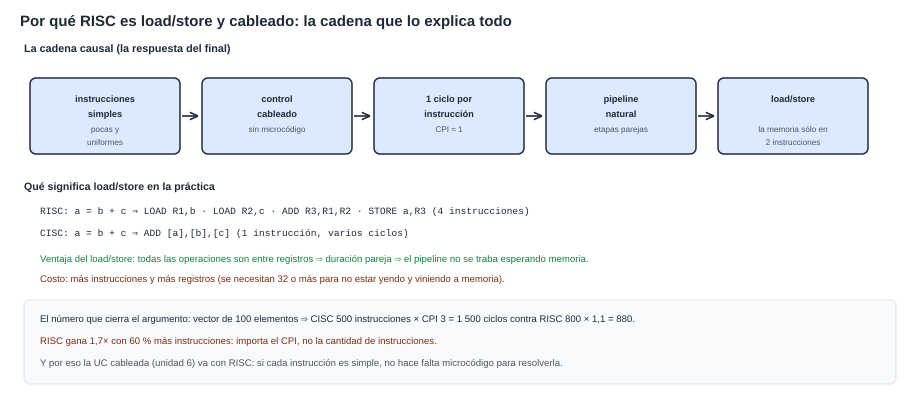
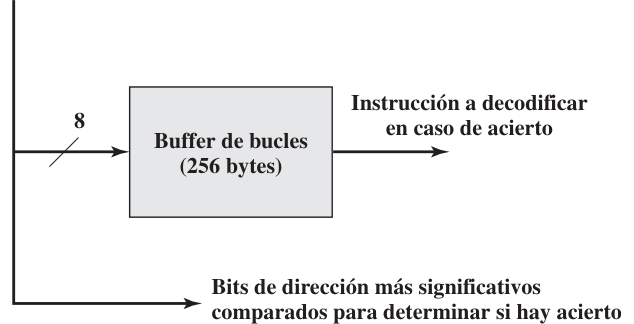

# 7.3.2 UC cableada vs microprogramada y load/store

> [!abstract] En una frase
> **RISC elige control cableado** porque cada instrucción debe resolverse en **un ciclo** (leer una ROM de control costaría un ciclo más) y **limita la memoria a `load`/`store`** porque así la etapa de memoria es **corta y uniforme**, que es la condición para que todas las etapas duren lo mismo y el pipeline funcione.

> [!note] Si la primera vez que ves esto
> El pipeline es una línea de montaje donde **cada puesto tarda lo mismo**. Un `load/store` único hace que el puesto de memoria haga **siempre lo mismo** (traer o llevar un dato). Si cualquier instrucción pudiera tocar memoria, el puesto tendría a veces mucho trabajo y a veces nada: **la línea se trabaría**.

## La cadena causal



## El control: cableado vs microprogramado

| | **Cableada** (RISC) | **Microprogramada** (CISC) |
|---|---|---|
| Velocidad | **1 ciclo** por instrucción | **2 o más**: leer la ROM de control |
| Flexibilidad | ninguna (recablear) | alta (reescribir la ROM) |
| Costo de diseño | alto con repertorio grande | ordenado para repertorios grandes |
| Se usa en | ARM, MIPS, RISC-V | x86, 8086/8088 |

👉 El desarrollo completo está en [[6.3.1 Cableada vs microprogramada]] y [[6.2.1 Memoria de control y microinstrucción]].

> [!important] La cadena de razonamiento que se pide
> instrucciones **simples** ⇒ se pueden generar con **compuertas** (cableada) ⇒ **1 ciclo** ⇒ **pipeline** ⇒ **CPI ≈ 1**. Si el repertorio fuera complejo, haría falta **microprograma** ⇒ varios ciclos ⇒ el pipeline se rompe (una instrucción que dura 10 ciclos obliga a frenar la línea).

## El `load/store`: la restricción que ordena todo

| Modelo | Instrucciones que tocan memoria | Etapa de memoria |
|---|---|---|
| **CISC** | casi todas (`ADD [a],[b],[c]`) | variable: a veces lee 2 datos y escribe 1 |
| **RISC** | **sólo** `LW` / `SW` | **fija**: un acceso por instrucción |

Consecuencias para el pipeline:

| Requisito del pipeline | Cómo lo cumple `load/store` |
|---|---|
| Etapas **parejas** | la etapa de memoria siempre tarda lo mismo (1 acceso) |
| Instrucciones de **largo fijo** | sin campos extra de direcciones de memoria |
| Cálculo de dirección **simple** | casi todos los accesos son `registro + desplazamiento` |
| Pocos **conflictos estructurales** | sólo `LW`/`SW` compiten por la memoria |

**El costo:** más instrucciones (hay que mover explícitamente) y más código. **El beneficio:** un `CPI` de 1 y un pipeline que no se traba.

## Comparación de CPI y código (ejemplo numérico)
Programa: sumar dos vectores de 100 elementos y guardar el resultado.

| Estilo | Instrucciones del lazo | Instrucciones totales | CPI | Ciclos |
|---|---|---|---|---|
| **CISC** (operando en memoria) | `MOV` + `ADD [ ], [ ]` + `INC` + `CMP` + `JNZ` ≈ 5 | ~500 | **3** | **1 500** |
| **RISC** (`load/store`) | `LW` + `LW` + `ADD` + `SW` + `INC×3` + `BNE` ≈ 8 | ~800 | **1,1** | **880** |

**Resultado:** el RISC ejecuta **más instrucciones** (800 contra 500) y aun así tarda **menos ciclos** (880 contra 1 500). Ésa es exactamente la sorpresa de los años 80: **no importa cuántas instrucciones, sino cuántos ciclos por instrucción.**

**Verificación:** `800 × 1,1 = 880` ✔ · `500 × 3 = 1 500` ✔ ⇒ el RISC gana por **1,7×** con **60 % más** de instrucciones.

## El híbrido actual
```
x86 (CISC) ──► decodificador que traduce ──► micro-operaciones tipo RISC ──► núcleo cableado con pipeline
```

- El **ISA** que ve el programador es CISC (compatibilidad).

- El **motor** que ejecuta es RISC (velocidad).

- La **ROM de microcódigo** sigue existiendo para instrucciones raras y para corregir errores después de fabricar (¡se puede parchear un CPU con una actualización de microcódigo!).

> [!warning] Errores típicos
> - Decir que CISC **no puede** tener pipeline (todos los x86 lo tienen, con traducción previa).
> - Creer que cableada/microprogramada **es** lo mismo que RISC/CISC (es una **tendencia**, no una identidad).
> - Olvidar el **costo** del `load/store`: más instrucciones y más presión en los registros.
> - Decir que "menos instrucciones = más rápido" sin mirar el CPI.
> - Confundir el **microcódigo** del x86 (interno) con el **programa** del usuario.

## Figura del libro



*Fig. 12.15 — Buffer de bucles.* · Stallings, *Organización y arquitectura de computadores*, 7ª ed., p. 480.

> [!example] La cadena causal
> Instrucciones **simples y de tamaño fijo** ⇒ se decodifican en paralelo ⇒ **pipeline** ⇒ hace falta que casi todas tarden lo mismo ⇒ **load/store** (sólo `LOAD` y `STORE` tocan memoria). Si se rompe un eslabón, el pipeline pierde: por eso RISC es "un paquete".

## Relacionado
[[7.3.1 Tabla comparativa y ejemplos]] · [[6.3.2 El 8088, ROM de control 504x21]] · [[6.3.1 Cableada vs microprogramada]] · [[7.1.2 Hazards y sus soluciones]] · [[CISC y RISC]] · [[Glosario — Unidad 7]]
