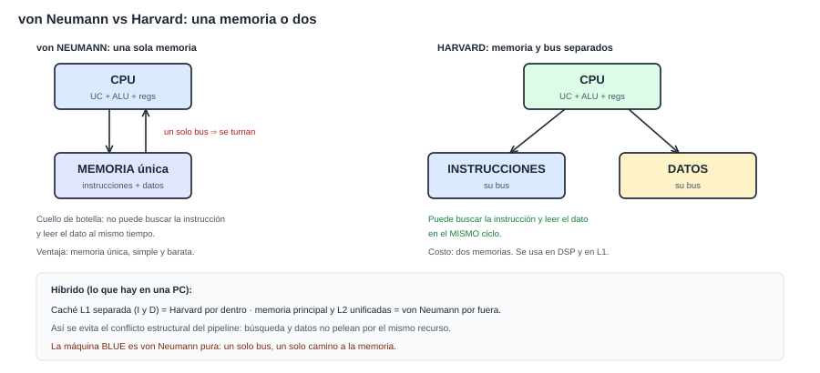

# 7.4.1 von Neumann vs Harvard

> [!abstract] En una frase
> **von Neumann**: **una sola** memoria y un solo bus para instrucciones y datos ⇒ simple, barato, pero con un
> **cuello de botella** (no se puede buscar la instrucción y leer el dato a la vez). **Harvard**: memorias y buses
> **separados** ⇒ las dos cosas van en el mismo ciclo, a cambio de **duplicar** la memoria.

> [!note] Si la primera vez que ves esto
> von Neumann es una **puerta** para entrar y salir: si alguien entra, el otro espera. Harvard son **dos puertas**:
> uno entra mientras el otro sale. Cuesta más (dos puertas), pero no hay cola.

## Los dos esquemas



| | **von Neumann** | **Harvard** |
|---|---|---|
| Memoria | **una**, compartida | **dos** (instrucciones y datos) |
| Bus | uno | **dos** |
| En el mismo ciclo | o busca instrucción **o** accede al dato | **las dos cosas** |
| Ventaja | simple, barata, flexible (el programa puede automodificarse) | **más rápida** (sin conflicto) |
| Desventaja | **cuello de botella** | más costosa, menos flexible |
| Ejemplos | **BLUE**, PCs (memoria principal), la mayoría de los ISA | DSP, microcontroladores, **caché L1 I/D** |

## El cuello de botella
```
CPU ──► bus único ──► MEMORIA (instrucciones + datos)

ciclo 1: buscar instrucción
ciclo 2: leer operando          ← tiene que esperar el turno
ciclo 3: escribir resultado
```
Todo lo que se gana con etapas más rápidas se pierde **esperando el bus**. Se lo llama **cuello de botella de von
Neumann** y es la razón histórica por la que se agregaron **cachés** y **bancos de memoria**.

**Mitigaciones (todas conocidas):** caché (evita ir a memoria), caché **I y D separadas** (Harvard por dentro),
bancos entrelazados, *prefetch* (la BIU del 8086 con su cola de 6 bytes).

## El híbrido: cómo es una PC de verdad
```
        ┌──────── CPU ────────┐
        │  L1 de instrucciones│   ← Harvard
        │  L1 de datos        │   ← Harvard
        │  L2 unificada       │   ← von Neumann
        └──────────┬──────────┘
                   │ bus del sistema
              memoria principal          ← von Neumann
```
**"Harvard modificado"**: separado en el **primer nivel** (donde el conflicto estructural duele) y unificado más
abajo (donde la memoria es grande y cara).

> [!important] Cómo se conecta con el pipeline
> El conflicto **estructural** de la etapa de búsqueda contra la de datos **desaparece** si hay caché I y D. Ésa es
> la razón por la que **todo** procesador con pipeline usa Harvard en L1, aunque el ISA sea von Neumann.

## Comparación para el final

| Pregunta | von Neumann | Harvard |
|---|---|---|
| ¿Cuántas memorias? | 1 | 2 |
| ¿Se puede ejecutar código de los datos? | sí (y es un riesgo de seguridad) | no (más seguro) |
| ¿Qué cuesta más? | — | el doble de memoria y buses |
| ¿Dónde se usa? | memoria principal, máquinas didácticas (BLUE) | DSP, microcontroladores, L1 |
| ¿Qué problema resuelve? | simplicidad | conflicto estructural del pipeline |

> [!warning] Errores típicos
> - Decir que la PC es **puramente** Harvard o **puramente** von Neumann (es **híbrida**).
> - Confundir Harvard con "tener caché" (Harvard es **separar** instrucciones y datos).
> - Olvidar que la BLUE (y el modelo del teórico) es von Neumann **pura**.
> - Decir que Harvard es "más moderna" (nació **antes**, en los años 40, con la máquina de Harvard Mark I).
> - Creer que el cuello de botella se arregla **sólo** subiendo la frecuencia del bus.

## Relacionado
[[7.4.2 Buses internos y externos]] · [[7.1.2 Hazards y sus soluciones]] · [[4.1.1 Unidades funcionales de una computadora]] ·
[[2.5.2 Caché: mapeos y políticas]] · [[5.6.1 BIU, EU y segmentación]]
