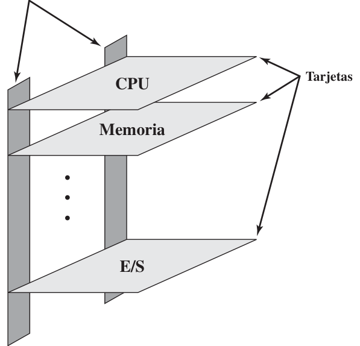

# 7.4.2 Buses internos y externos

> [!abstract] En una frase
> Un **bus** es un conjunto de conductores compartidos con **tres grupos de líneas** —**direcciones, datos y
> control**—; el **interno** conecta los bloques dentro del chip y el **externo** (del sistema) conecta CPU, memoria
> y periféricos. Su **ancho de banda** es `(bits / 8) × frecuencia`.

> [!note] Si la primera vez que ves esto
> El bus es la **autopista** del computador: cuántos carriles (bits de datos), cuántos km/h (frecuencia) y las
> señales de tránsito (control). Y como es **compartida**, hay un **guardia** que decide quién pasa: el
> **arbitraje**.

## Los tres grupos de líneas
| Grupo | Función | Sentido | Cuántas |
|---|---|---|---|
| **Direcciones** | **cuál** es la posición de memoria o el periférico | **un solo sentido** (CPU → memoria) | tantas como bits de dirección |
| **Datos** | **qué** se transfiere | **bidireccional** | 8, 16, 32, 64 bits |
| **Control** | **cómo**: `Read`, `Write`, reloj, `IRQ`, `Ready`, selección | según la línea | varias |

**De la BLUE:** el bus tiene **12 líneas de dirección** (4096 celdas) y **16 de datos** ⇒ es un bus único
compartido por CPU, memoria y periféricos ([[3.1.2 Bus único y buffers de 3 estados]]).

## Interno vs externo


| | **Bus interno** | **Bus externo** (del sistema) |
|---|---|---|
| Dónde está | dentro del chip | en la placa madre |
| Conecta | registros, ALU, UC, caché | CPU ↔ memoria ↔ E/S |
| Ancho | muy grande (varios cientos de bits) | 64 bits típico |
| Velocidad | la del reloj del núcleo | menor (con multiplicadores) |
| Quién lo maneja | la UC | **arbitraje** entre maestros |

## El cálculo del ancho de banda
```
ancho de banda = (bits del bus de datos / 8) × frecuencia de transferencia
tiempo de transferencia = bytes a transferir / ancho de banda
```

> [!example] Ejemplo resuelto 1
> "Bus de datos de 64 bits a 200 MHz. ¿Ancho de banda? ¿Cuánto tarda en transferir 1 MB?"
>
> 1. `64 bits = 8 bytes` por transferencia.
> 2. `8 B × 200·10⁶ = 1,6·10⁹ B/s =` **1,6 GB/s**.
> 3. `1 MB / 1,6 GB/s = 1,048·10⁶ / 1,6·10⁹ =` **0,655 ms** (≈ 0,62 ms con 1 MB = 10⁶ B).

> [!example] Ejemplo resuelto 2
> "El mismo bus, pero de **32 bits** a **400 MHz**. ¿Mejor o peor?"
>
> - `4 B × 400·10⁶ =` **1,6 GB/s** ⇒ **lo mismo**. Duplicar la frecuencia con la mitad del ancho **no cambia** el
>   caudal; cambiar los dos sí.
> - **Conclusión:** el ancho de banda depende **del producto** `ancho × frecuencia`, no de uno solo.

## Los conceptos que se preguntan
| Concepto | Qué es |
|---|---|
| **Maestro** (*master*) | el que **inicia** la transferencia (CPU, DMA, un periférico) |
| **Esclavo** (*slave*) | el que **responde** (memoria, registro de un periférico) |
| **Arbitraje** | quién tiene el bus cuando hay varios maestros: **centralizado** o **distribuido** |
| **Ciclo de bus** | una transferencia completa (dirección + dato + *handshake*) |
| **Handshake** | protocolo de "estoy listo / recibido" (`Ready`, `Ack`) |
| **Espera** (*wait state*) | ciclos extra porque el esclavo es lento |
| **Ráfaga** (*burst*) | varias transferencias con **una sola** dirección inicial ⇒ más eficiente |

## La jerarquía real de buses
| Nivel | Ejemplo | Ancho típico |
|---|---|---|
| **Interno del núcleo** | ALU ↔ registros | cientos de bits |
| **Caché ↔ núcleo** | L1 | 128-512 bits |
| **Del sistema** | CPU ↔ DRAM | 64 bits × varios canales |
| **De E/S** | PCIe, USB, SATA | seriales de alta velocidad (PCIe x16 ≈ 32 GB/s) |

> [!important] Por qué hoy casi todo es **serial**
> Un bus paralelo de 32 líneas tiene **desfasajes** entre líneas a frecuencias altas (unos cables llegan antes que
> otros). Un enlace **serial** de muy alta frecuencia es más fácil de sincronizar: por eso PCIe reemplazó a PCI y
> SATA a IDE. **"Serial" no significa "lento"**: significa un solo carril, pero a GHz.

> [!warning] Errores típicos
> - Confundir **ancho de banda** con **latencia** (el bus puede tener mucho caudal y mucha demora).
> - Calcular el ancho de banda con los bits de **dirección** (se calcula con los de **datos**).
> - Olvidar que el bus es **compartido**: si dos maestros lo piden, uno espera (arbitraje).
> - Decir que un bus más ancho siempre es mejor (si el resto del sistema no lo aprovecha, no cambia nada).
> - Creer que serial = lento.

## Figura del libro



*Fig. 3.17 — Implementación física típica de una arquitectura de bus.* · Stallings, *Organización y arquitectura de computadores*, 7ª ed., p. 101.

## Relacionado
[[7.4.1 von Neumann vs Harvard]] · [[3.1.2 Bus único y buffers de 3 estados]] · [[3.1.1 Notación de transferencia entre registros]] ·
[[8.3.1 Bancos de memoria y ancho de banda]] · [[Técnicas para aumentar la velocidad]]
