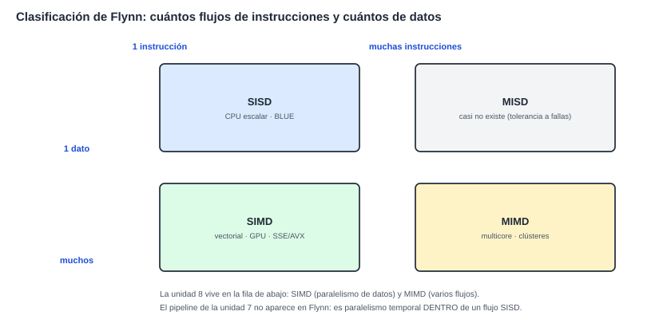
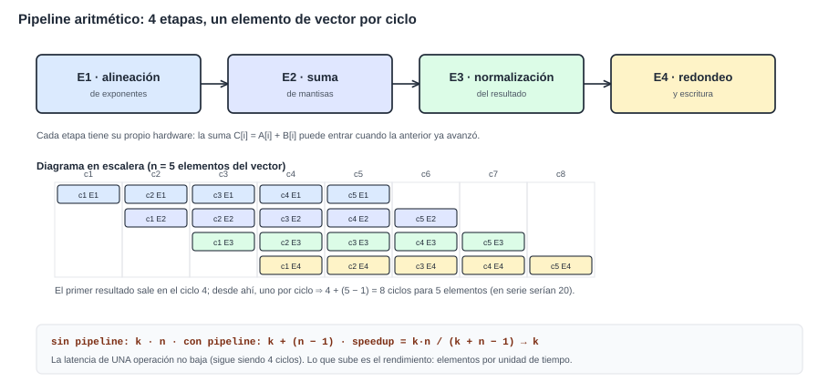
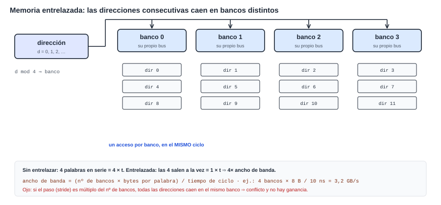

# Síntesis — Unidad 8: Paralelismo

> [!abstract] Qué es este archivo
> **Toda la Unidad 8 en un solo lugar**: pipeline aritmético, SIMD/vectorial, memoria entrelazada y multiprocesadores, con las fórmulas, las recetas de examen y la autoevaluación. Sirve para repasar sin abrir las 9 notas.

> [!tip] Cómo usarlo
> 1. Leer **§1 a §6** (25 minutos).
> 2. Recitar de memoria las **5 fórmulas** de §7.
> 3. Resolver **§8 recetas** con calculadora.
> 4. Contestar **§10** sin mirar.

## Índice

1. [[#1. Las tres formas de paralelismo]]

2. [[#2. Pipeline aritmético]]

3. [[#3. Encadenamiento]]

4. [[#4. SIMD y procesamiento vectorial]]

5. [[#5. Memoria entrelazada]]

6. [[#6. Multiprocesadores y Amdahl]]

7. [[#7. Tablas de memoria rápida]]

8. [[#8. Recetas de examen]]

9. [[#9. Errores que cuestan puntos]]

10. [[#10. Autoevaluación]]

---

## 1. Las tres formas de paralelismo

| Forma | Qué se solapa | Tema | Clase de Flynn |
|---|---|---|---|
| **Tiempo** | etapas de una operación (o de una instrucción) | 8.1 / Unidad 7 | **SISD** |
| **Ancho** | muchos datos con una instrucción | 8.2 | **SIMD** |
| **Unidades** | bancos de memoria y núcleos | 8.3 / 8.4 | — / **MIMD** |

### Clasificación de Flynn


| Clase | Instrucciones | Datos | Ejemplo |
|---|---|---|---|
| **SISD** | 1 | 1 | CPU escalar, **BLUE**, pipeline |
| **SIMD** | 1 | muchos | vectorial, GPU, SSE/AVX |
| **MISD** | muchas | 1 | casi no existe |
| **MIMD** | muchas | muchos | multicore, clústeres |

👉 [[8.2.2 Flynn, arreglos SIMD y conectados]]

## 2. Pipeline aritmético

Unidad segmentada en **k etapas** con hardware propio; acepta **un elemento por ciclo**.

| Etapa (suma en punto flotante) | Qué hace |
|---|---|
| **E1** alineación | iguala exponentes |
| **E2** suma | suma mantisas |
| **E3** normalización | corre la coma |
| **E4** redondeo | ajusta y escribe |

```
sin pipeline:  k · n            con pipeline:  k + (n − 1)
speedup:       S = k·n / (k + n − 1)   →  k
```

| k | n | Serie | Pipeline | S |
|---|---|---|---|---|
| 4 | 5 | 20 | **8** | 2,5 |
| 4 | 100 | 400 | **103** | 3,88 |
| 8 | 100 | 800 | **107** | 7,48 |



👉 [[8.1.1 Etapas segmentadas y suma de vectores]]

## 3. Encadenamiento

El resultado de una etapa alimenta la operación siguiente **sin pasar por el registro**.

> [!example] `C = (A + B)·D`, 100 elementos, 4 + 4 etapas, 250 MHz
> | Caso | Ciclos | Tiempo |
> |---|---|---|
> | sin encadenar (la 2.ª espera el vector entero) | `(4+99) + (4+99) = 206` | 824 ns |
> | **encadenado** | `4 + 4 + 99 = 107` | **428 ns** |
> `S = 206/107 = 1,93`

**Límites:** etapas desparejas, dependencias (stall), llenado. **Techo:** `k`. 👉 [[8.1.2 Encadenamiento y speedup]]

## 4. SIMD y procesamiento vectorial

```
escalar:   for i: C[i] = A[i] + B[i]     ← n instrucciones
vectorial: VADD C, A, B                   ← 1 instrucción
```

| Registro | Ancho | Enteros de 32 bits |
|---|---|---|
| MMX | 64 | 2 |
| SSE | 128 | 4 |
| AVX | 256 | 8 |
| AVX-512 | 512 | 16 |

**Instrucciones = `n / ancho`**: 10 000 elementos con AVX-512 ⇒ `10 000/16 = 625` instrucciones. **Se gana throughput, no latencia.**

### Arreglos

| | Arreglo SIMD | Arreglo conectado |
|---|---|---|
| Qué tiene | muchos PE con una UC común | lo mismo **+ red** entre PE |
| Para qué | imagen: un PE por píxel | autómata celular, simulación física, convolución |

### Multiplicación de matrices
`C[i][j] = Σ A[i][k]·B[k][j]` ⇒ **`n³`** multiplicaciones. Se vectoriza el **lazo interno** (producto punto) y se **bloquea** (`strip mining`) para el ancho del registro. Es el benchmark de la industria (**LINPACK/TOP500**). 👉 [[8.2.1 SIMD, registros vectoriales y GPU]] · [[8.2.3 Multiplicación de matrices]]

## 5. Memoria entrelazada



```
banco = dirección mod (nº de bancos)
ancho de banda = (bancos × bytes por palabra) / tiempo de ciclo
```

> [!example] 4 bancos × 8 B / 10 ns
> `4 × 8 / 10 ns = 3,2 GB/s` (con 1 banco serían 0,8 GB/s). **La latencia no cambia.**

### El conflicto de banco

| stride | Bancos (dir mod 4) | Resultado |
|---|---|---|
| **1** | 0,1,2,3 | 4 en paralelo ✔ |
| 2 | 0,2,0,2 | mitad |
| **4** | 0,0,0,0 | **conflicto total** ✘ |
| 3 | 0,3,2,1 | 4 en paralelo ✔ (coprimo) |

**Matriz por columnas:** `stride = n`; si `n` es múltiplo de los bancos ⇒ 4× más lento. Se arregla **transponiendo** o con **padding**. 👉 [[8.3.1 Bancos de memoria y ancho de banda]] · [[8.3.2 Patrón de entrelazado y conflictos de banco]]

## 6. Multiprocesadores y Amdahl

| Tipo | Memoria | Ejemplo |
|---|---|---|
| **Multicore** | compartida | Ryzen, Core i7 |
| **SMP** | compartida, varios sockets | servidores |
| **Clúster / NUMA** | distribuida | supercomputadoras |

### Coherencia de caché
Si cada núcleo tiene copia de `X`, al escribir uno hay que **invalidar** las demás copias.

| Protocolo | Idea |
|---|---|
| **Snooping** | cada caché espía el bus |
| **Directorio** | tabla central de quién tiene qué |
| **MESI** | **M**odificada · **E**xclusiva · **S**hared · **I**nvalid |

**Falso compartido:** dos hilos escriben variables **distintas** en la **misma línea** (64 B) ⇒ invalidaciones inútiles. Se arregla con **padding**.

### La ley de Amdahl
```
S(n) = 1 / ((1 − f) + f/n)
```

| f | n=4 | n=8 | n → ∞ |
|---|---|---|---|
| 0,50 | 1,60 | 1,78 | **2,0** |
| 0,80 | 2,50 | 3,33 | **5,0** |
| 0,90 | 3,08 | 3,60 | **10,0** |
| 0,95 | 3,48 | 5,93 | **20,0** |

> [!example] 100 s, 80 % paralelizable, 4 procesadores
> secuencial `20 s` + paralelo `80/4 = 20 s` ⇒ `40 s` ⇒ **S = 2,5** · techo `1/0,2 = 5×`

**Escalado:** *fuerte* (mismo problema, más núcleos) · *débil* (más trabajo, mismo tiempo por núcleo). 👉 [[8.4.1 Multicore, coherencia de caché y ley de Amdahl]]

## 7. Tablas de memoria rápida

### Las cinco fórmulas

| Qué | Fórmula |
|---|---|
| Pipeline aritmético | `ciclos = k + (n − 1)` |
| Speedup del pipeline | `S = k·n / (k + n − 1) → k` |
| Instrucciones vectoriales | `n / ancho del registro` |
| Ancho de banda de memoria | `(bancos × bytes) / t_ciclo` |
| Ley de Amdahl | `S = 1 / ((1−f) + f/n)` |

### Los números que hay que saber

| Dato | Valor |
|---|---|
| Línea de caché | 64 B |
| Registros SIMD | 128 (SSE) · 256 (AVX) · 512 (AVX-512) |
| Warp de una GPU | 32 hilos |
| Matriz `n × n` | `n³` multiplicaciones |
| Amdahl con 10 % secuencial | techo **10×** |

### Monousuario vs multiusuario

| | Monousuario | Multiusuario |
|---|---|---|
| Objetivo | **latencia** | **productividad** |
| Núcleos | pocos y rápidos | muchos |
| Se mide con | tiempo de respuesta | trabajos/hora |

👉 [[8.4.2 Monousuario vs multiusuario]]

## 8. Recetas de examen

> [!example] Receta 1 — "¿Cuánto tarda un pipeline aritmético?"
> 1. Identificar `k` (etapas) y `n` (elementos).
> 2. `ciclos = k + n − 1`; serie `k·n`.
> 3. `S = k·n / (k + n − 1)` y comentar que tiende a `k`.
> 4. Tiempo: `ciclos / frecuencia` (o `× período`).
> 5. Verificar `S < k`.

> [!example] Receta 2 — "¿Cuántas instrucciones ahorra SIMD?"
> 1. Ancho del registro ÷ tamaño del dato = **elementos por registro**.
> 2. `instrucciones = n / (elementos por registro)` (redondear hacia arriba).
> 3. Comparar con `n` del escalar.
> 4. Aclarar: **throughput**, no latencia.

> [!example] Receta 3 — "Ancho de banda con bancos"
> 1. `bytes por ciclo = bancos × bytes por palabra`.
> 2. Dividir por el tiempo de ciclo.
> 3. Chequear el **patrón**: si `stride mod bancos = 0` ⇒ conflicto ⇒ olvidarse del paralelismo.

> [!example] Receta 4 — "Speedup con n procesadores" (Amdahl)
> 1. `f` = fracción paralelizable; secuencial = `1 − f`.
> 2. `S = 1 / ((1−f) + f/n)`.
> 3. Verificar el **techo**: `1/(1−f)`.
> 4. Si el enunciado da tiempos: `t = t_total·(1−f) + t_total·f/n`.
> 5. Cerrar: "la parte secuencial manda".

> [!example] Receta 5 — "Compará las formas de paralelismo"
> 1. Tres columnas: **tiempo** (pipeline), **ancho** (SIMD), **unidades** (bancos/núcleos).
> 2. Cada una con su techo: `k` · ancho del registro · `n` teórico y Amdahl en la práctica.
> 3. Ubicarlas en Flynn: SISD, SIMD, MIMD.
> 4. Cerrar: son **complementarias** (una GPU usa las tres).

## 9. Errores que cuestan puntos

| Error | Lo correcto |
|---|---|
| "El pipeline hace más rápida **una** operación" | hace más **operaciones** por unidad de tiempo |
| Usar `k·n` con pipeline | `k + (n − 1)` |
| Prometer speedup > `k` | el techo es `k` (con un cauce) |
| Decir que SIMD baja la latencia | sube el **throughput** |
| Confundir SIMD y MIMD | 1 instrucción vs muchas |
| Ubicar el pipeline en Flynn como MIMD | es **SISD** (paralelismo temporal) |
| Confundir arreglo SIMD y conectado | el conectado **agrega red** |
| `n²` operaciones en la matriz | **`n³`** |
| Decir que el entrelazado baja el tiempo de acceso | sube el **ancho de banda** |
| Olvidar el conflicto de banco | `stride` múltiplo de los bancos ⇒ todo al mismo banco |
| "4 núcleos = 4×" | **Amdahl**: la parte secuencial no se divide |
| Confundir **coherencia** y **consistencia** | coherencia = mismo valor; consistencia = orden |
| Invertir monousuario/multiusuario | PC = latencia · servidor = throughput |
| Confundir **multiprogramación** (turnos) con **multiprocesamiento** | una CPU vs varias |

## 10. Autoevaluación

1. Nombrá las **tres formas de paralelismo** y a qué tema de la unidad corresponde cada una.

2. ¿Cuáles son las etapas de una suma en punto flotante y por qué se pueden solapar?

3. Con `k = 4` y `n = 20`: ¿cuántos ciclos con y sin pipeline? ¿Qué speedup da?

4. ¿Por qué el speedup **tiende** a `k` y no lo supera?

5. ¿Qué es el **encadenamiento** y en qué se diferencia del *forwarding*?

6. Definí **SIMD** y explicá por qué amortiza la decodificación.

7. ¿Cuántas instrucciones pide sumar 4 000 enteros con AVX-256? ¿Y en escalar?

8. Completá Flynn: SISD, SIMD, MISD, MIMD — con un ejemplo de cada uno y dónde ubicás el pipeline.

9. Diferencia **arreglo SIMD** de **arreglo conectado**; dame una aplicación de cada uno.

10. ¿Cuántas multiplicaciones tiene `C = A·B` con `n = 100`? ¿Qué lazo se vectoriza y por qué?

11. Con 8 bancos, 4 B por palabra y ciclo de 5 ns: ¿ancho de banda? ¿Y si el `stride` es 8?

12. ¿Por qué el entrelazado no mejora la latencia?

13. Explicá **coherencia de caché** y **MESI** en tres frases. ¿Qué es el falso compartido?

14. Aplicá Amdahl con `f = 0,9` y `n = 8`. ¿Cuál es el techo? ¿Qué conclusión saca un diseñador?

15. Diferenciá **latencia** de **productividad** y explicá por qué un servidor justifica 64 núcleos y una notebook no.

16. ¿Por qué el paralelismo no evita tener que resolver la **memoria entrelazada**?

---

## Relacionado
[[00 Unidad 8 completa (lectura de corrido)]] · [[00 Unidad 8 — temas y subtemas]] · [[00 Unidad 7 — temas y subtemas]] · [[00 Unidad 9 — temas y subtemas]] · [[00 Índice de la materia (las 10 unidades)]] · [[Paralelismo y procesamiento vectorial]]
