# Unidad 8 — Paralelismo

> [!abstract] Qué es este archivo
> **La Unidad 8 completa en un solo archivo**: los **9 subtemas** pegados uno detrás de otro,
> con todo su contenido: definiciones, tablas, diagramas, ejemplos resueltos, figuras del libro y errores
> típicos. Son **7.500 palabras** y **4 temas**. Está pensado para **leer de corrido** y para
> **imprimir**: no hace falta abrir ninguna otra nota.
>
> - **Repaso rápido** (una página): [[00 Síntesis — Unidad 8]].
> - **Buscar un punto**: el índice de abajo o el de la unidad, [[00 Unidad 8 — temas y subtemas]].
> - Cada subtema conserva su número (`1.4.1`), así coincide con el índice y con las preguntas del final.
> - **Todo junto, las 10 unidades**: [[00 Materia completa (las 10 unidades en un archivo)]].

## Contenido

**8.1 Pipeline aritmético**
- [[#8.1.1 Etapas segmentadas y suma de vectores]]
- [[#8.1.2 Encadenamiento y speedup]]

**8.2 Procesamiento vectorial y SIMD**
- [[#8.2.1 SIMD, registros vectoriales y GPU]]
- [[#8.2.2 Flynn, arreglos SIMD y conectados]]
- [[#8.2.3 Multiplicación de matrices]]

**8.3 Memoria entrelazada**
- [[#8.3.1 Bancos de memoria y ancho de banda]]
- [[#8.3.2 Patrón de entrelazado y conflictos de banco]]

**8.4 Multiprocesadores**
- [[#8.4.1 Multicore, coherencia de caché y ley de Amdahl]]
- [[#8.4.2 Monousuario vs multiusuario]]

---

## 8.1 Pipeline aritmético

### 8.1.1 Etapas segmentadas y suma de vectores

> [!abstract] En una frase
> Un **pipeline aritmético** parte una operación larga (una suma en punto flotante, una multiplicación) en **k
> etapas** con hardware propio, y acepta **un elemento nuevo por ciclo**: así `n` operaciones se hacen en
> **`k + (n − 1)`** ciclos en lugar de `k·n`.

> [!note] Si la primera vez que ves esto
> Es la **línea de montaje** de una fábrica: el primer auto tarda 4 estaciones en salir, pero después **sale uno
> por estación**. La primera operación no se hace más rápido; lo que cambia es el **ritmo**.

#### Las 4 etapas de una suma en punto flotante

| Etapa | Qué hace | Por qué es lenta sola |
|---|---|---|
| **E1 · alineación** | iguala los exponentes (desplaza la mantisa menor) | comparar y desplazar |
| **E2 · suma** | suma las mantisas (sumador completo de `n` bits) | propagación del acarreo |
| **E3 · normalización** | corre la coma para que quede en 1,xxx | contar ceros, desplazar |
| **E4 · redondeo** | ajusta el último bit y escribe el resultado | lógica de redondeo |

Cada etapa tiene **su propio hardware**. Eso es lo que permite que trabajen a la vez: si dos etapas compartieran
un bloque, no se podría solapar (**conflicto estructural**).

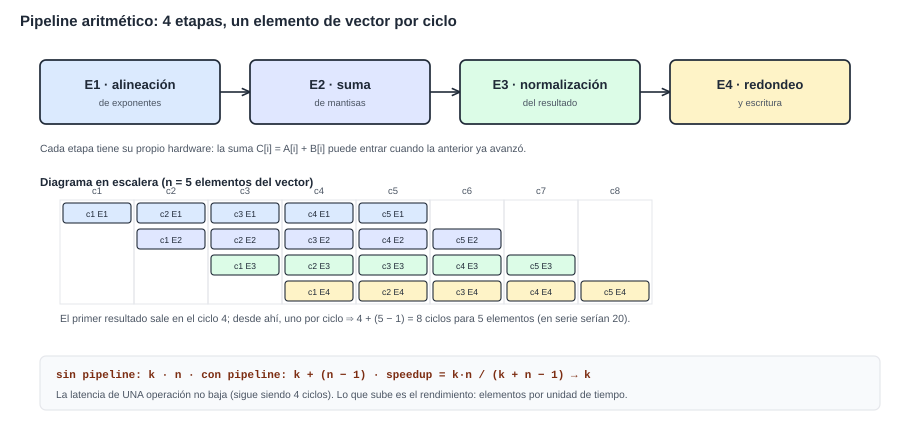

#### El diagrama en escalera (n = 5 elementos)

| ciclo | 1 | 2 | 3 | 4 | 5 | 6 | 7 | 8 |
|---|---|---|---|---|---|---|---|---|
| **C[0]** | E1 | E2 | E3 | E4 | | | | |
| **C[1]** | | E1 | E2 | E3 | E4 | | | |
| **C[2]** | | | E1 | E2 | E3 | E4 | | |
| **C[3]** | | | | E1 | E2 | E3 | E4 | |
| **C[4]** | | | | | E1 | E2 | E3 | E4 |

- **C[0] sale en el ciclo 4** (igual que sin pipeline).
- **C[4] sale en el ciclo 8**; en serie habría sido el ciclo **20**.
- Desde el ciclo 4, **sale un resultado por ciclo**.

#### La cuenta general
```
sin pipeline:   k · n          ciclos
con pipeline:   k + (n − 1)    ciclos
speedup:        S = k·n / (k + n − 1)     →  k  cuando n ≫ k
```

| k (etapas) | n (elementos) | Serie | Pipeline | Speedup |
|---|---|---|---|---|
| 4 | 5 | 20 | 8 | **2,5** |
| 4 | 100 | 400 | 103 | **3,88** |
| 4 | 1000 | 4000 | 1003 | **3,99** |
| 8 | 100 | 800 | 107 | **7,48** |

> [!important] El límite es `k`, no más
> El speedup **tiende** a `k` (la cantidad de etapas) y nunca lo supera: en el límite, cada ciclo entrega **un**
> elemento. Para ir más allá hay que **duplicar el pipeline** (superescalar) o **ensanchar** el vector (SIMD).

#### Diferencia con el pipeline de instrucciones

| | **Pipeline aritmético** (8.1) | **Pipeline de instrucciones** (Unidad 7) |
|---|---|---|
| Qué se solapa | operaciones **de datos** (elementos del vector) | **instrucciones** del programa |
| Etapas | fases de una operación (alinear, sumar, normalizar) | búsqueda, decodificación, operandos, ejecución |
| Quién lo usa | procesadores **vectoriales**, GPU | toda CPU moderna |
| Conflictos | dependencia entre elementos, etapa no uniforme | estructural, de datos (RAW), de control (saltos) |
| Clasificación de Flynn | **SIMD** | sigue siendo **SISD** (paralelismo temporal) |

#### Ejemplo resuelto (el que se toma)
> "Se suman dos vectores de 60 elementos en un pipeline aritmÉtico de 4 etapas que funciona a 200 MHz. ¿Cuánto
> tarda y qué speedup se obtiene?"

1. Ciclos con pipeline: `4 + (60 − 1) = 63`.
2. Tiempo: `63 / 200 MHz = 63 × 5 ns = 315 ns`.
3. Ciclos en serie: `4 × 60 = 240` ⇒ `240 × 5 ns = 1 200 ns`.
4. `Speedup = 240 / 63 = 3,81` (cerca del máximo teórico, 4).

**Verificación:** `3,81 < 4` ✔ y el tiempo baja al 26 % del original ✔.

> [!warning] Errores típicos
> - Decir que **una** operación tarda menos: tarda lo mismo (4 ciclos) o un poco más por los registros de etapa.
> - Usar `k·n` para el caso con pipeline (es `k + n − 1`).
> - Prometer speedup mayor que `k` con un solo pipeline.
> - Olvidar que la etapa **más lenta** fija el período del reloj: si E2 tarda el doble, todas esperan.
> - Confundir este pipeline con el de instrucciones: acá se solapan **datos**.

#### Figura del libro

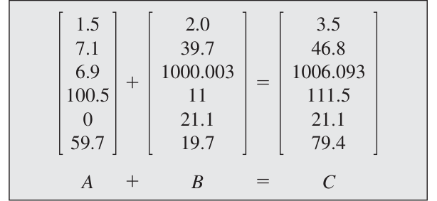

*Fig. 18.13 — Ejemplo de suma vectorial.* · Stallings, *Organización y arquitectura de computadores*, 7ª ed., p. 727.

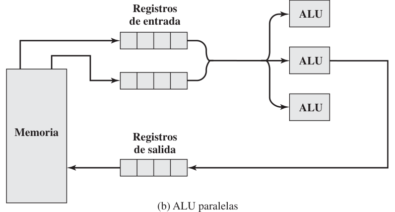

*Fig. 18.15 — Alternativas para la computación vectorial.* · Stallings, *Organización y arquitectura de computadores*, 7ª ed., p. 729.

#### Relacionado
[[8.1.2 Encadenamiento y speedup]] · [[Pipeline]] · [[Paralelismo y procesamiento vectorial]] ·
[[TP5 Sumadores]] · [[4.3.1 Ciclo de reloj, de máquina y de instrucción]] · [[Glosario — Unidad 8]]

### 8.1.2 Encadenamiento y speedup

> [!abstract] En una frase
> El **encadenamiento** (*chaining*) conecta la **salida** de una etapa con la **entrada** de la siguiente operación
> **sin pasar por los registros**: así una cadena de operaciones sobre vectores (`C = (A+B)·D`) avanza al ritmo de
> la etapa más lenta, no al de la operación completa.

> [!note] Si la primera vez que ves esto
> Sin encadenamiento, cada resultado espera a "guardarse en la caja" antes de que lo use la etapa siguiente. Con
> encadenamiento, el resultado **sale por la ventana** y la etapa siguiente lo toma al vuelo, como en una cadena de
> montaje donde el auto pasa directo al siguiente puesto.

#### Encadenar etapas

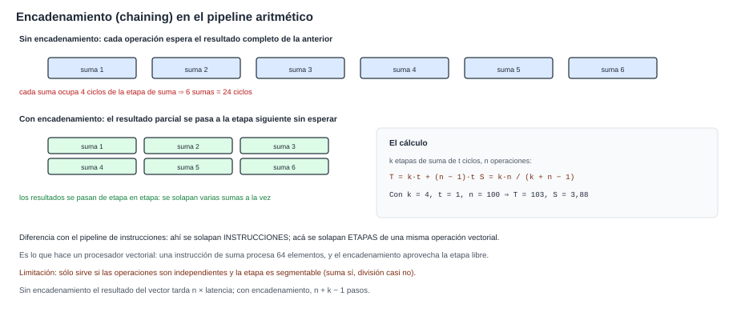

#### Qué es exactamente
```
sin encadenamiento:   E1→E2→E3→E4 → [registro] → E1→E2→E3→E4
con encadenamiento:   E1→E2→E3→E4 ─────────────► E1→E2→E3→E4
                                    (el dato sale de E4 y entra a E1 sin esperar)
```
En un procesador vectorial, **cada etapa de una operación puede alimentar la etapa equivalente de la otra**:
`A+B` en E4 pasa a la multiplicación en su E1 mientras los elementos siguientes siguen entrando.

#### El speedup, con sus tres límites

| Límite | Qué hace | Cómo se nota |
|---|---|---|
| **Etapas desparejas** | el período es el de la etapa más lenta | si E2 tarda 2 ciclos, todo tarda 2 ciclos |
| **Dependencias** | el elemento `i` necesita el `i−1` | aparece un **stall** (burbuja) |
| **Tiempo de llenado** | el primer resultado tarda `k` ciclos | con `n` chico el speedup se derrumba |

```
S(n) = k·n / (k + n − 1)
```
| n con k = 4 | S | Comentario |
|---|---|---|
| 4 | 2,29 | el llenado pesa tanto como el trabajo |
| 10 | 3,08 | |
| 100 | 3,88 | |
| ∞ | **4** | techo |

> [!important] La consecuencia práctica
> Un pipeline aritmético **sólo vale la pena con vectores largos**. Por eso el procesamiento vectorial (8.2) usa
> vectores de cientos o miles de elementos y "**strip mining**": cortar un vector enorme en bloques del ancho del
> registro.

#### Ejemplo resuelto: `C[i] = (A[i] + B[i]) · D[i]`
> Pipeline de 4 etapas para la suma y 4 para el producto, a 250 MHz (4 ns por ciclo), vector de 100 elementos.
> ¿Cuánto tarda sin encadenamiento y con encadenamiento?

| Caso | Qué pasa | Ciclos | Tiempo |
|---|---|---|---|
| **Sin encadenamiento** | el producto **no arranca** hasta que la suma terminó **todo** el vector | `(4+99) + (4+99) = 206` | `206 × 4 ns =` **824 ns** |
| **Con encadenamiento** | el producto toma el primer resultado de la suma y avanza de a uno | `4 + 4 + (100−1) = 107` | `107 × 4 ns =` **428 ns** |

`Speedup = 206 / 107 = 1,93` — casi el doble, **sin agregar hardware**: sólo dejando que el dato pase de una
unidad a la otra sin esperar a que se escriba el registro.

> [!tip] La regla
> Sin encadenamiento se paga **dos veces el llenado y dos veces el vaciado** del vector. Con encadenamiento se paga
> **un llenado** (`k1 + k2 − 2` ciclos de arranque) y después un elemento por ciclo.

#### Producto punto: el caso donde se ve
```
escalar:     AC ← 0 ;  para i: AC ← AC + A[i]·B[i]
vectorial:   multiplicar el vector A por el B (pipeline de producto)
             y encadenar con el sumador de acumulación (árbol de suma)
```
- Sin encadenamiento: cada `A[i]·B[i]` debe **terminar** para sumarse ⇒ 1 elemento cada 8 ciclos.
- Con encadenamiento y **suma en árbol**: se suman 4 productos a la vez ⇒ 1 elemento cada ciclo o mejor.

#### Cómo se relaciona con lo demás
| Técnica | Qué agrega sobre el pipeline simple |
|---|---|
| **Encadenamiento** | solapa operaciones **distintas** sobre datos distintos |
| **Múltiples pipelines funcionales** | permite lanzar suma y producto a la vez (uno por tipo) |
| **Suma en árbol** (reducción) | reduce `n` valores en `log₂ n` etapas en vez de `n` |
| **SIMD** | procesa 4-8 elementos por **instrucción** |

> [!warning] Errores típicos
> - Creer que el encadenamiento duplica la velocidad: elimina **esperas**, no etapas.
> - Olvidar que la **etapa más lenta** define el período (diseñar etapas parejas).
> - Aplicar la fórmula `k + n − 1` **sin** sumar el llenado de cada operación encadenada.
> - Confundir encadenamiento con *forwarding*: el primero es entre **operaciones vectoriales**; el segundo, entre
>   **instrucciones** de un pipeline de instrucciones.

#### Figura del libro

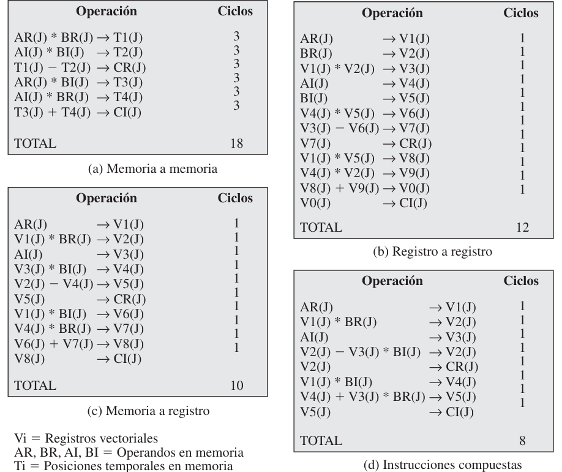

*Fig. 18.19 — Programas alternativos de computación vectorial.* · Stallings, *Organización y arquitectura de computadores*, 7ª ed., p. 734.

#### Relacionado
[[8.1.1 Etapas segmentadas y suma de vectores]] · [[8.2.1 SIMD, registros vectoriales y GPU]] ·
[[8.2.3 Multiplicación de matrices]] · [[Pipeline]] · [[Técnicas para aumentar la velocidad]] · [[Glosario — Unidad 8]]

## 8.2 Procesamiento vectorial y SIMD

### 8.2.1 SIMD, registros vectoriales y GPU

> [!abstract] En una frase
> **SIMD** = *Single Instruction, Multiple Data*: **una instrucción** que opera sobre **muchos datos a la vez**.
> Se implementa con **registros vectoriales** anchos (64 a 512 bits) y con muchas unidades de ejecución en
> paralelo; es la base del procesamiento vectorial, de SSE/AVX y de las **GPU**.

> [!note] Si la primera vez que ves esto
> En vez de decirle al pintor "pintá esta pared", "pintá esta otra", "pintá esta otra" (una instrucción por pared),
> le das **un rodillo ancho** y dice "pintá estas cuatro a la vez". La orden es una; el trabajo, cuádruple.

#### Lanes en un registro

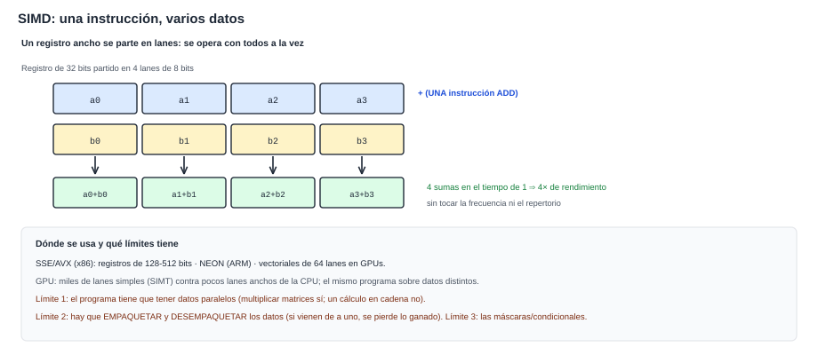

#### La idea en código
```
escalar:    for i in 0..n-1:  C[i] = A[i] + B[i]     ← n instrucciones (+ lazos)
vectorial:  VADD C, A, B                             ← 1 instrucción, n operaciones
```

| | Escalar | Vectorial |
|---|---|---|
| Instrucciones para 1000 elementos | 1000 `ADD` + lazos | 125 `VADD` (con AVX-256) |
| Búsqueda/decodificación | una por elemento | una por **grupo** |
| Registros | 8-32 de 32/64 bits | 16-32 de 128/256/512 bits |

#### Los registros vectoriales

| Arquitectura | Ancho | Cuántos enteros de 32 bits |
|---|---|---|
| MMX | 64 bits | 2 |
| SSE / SSE2 | 128 bits | 4 |
| AVX | 256 bits | 8 |
| AVX-512 | 512 bits | 16 |
| Vectorial clásico (Cray) | 64 × 64 bits | 64 (¡registros de 4 kbit!) |

**Cuenta rápida:** un registro de **256 bits** con enteros de **32 bits** guarda `256 / 32 = 8` elementos ⇒ procesar
un vector de **1 000** elementos pide `1000 / 8 = 125` instrucciones.

#### Las tres formas de implementarlo
| Forma | Cómo | Costo |
|---|---|---|
| **Unidad vectorial segmentada** | un pipeline aritmético ancho que procesa el vector elemento por elemento (Cray) | hardware caro, muy eficiente con vectores largos |
| **Extensiones SIMD del ISA** | registros anchos + una ALU por `lane` (SSE, AVX, NEON) | se agrega a una CPU normal |
| **GPU** | miles de hilos SIMT, cada uno con su ALU, agrupados en *warps* de 32 | enorme throughput, mala latencia individual |

**SIMT** (*Single Instruction, Multiple Threads*) es el SIMD de las GPU: el programador escribe **un** programa por
hilo y el hardware ejecuta los 32 hilos del *warp* con la misma instrucción.

> [!important] Por qué la GPU gana en lo suyo
> No porque cada núcleo sea más rápido (son **más lentos** que un núcleo de CPU), sino porque hay **miles**. Sirve
> para tareas **paralelas de datos**: píxeles, vértices, multiplicación de matrices, redes neuronales. Falla en
> tareas con dependencias en cadena (un solo hilo que decide todo).

#### Lo que se gana y lo que no
| Se gana | No se gana |
|---|---|
| Throughput: elementos por segundo | **latencia**: un elemento solo no va más rápido |
| Menos instrucciones ⇒ menos búsquedas | Si el vector es corto, el llenado se come la ganancia |
| Menos consumo por operación | Código con `if` distintos por elemento (divergencia) |
| Se aprovecha el pipeline aritmético | Datos no contiguos ⇒ hay que reordenarlos (`gather`/`scatter`) |

#### Ejemplo resuelto
> "Un procesador con AVX-512 (16 enteros de 32 bits por registro) suma dos vectores de 10 000 enteros. El `VADD`
> tarda 1 ciclo y la frecuencia es 3 GHz. Comparar con el escalar (1 `ADD` por ciclo, más 2 ciclos de búsqueda por
> instrucción)."

| | Instrucciones | Ciclos | Tiempo |
|---|---|---|---|
| **Escalar** | 10 000 | `10 000 × (1 + 2) = 30 000` | `10 µs` |
| **Vectorial** | `10 000 / 16 = 625` | `625 × (1 + 2) = 1 875` | `0,625 µs` |

**Speedup ≈ 16×** — exactamente el ancho del registro, porque el trabajo por elemento es el mismo y la
decodificación se amortiza.

> [!warning] Errores típicos
> - Decir que SIMD **baja la latencia**: baja el **tiempo total** (throughput).
> - Confundir el ancho del registro con la cantidad de instrucciones (hay que **dividir**).
> - Olvidar la divergencia: si cada elemento toma un camino distinto, SIMD pierde.
> - Decir que una GPU reemplaza a la CPU (es un **acelerador**: necesita a la CPU para todo lo secuencial).
> - Confundir SIMD (una instrucción, muchos datos) con el pipeline aritmético (mismo dato fluyendo por etapas).

#### Relacionado
[[8.2.2 Flynn, arreglos SIMD y conectados]] · [[8.2.3 Multiplicación de matrices]] ·
[[8.1.1 Etapas segmentadas y suma de vectores]] · [[Paralelismo y procesamiento vectorial]] · [[Glosario — Unidad 8]]

### 8.2.2 Flynn, arreglos SIMD y conectados

> [!abstract] En una frase
> Flynn clasifica las arquitecturas por **cuántos flujos de instrucciones** y **cuántos flujos de datos** tienen
> (SISD, SIMD, MISD, MIMD); dentro del SIMD, un **arreglo de procesadores** pone **un PE por dato** y, si además los
> PE están **interconectados**, se convierte en un **arreglo conectado**.

> [!note] Si la primera vez que ves esto
> Un **arreglo SIMD** es un aula donde todos los alumnos (PE) hacen **la misma consigna** con **su propia** hoja.
> Un **arreglo conectado** es la misma aula, pero además los alumnos **se pasan papelitos** entre bancos vecinos.

#### La clasificación de Flynn

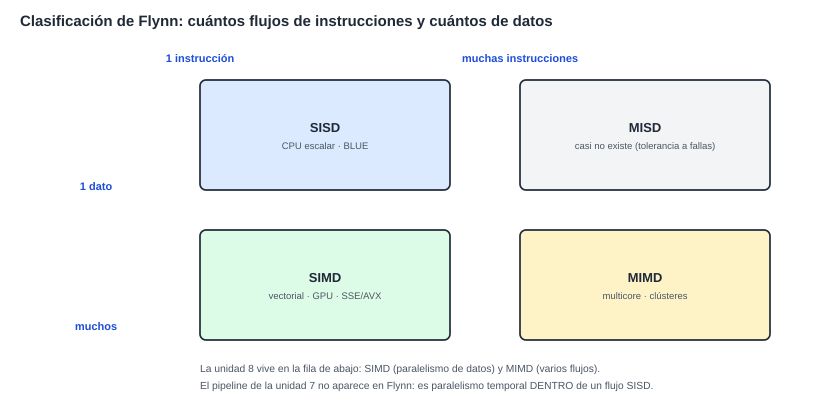

| Clase | Instrucciones | Datos | Ejemplo | ¿Dónde está en la cursada? |
|---|---|---|---|---|
| **SISD** | 1 | 1 | CPU escalar clásica, **BLUE** | Unidades 4-5 |
| **SIMD** | 1 | muchos | vectorial, GPU, MMX/SSE/AVX | **esta unidad** |
| **MISD** | muchas | 1 | casi no existe (tolerancia a fallas, *systolic arrays*) | mención |
| **MIMD** | muchas | muchos | multicore, multiprocesadores, clústeres | 8.4 |

> [!important] El pipeline no está en Flynn
> El pipeline de instrucciones es paralelismo **temporal dentro de un flujo**: sigue siendo **SISD**. Metros de
> gente lo responde como "MIMD" porque "hace varias cosas a la vez"; **no**: hay una sola instrucción por ciclo
> saliendo por el cauce, no muchas.

#### Arreglo SIMD (sin conexión)
```
        ┌──────────────── UC común (una instrucción) ────────────────┐
        ▼             ▼             ▼             ▼             ▼
      ┌─────┐      ┌─────┐      ┌─────┐      ┌─────┐      ┌─────┐
      │ PE0 │      │ PE1 │      │ PE2 │      │ PE3 │  ... │ PEn │
      │ALU+M│      │ALU+M│      │ALU+M│      │ALU+M│      │ALU+M│
      └─────┘      └─────┘      └─────┘      └─────┘      └─────┘
       dato 0       dato 1       dato 2       dato 3       dato n
```
- **Un PE** (*processing element*) = una ALU chica + su memoria local.
- Todos reciben **la misma instrucción** y trabajan sobre **su** dato.
- **Ejemplo típico:** procesar los píxeles de una imagen (un PE por píxel), aplicar un filtro, umbralizar.

#### Arreglo conectado (con red de interconexión)
```
      PE0 ──── PE1 ──── PE2
       │  ╲     │     ╱  │
       │    ╲   │   ╱    │        malla 2D: cada PE habla con sus 4 vecinos
      PE3 ──── PE4 ──── PE5       (o hipercubo, toroide, árbol…)
       │    ╱   │   ╲    │
      PE6 ──── PE7 ──── PE8
```
**Agrega el intercambio de datos entre PE**. Sirve cuando cada elemento **necesita a sus vecinos**:

| Aplicación | Por qué necesita vecinos |
|---|---|
| **Autómata celular** (Juego de la vida) | cada celda mira sus 8 vecinas |
| **Simulación física** (difusión, calor) | el valor nuevo depende de la celda y sus contiguas |
| **Procesamiento de imágenes** (convolución) | cada píxel se calcula con su entorno 3×3 |

> [!important] La diferencia que se pregunta
> **Arreglo SIMD** = mismos datos distintos, **sin** comunicación. **Arreglo conectado** = lo mismo **+ red** entre
> PE. La red es lo que permite resolver problemas con **dependencia espacial**.

#### El problema del arreglo: el tamaño
| Situación | Qué se hace |
|---|---|
| El problema es **más chico** que el arreglo | se apagan PE (desperdicio) |
| El problema es **más grande** | se parte en tandas (*strip mining*) |
| Los datos necesitan viajar lejos | cuesta más la comunicación que el cálculo |

#### Monousuario vs multiusuario (cierre del tema)

| | **Monousuario** (PC, notebook) | **Multiusuario** (servidor, mainframe) |
|---|---|---|
| Paralelismo típico | ILP + SIMD + pocos núcleos | **MIMD** con muchos núcleos/nodos |
| Objetivo | **latencia**: que *mi* programa termine ya | **productividad** (*throughput*): muchas tareas por hora |
| Memoria | jerarquía local + caché grande | compartida o distribuida + red de interconexión |
| E/S | estándar | canales de E/S de alta capacidad |
| Se mide con | tiempo de respuesta | trabajos por unidad de tiempo |
| Ejemplo | Ryzen de 8 núcleos | clúster, mainframe, granja de servidores |

**La misma idea de SIMD aplica distinto:** en un PC sirve para acelerar **un** programa (juegos, video); en un
servidor, para atender **muchos** usuarios a la vez.

> [!warning] Errores típicos
> - Confundir SIMD con MIMD (una instrucción vs muchas).
> - Decir que el pipeline es MIMD (es SISD, paralelismo temporal).
> - Confundir arreglo SIMD con arreglo conectado (falta la red).
> - Invertir los objetivos: el servidor busca **throughput**, el PC busca **latencia**.
> - Olvidar que MISD casi no existe.

> [!example] Flynn con ejemplos
> **SISD**: la BLUE (una instrucción, un dato). **SIMD**: una GPU sumando un vector (una instrucción, 32 datos).
> **MISD**: casi no existe (aviónica redundante). **MIMD**: un multicore o un cluster (cada núcleo con su
> instrucción y su dato). Para clasificar cualquier máquina alcanza con contar **cuántas instrucciones** y
> **cuántos datos** procesa por vez.

#### Figura del libro

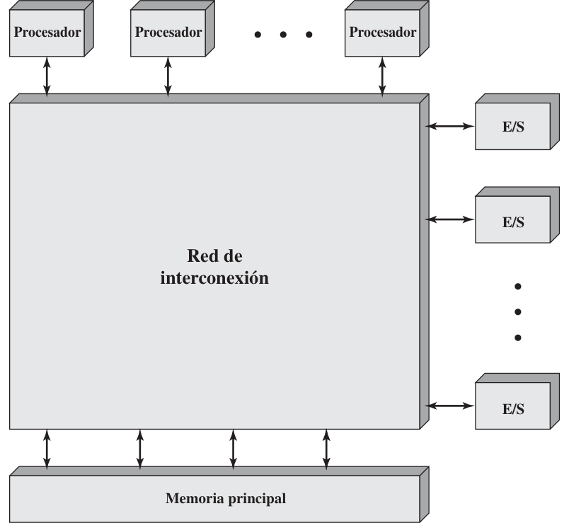

*Fig. 18.4 — Diagrama de bloques genérico de un multiprocesador fuertemente acoplado.* · Stallings, *Organización y arquitectura de computadores*, 7ª ed., p. 696.

> [!tip] Qué mirar
> Varios procesadores, una memoria principal y una red de interconexión común: es la clase **MIMD** con acoplamiento fuerte (memoria compartida). En un cluster la memoria no se comparte y la red es externa.

#### Relacionado
[[8.2.1 SIMD, registros vectoriales y GPU]] · [[8.2.3 Multiplicación de matrices]] · [[8.4.2 Monousuario vs multiusuario]] ·
[[Paralelismo y procesamiento vectorial]] · [[CISC y RISC]] · [[Glosario — Unidad 8]]

### 8.2.3 Multiplicación de matrices

> [!abstract] En una frase
> `C = A · B` con matrices de `n × n` necesita **`n³`** multiplicaciones y **`n³`** sumas; el procesamiento
> vectorial ataca el **lazo interno** (producto punto) y por eso es **el** benchmark clásico del paralelismo.

> [!note] Si la primera vez que ves esto
> Cada elemento de `C` es el **producto punto** de una fila de `A` con una columna de `B`: multiplicar de a pares y
> sumar todo. Ese "multiplicar de a pares y sumar" es justo lo que el hardware vectorial hace en un ciclo.

#### Matrices con SIMD

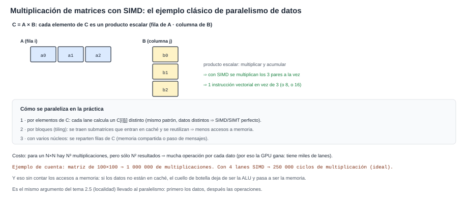

#### La fórmula
```
C[i][j] = Σ (k = 0..n-1)  A[i][k] · B[k][j]
```
```
escalar (3 lazos anidados):
    for i: for j: { s = 0 ; for k: s += A[i][k] * B[k][j] ; C[i][j] = s }
```

#### Las tres versiones

| Versión | Qué se vectoriza | Ganancia |
|---|---|---|
| **Escalar** | nada: `n³` multiplicaciones una por una | 1× |
| **Vectorial** (producto punto vectorial) | el lazo **interno** `k` se hace de a `w` elementos | ≈ `w` (ancho del registro) |
| **Vectorial + encadenamiento + bloqueo** | además se encadena `mult` con `suma` y se corta la matriz en bloques que entran en los registros | hasta `w` con mejor uso del pipeline |

**Bloqueo (*blocking*):** en lugar de recorrer `k` de 1 en 1, se toman bloques de `w` (el ancho vectorial) para que
cada dato traído de memoria se use `w` veces.

> [!important] El cuello de botella real: la memoria
> La cuenta dice `n³` operaciones, pero la **memoria** es lo que manda: para `n = 1000` haría falta mover del orden
> de **cientos de MB** por cada pasada si se recorre mal. Por eso se combina con **memoria entrelazada** (8.3) y con
> **caché** (reutilizar bloques). Sin eso, el pipeline se queda esperando datos.

#### Ejemplo resuelto 2 × 2 (a mano, para el pizarrón)
```
A = ┌ 1 2 ┐      B = ┌ 5 6 ┐
    └ 3 4 ┘          └ 7 8 ┘

C[0][0] = 1·5 + 2·7 = 5 + 14 = 19
C[0][1] = 1·6 + 2·8 = 6 + 16 = 22
C[1][0] = 3·5 + 4·7 = 15 + 28 = 43
C[1][1] = 3·6 + 4·8 = 18 + 32 = 50

C = ┌ 19 22 ┐
    └ 43 50 ┘
```
**Verificación con la traza:** `tr(C) = 69` y `tr(A)·tr(B) = 5 × 13 = 65`; no tienen por qué coincidir (el
producto de trazas no es la traza del producto) ⇒ **no** sirve como control. El control correcto es **recalcular
un elemento** por la definición: `C[1][1] = 43` ✔.

#### Cuánto cuesta

| n | Operaciones (`n³`) | Con vector de ancho 8 | Instrucciones |
|---|---|---|---|
| 10 | 1 000 | 1 000 / 8 | 125 (+ sumas) |
| 100 | 1 000 000 | 125 000 | ~250 000 |
| 1 000 | 1 000 000 000 | 125 000 000 | — |

**Comparación de tiempo (n = 100, 1 ciclo por operación vectorial a 3 GHz):** `125 000 / 3·10⁹ ≈ 42 µs` contra
`1 000 000 / 3·10⁹ ≈ 333 µs` del escalar ⇒ **8×** (el ancho del registro).

#### Por qué es *el* benchmark
- Es **regular**: mismo trabajo para todos los elementos (SIMD lo ama).
- Es **paralelizable** por filas: cada fila de `C` es independiente ⇒ se reparte entre núcleos (MIMD).
- Mide **cómputo + memoria + red** a la vez ⇒ **LINPACK** y el ranking **TOP500** se basan en esto.

> [!warning] Errores típicos
> - Decir `n²` operaciones (son `n³`: por cada uno de los `n²` elementos hay una suma de `n` productos).
> - Vectorizar el lazo **externo** en vez del **interno** (el interno es el que tiene datos contiguos).
> - Olvidar el costo de memoria: la ganancia vectorial se pierde si no hay ancho de banda.
> - Confundir transponer `B` (para acceder por filas) con "cambiar el algoritmo": es lo mismo, pero con memoria
>   amigable (**por eso las bibliotecas reales transponen**).

#### Relacionado
[[8.2.1 SIMD, registros vectoriales y GPU]] · [[8.3.1 Bancos de memoria y ancho de banda]] ·
[[8.1.2 Encadenamiento y speedup]] · [[8.4.1 Multicore, coherencia de caché y ley de Amdahl]] · [[Glosario — Unidad 8]]

## 8.3 Memoria entrelazada

### 8.3.1 Bancos de memoria y ancho de banda

> [!abstract] En una frase
> La **memoria entrelazada** divide la memoria en **bancos independientes** que atienden accesos **al mismo
> tiempo**; si las direcciones consecutivas caen en bancos distintos, el **ancho de banda se multiplica por la
> cantidad de bancos** sin que baje el tiempo de acceso de cada palabra.

> [!note] Si la primera vez que ves esto
> Un supermercado con **una** caja: cada cliente espera lo mismo. Con **cuatro** cajas y la gente repartida, en el
> tiempo de una atención salen cuatro clientes. El tiempo **de cada** cliente no cambió; la **cantidad por hora**,
> sí. Eso es ancho de banda.

#### El esquema

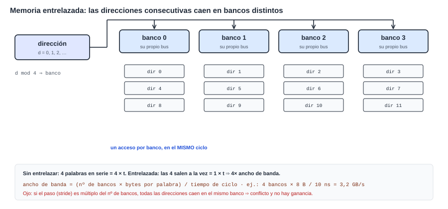

```
banco = dirección mod (nº de bancos)

dir 0 → banco 0        dir 4 → banco 0
dir 1 → banco 1        dir 5 → banco 1
dir 2 → banco 2        dir 6 → banco 2
dir 3 → banco 3        dir 7 → banco 3
```

Cada banco tiene **su propio** decodificador y su propio registro de datos: se accede a los cuatro **en el mismo
ciclo**.

#### Tiempo de acceso vs ancho de banda

| Concepto | Qué mide | Efecto del entrelazado |
|---|---|---|
| **Latencia** (tiempo de acceso) | cuánto tarda **una** palabra | **no cambia** |
| **Ancho de banda** | cuántos bytes por segundo | **se multiplica por el nº de bancos** |

```
ancho de banda = (nº de bancos × bytes por palabra) / tiempo de ciclo
```

> [!example] Ejemplo resuelto
> "Memoria de 4 bancos, palabras de **8 bytes**, tiempo de ciclo **10 ns**. ¿Ancho de banda? ¿Y con 8 bancos?"

| Bancos | Cálculo | Ancho de banda |
|---|---|---|
| 1 | `8 B / 10 ns` | **0,8 GB/s** |
| 4 | `4 × 8 B / 10 ns` | **3,2 GB/s** |
| 8 | `8 × 8 B / 10 ns` | **6,4 GB/s** |

**Verificación:** `4 × 8 = 32 B` por ciclo de 10 ns ⇒ `32 / 10·10⁻⁹ = 3,2·10⁹ B/s` ✔

#### Para qué sirve en la práctica
| Consumidor | Por qué lo necesita |
|---|---|
| **Procesador vectorial** | pide **un elemento por ciclo**: sin bancos, se queda esperando |
| **Pipeline de instrucciones** | busca instrucción **y** dato en el mismo ciclo (bancos distintos o caché I/D) |
| **DMA / GPU** | transfiere bloques enteros |
| **Multicore** | varios núcleos pidiendo a la vez |
| **DRAM moderna** | los *channels* y los *banks* internos del chip son exactamente esto |

#### Las dos formas de repartir
| Forma | Cómo | Cuándo conviene |
|---|---|---|
| **Entrelazado por bits bajos** (*low-order*) | `banco = dirección mod n` (los bits bajos eligen el banco) | accesos **consecutivos** (vectores, código) |
| **Entrelazado por bits altos** (*high-order*) | los bits altos eligen el banco (cada banco es un rango contiguo) | varios **procesos** trabajando en zonas distintas |

El caso normal en un procesador vectorial es el **low-order**: es el que hace que `A[0], A[1], A[2], A[3]` estén en
cuatro bancos distintos.

#### Lo que hay que decir junto a esto
1. **El entrelazado no reduce la latencia**: sólo mejora el caudal.
2. **Necesita accesos independientes**: si el programa pide la misma dirección, no hay paralelismo que valga.
3. **Se combina con la caché**: la caché evita el acceso; el entrelazado hace que, cuando hay que ir, vaya rápido.
4. **Cuesta hardware**: más decodificadores, más buses, más pines.

> [!warning] Errores típicos
> - Decir que el entrelazado **baja el tiempo de acceso** (no: sube el ancho de banda).
> - Olvidar dividir/multiplicar por el tamaño de palabra: confundir **palabras** con **bytes**.
> - Creer que más bancos siempre es mejor (cuesta y hay conflicto; ver 8.3.2).
> - Mezclar esta técnica con **caché**: son cosas distintas y complementarias.

#### Figura del libro

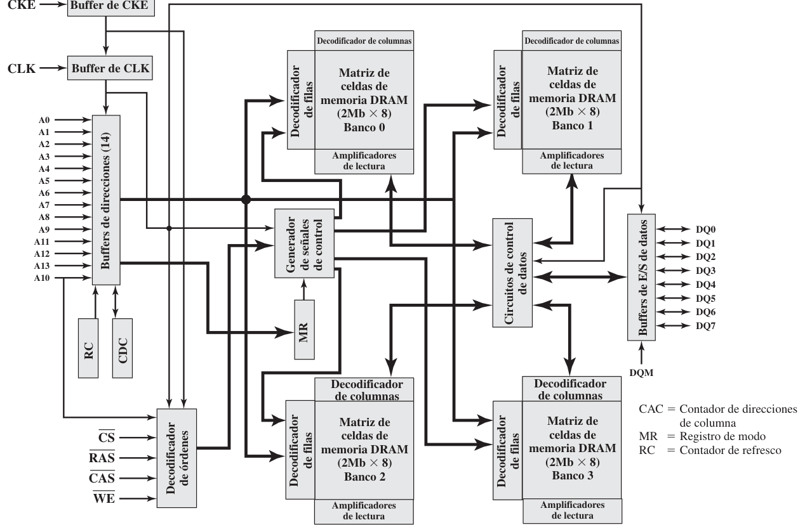

*Fig. 5.12 — RAM dinámica síncrona (SDRAM): varios chips en paralelo sobre el mismo bus de direcciones.* · Stallings, *Organización y arquitectura de computadores*, 7ª ed., p. 188.

> [!tip] Qué mirar
> Cada chip aporta una parte del dato y todos se direccionan a la vez: así se arma el **ancho** de la memoria. El ancho de banda sube con la cantidad de bancos que pueden trabajar en paralelo.

#### Relacionado
[[8.3.2 Patrón de entrelazado y conflictos de banco]] · [[2.3.3 Matriz, expansión y RAM 8x3]] ·
[[2.5.3 AMAT y cálculo de mejora]] · [[Jerarquía de memorias]] · [[Técnicas para aumentar la velocidad]] · [[Glosario — Unidad 8]]

### 8.3.2 Patrón de entrelazado y conflictos de banco

> [!abstract] En una frase
> El entrelazado sólo da ganancia si los accesos **caen en bancos distintos**: cuando el **paso** (*stride*) es
> **múltiplo del número de bancos**, todas las direcciones van al **mismo banco** ⇒ **conflicto de banco** y la
> ganancia desaparece.

> [!note] Si la primera vez que ves esto
> Cuatro cajas y todos los clientes con el número de ticket par: van **todos a la misma caja**. La culpa no es del
> supermercado, es del **patrón** de llegada. Acá pasa igual: la culpa es del paso del lazo.

#### Módulo bancos

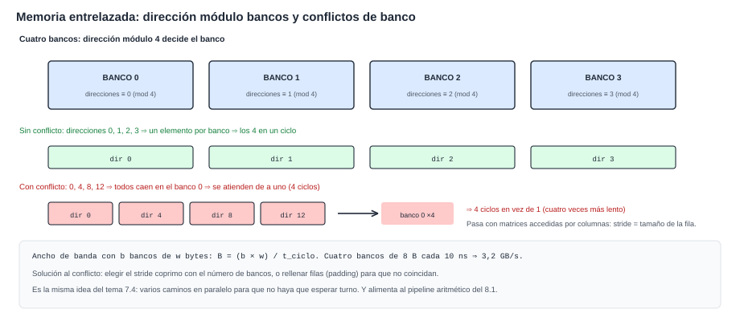

#### El conflicto, con números
4 bancos, `banco = dirección mod 4`:

| Paso (*stride*) | Direcciones | Bancos | Resultado |
|---|---|---|---|
| **1** | 0, 1, 2, 3 | 0, 1, 2, 3 | **4 en paralelo** ✔ |
| **2** | 0, 2, 4, 6 | 0, 2, 0, 2 | 2 por ciclo (mitad) |
| **4** | 0, 4, 8, 12 | **0, 0, 0, 0** | **conflicto total**: 1 por ciclo ✘ |
| **3** | 0, 3, 6, 9 | 0, 3, 2, 1 | 4 en paralelo ✔ (3 y 4 son coprimos) |

> [!important] La regla
> Con `B` bancos, hay conflicto si `stride` y `B` **comparten divisores**. Lo ideal: `stride` **coprimo** con `B`
> (por ejemplo `B` primo o impar).

#### Dónde aparece en la práctica (el caso de la matriz)
Recorrer una matriz `n × n` guardada **por filas**:
```
A[i][j]  está en la dirección  i·n + j
```
- Recorrer **por filas** (lazo `j` interno): `stride = 1` ⇒ **sin conflicto**.
- Recorrer **por columnas** (lazo `i` interno): `stride = n`. Si `n = 4` y hay 4 bancos ⇒ `stride = 4` ⇒
  **conflicto total**.

| Recorrido | `stride` | Con 4 bancos |
|---|---|---|
| por filas | 1 | 4 accesos/ciclo |
| por columnas, `n = 4` | 4 | **1 acceso/ciclo** (4× más lento) |
| por columnas, `n = 5` | 5 | 4 accesos/ciclo (5 y 4 coprimos) |

**La solución clásica:** **transponer** `B` (o recorrer por filas) para que el lazo interno tenga `stride = 1`, o
**rellenar** la matriz (`padding`) con una columna para que `n` deje de ser múltiplo de los bancos.

> [!example] Ejemplo resuelto
> "Un procesador con 4 bancos recorre una matriz de 100 × 100 por columnas. ¿Cuánto pierde respecto del recorrido
> por filas?"

1. Por filas: `stride = 1`, 4 palabras por ciclo ⇒ `10 000 / 4 = 2 500` ciclos.
2. Por columnas: `stride = 100`, y `100 mod 4 = 0` ⇒ **todas** al mismo banco ⇒ `10 000` ciclos.
3. Pérdida: `10 000 / 2 500 =` **4× más lento**.
4. Arreglo: transponer `B` (o `padding` a 101 columnas, `101 mod 4 = 1` ⇒ sin conflicto).

#### El entrelazado en la memoria real
| Nivel | Cómo se ve |
|---|---|
| **Bancos del chip** | la DRAM tiene 4-16 *banks* por chip y los abre en paralelo |
| **Canales** | dos o cuatro canales de DRAM (como "bancos" externos) |
| **Módulos** | *dual channel* del mother: `4 GB + 4 GB` en canales distintos |
| **Caché** | los *sets* de la caché también pueden tener conflictos (mismo problema, otra escala) |

> [!warning] Errores típicos
> - Decir que el conflicto depende de la memoria y no del **programa**: el patrón de acceso lo pone el código.
> - Olvidar que el conflicto también existe en la caché (conflictos de *set*).
> - Creer que "más bancos" siempre ayuda: con `stride` múltiplo, sigue habiendo conflicto.
> - Confundir `stride` con la cantidad de bancos.

#### Figura del libro

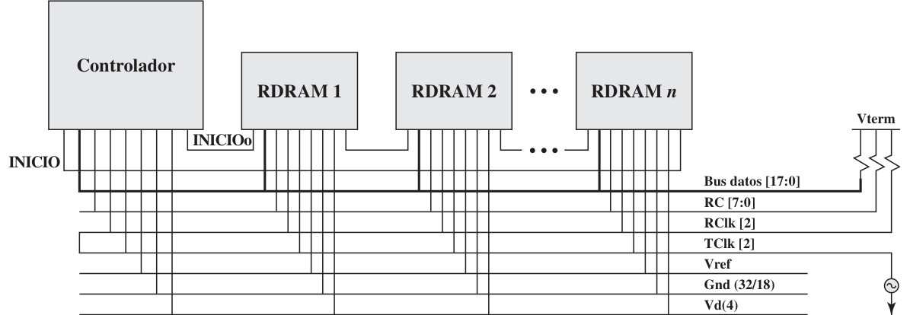

*Fig. 5.14 — Estructura RDRAM: un controlador y varios canales (RDRAM1 a RDRAMn) que trabajan en paralelo.* · Stallings, *Organización y arquitectura de computadores*, 7ª ed., p. 190.

> [!tip] Qué mirar
> Es entrelazado llevado al extremo: los canales se reparten las direcciones y transmiten a la vez. El patrón de acceso decide si el paralelismo se aprovecha o si todos los pedidos caen en el mismo canal (conflicto).

#### Relacionado
[[8.3.1 Bancos de memoria y ancho de banda]] · [[8.2.3 Multiplicación de matrices]] · [[2.5.2 Caché: mapeos y políticas]] ·
[[Jerarquía de memorias]] · [[8.4.1 Multicore, coherencia de caché y ley de Amdahl]] · [[Glosario — Unidad 8]]

## 8.4 Multiprocesadores

### 8.4.1 Multicore, coherencia de caché y ley de Amdahl

> [!abstract] En una frase
> Un **multiprocesador** pone varios núcleos a trabajar sobre el mismo problema, pero aparece un problema nuevo
> (**coherencia de caché**: cada núcleo tiene su copia) y un techo matemático (**ley de Amdahl**: la parte
> secuencial no se paraleliza).

> [!note] Si la primera vez que ves esto
> Diez personas pintando una pared: van 10 veces más rápido **si** cada uno tiene su franja y no se pisan. Si hay
> que preparar la pintura entre todos y esperar a uno solo para decidir el color, esa parte **no** se acelera, y
> por más gente que pongas el trabajo tarda lo mismo en esa parte.

#### La curva de Amdahl

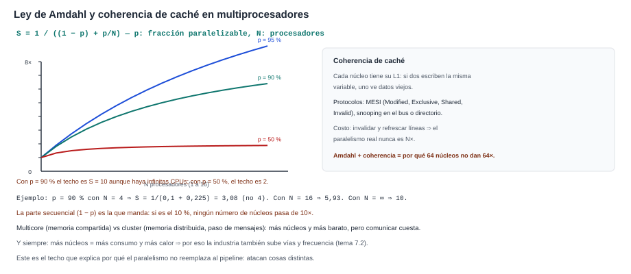

#### Los tipos de multiprocesador

| Tipo | Memoria | Cómo se comunican | Ejemplo |
|---|---|---|---|
| **Multicore** (chip) | **compartida** (misma DRAM) | cachés L2/L3 compartidas | Ryzen, Core i7 |
| **Multiprocesador simétrico (SMP)** | compartida | bus o red de interconexión | servidores de 2-4 sockets |
| **Clúster / NUMA** | **distribuida** (cada nodo la suya) | red (mensajes) | supercomputadoras, granjas |

**UMA** (*Uniform Memory Access*): todos tardan lo mismo en llegar a la memoria (multicore chico).
**NUMA**: la memoria local es más rápida que la remota (varios sockets).

#### El problema: coherencia de caché

```
núcleo 1 ── L1 (copia de X = 5) ──┐
                                  ├── DRAM (X = 5)
núcleo 2 ── L1 (copia de X = 5) ──┘

núcleo 1 escribe X = 9  ⇒  su L1 dice 9, la de 2 sigue diciendo 5  ⇒  ¡INCOHERENTE!
```

| Protocolo | Idea |
|---|---|
| **Snooping** (espía) | cada caché **escucha** el bus; si ve una escritura a una dirección que tiene, la invalida |
| **Directorio** | una tabla central dice quién tiene copia de cada bloque (para muchos núcleos) |
| **MESI** | cada línea está en un estado: **M**odificada, **E**xclusiva, **S**hared, **I**nvalid |

**En MESI:** para escribir una línea compartida, el núcleo debe **invalidar** las copias de los demás (o
actualizarlas) antes de escribir. Eso cuesta tiempo ⇒ es la razón por la que muchos hilos escribiendo **la misma**
variable escalan mal.

> [!important] Falso compartido (*false sharing*)
> Dos hilos escriben **variables distintas** que caen en la **misma línea de caché** (64 B): el protocolo invalida
> igual, aunque no haya dato compartido. Se arregla **separando** (`padding`) las variables. Es un error de
> rendimiento clásico y muy preguntable.

#### La ley de Amdahl
```
S(n) = 1 / ((1 − f) + f/n)          f = fracción paralelizable · n = nº de procesadores
```
| f | n = 4 | n = 8 | n = 16 | n → ∞ |
|---|---|---|---|---|
| 0,50 | 1,60 | 1,78 | 1,88 | **2,0** |
| 0,90 | **3,08** | 3,60 | 3,90 | **10,0** |
| 0,95 | 3,48 | 5,93 | 8,42 | **20,0** |
| 1,00 | 4,00 | 8,00 | 16,00 | ∞ |

**La lectura:** con un **10 %** secuencial, el máximo es **10×** aunque pongas mil núcleos. **La parte secuencial
manda.**

> [!example] Ejemplo resuelto
> "Un programa tarda 100 s; el 80 % es paralelizable. ¿Cuánto tarda con 4 procesadores y qué speedup da?"

1. `f = 0,8`; secuencial: `100 × 0,2 = 20 s` (no se toca).
2. Paralelo: `80 / 4 = 20 s`.
3. Total: `20 + 20 = 40 s` ⇒ `S = 100 / 40 =` **2,5**.
4. Verificación con la fórmula: `1 / (0,2 + 0,8/4) = 1 / 0,4 = 2,5` ✔
5. Techo con infinitos procesadores: `1 / 0,2 =` **5×**.

#### Escalabilidad
| Concepto | Pregunta | Qué se mantiene |
|---|---|---|
| **Escalado fuerte** (*strong*) | con el mismo problema, ¿cuánto acelera? | tamaño del problema |
| **Escalado débil** (*weak*) | con `n` veces más trabajo, ¿tarda lo mismo? | tiempo por núcleo |

Un problema **grande** escala mejor que uno chico (la parte secuencial pesa menos en proporción). Por eso las
supercomputadoras se miden con problemas enormes (LINPACK, matrices gigantes).

#### Otros límites, además de Amdahl
| Límite | Qué es |
|---|---|
| **Ley de Gustafson** | si el problema **crece** con `n`, se puede escalar casi linealmente |
| **Comunicación / sincronización** | compartir datos cuesta (barreras, mensajes) |
| **Ancho de banda de memoria** | todos los núcleos piden a la misma DRAM (por eso el entrelazado) |
| **Consumo y temperatura** | más núcleos = más calor (*dark silicon*) |
| **Coherencia** | invalidaciones, falso compartido |

> [!warning] Errores típicos
> - Decir que 4 núcleos = 4× siempre (Amdahl: la parte secuencial no se divide).
> - Confundir **multicore** (memoria compartida) con **clúster** (distribuida).
> - Olvidar la **coherencia de caché** al explicar multiprocesadores.
> - Confundir coherencia (mismo dato en varias cachés) con **consistencia** (orden de las escrituras).
> - Aplicar Amdahl con `f = 1` en un caso real.

#### Figura del libro

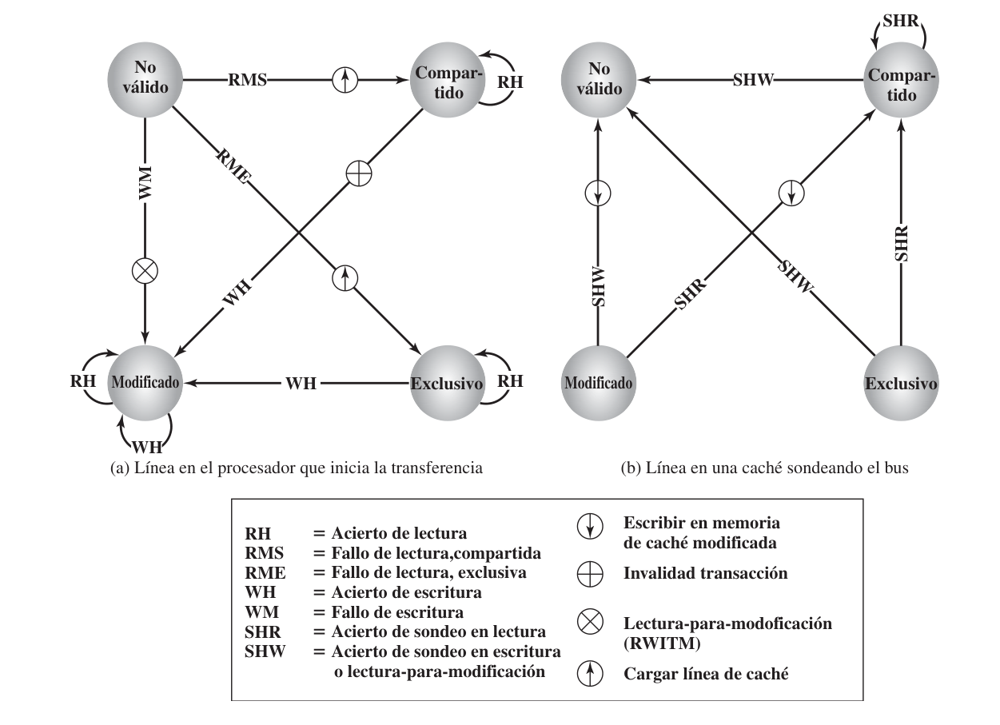

*Fig. 18.7 — Diagrama de transición de estados MESI.* · Stallings, *Organización y arquitectura de computadores*, 7ª ed., p. 706.

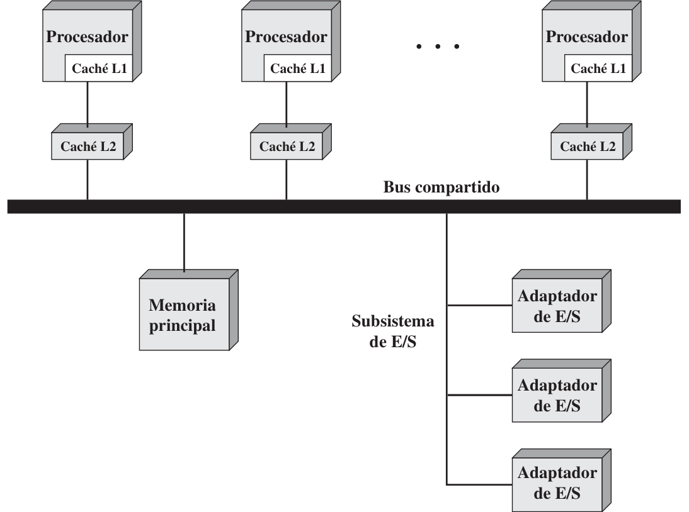

*Fig. 18.5 — Organización de multiprocesador simétrico.* · Stallings, *Organización y arquitectura de computadores*, 7ª ed., p. 697.

#### Relacionado
[[8.4.2 Monousuario vs multiusuario]] · [[8.3.1 Bancos de memoria y ancho de banda]] · [[2.5.2 Caché: mapeos y políticas]] ·
[[Técnicas para aumentar la velocidad]] · [[Paralelismo y procesamiento vectorial]] · [[Glosario — Unidad 8]]

### 8.4.2 Monousuario vs multiusuario

> [!abstract] En una frase
> Un sistema **monousuario** optimiza la **latencia** (que *mi* programa termine cuanto antes); un sistema
> **multiusuario** optimiza la **productividad** (*throughput*: cuántas tareas terminan por unidad de tiempo). Son
> dos objetivos distintos y llevan a máquinas distintas.

> [!note] Si la primera vez que ves esto
> Un **taxi** y un **colectivo**. El taxi te lleva a vos rápido aunque el resto espere (latencia); el colectivo
> lleva a muchos por hora aunque cada uno tarde más (productividad). Los dos son "transporte", pero no se diseñan
> igual.

#### Compartida o distribuida


#### La tabla

| | **Monousuario** (PC, notebook, celular) | **Multiusuario** (servidor, mainframe) |
|---|---|---|
| Objetivo | **latencia** mínima | **throughput** máximo |
| Se mide con | tiempo de respuesta | trabajos / hora, usuarios simultáneos |
| Paralelismo típico | ILP + **SIMD** + pocos núcleos | **MIMD** con muchos núcleos / nodos |
| Memoria | jerarquía local, caché grande, poca DRAM | mucha memoria, compartida o **distribuida** + red |
| E/S | estándar (SATA, USB, red doméstica) | **canales de E/S** de alta capacidad |
| Disponibilidad | se reinicia y listo | tolerancia a fallas, redundancia, *hot swap* |
| Ejemplo | Ryzen 8 núcleos | clúster, mainframe, granja de servidores |

#### Cómo cambia el diseño de cada uno
| Decisión | Monousuario | Multiusuario |
|---|---|---|
| Núcleos | pocos y **muy rápidos** (frecuencia alta) | muchos, más lentos, con **SMT** |
| Caché | grande y jerárquica (L1/L2/L3) por núcleo | compartida con **protocolo de coherencia** y directorio |
| Pipeline | profundo para latencia | ancho y **superescalar** para throughput |
| Red | no aplica | **interconexión** (InfiniBand, Ethernet rápida) |
| Balance | cómputo ≫ E/S | **E/S y memoria** tan importantes como el cómputo |

#### Qué se pregunta en el final
1. **Diferencia conceptual:** latencia (tiempo de **una** tarea) vs productividad (tareas por **unidad de tiempo**).
2. **Consecuencia:** el monousuario prioriza **frecuencia y caché**; el multiusuario, **núcleos, memoria y E/S**.
3. **Métricas:** el PC se prueba con *benchmarks* de un hilo y de juegos; el servidor, con **tpmC**, **SPEC** de
   throughput y **LINPACK**.
4. **Cierre:** ambos usan las mismas técnicas (paralelismo, jerarquía de memoria, entrelazado); cambia **el
   objetivo** con que se combinan.

> [!important] El puente con Amdahl
> En un servidor, el trabajo **es** paralelo (muchos usuarios, cada uno independiente) ⇒ `f` alta ⇒ escala bien.
> En un PC, un programa de un usuario suele tener partes secuenciales grandes ⇒ `f` baja ⇒ los núcleos extra se
> quedan ociosos. **Por eso el servidor justifica 64 núcleos y la notebook, 8.**

#### Confusiones frecuentes
| Se dice | Es |
|---|---|
| "Multiusuario = más rápido" | no: es **más productivo**; puede ser más lento por tarea |
| "Un servidor es una PC más grande" | no: cambia el **balance** (memoria, E/S, redundancia) |
| "Tiempo compartido (*time sharing*) = paralelismo" | no: es **multiprogramación** en un solo núcleo (se turnan) |
| "Multicore y multiusuario son lo mismo" | no: multicore es **hardware**; multiusuario, **modo de uso** |

> [!warning] Errores típicos
> - Invertir los objetivos (decir que el servidor busca latencia).
> - Confundir **multiprogramación** (turnos en una CPU) con **multiprocesamiento** (varias CPU a la vez).
> - Olvidar la E/S: en un servidor es la mitad del diseño.
> - Decir que un mainframe es "lento" sin aclarar que es lento **por tarea** y rapidísimo **por hora**.

#### Figura del libro

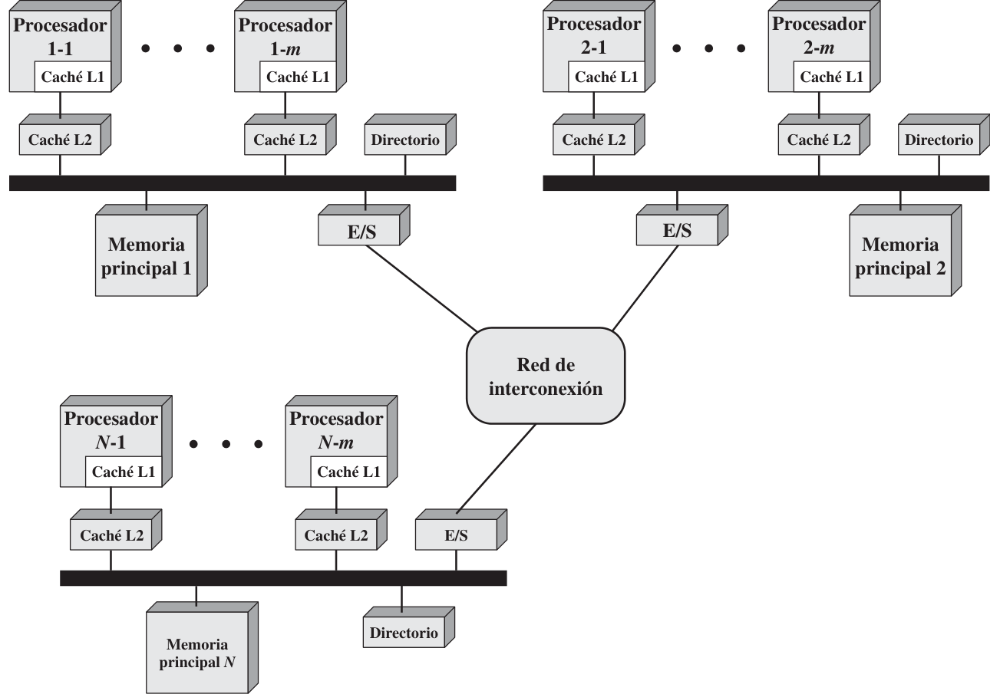

*Fig. 18.12 — Organización CC-NUMA.* · Stallings, *Organización y arquitectura de computadores*, 7ª ed., p. 724.

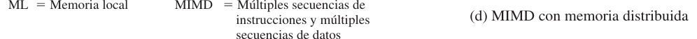

*Fig. 18.2 — Organizaciones de computador alternativas.* · Stallings, *Organización y arquitectura de computadores*, 7ª ed., p. 694.

> [!example] Los límites de cada modelo
> **Monousuario** (una PC): todos los recursos para uno, el límite es el reloj. **Multiusuario** (servidor): muchos
> usuarios a la vez ⇒ el límite es el **ancho de banda de memoria**, la coherencia de caché y la planificación del
> SO. Escalar de 4 a 16 núcleos no da 4×: con `p = 0,9`, Amdahl da **3,08** y **5,93** (ver
> [[8.4.1 Multicore, coherencia de caché y ley de Amdahl]]).

#### Relacionado
[[8.4.1 Multicore, coherencia de caché y ley de Amdahl]] · [[8.2.2 Flynn, arreglos SIMD y conectados]] ·
[[Técnicas para aumentar la velocidad]] · [[Paralelismo y procesamiento vectorial]] · [[Interrupciones y entrada-salida]] · [[Glosario — Unidad 8]]

---

## Al terminar la unidad
- Una pasada rápida: [[00 Síntesis — Unidad 8]].
- Los subtemas por separado: [[00 Unidad 8 — temas y subtemas]].
- Seguir de corrido: [[00 Materia completa (las 10 unidades en un archivo)]].
- Practicar: [[Banco de preguntas del final]] · [[Autoevaluación]] · [[Prácticas resueltas]].
